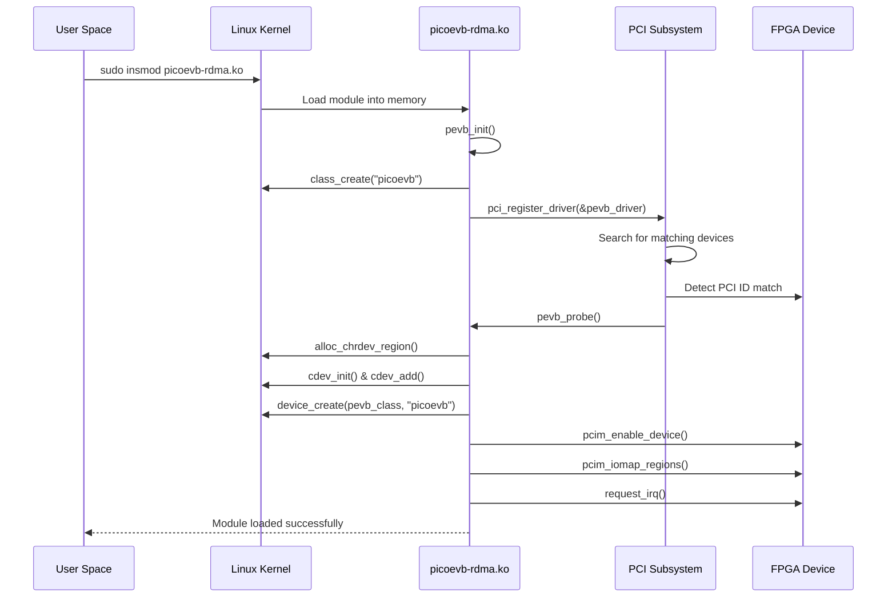
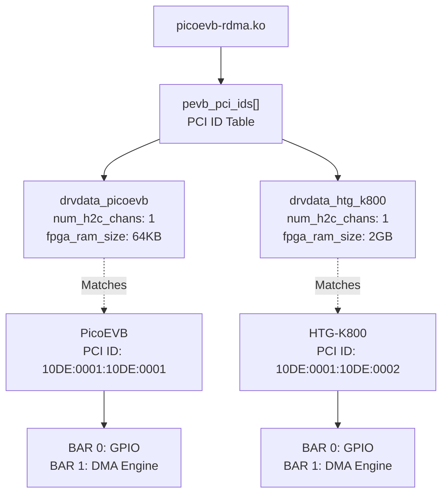
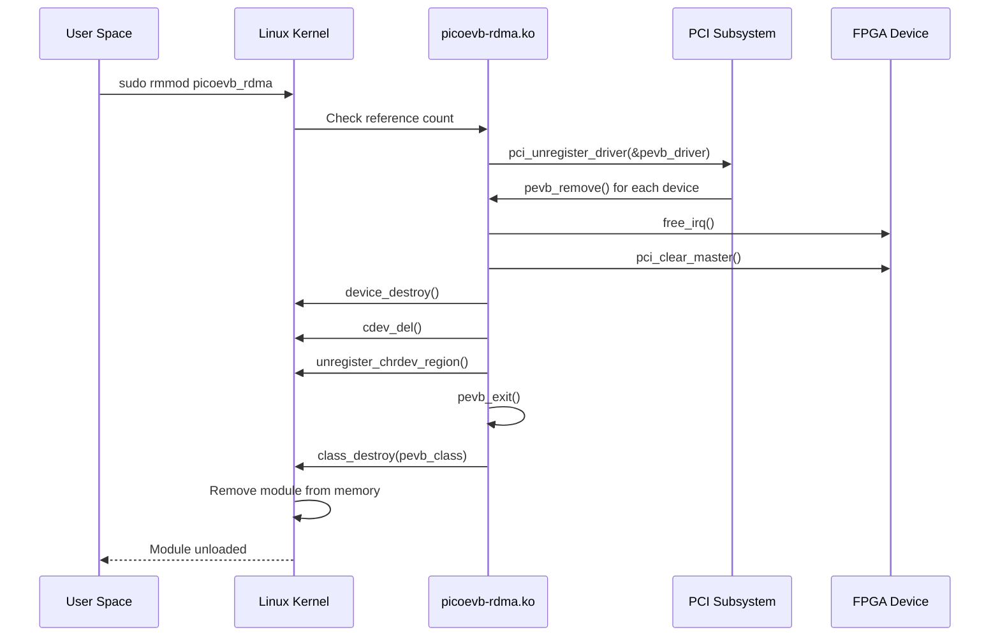
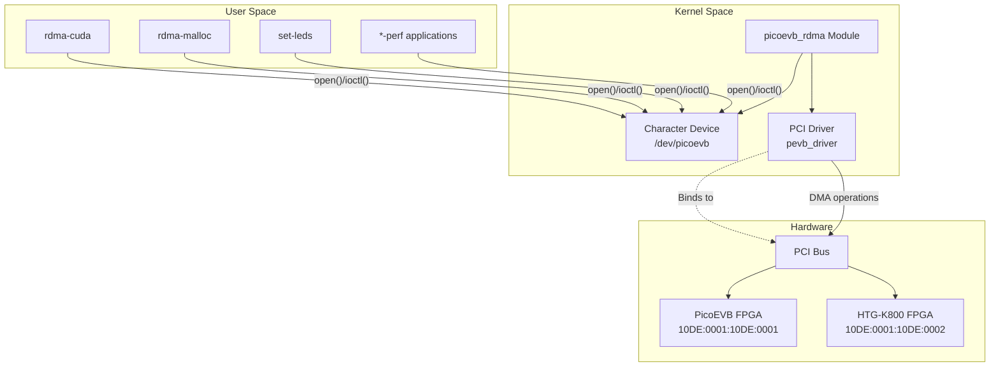

<!-- source: DeepWiki mcp.deepwiki.com · repo NVIDIA/jetson-rdma-picoevb · page 7.5 Installation and Module Loading · fetched 2026-11-11 -->

# Installation and Module Loading

<details>
<summary>Relevant source files</summary>

The following files were used as context for generating this wiki page:

- [README.md](README.md)
- [kernel-module/picoevb-rdma.c](kernel-module/picoevb-rdma.c)

</details>


This page describes how to install and load the `picoevb-rdma` kernel module after it has been compiled. It covers the installation procedure, module loading, verification steps, and device file access configuration.

For information about building the kernel module, see [Building the Kernel Module](#7.2). For building client applications, see [Building Client Applications](#7.3).

## Overview

The `picoevb-rdma.ko` kernel module must be loaded into the running kernel to enable communication between user-space applications and the FPGA hardware. When loaded, the module:

1. Registers as a PCI driver for the FPGA device
2. Creates a character device file at `/dev/picoevb`
3. Initializes DMA descriptor memory
4. Registers interrupt handlers

## Module Loading Process

### Loading with insmod

After building the kernel module as described in [Building the Kernel Module](#7.2), load it using the `insmod` command:

```bash
cd /path/to/this/project/kernel-module/
sudo insmod ./picoevb-rdma.ko
```

The module will attempt to bind to any compatible PCI devices present in the system. If the FPGA is properly programmed and detected, the module will successfully initialize.

**Module Loading Flow**



**Sources:** [kernel-module/picoevb-rdma.c:1281-1294](), [kernel-module/picoevb-rdma.c:1138-1230]()

### Module Initialization Details

The module initialization sequence involves several key kernel functions:

| Function | Purpose | Location |
|----------|---------|----------|
| `pevb_init()` | Module entry point | [kernel-module/picoevb-rdma.c:1281-1294]() |
| `class_create()` | Creates device class "picoevb" | [kernel-module/picoevb-rdma.c:1285]() |
| `pci_register_driver()` | Registers PCI driver | [kernel-module/picoevb-rdma.c:1289]() |
| `pevb_probe()` | Per-device initialization | [kernel-module/picoevb-rdma.c:1138-1230]() |
| `alloc_chrdev_region()` | Allocates character device number | [kernel-module/picoevb-rdma.c:1175-1179]() |
| `device_create()` | Creates `/dev/picoevb` device file | [kernel-module/picoevb-rdma.c:1188-1193]() |

**Sources:** [kernel-module/picoevb-rdma.c:1281-1294](), [kernel-module/picoevb-rdma.c:1138-1230]()

## Verification

### PCI Device Detection

After loading the module, verify that it has bound to the FPGA device using `lspci`:

```bash
lspci -v
```

Expected output:

```
0003:01:00.0 Memory controller: NVIDIA Corporation Device 0001
	Subsystem: NVIDIA Corporation Device 0001
	Flags: bus master, fast devsel, latency 0, IRQ 36
	Memory at 34210000 (32-bit, non-prefetchable) [size=4K]
	Memory at 34200000 (32-bit, non-prefetchable) [size=64K]
	Capabilities: <access denied>
	Kernel driver in use: picoevb-rdma
```

The critical line is `Kernel driver in use: picoevb-rdma`, which confirms the module has successfully bound to the device.

**Sources:** [README.md:265-278]()

### Device File Verification

Confirm that the character device file was created:

```bash
ls -l /dev/picoevb
```

Expected output:

```
crw------- 1 root root 240, 0 [timestamp] /dev/picoevb
```

The device file is created by the kernel when `device_create()` is called in the probe function.

**Sources:** [kernel-module/picoevb-rdma.c:1188-1193]()

### Kernel Log Messages

Check kernel logs for initialization messages:

```bash
sudo dmesg | grep -i picoevb
```

This will show any debug messages, warnings, or errors generated during module loading and device probing.

**Sources:** [kernel-module/picoevb-rdma.c:1138-1230]()

## Device Access Configuration

### Default Permissions

By default, `/dev/picoevb` is created with root-only permissions (`crw------- 1 root root`). This means applications must run with `sudo`:

```bash
sudo ./rdma-cuda
sudo ./rdma-malloc
```

**Sources:** [README.md:342-350]()

### Setting User Permissions

To allow non-root users to access the device, create a udev rule. Create the file `/etc/udev/rules.d/99-picoevb.rules` with the following content:

```bash
SUBSYSTEM=="picoevb", MODE="0666"
```

Or for a specific group:

```bash
SUBSYSTEM=="picoevb", GROUP="users", MODE="0660"
```

Reload udev rules:

```bash
sudo udevadm control --reload-rules
sudo udevadm trigger
```

After the next module load (or device replug), the permissions will be applied automatically.

**Sources:** [kernel-module/picoevb-rdma.c:1188-1193]()

## Module Information

### Module Metadata

View module information using `modinfo`:

```bash
modinfo picoevb-rdma.ko
```

Expected output includes:

```
filename:       /path/to/picoevb-rdma.ko
license:        GPL v2
author:         NVIDIA
description:    (none)
srcversion:     [hash]
alias:          pci:v000010DEd00000001sv000010DEsd00000002bc*sc*i*
alias:          pci:v000010DEd00000001sv000010DEsd00000001bc*sc*i*
depends:        
name:           picoevb_rdma
vermagic:       [kernel version] SMP mod_unload modversions aarch64
```

The `alias` lines show the PCI IDs that this module matches:
- `sd00000001`: PicoEVB board
- `sd00000002`: HTG-K800 board

**Sources:** [kernel-module/picoevb-rdma.c:1266-1271](), [kernel-module/picoevb-rdma.c:1310-1311]()

### Supported Devices

The module recognizes the following PCI device IDs:

| Board | Vendor ID | Device ID | Subsystem ID | Driver Data |
|-------|-----------|-----------|--------------|-------------|
| PicoEVB | 0x10DE | 0x0001 | 0x0001 | `drvdata_picoevb` |
| HTG-K800 | 0x10DE | 0x0001 | 0x0002 | `drvdata_htg_k800` |

**Device-Specific Configuration**



**Sources:** [kernel-module/picoevb-rdma.c:1248-1270]()

## Module Unloading

### Removing the Module

Unload the module using `rmmod`:

```bash
sudo rmmod picoevb_rdma
```

Note: The module name uses underscore (`picoevb_rdma`) when unloading, not hyphen.

The unload process executes `pevb_exit()`, which:
1. Unregisters the PCI driver via `pci_unregister_driver()`
2. Destroys the device class via `class_destroy()`

**Module Removal Flow**



**Sources:** [kernel-module/picoevb-rdma.c:1297-1302](), [kernel-module/picoevb-rdma.c:1232-1242]()

### Unload Requirements

The module can only be unloaded when:
- No applications have the `/dev/picoevb` device file open
- All allocated resources have been released
- The module reference count is zero

If unload fails with "Resource busy", ensure all applications using the device are closed.

**Sources:** [kernel-module/picoevb-rdma.c:1232-1242]()

## Persistent Module Loading

### Manual Loading at Boot

For testing purposes, the module can be loaded at boot by adding to `/etc/rc.local` (or equivalent):

```bash
#!/bin/bash
insmod /path/to/picoevb-rdma.ko
```

### Systemd Service

For production deployments, create a systemd service file `/etc/systemd/system/picoevb-rdma.service`:

```ini
[Unit]
Description=PicoEVB RDMA Kernel Module
After=multi-user.target

[Service]
Type=oneshot
ExecStart=/sbin/insmod /opt/picoevb/picoevb-rdma.ko
ExecStop=/sbin/rmmod picoevb_rdma
RemainAfterExit=yes

[Install]
WantedBy=multi-user.target
```

Enable the service:

```bash
sudo systemctl daemon-reload
sudo systemctl enable picoevb-rdma.service
sudo systemctl start picoevb-rdma.service
```

### Installation to System Module Directory

For automatic loading via `modprobe`, install the module to the system:

```bash
sudo mkdir -p /lib/modules/$(uname -r)/extra
sudo cp picoevb-rdma.ko /lib/modules/$(uname -r)/extra/
sudo depmod -a
```

Then load with:

```bash
sudo modprobe picoevb_rdma
```

To automatically load at boot, add `picoevb_rdma` to `/etc/modules`:

```bash
echo "picoevb_rdma" | sudo tee -a /etc/modules
```

**Sources:** [kernel-module/picoevb-rdma.c:1281-1294]()

## Troubleshooting

### Common Issues

| Symptom | Possible Cause | Solution |
|---------|---------------|----------|
| "No such device" error | FPGA not detected by PCI bus | Verify FPGA is programmed and powered |
| "Unknown symbol" errors | Missing kernel symbols | Rebuild module against current kernel headers |
| Module loads but device not found | PCI ID mismatch | Check `lspci -nn` output and compare to `pevb_pci_ids[]` |
| Permission denied accessing `/dev/picoevb` | Incorrect device permissions | Configure udev rules or use `sudo` |
| "Device or resource busy" when unloading | Applications still using device | Close all applications, check `/proc/modules` |

**Module and Device Interaction**



**Sources:** [kernel-module/picoevb-rdma.c:1138-1230](), [kernel-module/picoevb-rdma.c:1266-1271](), [kernel-module/picoevb-rdma.c:137-153]()

### Checking Module Status

Check if the module is loaded:

```bash
lsmod | grep picoevb
```

View module reference count and dependencies:

```bash
cat /proc/modules | grep picoevb
```

Check for kernel errors:

```bash
sudo dmesg | tail -50
```

**Sources:** [kernel-module/picoevb-rdma.c:1281-1302]()

---

