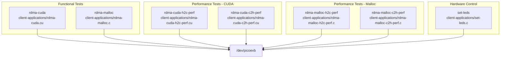
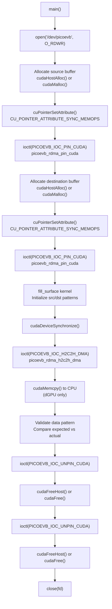
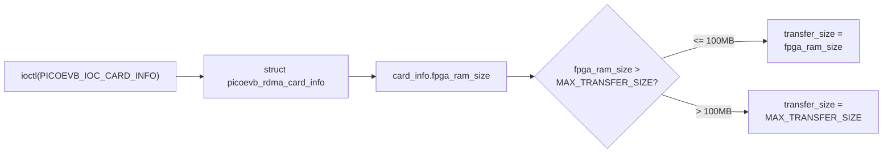
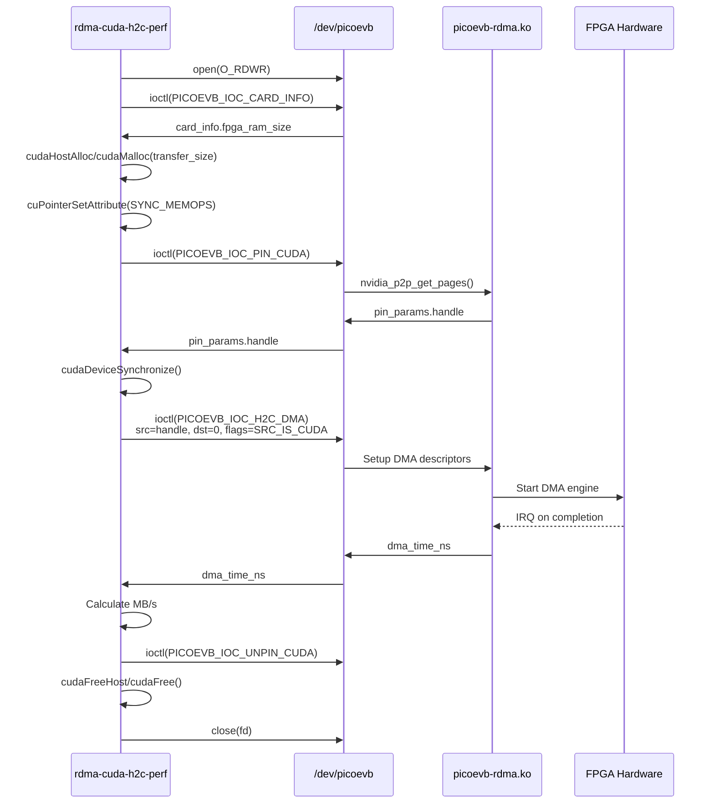
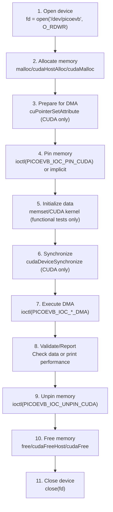

<!-- source: DeepWiki mcp.deepwiki.com · repo NVIDIA/jetson-rdma-picoevb · page 8.1 Running Tests · fetched 2026-11-11 -->

# Running Tests

<details>
<summary>Relevant source files</summary>

The following files were used as context for generating this wiki page:

- [README.md](README.md)
- [client-applications/rdma-cuda-c2h-perf.cu](client-applications/rdma-cuda-c2h-perf.cu)
- [client-applications/rdma-cuda-h2c-perf.cu](client-applications/rdma-cuda-h2c-perf.cu)
- [client-applications/rdma-cuda.cu](client-applications/rdma-cuda.cu)

</details>


This page provides instructions for executing the test applications included with the jetson-rdma-picoevb system. It covers functional tests that validate data integrity, performance benchmarks that measure transfer bandwidth, and hardware control utilities. For information on interpreting test results and expected performance metrics, see [Interpreting Results](#8.2).

## Prerequisites

Before running any tests, ensure the following conditions are met:

| Requirement | Verification Command | Expected Result |
|-------------|---------------------|-----------------|
| Kernel module loaded | `lsmod \| grep picoevb` | `picoevb_rdma` appears in output |
| Device node exists | `ls -l /dev/picoevb` | Character device file exists |
| FPGA programmed | `lspci -v \| grep picoevb-rdma` | Driver shows as "in use" for FPGA device |
| CUDA available (for CUDA tests) | `nvidia-smi` | GPU device listed |

The device file `/dev/picoevb` requires appropriate permissions. Tests can be run with `sudo`, or permissions can be applied to the device file to allow non-root access.

**Sources:** [README.md:257-278]()

## Test Suite Organization

The client applications directory contains six primary test executables organized by functionality:



**Sources:** [README.md:323-383]()

## Functional Tests

Functional tests perform bidirectional H2C2H transfers (Host-to-Card-to-Host) and validate data integrity by comparing expected vs. actual values. These tests use the FPGA's internal RAM as an intermediate buffer.

### rdma-cuda Test

The `rdma-cuda` application validates CUDA memory transfers using `PICOEVB_IOC_H2C2H_DMA`.

**Memory Allocation Strategy:**

| Platform Type | Compilation Flag | Memory API | Memory Location |
|---------------|------------------|------------|-----------------|
| iGPU (Jetson/Drive) | (default) | `cudaHostAlloc()` | Unified memory |
| dGPU (PC) | `NV_BUILD_DGPU` | `cudaMalloc()` | Device memory |

**Execution Command:**

```bash
sudo ./rdma-cuda
```

**Test Execution Flow:**



**Key Code Entities:**

- Surface size: `SURFACE_W * SURFACE_H` (1024x1024 = 1,048,576 uint32_t elements) [rdma-cuda.cu:37-39]()
- Data pattern generation: `DATA(x, y)` macro creates unique value per pixel [rdma-cuda.cu:42]()
- CUDA kernel: `fill_surface()` initializes surfaces with XOR'd pattern [rdma-cuda.cu:44-50]()
- Pin structures: `struct picoevb_rdma_pin_cuda` for source and destination [rdma-cuda.cu:60]()
- DMA parameters: `struct picoevb_rdma_h2c2h_dma` with `PICOEVB_H2C2H_DMA_FLAG_SRC_IS_CUDA` and `PICOEVB_H2C2H_DMA_FLAG_DST_IS_CUDA` flags [rdma-cuda.cu:147-148]()
- Validation loop: Iterates through all pixels checking `expected == actual` [rdma-cuda.cu:176-188]()

**Sources:** [README.md:327-359](), [rdma-cuda.cu:52-241]()

### rdma-malloc Test

The `rdma-malloc` application validates standard host memory transfers allocated with `malloc()`.

**Execution Command:**

```bash
sudo ./rdma-malloc
```

This test follows the same structural pattern as `rdma-cuda` but uses:
- `malloc()` for memory allocation instead of CUDA APIs
- `get_user_pages()` in the kernel for memory pinning
- Standard `memset()` for data initialization
- No CUDA synchronization or device memory copies required

The test demonstrates PCIe DMA to/from regular system RAM without GPU involvement.

**Sources:** [README.md:327-359]()

## Performance Benchmark Tests

Performance tests measure unidirectional transfer bandwidth for Host-to-Card (H2C) and Card-to-Host (C2H) operations. These tests determine the actual transfer size dynamically based on FPGA board capabilities.

### Transfer Size Determination



**Board-Specific Transfer Sizes:**

| FPGA Board | FPGA RAM Size | Actual Transfer Size | Limiting Factor |
|------------|---------------|---------------------|-----------------|
| PicoEVB | 64 KB (65,536 bytes) | 64 KB | FPGA RAM |
| HTG-K800 | 2 GB | 100 MB | `MAX_TRANSFER_SIZE` cap |

**Sources:** [rdma-cuda-c2h-perf.cu:37](), [rdma-cuda-c2h-perf.cu:64-72]()

### CUDA Performance Tests

#### rdma-cuda-h2c-perf (Host-to-Card)

Measures write bandwidth from CUDA memory to FPGA RAM.

**Execution Command:**

```bash
sudo ./rdma-cuda-h2c-perf
```

**IOCTL Sequence:**



**Key Parameters:**

- Source handle: `pin_params.handle` (CUDA memory) [rdma-cuda-h2c-perf.cu:105]()
- Destination offset: `0` (FPGA RAM base address) [rdma-cuda-h2c-perf.cu:106]()
- Flags: `PICOEVB_H2C_DMA_FLAG_SRC_IS_CUDA` [rdma-cuda-h2c-perf.cu:108]()
- Timing: `dma_params.dma_time_ns` returned by kernel [rdma-cuda-h2c-perf.cu:116]()

**Output Format:**

```
Bytes:65536 usecs:123 MB/s:532.520325
```

**Sources:** [rdma-cuda-h2c-perf.cu:39-143](), [README.md:361-371]()

#### rdma-cuda-c2h-perf (Card-to-Host)

Measures read bandwidth from FPGA RAM to CUDA memory.

**Execution Command:**

```bash
sudo ./rdma-cuda-c2h-perf
```

**Key Parameters:**

- Source offset: `0` (FPGA RAM base address) [rdma-cuda-c2h-perf.cu:105]()
- Destination handle: `pin_params.handle` (CUDA memory) [rdma-cuda-c2h-perf.cu:106]()
- Flags: `PICOEVB_C2H_DMA_FLAG_DST_IS_CUDA` [rdma-cuda-c2h-perf.cu:108]()

The test structure mirrors `rdma-cuda-h2c-perf` but reverses the transfer direction using `PICOEVB_IOC_C2H_DMA` instead of `PICOEVB_IOC_H2C_DMA`.

**Sources:** [rdma-cuda-c2h-perf.cu:39-143](), [README.md:361-371]()

### Malloc Performance Tests

#### rdma-malloc-h2c-perf and rdma-malloc-c2h-perf

These tests measure bandwidth for regular host memory allocated with `malloc()` instead of CUDA memory.

**Execution Commands:**

```bash
sudo ./rdma-malloc-h2c-perf
sudo ./rdma-malloc-c2h-perf
```

These tests follow the same structure as their CUDA counterparts but:
- Omit the `_IS_CUDA` flags in DMA structures
- Use `malloc()` and `free()` instead of CUDA allocation functions
- Skip `cuPointerSetAttribute()` calls
- Use standard memory pinning via `get_user_pages()` in the kernel

**Sources:** [README.md:361-371]()

## Hardware Control Utilities

### set-leds

The `set-leds` utility controls GPIO-connected LEDs on the PicoEVB board for hardware validation.

**Execution Command:**

```bash
sudo ./set-leds <value>
```

**Parameter:**

- `<value>`: Integer 0-7 representing 3-bit LED state
- Hardware inverts the value: `0` = all LEDs on, `7` = all LEDs off

**Examples:**

```bash
sudo ./set-leds 0  # All LEDs on
sudo ./set-leds 2  # LED pattern: 101 (binary)
sudo ./set-leds 5  # LED pattern: 010 (binary)
sudo ./set-leds 7  # All LEDs off
```

This utility provides a simple visual confirmation that the kernel driver can communicate with FPGA hardware registers.

**Sources:** [README.md:373-383]()

## Common Test Execution Patterns

All test applications follow this general pattern:



**Sources:** [rdma-cuda.cu:52-241](), [rdma-cuda-c2h-perf.cu:39-143](), [README.md:323-383]()

## Permission Considerations

The device file `/dev/picoevb` is created by the kernel module with default root-only permissions. Tests can be run in two ways:

**Option 1: Using sudo (simplest)**

```bash
sudo ./rdma-cuda
sudo ./rdma-malloc
sudo ./rdma-cuda-h2c-perf
# etc.
```

**Option 2: Setting device permissions**

```bash
sudo chmod 666 /dev/picoevb
./rdma-cuda  # Now works without sudo
```

Note that device permissions reset on module unload/reload or system reboot. For persistent permissions, configure udev rules.

**Sources:** [README.md:349-350]()

---

