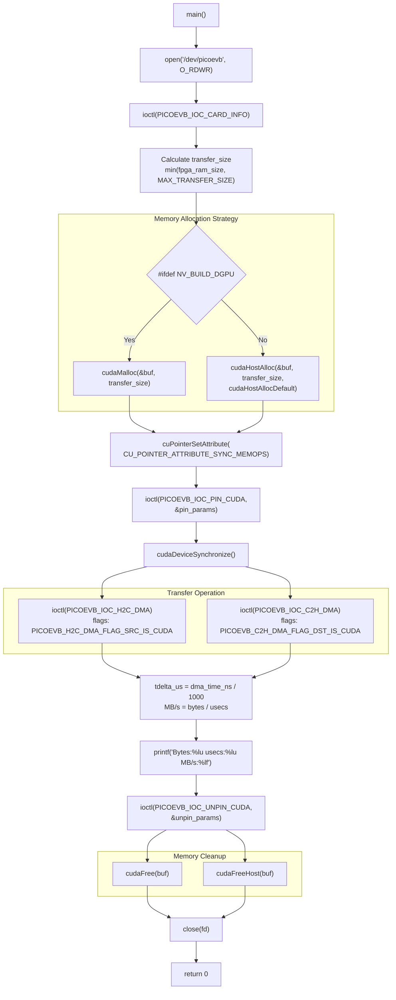
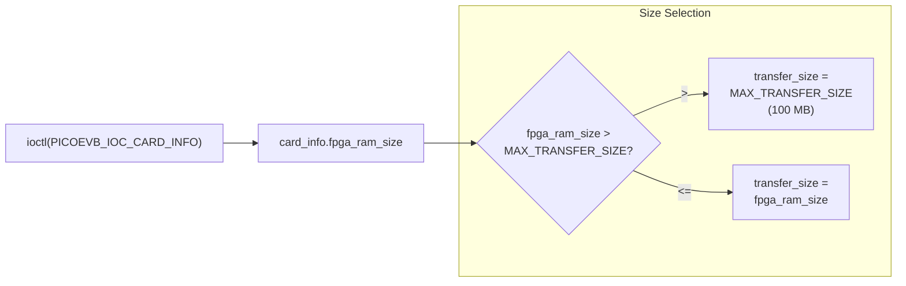
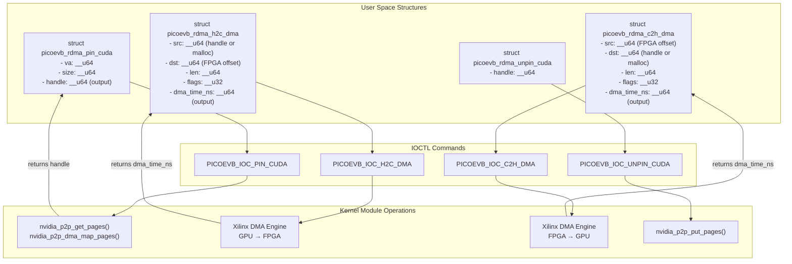

<!-- source: DeepWiki mcp.deepwiki.com · repo NVIDIA/jetson-rdma-picoevb · extra page CUDA Performance Tests · fetched 2026-11-11 -->

# CUDA Performance Tests

<details>
<summary>Relevant source files</summary>

The following files were used as context for generating this wiki page:

- [client-applications/rdma-cuda-c2h-perf.cu](client-applications/rdma-cuda-c2h-perf.cu)
- [client-applications/rdma-cuda-h2c-perf.cu](client-applications/rdma-cuda-h2c-perf.cu)

</details>


## Purpose and Scope

This page documents the CUDA-based performance measurement applications that benchmark unidirectional DMA transfer bandwidth between GPU memory and FPGA hardware. These applications measure raw throughput for Host-to-Card (H2C) and Card-to-Host (C2H) transfers using CUDA-allocated memory.

For functional correctness testing with bidirectional H2C2H transfers and data validation, see [rdma-cuda Test](#5.2.1). For performance tests using regular host memory allocation, see [Malloc Performance Tests](#5.3.2).

**Sources:** [client-applications/rdma-cuda-c2h-perf.cu:1-143](), [client-applications/rdma-cuda-h2c-perf.cu:1-143]()

---

## Overview

The CUDA performance test suite consists of two applications:

| Application | Binary Name | Transfer Direction | Purpose |
|-------------|-------------|-------------------|---------|
| C2H Performance Test | `rdma-cuda-c2h-perf` | FPGA → GPU | Measures read bandwidth from FPGA RAM to CUDA memory |
| H2C Performance Test | `rdma-cuda-h2c-perf` | GPU → FPGA | Measures write bandwidth from CUDA memory to FPGA RAM |

Both applications perform a single large DMA transfer and report the achieved bandwidth in MB/s. The transfer size is determined by querying the FPGA's onboard RAM capacity, capped at 100 MB maximum.

**Sources:** [client-applications/rdma-cuda-c2h-perf.cu:37-143](), [client-applications/rdma-cuda-h2c-perf.cu:37-143]()

---

## Application Architecture

### Program Flow Diagram



**Sources:** [client-applications/rdma-cuda-c2h-perf.cu:39-143](), [client-applications/rdma-cuda-h2c-perf.cu:39-143]()

---

## Memory Allocation Strategy

### Platform-Specific Memory Types

The applications use conditional compilation to select the appropriate CUDA memory allocation method based on GPU architecture:

| Platform | Compile Flag | Allocation Function | Memory Type | Use Case |
|----------|--------------|---------------------|-------------|----------|
| Discrete GPU | `NV_BUILD_DGPU` defined | `cudaMalloc()` | Device memory | Quadro, Tesla, desktop GPUs |
| Integrated GPU | `NV_BUILD_DGPU` undefined | `cudaHostAlloc()` | Unified/pinned memory | Jetson Xavier, Drive AGX Xavier |

**Implementation:**

[client-applications/rdma-cuda-c2h-perf.cu:74-82]() and [client-applications/rdma-cuda-h2c-perf.cu:74-82]() both use:
```c
#ifdef NV_BUILD_DGPU
    ce = cudaMalloc(&buf, transfer_size);
#else
    ce = cudaHostAlloc(&buf, transfer_size, cudaHostAllocDefault);
#endif
```

The corresponding cleanup uses matching deallocation functions at [client-applications/rdma-cuda-c2h-perf.cu:126-130]() and [client-applications/rdma-cuda-h2c-perf.cu:126-130]().

**Sources:** [client-applications/rdma-cuda-c2h-perf.cu:74-82](), [client-applications/rdma-cuda-c2h-perf.cu:126-130]()

---

### Pointer Attribute Configuration

After allocation, both tests configure the CUDA pointer for synchronous memory operations using `cuPointerSetAttribute()` at [client-applications/rdma-cuda-c2h-perf.cu:84-89]():

```c
cuPointerSetAttribute(&flag, CU_POINTER_ATTRIBUTE_SYNC_MEMOPS, (CUdeviceptr)buf);
```

This ensures memory operations complete synchronously, preventing race conditions during DMA transfers.

**Sources:** [client-applications/rdma-cuda-c2h-perf.cu:84-89](), [client-applications/rdma-cuda-h2c-perf.cu:84-89]()

---

## Transfer Size Determination

### Size Calculation Flow



**Implementation Details:**

The transfer size is determined by querying the FPGA's RAM capacity through `PICOEVB_IOC_CARD_INFO` at [client-applications/rdma-cuda-c2h-perf.cu:64-72]():

```c
ret = ioctl(fd, PICOEVB_IOC_CARD_INFO, &card_info);
transfer_size = card_info.fpga_ram_size;
if (transfer_size > MAX_TRANSFER_SIZE)
    transfer_size = MAX_TRANSFER_SIZE;
```

The `MAX_TRANSFER_SIZE` constant is defined as 100 MB at [client-applications/rdma-cuda-c2h-perf.cu:37]():
```c
#define MAX_TRANSFER_SIZE (100 * 1024 * 1024)
```

**Typical Transfer Sizes:**

| FPGA Board | RAM Size | Actual Transfer Size |
|-----------|----------|---------------------|
| PicoEVB | 64 KB | 64 KB (65,536 bytes) |
| HTG-K800 | 2 GB | 100 MB (capped at `MAX_TRANSFER_SIZE`) |

**Sources:** [client-applications/rdma-cuda-c2h-perf.cu:37](), [client-applications/rdma-cuda-c2h-perf.cu:64-72](), [client-applications/rdma-cuda-h2c-perf.cu:37](), [client-applications/rdma-cuda-h2c-perf.cu:64-72]()

---

## DMA Transfer Operations

### CUDA Memory Pinning

Before initiating DMA transfers, the CUDA buffer must be pinned for DMA access using the `PICOEVB_IOC_PIN_CUDA` IOCTL at [client-applications/rdma-cuda-c2h-perf.cu:91-97]():

```c
pin_params.va = (__u64)buf;
pin_params.size = transfer_size;
ret = ioctl(fd, PICOEVB_IOC_PIN_CUDA, &pin_params);
```

The kernel module uses NVIDIA's P2P API to pin the GPU memory pages and returns a `handle` that identifies the pinned region. This handle is used in subsequent DMA operations.

**Sources:** [client-applications/rdma-cuda-c2h-perf.cu:91-97](), [client-applications/rdma-cuda-h2c-perf.cu:91-97]()

---

### H2C Transfer (Host-to-Card)

The `rdma-cuda-h2c-perf` application writes data from GPU memory to FPGA RAM using the `PICOEVB_IOC_H2C_DMA` IOCTL at [client-applications/rdma-cuda-h2c-perf.cu:105-114]():

```c
dma_params.src = pin_params.handle;  // CUDA buffer handle
dma_params.dst = 0;                   // FPGA RAM offset 0
dma_params.len = transfer_size;
dma_params.flags = PICOEVB_H2C_DMA_FLAG_SRC_IS_CUDA;
ret = ioctl(fd, PICOEVB_IOC_H2C_DMA, &dma_params);
```

**Key Parameters:**
- `src`: Handle from `PICOEVB_IOC_PIN_CUDA` identifying the GPU memory region
- `dst`: Offset within FPGA RAM (always 0 for performance tests)
- `flags`: `PICOEVB_H2C_DMA_FLAG_SRC_IS_CUDA` indicates source is CUDA memory

**Sources:** [client-applications/rdma-cuda-h2c-perf.cu:105-114]()

---

### C2H Transfer (Card-to-Host)

The `rdma-cuda-c2h-perf` application reads data from FPGA RAM to GPU memory using the `PICOEVB_IOC_C2H_DMA` IOCTL at [client-applications/rdma-cuda-c2h-perf.cu:105-114]():

```c
dma_params.src = 0;                   // FPGA RAM offset 0
dma_params.dst = pin_params.handle;   // CUDA buffer handle
dma_params.len = transfer_size;
dma_params.flags = PICOEVB_C2H_DMA_FLAG_DST_IS_CUDA;
ret = ioctl(fd, PICOEVB_IOC_C2H_DMA, &dma_params);
```

**Key Parameters:**
- `src`: Offset within FPGA RAM (always 0 for performance tests)
- `dst`: Handle from `PICOEVB_IOC_PIN_CUDA` identifying the GPU memory region
- `flags`: `PICOEVB_C2H_DMA_FLAG_DST_IS_CUDA` indicates destination is CUDA memory

**Sources:** [client-applications/rdma-cuda-c2h-perf.cu:105-114]()

---

### IOCTL Data Structure Flow



**Sources:** [client-applications/rdma-cuda-c2h-perf.cu:48-51](), [client-applications/rdma-cuda-h2c-perf.cu:48-51]()

---

## Performance Measurement

### Timing Mechanism

The kernel module measures DMA transfer time in nanoseconds and returns it in the `dma_time_ns` field of the DMA parameter structures. The applications convert this to microseconds and calculate bandwidth at [client-applications/rdma-cuda-c2h-perf.cu:116-117]():

```c
tdelta_us = dma_params.dma_time_ns / 1000;
printf("Bytes:%lu usecs:%lu MB/s:%lf\n", transfer_size, tdelta_us, 
       (double)transfer_size / (double)tdelta_us);
```

**Bandwidth Calculation:**
```
MB/s = (transfer_size_bytes / microseconds)
```

Note: This produces MB/s where 1 MB = 1,000,000 bytes (not MiB = 1,048,576 bytes).

**Sources:** [client-applications/rdma-cuda-c2h-perf.cu:116-117](), [client-applications/rdma-cuda-h2c-perf.cu:116-117]()

---

### Output Format

Both applications produce a single line of output with three colon-separated fields:

```
Bytes:<transfer_size> usecs:<time_in_microseconds> MB/s:<calculated_bandwidth>
```

**Example Output:**

```
Bytes:65536 usecs:42 MB/s:1560.000000
```

This indicates:
- **65,536 bytes** transferred (64 KB, typical for PicoEVB)
- **42 microseconds** elapsed time
- **1,560 MB/s** achieved bandwidth

**Sources:** [client-applications/rdma-cuda-c2h-perf.cu:117](), [client-applications/rdma-cuda-h2c-perf.cu:117]()

---

## Resource Cleanup

### Memory Unpinning

After the transfer completes, the CUDA buffer must be unpinned using `PICOEVB_IOC_UNPIN_CUDA` at [client-applications/rdma-cuda-c2h-perf.cu:119-124]():

```c
unpin_params.handle = pin_params.handle;
ret = ioctl(fd, PICOEVB_IOC_UNPIN_CUDA, &unpin_params);
```

This releases the kernel module's P2P mapping of the GPU memory.

**Sources:** [client-applications/rdma-cuda-c2h-perf.cu:119-124](), [client-applications/rdma-cuda-h2c-perf.cu:119-124]()

---

### CUDA Memory Deallocation

The CUDA buffer is freed using the platform-appropriate function at [client-applications/rdma-cuda-c2h-perf.cu:126-134]():

```c
#ifdef NV_BUILD_DGPU
    ce = cudaFree(buf);
#else
    ce = cudaFreeHost(buf);
#endif
```

**Sources:** [client-applications/rdma-cuda-c2h-perf.cu:126-134](), [client-applications/rdma-cuda-h2c-perf.cu:126-134]()

---

## Usage

### Command-Line Interface

Both applications accept no command-line arguments:

```bash
$ rdma-cuda-c2h-perf
Bytes:65536 usecs:42 MB/s:1560.000000

$ rdma-cuda-h2c-perf
Bytes:65536 usecs:38 MB/s:1724.000000
```

Any arguments result in a usage error at [client-applications/rdma-cuda-c2h-perf.cu:53-56]():

```c
if (argc != 1) {
    fprintf(stderr, "usage: rdma-cuda-c2h-perf\n");
    return 1;
}
```

**Sources:** [client-applications/rdma-cuda-c2h-perf.cu:53-56](), [client-applications/rdma-cuda-h2c-perf.cu:53-56]()

---

## Prerequisites

### Runtime Requirements

| Requirement | Description |
|------------|-------------|
| Kernel Module | `picoevb-rdma.ko` must be loaded |
| Device Node | `/dev/picoevb` must exist and be accessible |
| FPGA Bitstream | FPGA must be programmed with appropriate bitstream |
| CUDA Runtime | CUDA driver and runtime libraries must be installed |
| Permissions | Read/write access to `/dev/picoevb` required |

### Build Requirements

The applications are built using the Makefile in `client-applications/` with NVCC compiler support. See [Building Client Applications](#7.3) for details.

**Sources:** [client-applications/rdma-cuda-c2h-perf.cu:58-62](), [client-applications/rdma-cuda-h2c-perf.cu:58-62]()

---

## Error Handling

### Common Error Scenarios

| Error Location | Condition | Exit Code | Description |
|----------------|-----------|-----------|-------------|
| Device open | `open()` fails | 1 | Cannot access `/dev/picoevb` |
| Card info | `PICOEVB_IOC_CARD_INFO` fails | 1 | Device communication error |
| Memory allocation | `cudaMalloc()`/`cudaHostAlloc()` fails | 1 | Insufficient GPU memory |
| Pointer attribute | `cuPointerSetAttribute()` fails | 1 | CUDA configuration error |
| Pin CUDA | `PICOEVB_IOC_PIN_CUDA` fails | 1 | P2P pinning failed |
| Device sync | `cudaDeviceSynchronize()` fails | 1 | CUDA synchronization error |
| DMA transfer | `PICOEVB_IOC_H2C_DMA`/`PICOEVB_IOC_C2H_DMA` fails | 1 | DMA operation failed |
| Unpin CUDA | `PICOEVB_IOC_UNPIN_CUDA` fails | 1 | P2P unpinning failed |
| Memory free | `cudaFree()`/`cudaFreeHost()` fails | 1 | CUDA cleanup error |
| Device close | `close()` fails | 1 | Device close error |

All errors are reported to stderr with descriptive messages before the application exits with code 1.

**Sources:** [client-applications/rdma-cuda-c2h-perf.cu:58-141](), [client-applications/rdma-cuda-h2c-perf.cu:58-141]()

---

