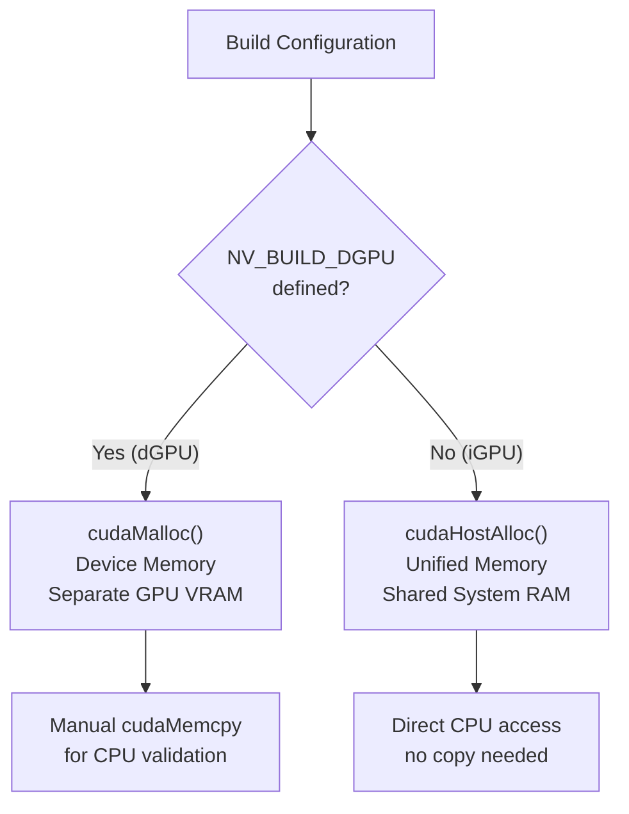
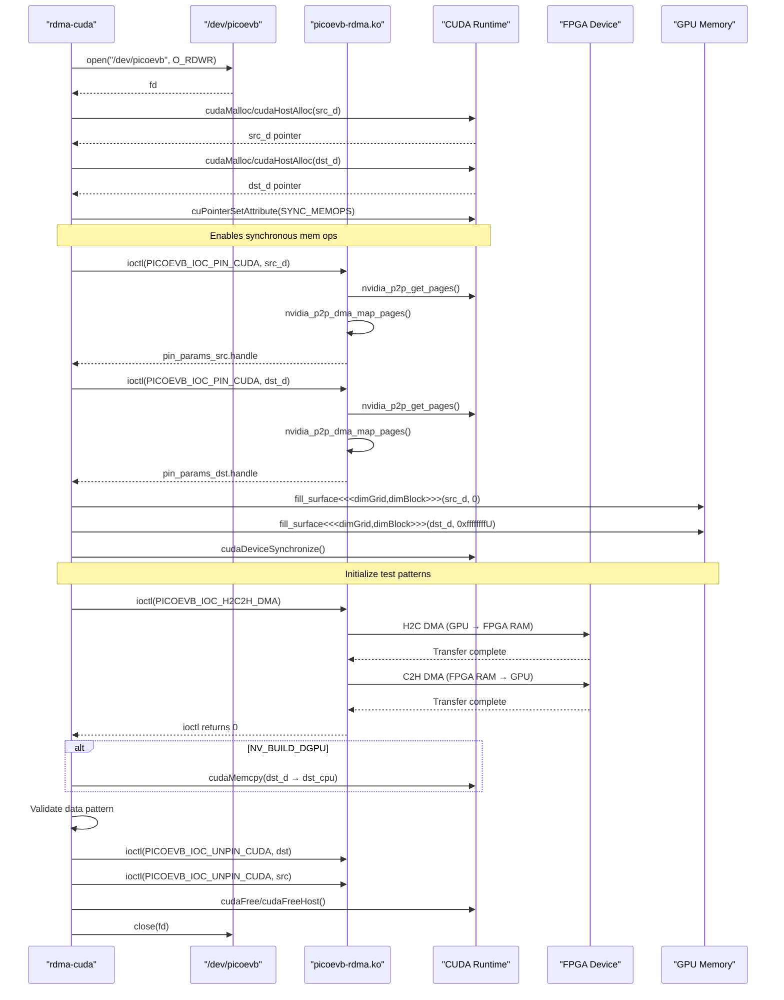
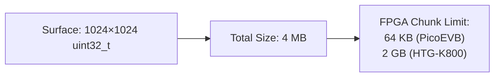
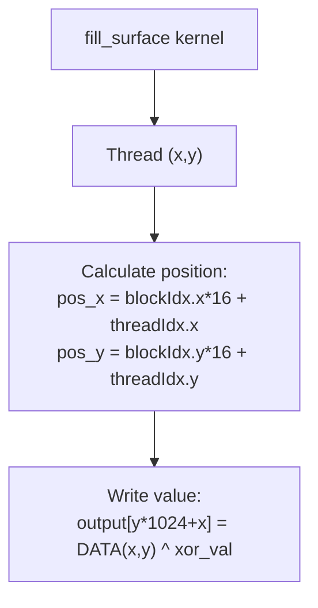
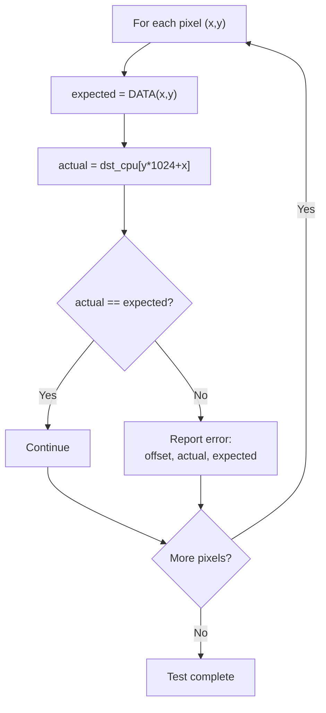

<!-- source: DeepWiki mcp.deepwiki.com · repo NVIDIA/jetson-rdma-picoevb · extra page rdma-cuda Test · fetched 2026-11-11 -->

# rdma-cuda Test

<details>
<summary>Relevant source files</summary>

The following files were used as context for generating this wiki page:

- [client-applications/rdma-cuda.cu](client-applications/rdma-cuda.cu)

</details>


## Purpose and Scope

The `rdma-cuda` test is a functional validation application that verifies the correctness of CUDA memory transfers through the FPGA device using the H2C2H (Host-to-Card-to-Host) DMA pattern. This test ensures that data integrity is maintained when transferring CUDA-allocated memory buffers via the FPGA's onboard RAM, validating the entire GPUDirect RDMA pipeline.

This page documents the test implementation, execution flow, and validation methodology. For performance measurement of CUDA transfers, see [CUDA Performance Tests](#5.3.1). For similar tests using regular host memory instead of CUDA memory, see [rdma-malloc Test](#5.2.2).

**Sources**: [client-applications/rdma-cuda.cu:1-241]()

---

## Test Overview

The `rdma-cuda` test validates bidirectional DMA transfers between GPU memory and the FPGA device. It allocates two CUDA buffers (source and destination), initializes them with known patterns using CUDA kernels, performs a DMA transfer via the FPGA, and validates that the data was copied correctly.

### Key Characteristics

| Characteristic | Value |
|---|---|
| **Test Type** | Functional (data integrity) |
| **Transfer Pattern** | H2C2H (bidirectional via FPGA RAM) |
| **Buffer Size** | 1024×1024 uint32_t (4 MB) |
| **Validation Method** | Pattern matching |
| **Memory Type** | CUDA-managed (device or unified) |
| **Platform Support** | Both iGPU and dGPU configurations |

**Sources**: [client-applications/rdma-cuda.cu:37-42]()

---

## Memory Allocation Strategy

The test supports two distinct memory allocation strategies based on the GPU architecture:



### Discrete GPU Mode (NV_BUILD_DGPU)

When compiled with `-DNV_BUILD_DGPU`, the test uses `cudaMalloc()` to allocate memory in discrete GPU VRAM. This is required for x86 systems with Quadro or Tesla GPUs.

- **Source allocation**: [client-applications/rdma-cuda.cu:76]()
- **Destination allocation**: [client-applications/rdma-cuda.cu:102]()
- **Requires explicit copy**: [client-applications/rdma-cuda.cu:161-170]() for CPU validation

### Integrated GPU Mode (Default)

When compiled without `NV_BUILD_DGPU`, the test uses `cudaHostAlloc()` to allocate unified memory accessible by both CPU and GPU. This is the default for Jetson and Drive platforms with integrated GPUs.

- **Source allocation**: [client-applications/rdma-cuda.cu:78-79]()
- **Destination allocation**: [client-applications/rdma-cuda.cu:104-105]()
- **Direct CPU access**: [client-applications/rdma-cuda.cu:172]()

**Sources**: [client-applications/rdma-cuda.cu:75-84](), [client-applications/rdma-cuda.cu:101-110](), [client-applications/rdma-cuda.cu:156-173]()

---

## Test Execution Flow

The test follows a structured sequence of operations to validate the RDMA transfer pipeline:



### Execution Stages

#### 1. Device Initialization
[client-applications/rdma-cuda.cu:69-73]()
```c
fd = open("/dev/picoevb", O_RDWR);
```

#### 2. Memory Allocation and Pinning
[client-applications/rdma-cuda.cu:75-125]()
- Allocate source and destination buffers
- Set `CU_POINTER_ATTRIBUTE_SYNC_MEMOPS` for synchronous operations
- Pin buffers using `PICOEVB_IOC_PIN_CUDA` IOCTL
- Returns pinning handles for subsequent DMA operations

#### 3. Data Initialization
[client-applications/rdma-cuda.cu:133-142]()
- Launch CUDA kernel `fill_surface` to initialize source buffer
- Launch CUDA kernel `fill_surface` to initialize destination buffer (different pattern)
- Synchronize GPU execution

#### 4. DMA Transfer
[client-applications/rdma-cuda.cu:144-153]()
- Execute H2C2H DMA using `PICOEVB_IOC_H2C2H_DMA` IOCTL
- Transfer uses both `PICOEVB_H2C2H_DMA_FLAG_SRC_IS_CUDA` and `PICOEVB_H2C2H_DMA_FLAG_DST_IS_CUDA` flags
- Data flows: GPU → FPGA RAM → GPU

#### 5. Data Validation
[client-applications/rdma-cuda.cu:175-190]()
- Compare each element against expected pattern
- Report any mismatches with offset and values

#### 6. Cleanup
[client-applications/rdma-cuda.cu:200-238]()
- Unpin buffers using `PICOEVB_IOC_UNPIN_CUDA`
- Free CUDA memory
- Close device file descriptor

**Sources**: [client-applications/rdma-cuda.cu:52-241]()

---

## Data Pattern and Validation

The test uses a deterministic pattern that encodes 2D coordinates into each 32-bit word, enabling precise error localization.

### Surface Geometry



| Constant | Value | Definition |
|---|---|---|
| `SURFACE_W` | 1024 | Width in pixels |
| `SURFACE_H` | 1024 | Height in pixels |
| `SURFACE_SIZE` | 1,048,576 | Total elements |
| Total bytes | 4,194,304 | 4 MB |

**Sources**: [client-applications/rdma-cuda.cu:37-39]()

### Pattern Generation

The test pattern encodes the (x, y) coordinate into each 32-bit value:

```c
#define DATA(x, y)  (((y & 0xffff) << 16) | ((x) & 0xffff))
```

| Bits | Content |
|---|---|
| [31:16] | Y coordinate (masked to 16 bits) |
| [15:0] | X coordinate (masked to 16 bits) |

The CUDA kernel `fill_surface` generates this pattern:



- **Grid dimensions**: 64×64 blocks (for 1024×1024 surface)
- **Block dimensions**: 16×16 threads
- **XOR value**: 0 for source, 0xffffffff for destination (initial)

**Sources**: [client-applications/rdma-cuda.cu:41-50](), [client-applications/rdma-cuda.cu:133-136]()

### Validation Logic

After DMA transfer, the test validates every element:



The validation loop [client-applications/rdma-cuda.cu:176-188]() checks all 1,048,576 elements and reports any mismatches with precise location information.

**Sources**: [client-applications/rdma-cuda.cu:175-190]()

---

## IOCTL Commands Used

The test exercises the following kernel module IOCTL commands:

| IOCTL Command | Purpose | Parameters | Used At |
|---|---|---|---|
| `PICOEVB_IOC_PIN_CUDA` | Pin CUDA memory for DMA | `struct picoevb_rdma_pin_cuda` | [Line 95](), [Line 121]() |
| `PICOEVB_IOC_H2C2H_DMA` | Execute bidirectional DMA | `struct picoevb_rdma_h2c2h_dma` | [Line 149]() |
| `PICOEVB_IOC_UNPIN_CUDA` | Unpin CUDA memory | `struct picoevb_rdma_unpin_cuda` | [Line 201](), [Line 218]() |

### PIN_CUDA Structure

```c
struct picoevb_rdma_pin_cuda {
    __u64 va;          // Virtual address of CUDA buffer
    __u64 size;        // Size in bytes
    __u32 handle;      // Returned handle for DMA operations
};
```

- **Source pinning**: [client-applications/rdma-cuda.cu:93-99]()
- **Destination pinning**: [client-applications/rdma-cuda.cu:119-125]()

### H2C2H_DMA Structure

```c
struct picoevb_rdma_h2c2h_dma {
    __u32 src;         // Source handle from PIN_CUDA
    __u32 dst;         // Destination handle from PIN_CUDA
    __u64 len;         // Transfer length in bytes
    __u32 flags;       // PICOEVB_H2C2H_DMA_FLAG_*
};
```

Flags used: [client-applications/rdma-cuda.cu:147-148]()
- `PICOEVB_H2C2H_DMA_FLAG_SRC_IS_CUDA`: Source is CUDA memory
- `PICOEVB_H2C2H_DMA_FLAG_DST_IS_CUDA`: Destination is CUDA memory

**Sources**: [client-applications/rdma-cuda.cu:60-62](), [client-applications/rdma-cuda.cu:144-153]()

---

## Build Configuration

The test is compiled with NVCC (NVIDIA CUDA Compiler) and supports conditional compilation for different GPU architectures:

### Compilation Modes

| Mode | Define | Memory Allocation | Target Platform |
|---|---|---|---|
| **Integrated GPU** | (none) | `cudaHostAlloc()` | Jetson Xavier, Drive AGX Xavier |
| **Discrete GPU** | `-DNV_BUILD_DGPU` | `cudaMalloc()` | x86 PC with Quadro/Tesla |

### Conditional Compilation Blocks

The test has four conditional compilation sections:

1. **Source allocation**: [client-applications/rdma-cuda.cu:75-84]()
2. **Destination allocation**: [client-applications/rdma-cuda.cu:101-110]()
3. **Validation data preparation**: [client-applications/rdma-cuda.cu:160-173]()
4. **Memory cleanup**: [client-applications/rdma-cuda.cu:192-198](), [client-applications/rdma-cuda.cu:207-215](), [client-applications/rdma-cuda.cu:224-232]()

### Build Invocation

The application is built via the Makefile in `client-applications/`. For iGPU platforms:
```bash
make rdma-cuda
```

For dGPU platforms:
```bash
make rdma-cuda NV_BUILD_DGPU=1
```

**Sources**: [client-applications/rdma-cuda.cu:75-232]()

---

## Expected Output and Error Handling

### Success Case

When the test passes, it exits silently with return code 0:
```bash
$ ./rdma-cuda
$ echo $?
0
```

### Failure Cases

The test performs comprehensive error checking at each stage:

| Error Condition | Error Message | Exit Code | Location |
|---|---|---|---|
| Device open failure | `open() failed` | 1 | [Line 70-73]() |
| Source allocation failure | `Allocation of src_d failed` | 1 | [Line 81-84]() |
| Destination allocation failure | `Allocation of dst_d failed` | 1 | [Line 107-110]() |
| Pointer attribute failure | `cuPointerSetAttribute(...) failed` | 1 | [Line 88-91](), [Line 114-117]() |
| Source pinning failure | `ioctl(PIN_CUDA src) failed` | 1 | [Line 96-99]() |
| Destination pinning failure | `ioctl(PIN_CUDA dst) failed` | 1 | [Line 122-125]() |
| Synchronization failure | `cudaDeviceSynchronize() failed` | 1 | [Line 139-142]() |
| DMA transfer failure | `ioctl(DMA) failed` | 1 | [Line 150-153]() |
| Data validation failure | `dst[0x%x] is 0x%x not 0x%x` | 1 | [Line 181-186]() |
| Unpinning failure | `ioctl(UNPIN_CUDA ...) failed` | 1 | [Line 201-205](), [Line 218-222]() |
| Memory free failure | `Free of ... failed` | 1 | [Line 212-215](), [Line 229-232]() |

### Validation Error Example

When data corruption occurs, the test reports the exact location and values:
```
dst[0x12345] is 0xdeadbeef not 0x0abb0ccd
```

This indicates:
- **Offset**: `0x12345` (linear index in buffer)
- **Actual value**: `0xdeadbeef` (what was read from destination)
- **Expected value**: `0x0abb0ccd` (what should have been transferred)

**Sources**: [client-applications/rdma-cuda.cu:69-238]()

---

## Usage

The test accepts no command-line arguments:

```bash
./rdma-cuda
```

If arguments are provided, the test displays usage and exits:
```bash
$ ./rdma-cuda --help
usage: rdma-cuda
$ echo $?
1
```

**Sources**: [client-applications/rdma-cuda.cu:64-67]()

---

## Relationship to Other Tests

This functional test is part of a comprehensive test suite:

| Test | Memory Type | Purpose | See |
|---|---|---|---|
| **rdma-cuda** | CUDA memory | Data integrity validation | This page |
| rdma-malloc | malloc() memory | Data integrity validation | [5.2.2](#5.2.2) |
| rdma-cuda-c2h-perf | CUDA memory | C2H bandwidth measurement | [5.3.1](#5.3.1) |
| rdma-cuda-h2c-perf | CUDA memory | H2C bandwidth measurement | [5.3.1](#5.3.1) |
| rdma-malloc-c2h-perf | malloc() memory | C2H bandwidth measurement | [5.3.2](#5.3.2) |
| rdma-malloc-h2c-perf | malloc() memory | H2C bandwidth measurement | [5.3.2](#5.3.2) |

**Sources**: [client-applications/rdma-cuda.cu:1-241]()

---

