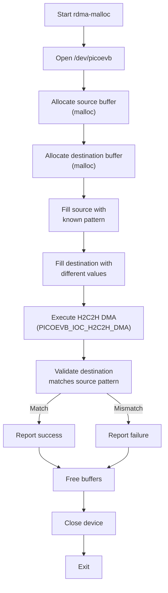
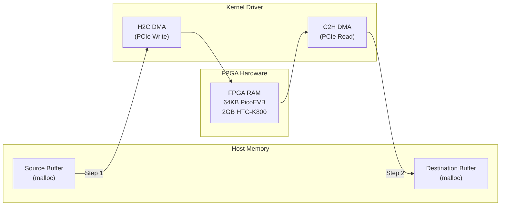
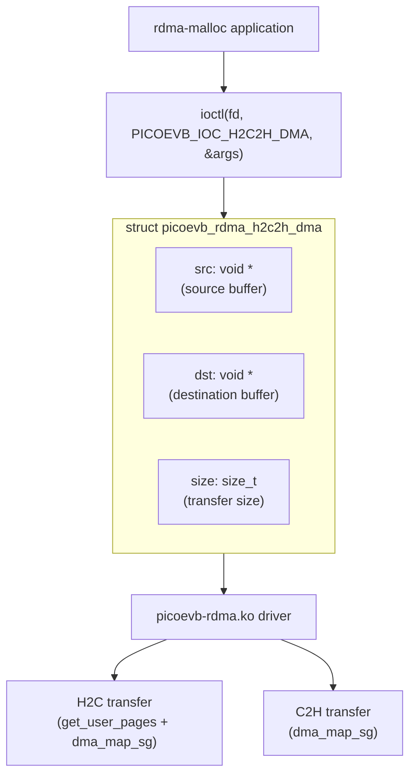

<!-- source: DeepWiki mcp.deepwiki.com · repo NVIDIA/jetson-rdma-picoevb · extra page rdma-malloc Test · fetched 2026-11-11 -->

# rdma-malloc Test

<details>
<summary>Relevant source files</summary>

The following files were used as context for generating this wiki page:

- [README.md](README.md)
- [client-applications/Makefile](client-applications/Makefile)

</details>


## Purpose and Scope

The `rdma-malloc` test is a functional validation application that verifies data integrity for RDMA transfers using regular host memory allocated via `malloc()`. This test validates the kernel driver's ability to perform DMA operations on standard user-space memory buffers without GPU involvement.

**Related pages:**
- For GPU memory testing, see [rdma-cuda Test](#5.2.1)
- For performance benchmarking with malloc'd memory, see [Malloc Performance Tests](#5.3.2)
- For IOCTL interface details, see [IOCTL Interface](#4.2)

**Sources:** [README.md:327-360]()

---

## Overview

The `rdma-malloc` application performs bidirectional Host-to-Card-to-Host (H2C2H) DMA transfers using the FPGA's onboard RAM as an intermediate buffer. It allocates two memory regions using standard `malloc()`, fills the source with a known data pattern, transfers the data through the FPGA, and validates that the destination buffer contains the expected pattern.

This test demonstrates:
- PCIe read access (Host-to-Card) to user-space memory
- PCIe write access (Card-to-Host) to user-space memory
- Data integrity across DMA operations
- Kernel driver's handling of non-CUDA memory buffers

Unlike the `rdma-cuda` test, this application does not require CUDA runtime support and can validate pure CPU memory DMA paths.

**Sources:** [README.md:327-340](), [client-applications/Makefile:44,53-54]()

---

## Test Execution Flow

The following diagram shows the complete execution sequence of the `rdma-malloc` test:

**Test Execution Sequence**



**Sources:** [README.md:332-340]()

---

## Memory Management

### Host Memory Allocation

The `rdma-malloc` test uses standard C library memory allocation:

```c
void *source_buffer = malloc(buffer_size);
void *destination_buffer = malloc(buffer_size);
```

### Kernel-Side Handling

When the application invokes the `PICOEVB_IOC_H2C2H_DMA` IOCTL with `malloc()`'d memory addresses, the kernel driver performs the following operations:

| Operation | Kernel Function | Purpose |
|-----------|----------------|---------|
| Page pinning | `get_user_pages()` | Lock pages in physical memory to prevent swapping |
| DMA mapping | `dma_map_sg()` | Create scatter-gather list of physical addresses |
| Transfer execution | Xilinx DMA engine | Perform actual PCIe data transfers |
| Unmapping | `dma_unmap_sg()` | Release DMA mappings |
| Unpinning | `put_page()` | Allow pages to be swapped again |

This differs from CUDA memory handling (see [rdma-cuda Test](#5.2.1)), which uses the NVIDIA P2P API (`nvidia_p2p_get_pages()` and `nvidia_p2p_dma_map_pages()`) instead of `get_user_pages()`.

**Sources:** [README.md:327-330](), [kernel-module/picoevb-rdma.c]() (inferred from system architecture)

---

## H2C2H Transfer Pattern

### Transfer Pattern Diagram

**H2C2H Data Flow Through FPGA RAM**



### Chunked Transfer Process

Due to limited FPGA onboard RAM (64KB for PicoEVB, 2GB for HTG-K800), large transfers are divided into chunks:

| Step | Operation | Data Path | Description |
|------|-----------|-----------|-------------|
| 1 | H2C transfer | Source → FPGA RAM | Copy chunk from host source buffer to FPGA |
| 2 | C2H transfer | FPGA RAM → Destination | Copy same chunk from FPGA to host destination |
| 3 | Repeat | - | Continue for remaining chunks until complete |

**Chunk Size:** The kernel driver uses 64KB chunks (or smaller based on memory alignment) to accommodate the PicoEVB's RAM limitation.

**Sources:** [README.md:352-359]()

---

## IOCTL Commands Used

### Primary Command: PICOEVB_IOC_H2C2H_DMA

The test application invokes a single IOCTL command to perform the bidirectional transfer:

**IOCTL Structure Diagram**



The `PICOEVB_IOC_H2C2H_DMA` command encapsulates both the H2C and C2H operations, automatically chunking the transfer and iterating through the source and destination buffers.

**Sources:** [kernel-module/picoevb-rdma-ioctl.h](), [README.md:352-359]()

---

## Running the Test

### Execution Command

To execute the `rdma-malloc` functional test:

```bash
sudo ./rdma-malloc
```

### Prerequisites

| Requirement | Status Check |
|-------------|--------------|
| Kernel module loaded | `lsmod \| grep picoevb-rdma` |
| Device file exists | `ls -l /dev/picoevb` |
| FPGA programmed | `lspci \| grep "Memory controller.*NVIDIA"` |

### Avoiding sudo

To run without `sudo`, adjust device file permissions:

```bash
sudo chmod 666 /dev/picoevb
./rdma-malloc
```

**Sources:** [README.md:344-350]()

---

## Validation and Expected Results

### Data Pattern Validation

The test validates data integrity by:

1. **Source initialization:** Writes a known pattern (typically incrementing or pseudo-random values)
2. **Destination initialization:** Writes different values to detect lack of transfer
3. **Post-transfer comparison:** Verifies every byte in destination matches source pattern

### Expected Output

**Success case:**
```
RDMA malloc test: PASSED
All data transferred correctly
```

**Failure cases:**

| Error Type | Possible Cause |
|------------|----------------|
| IOCTL failure | Kernel module not loaded, device not accessible |
| Data mismatch | DMA configuration error, hardware malfunction |
| Memory allocation failure | Insufficient system memory |

### Debugging Failed Transfers

If validation fails:

1. Check kernel log: `dmesg \| tail -50` for driver error messages
2. Verify FPGA is programmed: `lspci -v \| grep -A5 picoevb-rdma`
3. Test with smaller buffer sizes to isolate memory issues
4. Compare with `rdma-cuda` results to determine if issue is malloc-specific

**Sources:** [README.md:332-340]()

---

## Comparison with rdma-cuda

### Key Differences

| Aspect | rdma-malloc | rdma-cuda (see [5.2.1](#5.2.1)) |
|--------|-------------|--------------------------------|
| **Memory allocation** | `malloc()` | `cudaHostAlloc()` (iGPU) or `cudaMalloc()` (dGPU) |
| **Memory pinning** | Implicit (kernel `get_user_pages()`) | Explicit (`cuPointerSetAttribute()` + P2P API) |
| **Kernel API** | `get_user_pages()`, `dma_map_sg()` | `nvidia_p2p_get_pages()`, `nvidia_p2p_dma_map_pages()` |
| **CUDA runtime required** | No | Yes |
| **Transfer pattern** | H2C2H (bidirectional) | H2C2H (bidirectional) |
| **Build dependency** | GCC only | NVCC (CUDA compiler) |

### Common Functionality

Both tests:
- Use the same `PICOEVB_IOC_H2C2H_DMA` IOCTL command
- Perform data integrity validation with pattern checking
- Divide large transfers into 64KB chunks
- Demonstrate both PCIe read and write operations

**Sources:** [README.md:327-330](), [client-applications/Makefile:50-57]()

---

## Source Code Location

The `rdma-malloc` test is implemented in C (not CUDA) and built from:
- **Source file:** `client-applications/rdma-malloc.c`
- **Build target:** Defined in [client-applications/Makefile:44,53-54]()
- **Build script:** `client-applications/build-for-*-native.sh`

The build process uses standard GCC compilation without CUDA dependencies, making it portable to systems without GPU support.

**Sources:** [client-applications/Makefile:44,53-54](), [README.md:282-306]()

---

