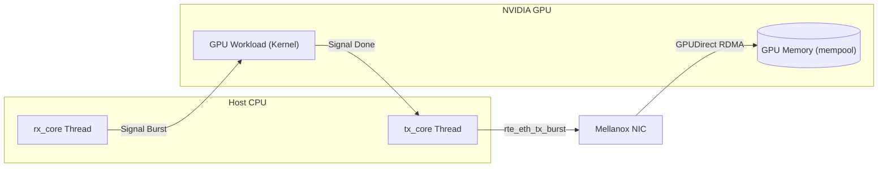
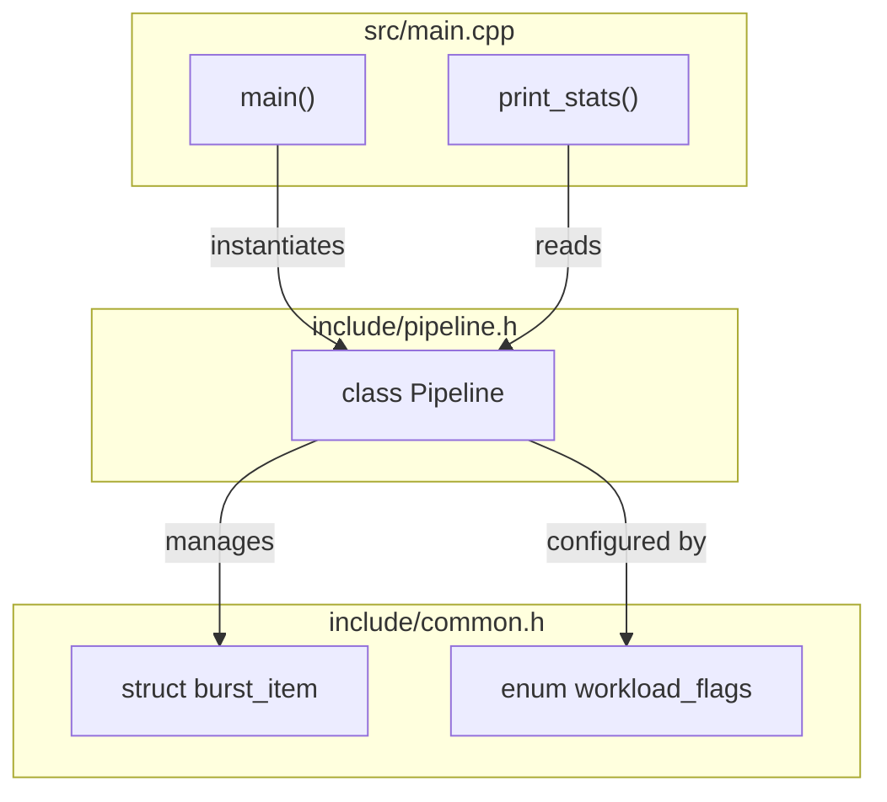

<!-- source: DeepWiki mcp.deepwiki.com · repo NVIDIA/l2fwd-nv · page 1 Overview · fetched 2026-11-11 -->

# Overview

Relevant source files

The following files were used as context for generating this wiki page:

- [README.md](README.md)
- [include/common.h](include/common.h)
- [src/main.cpp](src/main.cpp)

`l2fwd-nv` is a high-performance DPDK-based application designed to demonstrate the integration of NVIDIA GPUs into packet processing pipelines. It extends the classic DPDK `l2fwd` example by allowing packet payloads to be processed directly in GPU memory using GPUDirect RDMA [README.md:1-6]().

The project serves as a technical showcase for several technologies:
*   **DPDK `gpudev` Library**: For managing GPU memory and CPU-GPU synchronization [README.md:44-46]().
*   **GPUDirect RDMA**: Direct data path between Mellanox NICs and NVIDIA GPUs [README.md:114-115]().
*   **CUDA Workload Orchestration**: Multiple strategies for offloading packet processing to the GPU, including persistent kernels and CUDA Graphs [README.md:25-27]().

### System Data Flow
The application organizes data processing into "Pipelines." Each pipeline maps a dedicated DPDK RX queue to a dedicated GPU/CPU workload entity and a TX queue [README.md:8-11]().

**Pipeline Data Flow Overview**

Sources: [README.md:12-17](), [src/main.cpp:53-53]()

---

### Key Capabilities

`l2fwd-nv` provides flexible configuration for memory placement and processing logic, controlled via command-line arguments [src/main.cpp:38-51]().

| Feature | Description | Code Entities |
| :--- | :--- | :--- |
| **Memory Placement** | Mbuf payloads can be allocated in Host Pinned memory or Device (GPU) memory. | `MEM_HOST_PINNED`, `MEM_DEVMEM` [include/common.h:60-61]() |
| **Workload Modes** | Supports No-op, CPU-based MAC swap, and three distinct GPU execution strategies. | `workload_flags` [include/common.h:74-80]() |
| **Buffer Split** | Splits incoming packets: headers to CPU memory and payloads to GPU memory. | `conf_buffer_split`, `RTE_ETH_RX_OFFLOAD_BUFFER_SPLIT` [src/main.cpp:36-66]() |
| **Telemetry** | Real-time tracking of RX/TX packets per queue and throughput (PPS). | `pipeline_v[i]->rx_pkts`, `print_stats()` [src/main.cpp:96-157]() |

For a complete list of runtime options, see [Command-Line Interface and Runtime Options](#1.3).

---

### Major Subsystems

The codebase is structured around the interaction between DPDK EAL threads and CUDA streams.

#### 1. Pipeline and Threading Model
The application initializes a vector of `Pipeline` objects [src/main.cpp:53](). Each pipeline launches two CPU threads: an `rx_core` to accumulate packets into `burst_item` structures and a `tx_core` to monitor for workload completion [README.md:8-11]().
*   **For details, see [Project Purpose and Architecture](#1.1).**

#### 2. GPU Workload Engine
Workloads are implemented in CUDA and managed through the `Pipeline` class. The engine supports standard per-burst launches, persistent kernels that poll for work, and CUDA Graphs for reduced launch overhead [README.md:25-27]().
*   **For details, see [Core Architecture](#2).**

#### 3. Memory and Communication
The application uses `rte_gpu_comm_list` to create a shared status ring between the CPU and GPU. This allows the GPU kernel to signal completion without expensive interrupts or CPU-side polling of GPU registers [include/common.h:39-42]().
*   **For details, see [Memory Management and GPU Communication](#2.3).**

**System Entity Mapping**

Sources: [src/main.cpp:53-53](), [include/pipeline.h:1-1](), [include/common.h:85-93]()

---

### Getting Started

To run `l2fwd-nv`, the system must be configured with specific kernel parameters (hugepages, CPU isolation) and the `gdrdrv` kernel module must be loaded [README.md:55-58](), [README.md:153-158]().

*   **Build Requirements**: CUDA Toolkit, Mellanox OFED, Meson/Ninja, and CMake [README.md:100-147]().
*   **Step-by-step Guide**: See [Getting Started: Build and System Setup](#1.2).

---

