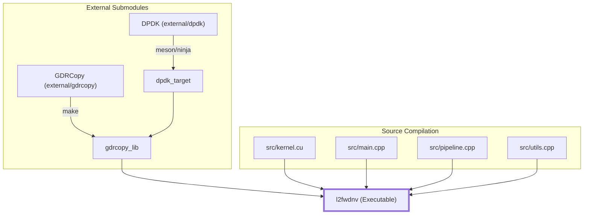
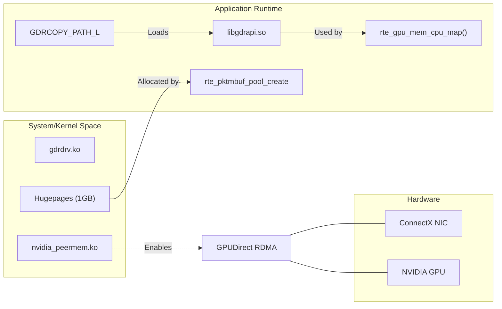

<!-- source: DeepWiki mcp.deepwiki.com · repo NVIDIA/l2fwd-nv · page 1.2 Getting Started: Build and System Setup · fetched 2026-11-11 -->

# Getting Started: Build and System Setup

<details>
<summary>Relevant source files</summary>

The following files were used as context for generating this wiki page:

- [.gitmodules](.gitmodules)
- [CMakeLists.txt](CMakeLists.txt)
- [README.md](README.md)

</details>


This page provides a comprehensive technical guide for setting up the environment, configuring the system kernel, and building the `l2fwd-nv` application. The application relies on a tightly coupled integration between DPDK, NVIDIA GPUs, and Mellanox NICs to demonstrate high-performance GPUDirect RDMA packet processing.

## Prerequisites and System Requirements

Before building the application, the system must meet specific hardware and software requirements to support the high-speed data path between the NIC and the GPU.

### Software Dependencies
*   **CUDA Toolkit**: Version 11.4 or newer is recommended for the `nvidia_peermem` module [README.md:100-119]().
*   **Mellanox OFED**: Version 5.4 or newer [README.md:91-91]().
*   **Build Tools**: 
    *   `meson` (> 0.49.2) and `ninja-build` [README.md:104-107]().
    *   `cmake` (>= 3.10) [CMakeLists.txt:15-15]().
    *   `pkg-config` for DPDK dependency resolution [CMakeLists.txt:126-131]().

### Hardware Configuration (NIC)
The Mellanox network card requires specific firmware settings to optimize for small packet throughput and GPU interaction:
1.  **CQE Compression**: Must be enabled using `mlxconfig -d <NIC> set CQE_COMPRESSION=1` [README.md:92-92]().
2.  **Link Type**: For VPI adapters, ensure the link type is set to Ethernet: `LINK_TYPE_P1=2` [README.md:95-95]().

**Sources:** [README.md:91-119](), [CMakeLists.txt:15-131]()

---

## Kernel Configuration

To achieve deterministic performance and allow DPDK to manage memory and CPU cores effectively, specific kernel parameters must be set.

### Boot Parameters
The following parameters should be added to `GRUB_CMDLINE_LINUX_DEFAULT` in `/etc/default/grub` [README.md:55-62]():

| Parameter | Purpose |
| :--- | :--- |
| `default_hugepagesz=1G` | Sets the default hugepage size to 1GB for DPDK mempools [README.md:57-57](). |
| `hugepages=16` | Reserves 16 hugepages (16GB total) [README.md:57-57](). |
| `isolcpus=2-21` | Isolates CPUs from the Linux scheduler for DPDK RX/TX threads [README.md:57-60](). |
| `nohz_full=2-21` | Reduces timer interrupts on isolated cores [README.md:57-57](). |
| `iommu=off` | Disables IOMMU to simplify GPUDirect RDMA memory mapping [README.md:57-57](). |
| `idle=poll` | Forces CPUs to stay in high-power states for low latency [README.md:57-57](). |

### GPUDirect RDMA Kernel Modules
Communication between the NIC and GPU requires a peer-memory module:
*   **Modern Systems (CUDA 11.4+):** Load the official NVIDIA module: `sudo modprobe nvidia_peermem` [README.md:118-122]().
*   **Legacy Systems:** Build and install the `nv_peer_memory` module manually [README.md:127-134]().

**Sources:** [README.md:55-85](), [README.md:114-134]()

---

## Build Process

The `l2fwd-nv` project uses CMake to manage a complex build that includes two submodules: DPDK and GDRCopy.

### 1. Cloning the Repository
The submodules must be initialized during cloning to ensure the specific versions of DPDK (22.03) and GDRCopy are available [README.md:38-51](), [.gitmodules:1-6]().

```bash
git clone --recurse-submodules https://github.com/NVIDIA/l2fwd-nv.git
cd l2fwd-nv
```

### 2. Compilation Flow
The `CMakeLists.txt` file defines a strict dependency chain to ensure DPDK is patched and built before the main application.

#### Build Pipeline Diagram
"This diagram illustrates how the CMake build system orchestrates the compilation of submodules and the final executable."



### 3. Build Commands
```bash
mkdir build && cd build
cmake ..
make -j$(nproc)
```

### Key Build Logic in CMake
*   **DPDK Patching**: The build system automatically uses `sed` to set `RTE_PKTMBUF_HEADROOM` to `0` in `config/rte_config.h`. This is critical for GPU memory performance [CMakeLists.txt:110-113]().
*   **Experimental APIs**: The flag `ALLOW_EXPERIMENTAL_API` is defined to enable the `gpudev` library features [CMakeLists.txt:23-23]().
*   **Driver Filtering**: To speed up compilation, the build system disables unnecessary DPDK drivers, focusing on `mlx5` [CMakeLists.txt:62-97]().
*   **NVCC Flag Wrapping**: Since `nvcc` is used for `src/kernel.cu`, DPDK's CFLAGS are wrapped using `-Xcompiler` to ensure compatibility [CMakeLists.txt:175-201]().

**Sources:** [CMakeLists.txt:15-208](), [README.md:136-148](), [.gitmodules:1-6]()

---

## Post-Build: GDRCopy and Runtime Setup

`l2fwd-nv` uses GDRCopy (via the DPDK `gpudev` abstraction) to map GPU memory into the CPU's address space for control-plane synchronization.

### 1. Loading the gdrdrv Module
The GDRCopy kernel driver must be loaded manually after the build [README.md:153-158]():
```bash
cd external/gdrcopy
sudo ./insmod.sh
```

### 2. Environment Variables
At runtime, the application needs to locate the GDRCopy shared library. You must set `GDRCOPY_PATH_L` to the directory containing `libgdrapi.so` [README.md:160-163]():
```bash
export GDRCOPY_PATH_L=$(pwd)/external/gdrcopy/src
```

### System Component Association
"This diagram bridges the system-level components and environment variables to the internal DPDK and GPU entities."



**Sources:** [README.md:149-163](), [CMakeLists.txt:137-145]()

---

