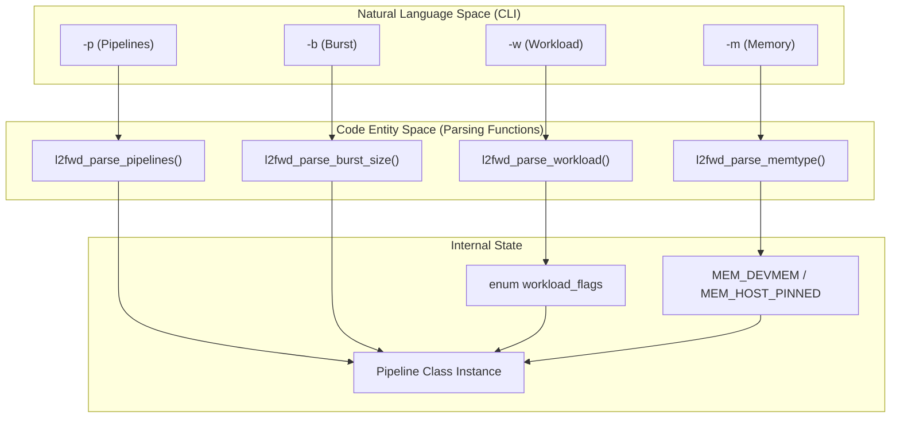
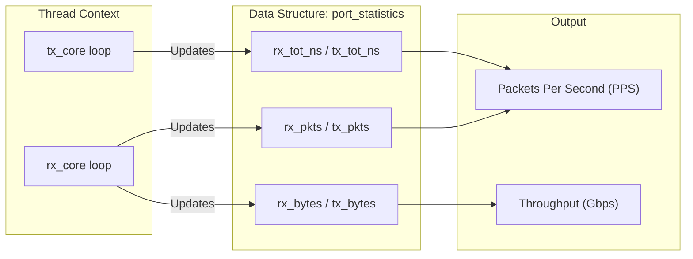

<!-- source: DeepWiki mcp.deepwiki.com · repo NVIDIA/l2fwd-nv · page 1.3 Command-Line Interface and Runtime Options · fetched 2026-11-11 -->

# Command-Line Interface and Runtime Options

<details>
<summary>Relevant source files</summary>

The following files were used as context for generating this wiki page:

- [README.md](README.md)
- [include/headers.h](include/headers.h)
- [src/utils.cpp](src/utils.cpp)

</details>


This page provides a comprehensive reference for the `l2fwd-nv` command-line interface (CLI). It describes the available flags, their valid ranges, internal mapping to configuration variables, and example invocations for various benchmarking scenarios.

## 1. Overview
The `l2fwd-nv` application uses a standard DPDK-style CLI where configuration is split into two parts:
1.  **EAL Options**: Handled by the DPDK Environmental Abstraction Layer (e.g., `-l` for cores, `-a` for device allow-listing).
2.  **Application Options**: Custom flags specific to `l2fwd-nv` provided after the `--` separator.

The application uses `getopt` to parse these custom flags in the main execution loop, mapping them to global configuration variables that dictate memory allocation, workload types, and pipeline counts.

## 2. CLI Flag Reference

The following table details the application-specific flags available after the `--` separator.

| Flag | Description | Valid Range | Default | Internal Variable |
| :--- | :--- | :--- | :--- | :--- |
| `-b` | **Burst Size**: Number of packets to accumulate before triggering a workload. | 1 to `DEFAULT_PKT_BURST_INPUT` (2048) | 64 | `pkt_burst_size` |
| `-d` | **Data Room Size**: Size of the mbuf payload. | 1 to `DEFAULT_MBUF_DATAROOM` (2048) | 2048 | `mbuf_dataroom_size` |
| `-g` | **GPU Device ID**: The ID of the GPU to use for processing. | 0 to N-1 | 0 | `gpu_id` |
| `-m` | **Mempool Type**: Location of mbuf payloads. 0: Host Pinned, 1: GPU Device Memory. | 0, 1 | 0 | `mempool_type` |
| `-n` | **NVTX Profiler**: Enable NVTX markers for profiling with NVIDIA Nsight/nvvp. | N/A (Boolean) | Disabled | `enable_nvtx` |
| `-p` | **Pipelines**: Number of parallel RX-Workload-TX pipelines. | 1 to `MAX_PIPELINES` (1024) | 1 | `num_pipelines` |
| `-s` | **Buffer Split**: Enable DPDK buffer split (64B CPU header, rest in GPU). | N/A (Boolean) | Disabled | `buffer_split` |
| `-t` | **Workload Time**: Simulated processing time per packet in nanoseconds. | 0 to `MAX_WTIME_NS` (10^9) | 0 | `workload_time_ns` |
| `-v` | **Performance Packets**: Total packets to process before exit. 0 for infinite. | 0 to INT_MAX | 0 | `exit_packet_num` |
| `-w` | **Workload Type**: The execution strategy for MAC swapping. | 0-4 (See Workload Modes) | 0 | `workload_type` |
| `-z` | **Warmup Packets**: Number of packets to process before starting metrics. | 0 to INT_MAX | 0 | `warmup_packet_num` |

### Workload Modes (`-w`)
The `-w` flag selects the processing engine defined in the `workload_flags` enum:
*   **0**: `NO_WORKLOAD` - Simple I/O forwarding. [src/utils.cpp:224]()
*   **1**: `CPU_WORKLOAD` - MAC swap performed on CPU cores. [src/utils.cpp:216]()
*   **2**: `GPU_WORKLOAD` - Standard per-burst CUDA kernel launch. [src/utils.cpp:218]()
*   **3**: `GPU_PK_WORKLOAD` - Persistent CUDA kernel (polls for work). [src/utils.cpp:220]()
*   **4**: `GPU_GRAPHS_WORKLOAD` - CUDA Graphs-based execution. [src/utils.cpp:222]()

Sources: [src/utils.cpp:105-120](), [src/utils.cpp:147-256](), [include/headers.h:118-129]()

## 3. Implementation and Data Flow

The CLI parsing logic resides in `src/utils.cpp`. These functions validate input against constraints defined in `include/common.h`.

### CLI to Configuration Mapping
The diagram below illustrates how CLI arguments are transformed into the internal `Pipeline` configuration.

**Title: CLI Configuration Flow**

Sources: [src/utils.cpp:160-240](), [include/pipeline.h:50-100]()

### Logic Validation
The parsing functions ensure the system remains in a stable state:
*   **`l2fwd_parse_burst_size`**: Validates that the burst does not exceed `DEFAULT_PKT_BURST_INPUT` (2048) to prevent ring buffer overflows. [src/utils.cpp:147-158]()
*   **`l2fwd_parse_workload`**: Maps integer inputs to the `workload_flags` enum, ensuring the `Pipeline` constructor selects the correct CUDA path. [src/utils.cpp:206-225]()
*   **`l2fwd_parse_warmup_packets`**: If packets are specified but below `DRIVER_MIN_RX_PKTS`, it rounds up to ensure NIC driver stability. [src/utils.cpp:176-189]()

Sources: [src/utils.cpp:147-256]()

## 4. Execution Examples

### GPU Direct RDMA (High Performance)
To run with packets stored in GPU memory using a persistent kernel for minimum latency:
```bash
./build/l2fwdnv -l 1,2,3 -a 0000:01:00.0 -- -p 1 -m 1 -w 3 -b 1024
```
*   `-m 1`: Use `MEM_DEVMEM`.
*   `-w 3`: Use `GPU_PK_WORKLOAD` (Persistent Kernel).

### Simulated Heavy Workload
To simulate a compute-intensive task (10 microseconds per packet) using CUDA Graphs:
```bash
./build/l2fwdnv -l 1-10 -- -p 4 -w 4 -t 10000 -v 10000000
```
*   `-t 10000`: 10,000ns per packet.
*   `-v 10000000`: Exit after 10M packets.

### Buffer Split Mode
To split incoming packets (64B header to CPU, payload to GPU):
```bash
./build/l2fwdnv -l 1,2,3 -- -s -m 1 -w 2
```
*   `-s`: Enables `buffer_split` in the NIC configuration.

Sources: [README.md:164-200]()

## 5. Statistics and Telemetry
The application tracks performance through the `port_statistics` structure.

**Title: Telemetry Data Flow**

Sources: [include/headers.h:82-95](), [README.md:200-250]()

*   **Warmup Phase**: Packets received during the warmup phase (configured by `-z`) are tracked in `rx_warmup_bytes` and excluded from final PPS calculations. [include/headers.h:91]()
*   **Latency**: The `tx_tot_ns` and `rx_tot_ns` fields track the time packets spend in the pipeline for average latency reporting. [include/headers.h:86,92]()

Sources: [include/headers.h:82-95]()

---

