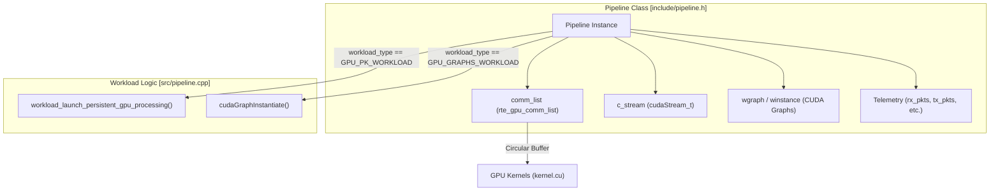
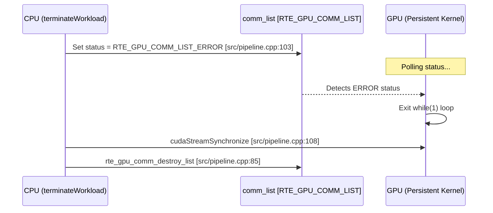

<!-- source: DeepWiki mcp.deepwiki.com · repo NVIDIA/l2fwd-nv · page 2.1 Pipeline Abstraction · fetched 2026-11-11 -->

# Pipeline Abstraction

Relevant source files

The following files were used as context for generating this wiki page:

- [include/common.h](include/common.h)
- [include/pipeline.h](include/pipeline.h)
- [src/pipeline.cpp](src/pipeline.cpp)

The `Pipeline` class serves as the central management entity for a single data path in `l2fwd-nv`. It encapsulates the lifecycle of CPU-GPU communication structures, CUDA streams, workload-specific kernel launches (Standard, Persistent, or Graphs), and high-resolution telemetry for performance monitoring.

### Pipeline Initialization

The `Pipeline` constructor [src/pipeline.cpp:19-32]() initializes the execution context for a specific GPU and workload type. It maps a specific RX queue and TX queue to a GPU device and prepares the communication layer.

#### CUDA Stream and Communication List
Each pipeline creates a dedicated `rte_gpu_comm_list` using `rte_gpu_comm_create_list` [src/pipeline.cpp:33](). This list acts as a circular buffer of `MAX_BURSTS_X_QUEUE` items (defined as 4096 in [include/common.h:35]()) used to synchronize packet metadata between the CPU and GPU.

If the workload type involves the GPU (i.e., `workload_type >= GPU_WORKLOAD`), a non-blocking CUDA stream `c_stream` is created [src/pipeline.cpp:49-50]().

#### Constructor Parameters
| Parameter | Description |
| :--- | :--- |
| `_index` | Unique identifier for the pipeline instance. |
| `_workload_type` | Selected mode from `enum workload_flags` [include/common.h:74-80](). |
| `_pkt_time_ns` | Simulated processing time per packet in nanoseconds. |
| `_rx_queue` / `_tx_queue` | DPDK queue indices assigned to this pipeline. |
| `_gpu_id` | Identifier of the GPU device to be used. |

**Sources:** [src/pipeline.cpp:19-50](), [include/pipeline.h:62-76](), [include/common.h:35,74-80]()

---

### Workload Branching Logic

The `Pipeline` class implements different kernel management strategies based on the `workload_type`.

#### 1. GPU_WORKLOAD (Standard)
In this mode, no persistent kernel is launched at initialization. Instead, the RX core triggers individual kernel launches for every burst.

#### 2. GPU_PK_WORKLOAD (Persistent Kernel)
The constructor calls `workload_launch_persistent_gpu_processing` [src/pipeline.cpp:60-61](). This launches a single long-running kernel that polls the `comm_list` for new work, reducing the overhead of frequent `cudaLaunchKernel` calls.

#### 3. GPU_GRAPHS_WORKLOAD (CUDA Graphs)
This mode captures a sequence of kernel launches into executable graphs to minimize driver overhead [src/pipeline.cpp:66-76]().
- It captures `N_GRAPHS` [include/common.h:37]().
- Each graph contains `GRAPH_BURST` (8) individual burst processing nodes [include/common.h:36]().
- Graphs are recorded via `cudaStreamBeginCapture` and instantiated into `winstance[]` [src/pipeline.cpp:70-74]().

#### Data Flow and Entity Mapping
The following diagram illustrates how the `Pipeline` class orchestrates these components.

"Pipeline Entity Relationship"

**Sources:** [src/pipeline.cpp:55-77](), [include/pipeline.h:75-79](), [include/common.h:36-37]()

---

### Telemetry and Statistics

The `Pipeline` class maintains per-pipeline counters and high-resolution timestamps to track throughput and latency [include/pipeline.h:89-98]().

| Field | Description |
| :--- | :--- |
| `rx_pkts` / `tx_pkts` | Total packets received/transmitted by this pipeline. |
| `rx_bytes` / `tx_bytes` | Total bytes processed. |
| `start_rx_core` / `stop_rx_core` | `std::chrono` timestamps for the start and end of the RX loop. |
| `start_tx_core` / `stop_tx_core` | `std::chrono` timestamps for the start and end of the TX loop. |

Timing utilities are provided by the `Time` helper class [include/pipeline.h:30-59](), which uses `std::chrono::system_clock` to provide nanosecond precision (`nowNs()`).

**Sources:** [include/pipeline.h:30-59, 89-98](), [src/pipeline.cpp:39-46]()

---

### Shutdown Sequence

The shutdown process ensures that GPU kernels are gracefully terminated before the application exits.

#### terminateWorkload()
For persistent workloads (`GPU_PK_WORKLOAD` or `GPU_GRAPHS_WORKLOAD`), the `terminateWorkload()` function [src/pipeline.cpp:98-110]() performs the following:
1. Iterates through the entire `comm_list`.
2. Sets the status of every item to `RTE_GPU_COMM_LIST_ERROR` [src/pipeline.cpp:103]().
3. The GPU-side persistent kernel detects this error state in its polling loop and exits.
4. Calls `cudaStreamSynchronize(c_stream)` [src/pipeline.cpp:108]() to ensure the GPU has finished cleanup.

#### Destructor
The destructor [src/pipeline.cpp:80-96]() handles resource deallocation:
- Destroys the CUDA stream via `cudaStreamDestroy` [src/pipeline.cpp:83]().
- Releases the communication list via `rte_gpu_comm_destroy_list` [src/pipeline.cpp:85]().
- Destroys CUDA Graphs (`wgraph`) if they were initialized [src/pipeline.cpp:91]().

#### Shutdown Logic Flow
"Termination Sequence"

**Sources:** [src/pipeline.cpp:80-110](), [include/common.h:42]()

---

