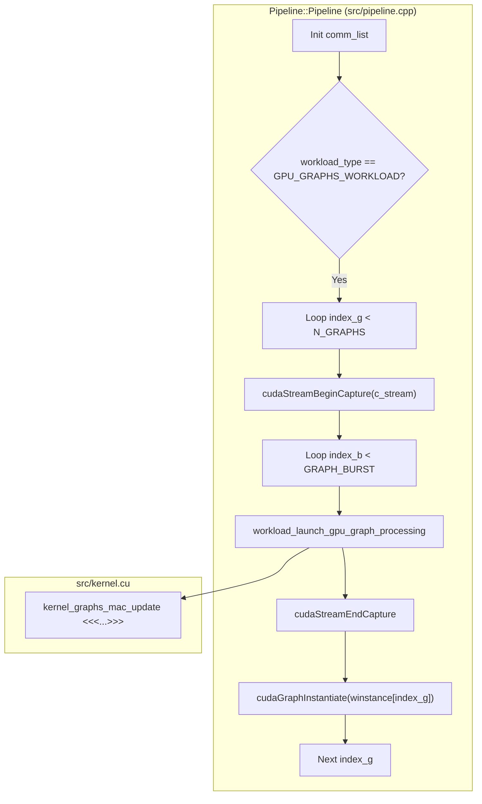
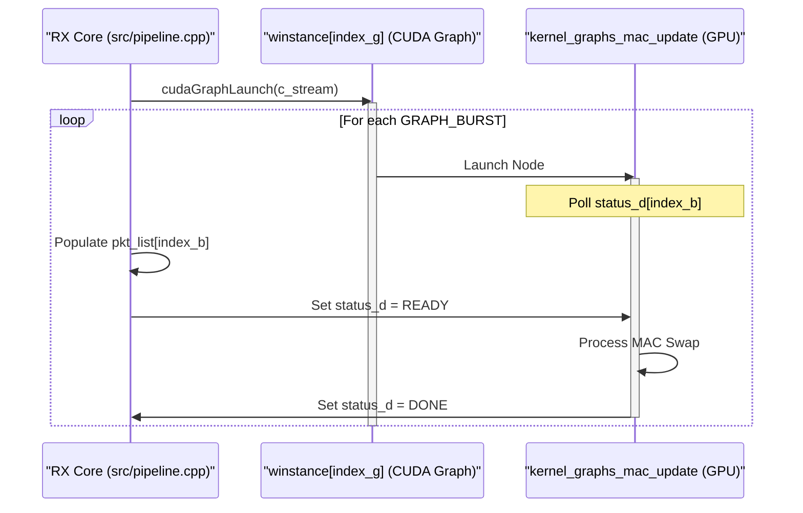

<!-- source: DeepWiki mcp.deepwiki.com · repo NVIDIA/l2fwd-nv · page 3.3 CUDA Graphs Strategy · fetched 2026-11-11 -->

# CUDA Graphs Strategy

Relevant source files

The following files were used as context for generating this wiki page:

- [include/common.h](include/common.h)
- [src/kernel.cu](src/kernel.cu)
- [src/pipeline.cpp](src/pipeline.cpp)

The CUDA Graphs strategy is an optimized execution model designed to reduce CPU-side overhead associated with frequent kernel launches. By capturing a sequence of operations into a graph object, the application can instantiate and execute complex workload patterns with a single `cudaGraphLaunch` call. In `l2fwd-nv`, this strategy utilizes a hybrid approach where the graph contains kernels that internally poll for data readiness, combining the low-overhead benefits of Graphs with the responsiveness of persistent polling.

### Pipeline Initialization and Graph Capture

The `Pipeline` constructor [src/pipeline.cpp:19-32]() handles the creation and recording of CUDA Graphs when the `GPU_GRAPHS_WORKLOAD` flag is set. To balance responsiveness and resource management, the system divides the total `MAX_BURSTS_X_QUEUE` into `N_GRAPHS` separate graph instances [include/common.h:35-37]().

1.  **Stream Capture**: The constructor iterates through `N_GRAPHS`, calling `cudaStreamBeginCapture` [src/pipeline.cpp:70]() to record operations on the pipeline's CUDA stream (`c_stream`).
2.  **Node Recording**: For each graph, it records `GRAPH_BURST` (default 8) calls to `workload_launch_gpu_graph_processing` [src/pipeline.cpp:71-72](). Each call targets a specific item in the `comm_list`.
3.  **Instantiation**: Once captured via `cudaStreamEndCapture`, the graph is instantiated into an executable instance (`winstance[index_g]`) using `cudaGraphInstantiate` [src/pipeline.cpp:73-74]().

#### Graph Initialization Flow
The following diagram illustrates how the `Pipeline` class prepares the graph infrastructure.

Title: Pipeline Graph Construction

Sources: [src/pipeline.cpp:66-76](), [include/common.h:35-37](), [src/kernel.cu:213-225]()

### Hybrid Kernel Implementation

The kernel used within the graphs, `kernel_graphs_mac_update`, is a hybrid between a standard per-burst kernel and a persistent kernel. Unlike a standard kernel that assumes data is ready upon launch, this kernel performs internal polling on the `status_d` flag of its assigned `rte_gpu_comm_list` item.

*   **Polling Loop**: Thread 0 in the block enters a `while` loop, checking if `status_d` has transitioned away from `RTE_GPU_COMM_LIST_FREE` [src/kernel.cu:231-240]().
*   **Status Propagation**: The status is shared with other threads in the block via `__shared__ uint32_t wait_status_shared` [src/kernel.cu:224-243]().
*   **Workload Execution**: If the status is `RTE_GPU_COMM_LIST_READY`, the kernel performs the MAC address swap logic and simulates processing time using `__globaltimer()` [src/kernel.cu:248-285]().
*   **Completion**: Upon finishing, it sets the status to `RTE_GPU_COMM_LIST_DONE` and signals the CPU [src/kernel.cu:291-294]().
*   **Termination**: If the status is `RTE_GPU_COMM_LIST_ERROR`, the kernel exits, allowing the graph to complete and the pipeline to shut down [src/kernel.cu:245-246]().

| Parameter | Value | Description |
| :--- | :--- | :--- |
| `GRAPH_BURST` | 8 | Number of bursts (comm_list items) per graph instance |
| `N_GRAPHS` | 512 | Total number of graph instances (`MAX_BURSTS_X_QUEUE / GRAPH_BURST`) |
| `MAC_THREADS_BLOCK` | 256 | Threads per block for MAC update kernel |

Sources: [src/kernel.cu:213-298](), [include/common.h:30-37]()

### Execution and Replay

During the runtime loop (typically within the RX/TX core logic, though managed by the pipeline's workload state), the system replays the pre-instantiated graphs.

The replay mechanism uses `cudaGraphLaunch(winstance[index_g], c_stream)`. Because the kernels within the graph poll for data, the CPU can launch a graph covering multiple future bursts ahead of time. This effectively masks the kernel launch latency behind the GPU's internal polling and the NIC's DMA transfer time.

#### Data Flow: CPU Signaling to GPU Graph
This diagram shows the interaction between the CPU-side `comm_list` management and the GPU-side graph execution.

Title: CUDA Graph Runtime Execution

Sources: [src/pipeline.cpp:66-76](), [src/kernel.cu:228-246](), [src/kernel.cu:291-294]()

### Termination Sequence

To safely stop the CUDA Graphs workload, the `terminateWorkload()` function triggers an exit condition across all possible graph nodes.

1.  The function iterates through the entire `comm_list` (size `MAX_BURSTS_X_QUEUE`) [src/pipeline.cpp:102]().
2.  It calls `rte_gpu_comm_set_status` to set every item to `RTE_GPU_COMM_LIST_ERROR` [src/pipeline.cpp:103]().
3.  The `kernel_graphs_mac_update` instances, which are polling their respective `status_d` flags, detect the `ERROR` state and break their internal loops [src/kernel.cu:245-246]().
4.  The CPU calls `cudaStreamSynchronize(c_stream)` to ensure all graph instances have finished execution before destroying resources [src/pipeline.cpp:108]().

Sources: [src/pipeline.cpp:98-110](), [src/kernel.cu:245-246]()

---

