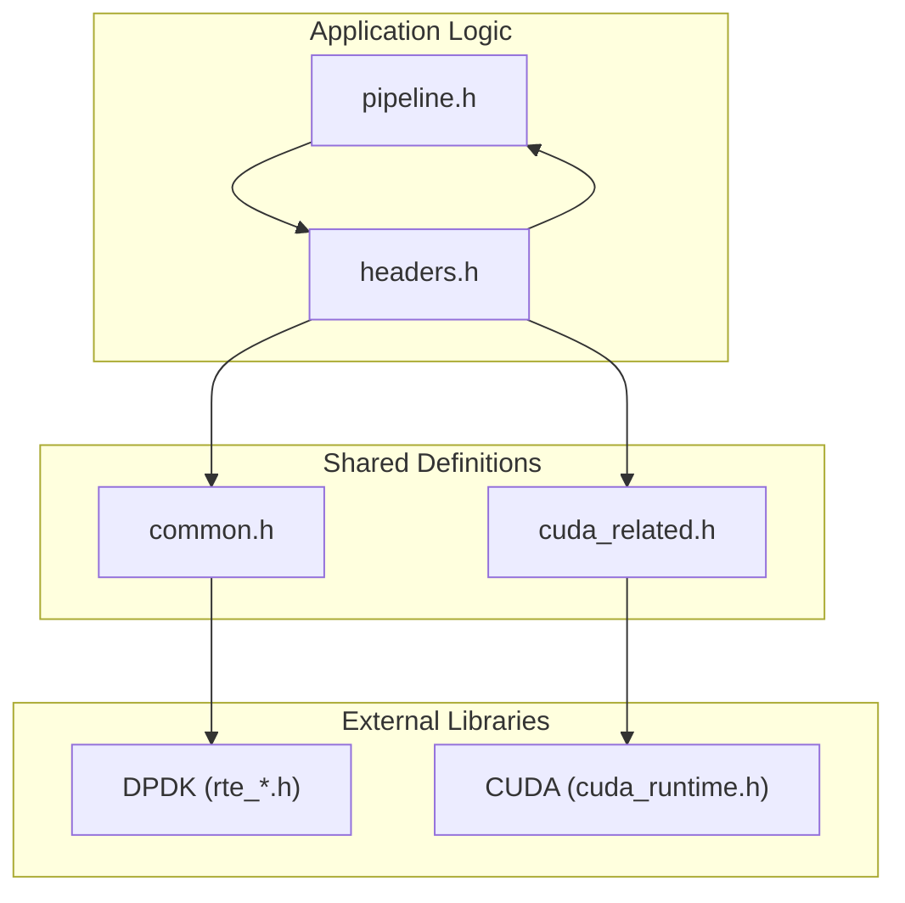
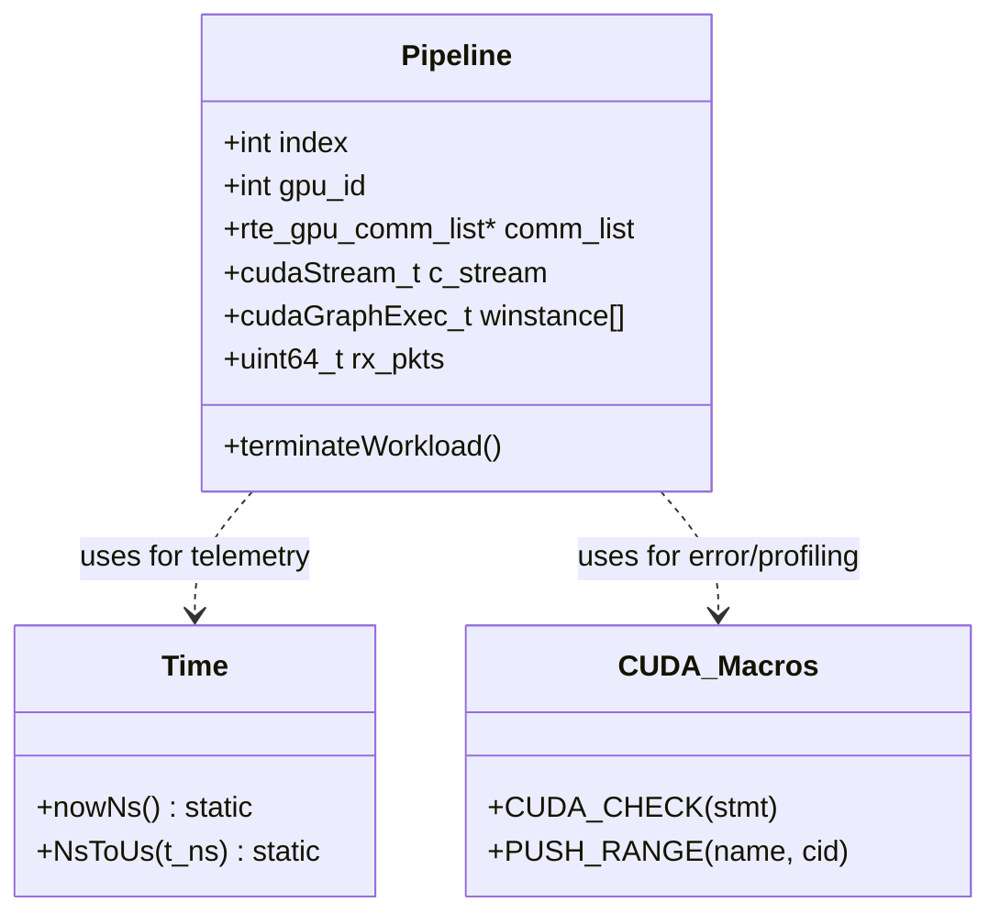

<!-- source: DeepWiki mcp.deepwiki.com · repo NVIDIA/l2fwd-nv · page 4 Header Files and Shared Definitions · fetched 2026-11-11 -->

# Header Files and Shared Definitions

Relevant source files

The following files were used as context for generating this wiki page:

- [include/common.h](include/common.h)
- [include/cuda_related.h](include/cuda_related.h)
- [include/headers.h](include/headers.h)
- [include/pipeline.h](include/pipeline.h)

This section provides an overview of the `include/` directory, which contains the foundational definitions, constants, and abstractions used across the **l2fwd-nv** application. The headers are organized to separate DPDK-specific logic, CUDA utilities, and high-level C++ pipeline management.

### Overview of Header Layering

The codebase uses a layered include strategy to manage dependencies between DPDK, CUDA, and the application logic. `include/headers.h` serves as the primary aggregator for the project.

**Header Hierarchy and Dependencies**

*Sources: [include/headers.h:75-77](), [include/pipeline.h:20](), [include/common.h:20](), [include/cuda_related.h:20-23]()*

---

### [common.h — Constants and Data Structures](#4.1)

The `include/common.h` file defines the core compile-time constants that dictate the behavior of the network pipeline and GPU workloads. It contains critical values for:
*   **Burst Sizing:** Constants like `DEFAULT_PKT_BURST` (32) and `MAX_MBUFS_BURST` (1024) [include/common.h:26-34]().
*   **Memory Management:** GPU page size definitions (`GPU_PAGE_SIZE`) and memory type enums (`MEM_DEVMEM`, `MEM_HOST_PINNED`) [include/common.h:60-66]().
*   **Workload Flags:** The `workload_flags` enum which determines if processing occurs on the CPU or via specific GPU strategies (Standard, Persistent, or Graphs) [include/common.h:74-80]().
*   **Communication Structures:** The `burst_item` struct, used to track the lifecycle of a packet burst as it moves through the system [include/common.h:85-93]().

For details on these constants and the `burst_item` lifecycle, see [common.h — Constants and Data Structures](#4.1).

---

### [headers.h — Application-Wide Declarations](#4.2)

`include/headers.h` is the central header that pulls together standard C/C++ libraries, DPDK headers, and local project headers. It defines the global state tracking structures and function signatures for the CLI and workload launchers.

**Key Entities in headers.h**
| Entity | Description |
| :--- | :--- |
| `port_statistics` | A cache-aligned structure tracking per-queue TX/RX packets, bytes, and dropped counts [include/headers.h:82-95](). |
| **Workload Launchers** | Declarations for `workload_launch_gpu_processing`, `workload_launch_persistent_gpu_processing`, and others [include/headers.h:106-113](). |
| **CLI Parsers** | Signatures for functions that handle arguments like burst size, pipelines, and memory types [include/headers.h:120-129](). |

For details on the statistics tracking and global function signatures, see [headers.h — Application-Wide Declarations](#4.2).

---

### [pipeline.h and cuda_related.h — C++ and CUDA Abstractions](#4.3)

These headers provide the object-oriented and macro-based abstractions for managing the GPU-accelerated pipeline.

*   **`pipeline.h`**: Defines the `Pipeline` class, which encapsulates the state of a single processing thread, including its `rte_gpu_comm_list`, CUDA stream (`c_stream`), and telemetry data [include/pipeline.h:62-99](). It also includes the `Time` utility class for high-resolution nanosecond timing [include/pipeline.h:30-59]().
*   **`cuda_related.h`**: Provides essential CUDA error-checking macros (`CUDA_CHECK`, `CU_CHECK`) and NVTX instrumentation macros (`PUSH_RANGE`, `POP_RANGE`) for profiling with NVIDIA Nsight Systems [include/cuda_related.h:41-91]().

**Code Entity Association: Pipeline and CUDA State**

*Sources: [include/pipeline.h:30-99](), [include/cuda_related.h:41-80]()*

For details on the `Pipeline` class layout and CUDA utility macros, see [pipeline.h and cuda_related.h — C++ and CUDA Abstractions](#4.3).

---

