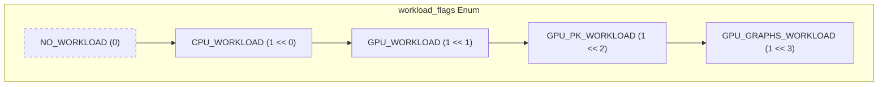
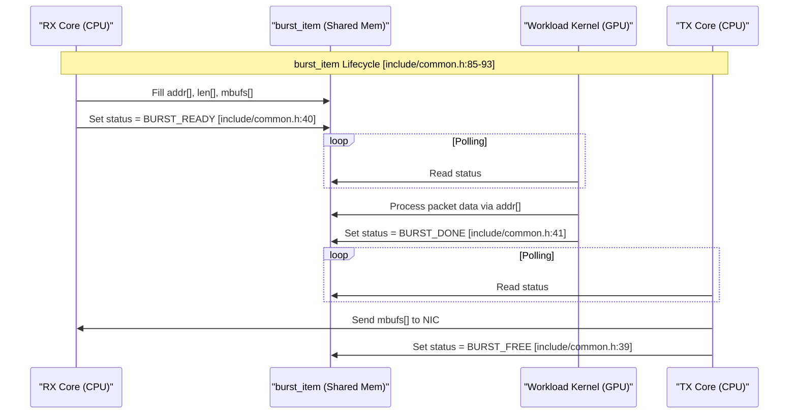

<!-- source: DeepWiki mcp.deepwiki.com · repo NVIDIA/l2fwd-nv · page 4.1 common.h — Constants and Data Structures · fetched 2026-11-11 -->

# common.h — Constants and Data Structures

Relevant source files

The following files were used as context for generating this wiki page:

- [include/common.h](include/common.h)

This page documents the compile-time constants, enumerations, and primary data structures defined in `include/common.h`. This header serves as the central configuration point for the `l2fwd-nv` application, defining hardware-specific parameters, pipeline limits, and the memory layout for CPU-GPU communication.

### Burst Sizing and Queue Depths

The application uses specific burst sizes to balance throughput and latency. While DPDK typically uses small bursts (e.g., 32), GPU processing often requires larger batches to saturate the parallel compute units.

| Constant | Value | Description |
| :--- | :--- | :--- |
| `DEFAULT_PKT_BURST` | 32 | Standard DPDK burst size for RX/TX operations [include/common.h:26-26](). |
| `DEFAULT_PKT_BURST_INPUT` | 8192 | Default total packets to accumulate before triggering a GPU workload [include/common.h:27-27](). |
| `MAX_MBUFS_BURST` | 1024 | Maximum packets allowed in a single `burst_item` [include/common.h:34-34](). |
| `RX_DESC_DEFAULT` | 1024 | Default number of RX ring descriptors [include/common.h:46-46](). |
| `TX_DESC_DEFAULT` | 1024 | Default number of TX ring descriptors [include/common.h:47-47](). |
| `MAX_BURSTS_X_QUEUE` | 4096 | Depth of the communication list (ring buffer) between CPU and GPU [include/common.h:35-35](). |

**Sources:** [include/common.h:26-47]()

### Pipeline and Core Limits

These constants define the scaling limits of the application, determining how many CPU cores and independent processing pipelines can be instantiated.

*   **`MAX_CORES` (16):** Maximum number of CPU cores the application can utilize [include/common.h:48-48]().
*   **`MAX_PIPELINES` (8):** Maximum number of concurrent pipelines (RX core + GPU + TX core) [include/common.h:49-49]().
*   **`MAX_RX_QUEUE_PER_LCORE` (8):** Limits the number of RX queues assigned to a single lcore [include/common.h:50-50]().

**Sources:** [include/common.h:48-51]()

### CUDA Launch Parameters

These constants control the execution configuration for GPU kernels, specifically the number of threads and blocks used during workload launches.

*   **Standard Kernel:** Uses `MAC_CUDA_BLOCKS` (1) and `MAC_THREADS_BLOCK` (256) [include/common.h:29-30]().
*   **Persistent Kernel:** Uses `PK_CUDA_BLOCKS` (1) and `PK_CUDA_THREADS` (1024). Note that `MAX_MBUFS_BURST` is tied to the persistent thread count [include/common.h:31-34]().
*   **CUDA Graphs:** Defines `GRAPH_BURST` (8) packets per graph node and calculates `N_GRAPHS` based on the queue depth [include/common.h:36-37]().

**Sources:** [include/common.h:29-37]()

### Memory and Alignment

The application supports different memory types and requires specific alignment for GPUDirect RDMA operations.

*   **Memory Types:** `MEM_DEVMEM` (1) for GPU-resident memory and `MEM_HOST_PINNED` (0) for CPU-resident memory registered with the GPU [include/common.h:60-61]().
*   **GPU Page Size:** Defined as 64KB (`1UL << 16`), which is standard for many NVIDIA GPU architectures to optimize TLB usage [include/common.h:65-68]().
*   **CPU Page Size:** Defined as 4KB [include/common.h:70-70]().
*   **Buffer Split:** `BUFFER_SPLIT_MP0` (60 bytes) defines the header split size when using DPDK buffer split features [include/common.h:57-58]().

**Sources:** [include/common.h:57-70]()

### Workload Flags

The `workload_flags` enum determines the processing logic applied to packets within the pipeline.

*Figure 4.1.1: Workload Type Bitmask*

**Sources:** [include/common.h:74-80]()

### The burst_item Structure

The `burst_item` is the fundamental unit of data exchange between the CPU (DPDK) and the GPU (CUDA). It contains metadata, packet pointers, and status information for a single burst of packets.

#### Structure Definition
[include/common.h:85-93]()
*   `status`: The lifecycle state of the burst (READY, DONE, etc.).
*   `addr[]`: Array of packet payload addresses (IOVA or Virtual).
*   `len[]`: Array of packet lengths.
*   `mbufs[]`: Pointers to the original `rte_mbuf` structures (used by CPU for TX/Freeing).
*   `num_mbufs`: Count of valid packets in this burst.

#### Lifecycle States
The `status` field transitions through specific integer constants to synchronize CPU and GPU access:

| Constant | Value | Description |
| :--- | :--- | :--- |
| `BURST_FREE` | 0 | Slot is empty; RX core can fill it [include/common.h:39-39](). |
| `BURST_READY` | 1 | RX core has filled the data; GPU can process [include/common.h:40-40](). |
| `BURST_DONE` | 2 | GPU has finished processing; TX core can transmit [include/common.h:41-41](). |
| `BURST_EXIT` | 3 | Signaling state to shut down persistent kernels [include/common.h:42-42](). |

#### Data Flow Diagram
The following diagram illustrates how the `burst_item` facilitates the movement of packet metadata across the system.

*Figure 4.1.2: burst_item Lifecycle and Data Flow*

**Sources:** [include/common.h:39-42](), [include/common.h:85-93]()

---

