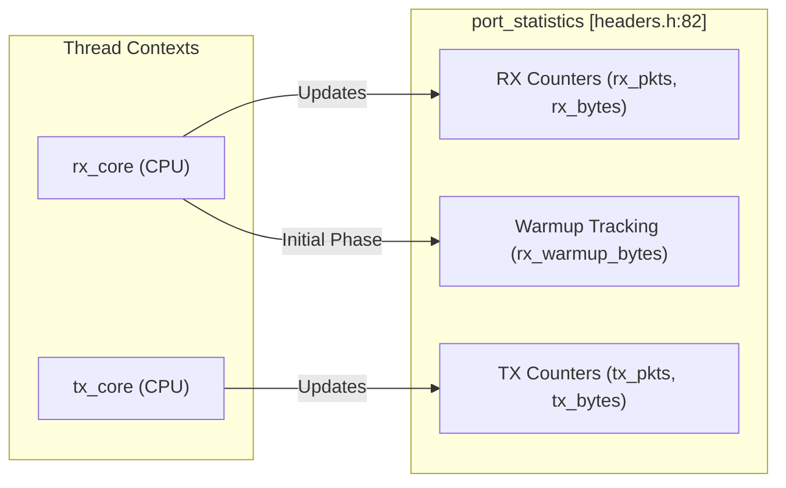
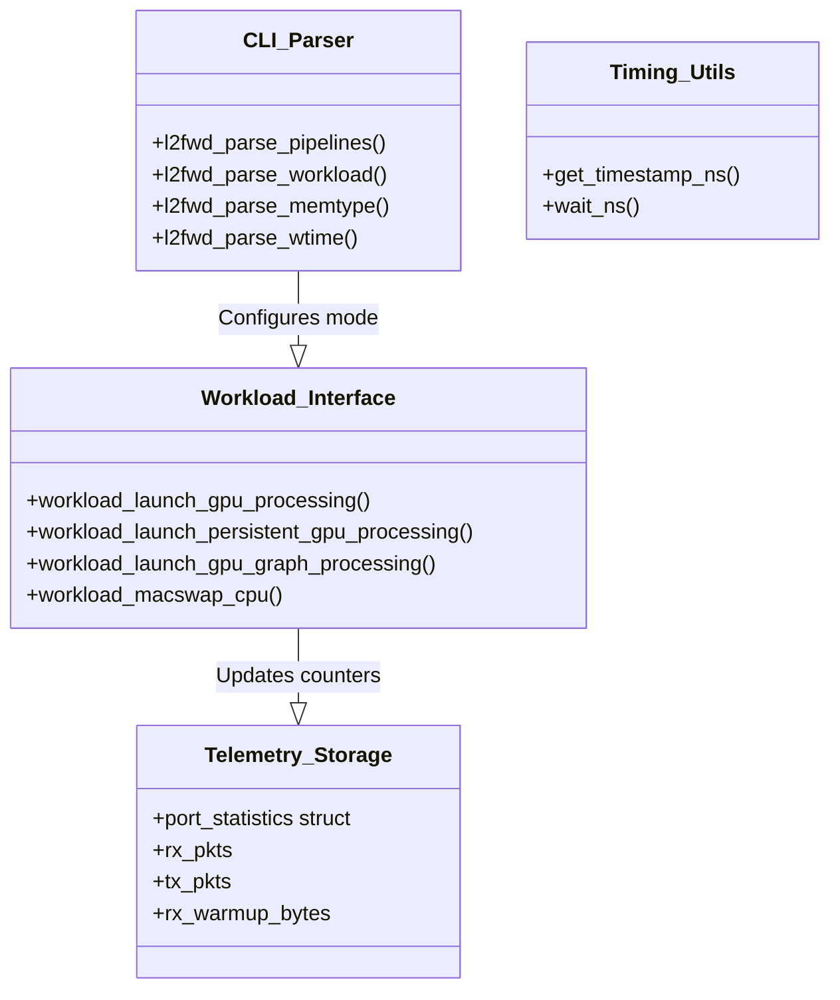

<!-- source: DeepWiki mcp.deepwiki.com · repo NVIDIA/l2fwd-nv · page 4.2 headers.h — Application-Wide Declarations · fetched 2026-11-11 -->

# headers.h — Application-Wide Declarations

Relevant source files

The following files were used as context for generating this wiki page:

- [include/headers.h](include/headers.h)

The `include/headers.h` file serves as the master include aggregator and central declaration hub for the `l2fwd-nv` application. It provides a unified interface for system-level C/C++ headers, DPDK libraries, and local project-specific modules, while defining the core statistics structures and function signatures used across the CPU and GPU boundaries.

## Master Include Aggregator

`headers.h` centralizes all dependencies to ensure consistent compilation across the various modules (RX, TX, and Workload).

### Header Layers
1.  **Generic Headers**: Standard C/C++ libraries for I/O, networking, and threading (e.g., `<stdio.h>`, `<pthread.h>`, `<vector>`) [include/headers.h:23-43]().
2.  **DPDK Headers**: Essential DPDK libraries including `rte_eal.h` for the environment abstraction, `rte_ethdev.h` for NIC interaction, and `rte_gpudev.h` for GPU integration [include/headers.h:47-71]().
3.  **Local Headers**: Project-specific definitions including `cuda_related.h` (error handling), `common.h` (constants), and `pipeline.h` (class definitions) [include/headers.h:75-77]().

Sources: [include/headers.h:20-78]()

---

## The `port_statistics` Structure

The `port_statistics` struct is a critical data structure used for telemetry and performance monitoring. It is marked with `__rte_cache_aligned` to prevent false sharing between CPU cores during high-frequency updates [include/headers.h:95-95]().

### Structure Fields
| Field | Type | Description |
| :--- | :--- | :--- |
| `tx_pkts` | `uint64_t[]` | Count of packets successfully transmitted per queue [include/headers.h:83-83](). |
| `tx_brst` | `uint64_t[]` | Count of transmit bursts (calls to TX functions) [include/headers.h:84-84](). |
| `rx_pkts` | `uint64_t[]` | Count of packets received per queue [include/headers.h:88-88](). |
| `rx_warmup_bytes` | `uint64_t[]` | Bytes received during the "warmup" phase (excluded from performance metrics) [include/headers.h:91-91](). |
| `rx_tot_ns` | `uint64_t[]` | Total nanoseconds spent in RX processing for latency calculation [include/headers.h:92-92](). |
| `dropped` | `uint64_t[]` | Count of packets dropped due to ring overflows or errors [include/headers.h:94-94](). |

### Data Flow: Statistics Collection
The following diagram illustrates how the `port_statistics` struct aggregates data from the pipeline threads.

**Telemetry Aggregation Flow**

Sources: [include/headers.h:82-95]()

---

## Function Declarations

`headers.h` defines the interface for the three primary subsystems: Workload Engines, CLI Parsing, and Timing Utilities.

### Workload Engine Launchers
These functions bridge the Pipeline management logic with the specific GPU or CPU execution strategies:
*   `workload_macswap_cpu`: Executes MAC address swapping on the CPU [include/headers.h:104-104]().
*   `workload_launch_gpu_processing`: Standard per-burst CUDA kernel launch [include/headers.h:106-107]().
*   `workload_launch_persistent_gpu_processing`: Persistent kernel management [include/headers.h:109-110]().
*   `workload_launch_gpu_graph_processing`: CUDA Graph replay launcher [include/headers.h:112-113]().

### CLI and Configuration
The header declares functions for parsing command-line arguments and printing port configurations:
*   `l2fwd_parse_workload`: Determines if the app runs in GPU, CPU, or Persistent mode [include/headers.h:125-125]().
*   `l2fwd_parse_memtype`: Configures memory as `MEM_HOST_PINNED` or `MEM_DEVMEM` [include/headers.h:126-126]().
*   `check_all_ports_link_status`: Utility to ensure NICs are ready before processing starts [include/headers.h:130-130]().

### Timing Utilities
High-precision timing functions used for performance measurement and simulating workload delay (`wtime_n`):
*   `get_timestamp_ns`: Returns current time in nanoseconds [include/headers.h:137-137]().
*   `wait_ns` / `wait_until_ns`: Busy-wait utilities for precise timing control [include/headers.h:138-139]().

Sources: [include/headers.h:101-140]()

---

## Code Entity Map

The following diagram maps the logical application components to the specific function signatures and structures declared in `headers.h`.

**Application Interface Map**

Sources: [include/headers.h:82-140]()

---

