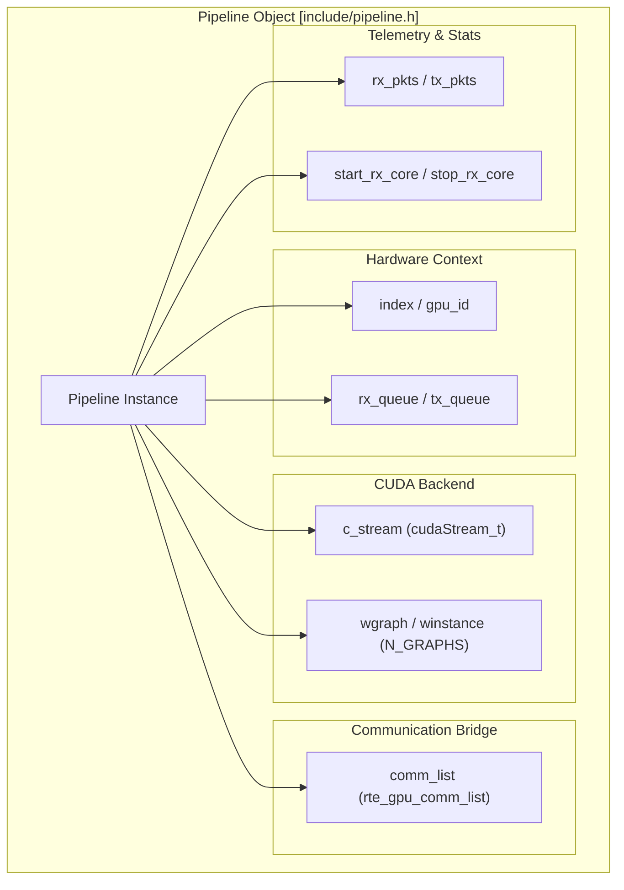
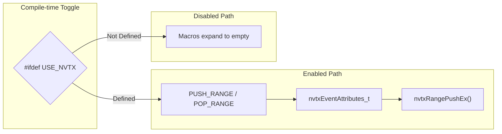

<!-- source: DeepWiki mcp.deepwiki.com · repo NVIDIA/l2fwd-nv · page 4.3 pipeline.h and cuda_related.h — C++ and CUDA Abstractions · fetched 2026-11-11 -->

# pipeline.h and cuda_related.h — C++ and CUDA Abstractions

Relevant source files

The following files were used as context for generating this wiki page:

- [include/cuda_related.h](include/cuda_related.h)
- [include/pipeline.h](include/pipeline.h)

This page documents the primary C++ abstractions used for pipeline management and timing, alongside the CUDA utility macros and instrumentation tools that facilitate GPU-accelerated packet processing in `l2fwd-nv`.

## Time Utility Class

The `Time` class in `include/pipeline.h` provides a high-level wrapper around `std::chrono` for nanosecond-precision timing. It is used throughout the application to measure execution duration and calculate throughput statistics.

### Key Methods
*   `nowNs()`: Returns the current system time since epoch in nanoseconds [include/pipeline.h:35-38]().
*   `zeroNs()`: Returns a zero-initialized nanosecond duration [include/pipeline.h:40-43]().
*   `NsToUs(t_ns)`: Converts nanoseconds to microseconds [include/pipeline.h:45-48]().
*   `NsToSec(t_ns)`: Converts nanoseconds to seconds [include/pipeline.h:50-53]().

### Time Conversion Logic
| From | To | Implementation |
| :--- | :--- | :--- |
| `t_ns` | `t_us` | `std::chrono::duration_cast<t_us>(time)` |
| `t_ns` | `t_s` | `std::chrono::duration_cast<t_s>(time)` |
| `t_us` | `t_ns` | `std::chrono::duration_cast<t_ns>(time)` |

**Sources:** [include/pipeline.h:24-59]()

---

## Pipeline Class

The `Pipeline` class represents a single execution unit of the application, binding together DPDK queues, a CUDA stream, and the communication structures required for CPU-GPU synchronization.

### Member Layout and Purpose
The class maintains the state of the workload, including hardware identifiers and telemetry data.

*   **Identifiers**: `index`, `gpu_id`, `rx_queue`, and `tx_queue` [include/pipeline.h:69-74]().
*   **CUDA Resources**:
    *   `c_stream`: The `cudaStream_t` used for all asynchronous GPU operations within this pipeline [include/pipeline.h:76]().
    *   `wgraph[]` / `winstance[]`: Arrays of `cudaGraph_t` and `cudaGraphExec_t` used when the `GPU_GRAPHS_WORKLOAD` mode is active [include/pipeline.h:78-79]().
*   **Communication**:
    *   `comm_list`: A pointer to the `rte_gpu_comm_list` structure used for status signaling between the CPU cores and the GPU kernel [include/pipeline.h:75]().
*   **Control Flags**:
    *   `pipeline_force_quit`: A per-pipeline termination flag [include/pipeline.h:80]().
*   **Telemetry Fields**:
    *   Counters for `rx_pkts`, `tx_pkts`, `rx_bytes`, and `tx_bytes` [include/pipeline.h:91-94]().
    *   Timestamps for core start/stop events (`start_rx_core`, `stop_rx_core`, etc.) using the `t_ns` type [include/pipeline.h:95-98]().

### Pipeline Data Entity Map
The following diagram maps the logical pipeline components to their specific code entities.

**Sources:** [include/pipeline.h:62-99]()

---

## cuda_related.h: Error Handling and Instrumentation

The `include/cuda_related.h` header provides the necessary macros for robust CUDA error checking and performance profiling via NVIDIA Tools Extension (NVTX).

### CUDA Error Macros
These macros wrap CUDA Runtime and Driver API calls to ensure any failure results in an immediate assertion and error message.

*   `CUDA_CHECK(stmt)`: Wraps CUDA Runtime API calls. It retrieves the error string via `cudaGetErrorString(result)` and asserts on failure [include/cuda_related.h:71-80]().
*   `CU_CHECK(stmt)`: Wraps CUDA Driver API calls. It prints the `CUresult` code and asserts on failure [include/cuda_related.h:82-91]().

### NVTX Instrumentation
If the `USE_NVTX` macro is defined, the application enables color-coded range instrumentation for profiling with tools like NVIDIA Nsight Systems.

*   **Color Definitions**: Specific colors are assigned to different phases, such as `WAIT_COL` (10) for polling and `KERNEL_COL` (11) for GPU execution [include/cuda_related.h:28-40]().
*   **`PUSH_RANGE(name, cid)`**: Starts an NVTX range with a specific name and color index. It uses `nvtxRangePushEx` with `NVTX_COLOR_ARGB` [include/cuda_related.h:41-56]().
*   **`PUSH_RANGE_STR(cid, FMT, ARGS...)`**: A variadic version of `PUSH_RANGE` that allows formatted strings (e.g., including burst IDs) [include/cuda_related.h:58-63]().
*   **`POP_RANGE`**: Ends the current NVTX range via `nvtxRangePop()` [include/cuda_related.h:65]().

### Instrumentation Toggle Logic

**Sources:** [include/cuda_related.h:25-69]()

---

## Implementation Details

### Pipeline Termination
The `terminateWorkload()` method [include/pipeline.h:67]() is responsible for the graceful shutdown of GPU-side persistent kernels. By setting specific flags or sending termination signals through the `comm_list`, it ensures the GPU releases resources before the CPU application exits.

### Telemetry Measurement
The `Pipeline` class includes `struct timespec` fields (`temp_rx_start`, `temp_rx_end`, etc.) and boolean flags (`start_rx_measure`) [include/pipeline.h:84-90]() to manage high-precision delta calculations during packet processing loops. These are used to calculate the final `rx_pkts` and `tx_pkts` throughput reported at the end of execution.

**Sources:** [include/pipeline.h:84-99]()

---

