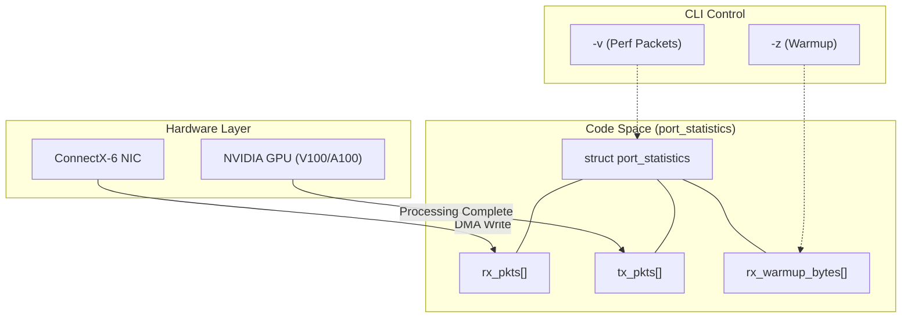

<!-- source: DeepWiki mcp.deepwiki.com · repo NVIDIA/l2fwd-nv · page 6 Performance, Benchmarking, and Profiling · fetched 2026-11-11 -->

# Performance, Benchmarking, and Profiling

Relevant source files

The following files were used as context for generating this wiki page:

- [README.md](README.md)
- [include/cuda_related.h](include/cuda_related.h)
- [include/headers.h](include/headers.h)
- [src/utils.cpp](src/utils.cpp)

This page provides an overview of how to measure, interpret, and optimize the performance of the `l2fwd-nv` application. The application is designed as a high-performance showcase for GPUDirect RDMA, requiring precise benchmarking methodologies to account for hardware topology and software overheads.

## Measurement Phases and CLI Flags

To ensure accurate performance data, `l2fwd-nv` implements a two-phase execution model: a warmup phase to prime the NIC and GPU pipelines, followed by a performance phase where statistics are recorded.

*   **Warmup Phase (`-z`):** Specifies the number of packets to process before statistics collection begins [src/utils.cpp:118](). The application tracks this via `rx_warmup_bytes` in the `port_statistics` structure [include/headers.h:91]().
*   **Performance Phase (`-v`):** Specifies the total number of packets to process before the application gracefully terminates [src/utils.cpp:116](). If set to 0, the application runs indefinitely.
*   **Workload Simulation (`-t`):** Allows users to simulate computational intensity by forcing a specific execution time (in nanoseconds) per packet [src/utils.cpp:115](). This is implemented via a busy-wait loop in both CPU and GPU workloads [src/utils.cpp:97-100]().

For details on configuring these flags, see [Command-Line Interface and Runtime Options](#1.3).

## Statistics and Throughput Calculation

The application tracks performance using the `port_statistics` structure, which is cache-aligned to prevent false sharing between lcores [include/headers.h:82-95]().

### Key Metrics
| Metric | Code Entity | Description |
| :--- | :--- | :--- |
| **Throughput (PPS)** | `rx_pkts` / `tx_pkts` | Packets per second processed by the RX/TX cores [include/headers.h:83,88](). |
| **Bandwidth (Gbps)** | `rx_bytes` / `tx_bytes` | Total bytes moved across the PCIe bus [include/headers.h:85,90](). |
| **Latency** | `rx_tot_ns` / `tx_tot_ns` | Cumulative time spent in processing loops [include/headers.h:86,92](). |

The following diagram illustrates the relationship between the hardware performance and the code entities responsible for tracking it:

**Performance Tracking Architecture**

Sources: [include/headers.h:82-95](), [src/utils.cpp:105-120]()

## Profiling with NVTX

For deep-dive analysis of the CPU-GPU synchronization overhead, `l2fwd-nv` integrates **NVIDIA Tools Extension (NVTX)**. This allows developers to visualize the timeline of packet processing in NVIDIA Nsight Systems.

*   **Instrumentation:** The code uses `PUSH_RANGE` and `POP_RANGE` macros to mark functional blocks [include/cuda_related.h:41-65]().
*   **Color Coding:** Different phases are color-coded for clarity, such as `COMM_COL` for communication, `KERNEL_COL` for GPU execution, and `WAIT_COL` for synchronization [include/cuda_related.h:28-40]().
*   **Activation:** Profiling is enabled at compile-time with `-DENABLE_NVTX=ON` and at runtime using the `-n` flag [src/utils.cpp:112]().

For details on interpreting Nsight timelines, see [Profiling with NVTX and Statistics Collection](#6.2).

## Hardware Setup and Benchmarking

Performance is heavily dependent on the PCIe topology. Optimal results are achieved when the NIC and GPU share the same PCIe Switch (e.g., a PLX bridge).

*   **Reference Setup:** Benchmarks are typically performed using GIGABYTE servers with Xeon Gold CPUs and ConnectX-6 Dx NICs [README.md:46,92]().
*   **NIC Tuning:** Enabling `CQE_COMPRESSION` is critical for high-throughput small-packet processing [README.md:92]().
*   **Workload Selection:** The application supports different workload modes (`-w`), ranging from simple CPU swaps to persistent GPU kernels and CUDA Graphs [src/utils.cpp:117](). Choosing the right mode depends on the ratio of PCIe latency to compute intensity.

For specific throughput numbers and tuning steps, see [Benchmark Results and Hardware Configuration](#6.1).

## Sub-pages

*   **[Benchmark Results and Hardware Configuration](#6.1)**: Detailed throughput data for V100/A100 GPUs and NIC configuration steps.
*   **[Profiling with NVTX and Statistics Collection](#6.2)**: How to use Nsight Systems to analyze the pipeline and interpret the `port_statistics` output.

Sources: [README.md:42-48](), [README.md:87-97](), [include/cuda_related.h:25-69](), [src/utils.cpp:105-120]()

---

