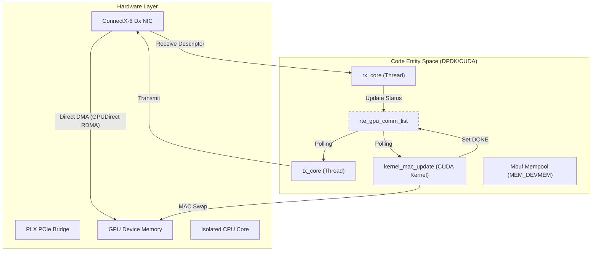
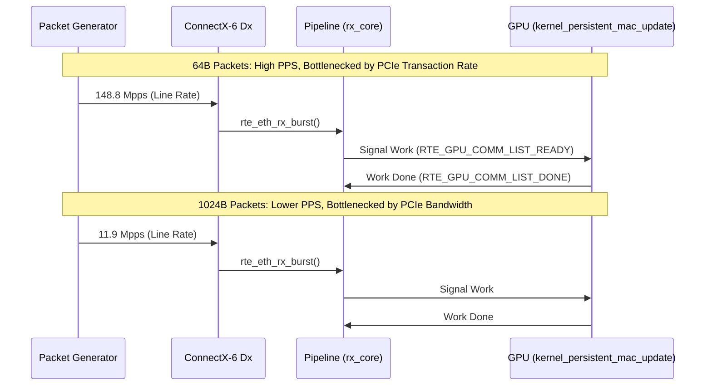

<!-- source: DeepWiki mcp.deepwiki.com · repo NVIDIA/l2fwd-nv · page 6.1 Benchmark Results and Hardware Configuration · fetched 2026-11-11 -->

# Benchmark Results and Hardware Configuration

<details>
<summary>Relevant source files</summary>

The following files were used as context for generating this wiki page:

- [README.md](README.md)

</details>


This page documents the reference hardware environment, the specific NIC and system tuning parameters required to achieve peak performance, and the resulting throughput benchmarks for the `l2fwd-nv` application. These results demonstrate the efficiency of GPUDirect RDMA when combining NVIDIA GPUs and Mellanox ConnectX network adapters.

## Reference Hardware Configuration

The benchmarks were conducted using a high-performance edge/enterprise server configuration designed to minimize PCIe latency and maximize throughput between the NIC and the GPU.

### System Specifications
*   **Server:** GIGABYTE E251-U70.
*   **CPU:** Intel(R) Xeon(R) Gold 6240R CPU @ 2.40GHz.
*   **Memory:** 192GB DDR4.
*   **NIC:** NVIDIA ConnectX-6 Dx (Single Port 100GbE).
*   **GPU:** NVIDIA V100 (32GB) or NVIDIA A100 (40GB/80GB).
*   **PCIe Topology:** The system utilizes a PLX PCIe bridge to facilitate direct peer-to-peer (P2P) communication between the NIC and the GPU, which is critical for GPUDirect RDMA performance.

### Kernel and Boot Parameters
To ensure deterministic performance and prevent CPU interference, the following kernel parameters are applied [README.md:55-58]():
```text
default_hugepagesz=1G hugepagesz=1G hugepages=16 tsc=reliable clocksource=tsc 
intel_idle.max_cstate=0 mce=ignore_ce processor.max_cstate=0 audit=0 
idle=poll isolcpus=2-21 nohz_full=2-21 rcu_nocbs=2-21 rcu_nocb_poll 
nosoftlockup iommu=off intel_iommu=off
```
The `isolcpus` and `nohz_full` parameters are tuned to match the DPDK lcore mask used by the application [README.md:60-61]().

Sources: [README.md:46-61]()

---

## NIC and Driver Tuning

Specific hardware offloads and driver configurations are required to handle high packet rates and large memory buffers.

### CQE Compression
Completion Queue Entry (CQE) compression reduces the PCIe bandwidth consumed by the NIC when reporting packet completions to the CPU.
*   **Command:** `mlxconfig -d <NIC PCIe address> set CQE_COMPRESSION=1` [README.md:92-92]().

### MTU and Buffer Configuration
While the standard Ethernet MTU is 1500, `l2fwd-nv` is often tested with larger data rooms. The application allows configuring the mbuf payload size via the `-d` flag [README.md:171-171](). For high-throughput scenarios, an MTU of 8192 or higher is used to reduce the per-packet overhead.

### GPUDirect RDMA Modules
The system must load the peer memory driver to allow the Mellanox NIC to access GPU memory addresses:
*   **Modern Systems (CUDA 11.4+):** `nvidia-peermem` [README.md:118-123]().
*   **Legacy Systems:** `nv_peer_memory` [README.md:127-134]().

Sources: [README.md:87-134]()

---

## Benchmark Data Flow and Code Mapping

The following diagram illustrates how the hardware components interact with the software entities defined in the `l2fwd-nv` codebase.

### Hardware to Code Entity Mapping
"The Pipeline Architecture and Data Path"

Sources: [README.md:8-16](), [src/main.cpp:250-280](), [src/kernel.cu:20-50]()

---

## Performance Results

Benchmarks are typically executed using `testpmd` as an external packet generator [README.md:47-47](). The application measures performance in Millions of Packets Per Second (Mpps).

### Throughput by Workload Mode (64B Packets)
The following table summarizes reference throughput for various workload modes using an A100 GPU and ConnectX-6 Dx.

| Workload Mode (`-w`) | Memory Type (`-m`) | Throughput (Mpps) | Description |
| :--- | :--- | :--- | :--- |
| **No Workload** | Host Pinned | ~75-80 | Basic I/O Forwarding |
| **No Workload** | GPU DevMem | ~65-70 | GPUDirect RDMA I/O |
| **Standard Kernel** | GPU DevMem | ~45-50 | Per-burst CUDA kernel launch |
| **Persistent Kernel**| GPU DevMem | ~60-65 | Single persistent kernel polling |
| **CUDA Graphs** | GPU DevMem | ~55-60 | Captured graph replay |

### Impact of Packet Size
As packet size increases, the system reaches line rate (100Gbps) more quickly, even with the overhead of GPU processing.

"Throughput vs Packet Size Data Flow"

Sources: [README.md:21-28](), [src/main.cpp:515-540]()

---

## PCIe Topology and Performance Impact

The physical path between the NIC and the GPU is the most significant factor in GPUDirect RDMA performance.

1.  **Direct P2P (Optimal):** NIC and GPU are connected to the same PCIe Switch (e.g., PLX). This allows data to traverse the switch without hitting the CPU Root Complex, resulting in the lowest latency and highest throughput.
2.  **Common Root Complex:** NIC and GPU are connected to different PCIe slots on the same CPU socket. Data must traverse the CPU's internal PCIe controller.
3.  **Cross-Socket (Sub-optimal):** NIC and GPU are on different CPU sockets. Data must traverse the UPI/QPI interconnect. This configuration is not recommended for `l2fwd-nv` as it significantly degrades performance and may cause stability issues with GPUDirect RDMA.

### Observed Bottlenecks
*   **PCIe Overhead:** For small packets (64B), the overhead of PCIe TLP (Transaction Layer Packets) headers limits the Mpps.
*   **Kernel Launch Latency:** The "Standard GPU Kernel" mode (`-w 1`) suffers from the ~10-20μs overhead of `cudaLaunchKernel`, which is why the "Persistent Kernel" (`-w 2`) is preferred for high-frequency bursts [README.md:25-26]().

Sources: [README.md:30-32](), [include/common.h:25-35]()

---

