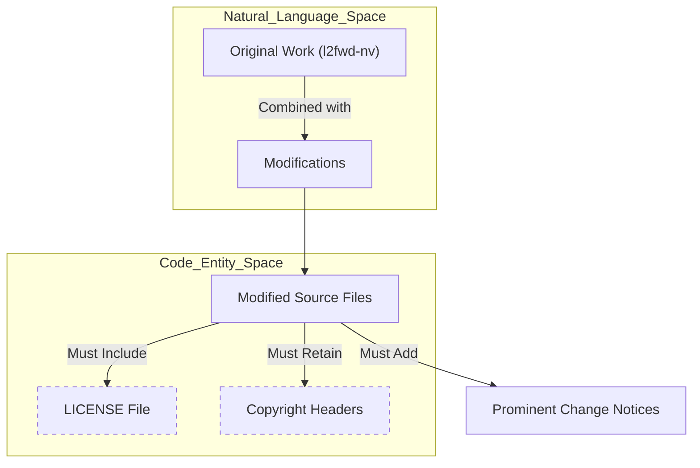
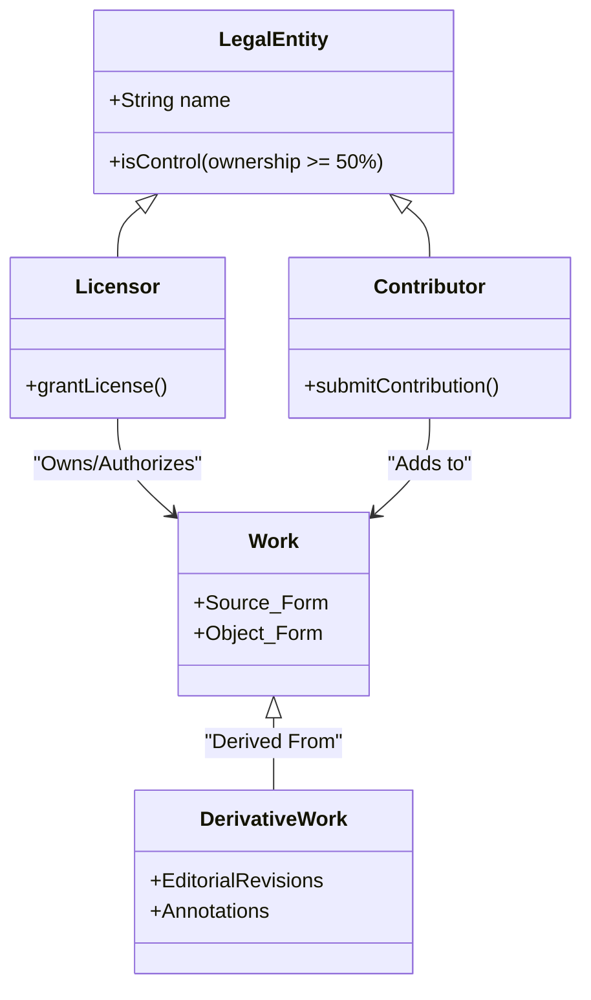

<!-- source: DeepWiki mcp.deepwiki.com · repo NVIDIA/l2fwd-nv · page 7.2 License · fetched 2026-11-11 -->

# License

Relevant source files

The following files were used as context for generating this wiki page:

- [LICENSE](LICENSE)

The `l2fwd-nv` application is distributed under the **Apache License, Version 2.0**. This license governs the use, reproduction, and distribution of the software, providing a perpetual, worldwide, non-exclusive, and royalty-free grant of copyright and patent rights.

### 1. License Overview

The Apache License 2.0 is a permissive free software license that allows users to use the software for any purpose, distribute it, modify it, and distribute modified versions of the software under the terms of the license, without concern for royalties.

| Feature | Description |
| :--- | :--- |
| **License Type** | Apache License 2.0 [LICENSE:1-2]() |
| **Copyright Grant** | Perpetual, worldwide, non-exclusive, no-charge, royalty-free [LICENSE:66-71]() |
| **Patent Grant** | Perpetual, worldwide, non-exclusive, no-charge, royalty-free (subject to litigation clauses) [LICENSE:73-81]() |
| **Redistribution** | Permitted in Source or Object form with specific conditions [LICENSE:89-92]() |

**Sources:** [LICENSE:1-129]()

### 2. Redistribution and Derivative Works

Users may reproduce and distribute copies of the Work or Derivative Works thereof in any medium, provided they meet the following conditions defined in the license:

1.  **Attribution**: Recipients must be given a copy of the license [LICENSE:94-95]().
2.  **Notice of Change**: Any modified files must carry prominent notices stating that the files were changed [LICENSE:97-98]().
3.  **Preservation of Notices**: All copyright, patent, trademark, and attribution notices from the Source form must be retained in any Derivative Works [LICENSE:100-104]().
4.  **NOTICE File**: If the distribution includes a `NOTICE` text file, its attribution notices must be included in the Derivative Works [LICENSE:106-115]().

#### Data Flow: License Compliance in Redistribution
The following diagram illustrates the requirements for moving from the original "Work" to a "Derivative Work" while maintaining compliance with the Apache 2.0 terms.

**Diagram: License Compliance Flow**

**Sources:** [LICENSE:89-121]()

### 3. Copyright and Contributions

The codebase contains NVIDIA copyright headers in its source files, designating NVIDIA as the original Licensor. Contributions to the project are governed by the same license terms unless explicitly stated otherwise.

*   **Licensor**: The copyright owner granting the license [LICENSE:12-13]().
*   **Contributor**: Any individual or Legal Entity on behalf of whom a Contribution has been received by the Licensor and incorporated into the Work [LICENSE:62-64]().
*   **Submission of Contributions**: Unless stated otherwise, any contribution intentionally submitted for inclusion in the Work is under the terms and conditions of this License [LICENSE:130-131]().

#### Entity Relationship: Licensing Terms
This diagram maps the legal entities defined in the license to their roles within the `l2fwd-nv` ecosystem.

**Diagram: Entity Relationship**

**Sources:** [LICENSE:7-64]()

### 4. Limitations and Warranty

The Apache License 2.0 provides the software on an "AS IS" BASIS, WITHOUT WARRANTIES OR CONDITIONS OF ANY KIND, either express or implied.

*   **No Warranty**: Contributors provide the Work without warranties regarding title, non-infringement, merchantability, or fitness for a particular purpose.
*   **Limitation of Liability**: In no event and under no legal theory shall any Contributor be liable for damages, including direct, indirect, special, incidental, or consequential damages arising out of the use or inability to use the Work.

**Sources:** [LICENSE:1-129]() (Note: Standard Apache 2.0 clauses for Disclaimer of Warranty and Limitation of Liability).

---

