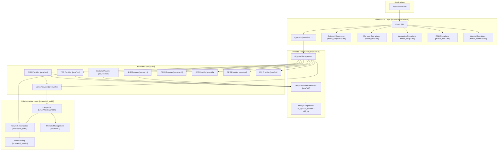
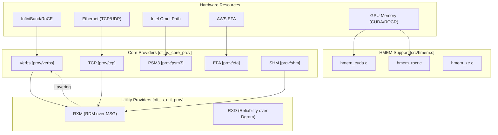

<!-- source: DeepWiki mcp.deepwiki.com · repo ofiwg/libfabric · page 1 Overview · fetched 2026-11-11 -->

# Overview

Relevant source files

The following files were used as context for generating this wiki page:

- [AUTHORS](AUTHORS)
- [COPYING](COPYING)
- [Makefile.am](Makefile.am)
- [NEWS.md](NEWS.md)
- [README](README)
- [README.md](README.md)
- [configure.ac](configure.ac)
- [docs/windows.txt](docs/windows.txt)
- [fabtests/AUTHORS](fabtests/AUTHORS)
- [fabtests/COPYING](fabtests/COPYING)
- [fabtests/README](fabtests/README)
- [fabtests/configure.ac](fabtests/configure.ac)
- [include/ofi.h](include/ofi.h)
- [include/ofi_mem.h](include/ofi_mem.h)
- [include/ofi_osd.h](include/ofi_osd.h)
- [include/rdma/fabric.h](include/rdma/fabric.h)
- [include/rdma/fi_domain.h](include/rdma/fi_domain.h)
- [include/rdma/providers/fi_prov.h](include/rdma/providers/fi_prov.h)
- [include/windows/config.h](include/windows/config.h)
- [libfabric.vcxproj](libfabric.vcxproj)
- [libfabric.vcxproj.filters](libfabric.vcxproj.filters)
- [man/fi_atomic.3.md](man/fi_atomic.3.md)
- [man/fi_domain.3.md](man/fi_domain.3.md)
- [man/fi_endpoint.3.md](man/fi_endpoint.3.md)
- [man/fi_getinfo.3.md](man/fi_getinfo.3.md)
- [man/fi_info.1.md](man/fi_info.1.md)
- [man/fi_mr.3.md](man/fi_mr.3.md)
- [man/fi_msg.3.md](man/fi_msg.3.md)
- [man/fi_psm3.7.md](man/fi_psm3.7.md)
- [man/fi_rma.3.md](man/fi_rma.3.md)
- [man/fi_tagged.3.md](man/fi_tagged.3.md)
- [man/man1/fi_pingpong.1](man/man1/fi_pingpong.1)
- [man/man7/fi_psm3.7](man/man7/fi_psm3.7)
- [prov/util/src/util_buf.c](prov/util/src/util_buf.c)
- [src/fabric.c](src/fabric.c)
- [src/fi_tostr.c](src/fi_tostr.c)
- [src/log.c](src/log.c)
- [src/var.c](src/var.c)
- [util/info.c](util/info.c)

Libfabric is a low-level network programming interface designed to facilitate communication across high-performance fabrics. It provides a framework for fabric communication interfaces, enabling applications to leverage various network fabrics (such as InfiniBand, RoCE, Intel Omni-Path, AWS EFA, TCP sockets, and shared memory) through a consistent, unified API.

The purpose of this overview is to introduce libfabric's architecture, core concepts, and components. It explains how libfabric organizes its codebase, the relationships between providers and hardware, and how data flows through the system. For details about specific API usage, see [API Introduction](#1.2).

## Libfabric Architecture

The libfabric architecture consists of several layers that provide abstractions for fabric communication. It follows a modular design to decouple application code from specific fabric implementation details.

Sources: [include/rdma/fabric.h:1-115](), [src/fabric.c:62-85](), [Makefile.am:46-108](), [configure.ac:23-46]()

## Core Concepts

Libfabric is built around several key abstractions (represented by `fid` structures) that model fabric communication:

### Fabric and Domains
- **Fabric (`fid_fabric`)**: Represents a fabric interface or network, the highest level of abstraction [include/rdma/fabric.h:101]().
- **Domain (`fid_domain`)**: Represents an addressable communication region within a fabric, typically mapping to a NIC or hardware port [include/rdma/fabric.h:102]().

### Endpoints and Communication
- **Endpoint (`fid_ep`)**: Communication portal used for data transfers [include/rdma/fabric.h:109]().
  - **Active Endpoint**: Performs data transfers (connected or connectionless) [man/fi_endpoint.3.md:172-178]().
  - **Passive Endpoint (`fid_pep`)**: Listens for incoming connection requests [man/fi_endpoint.3.md:68-69]().
  - **Scalable Endpoint**: Supports multiple transmit/receive contexts [man/fi_endpoint.3.md:65-66]().

### Data Structures
- **Address Vector (`fid_av`)**: Maps and stores transport/network addresses [include/rdma/fi_domain.h:48-50]().
- **Completion Queue (`fid_cq`)**: Reports completed operations [include/rdma/fabric.h:107]().
- **Event Queue (`fid_eq`)**: Reports connection management and asynchronous events [include/rdma/fabric.h:106]().
- **Memory Region (`fid_mr`)**: Registered memory buffers for fabric access [include/rdma/fi_domain.h:131-135]().

### Communication Models
Libfabric supports multiple communication models via capability flags:

| Capability Flag | Description | Key Header |
|-----------------|-------------|------------|
| `FI_MSG` | Standard message-based communication | [rdma/fi_endpoint.h]() |
| `FI_TAGGED` | Message passing with message tag identifiers | [rdma/fi_tagged.h]() |
| `FI_RMA` | Remote Memory Access operations | [rdma/fi_rma.h]() |
| `FI_ATOMIC` | Atomic operations on remote memory | [rdma/fi_atomic.h]() |
| `FI_COLLECTIVE` | Group communication operations | [rdma/fi_collective.h]() |

Sources: [include/rdma/fabric.h:125-132](), [include/rdma/fi_domain.h:65-73](), [man/fi_endpoint.3.md:179-188]()

## Provider Architecture

Providers are driver-like plugins that implement the libfabric API. They are classified by their relationship to the hardware and other providers.

### Provider Types
1. **Core Providers**: Interface directly with hardware or system network stacks (e.g., `verbs`, `tcp`, `efa`) [src/fabric.c:255-258]().
2. **Utility Providers**: Implement higher-level protocols over other providers (e.g., `rxm` provides RDM endpoints over MSG-only providers) [src/fabric.c:250-253]().
3. **Hook Providers**: Intercept API calls for instrumentation, such as `hook_perf` for profiling [src/fabric.c:260-263]().

Sources: [src/fabric.c:250-268](), [src/fabric.c:464-498](), [Makefile.am:47-54]()

## Data Flow and Initialization

The following sequence describes how applications interact with the libfabric framework to establish communication.

### Initialization Sequence
1. **Discovery**: Application calls `fi_getinfo()` with hints to find suitable providers [man/fi_getinfo.3.md:54-61]().
2. **Fabric/Domain**: Application opens a fabric object (`fi_fabric()`) and a domain (`fi_domain()`) [man/fi_getinfo.3.md:69-78]().
3. **Resources**: Application creates communication resources:
    - Open CQs (`fi_cq_open`) and AVs (`fi_av_open`).
    - Register memory (`fi_mr_reg`) for RMA/Atomics [man/fi_mr.3.md:58-65]().
4. **Endpoints**: Application allocates an endpoint (`fi_endpoint()`) and binds it to CQs/AVs [man/fi_endpoint.3.md:59-60]().
5. **Activation**: Application enables the endpoint (`fi_enable()`) to begin data transfers [man/fi_endpoint.3.md:95]().

### Data Transfer Sequence
1. **Post Buffers**: For incoming data, application calls `fi_recv()` [man/fi_msg.3.md]().
2. **Initiate Transfer**: Application calls `fi_send()`, `fi_write()`, or `fi_atomic()` [man/fi_rma.3.md]().
3. **Progress**: The provider's internal progress engine (e.g., `xnet` PE or `verbs` poll) moves data [man/fi_endpoint.3.md:201-207]().
4. **Completion**: Application polls the CQ (`fi_cq_read()`) to identify finished operations.

Sources: [src/fabric.c:590-628](), [man/fi_getinfo.3.md:54-69](), [man/fi_endpoint.3.md:171-225]()

## Build System and Configuration

Libfabric uses Autotools for configuration and building.

- **Configure Options**: Users can enable/disable specific providers using `--enable-<provider>` or force direct provider calls via `--enable-direct` [configure.ac:85-97]().
- **HMEM Support**: Accelerator memory support is toggled via `--with-cuda`, `--with-rocr`, etc [configure.ac:73-83]().
- **Platform Support**: Libfabric targets Linux, macOS, and FreeBSD [configure.ac:29-42](). Windows support is managed via separate project files [libfabric.vcxproj]().

Sources: [configure.ac:1-125](), [Makefile.am:1-40](), [NEWS.md:12-44]()

## Key Components and Their Roles

| Component | Code Pointer | Role |
|-----------|--------------|------|
| **Provider Registry** | `struct ofi_prov` [src/fabric.c:62-69]() | Tracks registered and loaded providers. |
| **Matching Engine** | `fi_getinfo` [src/fabric.c:590]() | Filters providers based on application requirements. |
| **HMEM Framework** | `src/hmem.c` [src/hmem.c:1]() | Provides unified access to GPU/accelerator memory. |
| **Utility Library** | `include/ofi.h` [include/ofi.h:1]() | Internal macros and functions shared across providers. |
| **String Conversion** | `src/fi_tostr.c` [src/fi_tostr.c:1]() | Debugging utility to convert libfabric types to strings. |

For details on the internal organization, see [Architecture](#1.1). For an overview of the programming model, see [API Introduction](#1.2).

---

