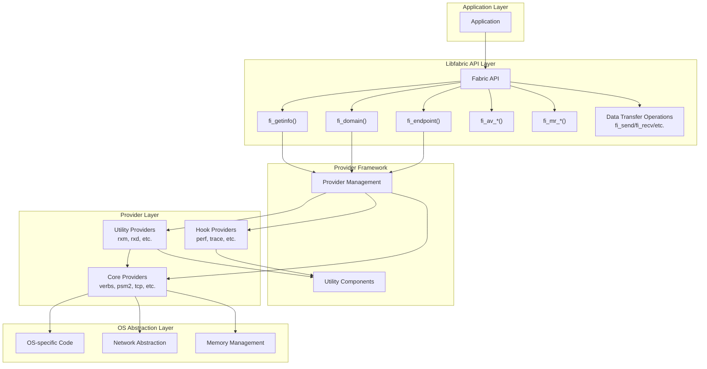
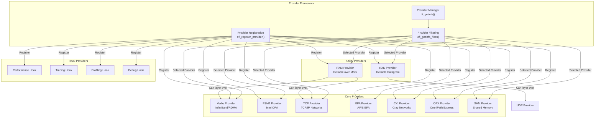
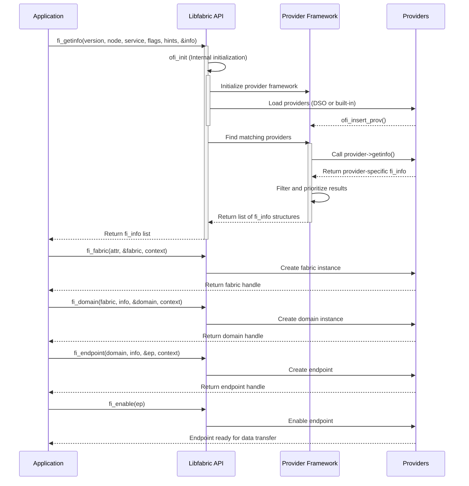
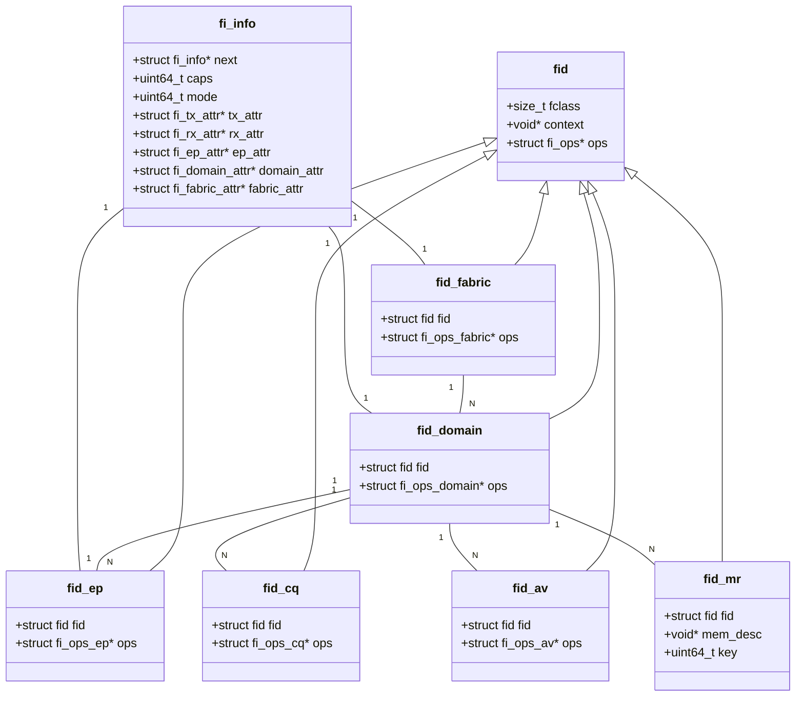
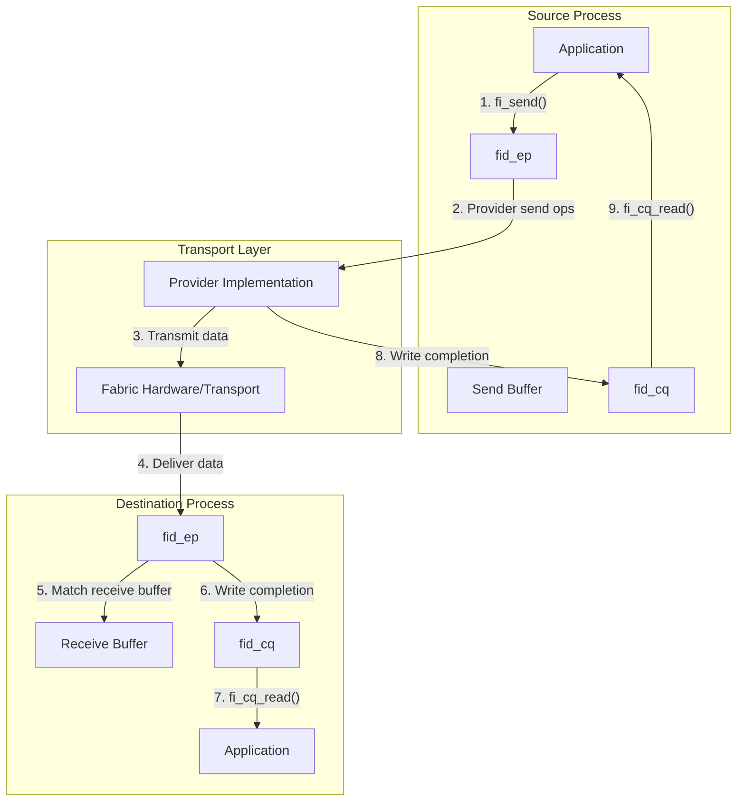
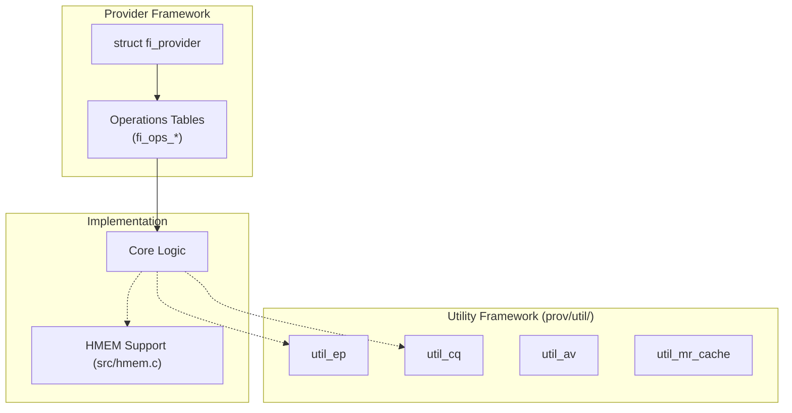

<!-- source: DeepWiki mcp.deepwiki.com · repo ofiwg/libfabric · page 1.1 Architecture · fetched 2026-11-11 -->

# Architecture

Relevant source files

The following files were used as context for generating this wiki page:

- [Makefile.am](Makefile.am)
- [include/ofi.h](include/ofi.h)
- [include/ofi_hook.h](include/ofi_hook.h)
- [include/ofi_mem.h](include/ofi_mem.h)
- [include/ofi_osd.h](include/ofi_osd.h)
- [include/ofi_prov.h](include/ofi_prov.h)
- [include/rdma/fabric.h](include/rdma/fabric.h)
- [include/rdma/fi_domain.h](include/rdma/fi_domain.h)
- [include/rdma/providers/fi_prov.h](include/rdma/providers/fi_prov.h)
- [libfabric.vcxproj](libfabric.vcxproj)
- [libfabric.vcxproj.filters](libfabric.vcxproj.filters)
- [man/fi_atomic.3.md](man/fi_atomic.3.md)
- [man/fi_domain.3.md](man/fi_domain.3.md)
- [man/fi_endpoint.3.md](man/fi_endpoint.3.md)
- [man/fi_getinfo.3.md](man/fi_getinfo.3.md)
- [man/fi_info.1.md](man/fi_info.1.md)
- [man/fi_mr.3.md](man/fi_mr.3.md)
- [man/fi_msg.3.md](man/fi_msg.3.md)
- [man/fi_rma.3.md](man/fi_rma.3.md)
- [man/fi_tagged.3.md](man/fi_tagged.3.md)
- [prov/hook/hook_debug/include/hook_debug.h](prov/hook/hook_debug/include/hook_debug.h)
- [prov/hook/hook_debug/src/hook_debug.c](prov/hook/hook_debug/src/hook_debug.c)
- [prov/hook/src/hook.c](prov/hook/src/hook.c)
- [prov/hook/src/hook_av.c](prov/hook/src/hook_av.c)
- [prov/hook/src/hook_cm.c](prov/hook/src/hook_cm.c)
- [prov/hook/src/hook_cntr.c](prov/hook/src/hook_cntr.c)
- [prov/hook/src/hook_cq.c](prov/hook/src/hook_cq.c)
- [prov/hook/src/hook_domain.c](prov/hook/src/hook_domain.c)
- [prov/hook/src/hook_ep.c](prov/hook/src/hook_ep.c)
- [prov/hook/src/hook_eq.c](prov/hook/src/hook_eq.c)
- [prov/hook/src/hook_wait.c](prov/hook/src/hook_wait.c)
- [prov/hook/src/hook_xfer.c](prov/hook/src/hook_xfer.c)
- [prov/opx/include/rdma/fi_direct_endpoint.h](prov/opx/include/rdma/fi_direct_endpoint.h)
- [prov/opx/src/fi_opx_info.c](prov/opx/src/fi_opx_info.c)
- [prov/util/src/util_buf.c](prov/util/src/util_buf.c)
- [src/fabric.c](src/fabric.c)
- [src/fi_tostr.c](src/fi_tostr.c)
- [src/log.c](src/log.c)
- [src/var.c](src/var.c)
- [util/info.c](util/info.c)

This document describes the high-level architecture of libfabric, explaining the framework's structure, component relationships, and data flow. Libfabric provides a unified API for fabric communication, abstracting away the details of different fabric providers to offer consistent access to high-performance networking hardware.

## Overview of Libfabric Architecture

Libfabric is designed as a framework that provides a unified interface to various network fabrics through a layered architecture. This framework allows applications to communicate over high-performance fabrics without needing to understand the specific details of the underlying hardware.

Sources: [src/fabric.c:36-1046](), [include/rdma/fabric.h:35-828](), [Makefile.am:10-230]()

The architecture consists of several key layers:

1. **Libfabric API Layer**: Provides the public API (defined in headers like `fabric.h` and `fi_endpoint.h`) that applications use to interact with fabric hardware. [include/rdma/fabric.h:35-220](), [include/rdma/fi_endpoint.h:54-116]()
2. **Provider Framework**: Manages provider registration, discovery via `fi_getinfo`, and selection. [src/fabric.c:62-183]()
3. **Provider Layer**: Contains implementations for specific fabrics (core providers), add-on functionality (utility providers like `rxm`), and hooks. [src/fabric.c:250-268]()
4. **OS Abstraction Layer**: Provides platform independence for network and system operations (e.g., `osd.h` for Linux/Windows). [Makefile.am:110-132](), [include/ofi_osd.h:1-61]()

## Provider Framework Architecture

The provider framework is at the heart of libfabric's design. It allows multiple fabric providers to coexist while presenting a unified API to applications.

Sources: [src/fabric.c:62-69](), [src/fabric.c:250-268](), [src/fabric.c:270-280](), [include/rdma/providers/fi_prov.h:1-100]()

The provider framework handles:

1. **Provider Registration**: During initialization, providers register via `ofi_insert_prov`. [src/fabric.c:153-183]()
2. **Provider Discovery**: Finding available providers that match application requirements using the matching engine in `fi_getinfo`. [man/fi_getinfo.3.md:54-91]()
3. **Provider Selection**: Choosing the most appropriate provider based on versioning and preferred flags. [src/fabric.c:140-151]()
4. **Provider Layering**: Supporting layered providers where utility providers (type `OFI_PROV_UTIL`) build on core providers (type `OFI_PROV_CORE`). [src/fabric.c:250-258]()

## Initialization and Provider Selection Flow

When an application uses libfabric, it follows a specific initialization flow to select and configure appropriate providers.

Sources: [src/fabric.c:84-183](), [man/fi_getinfo.3.md:54-91](), [man/fi_endpoint.3.md:54-116](), [man/fi_domain.3.md:19-35]()

The initialization flow includes:

1. **Provider Loading**: Providers are loaded from dynamic shared objects (DSOs) via `dlopen` or linked as built-in libraries. [src/fabric.c:57-69](), [Makefile.am:27]()
2. **Provider Selection**: The application calls `fi_getinfo()` to find providers matching its requirements (caps, mode, addr_format). [man/fi_getinfo.3.md:129-147]()
3. **Resource Creation**: The application creates fabric, domain, and endpoint resources using the selected provider's ops. [include/rdma/fabric.h:100-114]()
4. **Endpoint Enabling**: Endpoints are created in a disabled state and must transition to enabled via `fi_enable`. [man/fi_endpoint.3.md:189-194]()

## Data Structure Relationships

At the core of libfabric are several key data structures (fids) that represent fabric resources.

Sources: [include/rdma/fabric.h:100-114](), [include/rdma/fi_domain.h:114-117](), [include/rdma/fi_domain.h:131-135](), [man/fi_getinfo.3.md:130-147]()

The key data structures include:

1. **fid**: Base structure for all fabric identifiers. [include/rdma/fabric.h:115]()
2. **fid_fabric**: Represents a fabric instance. [include/rdma/fabric.h:101]()
3. **fid_domain**: Represents a resource domain (NIC/port boundary). [man/fi_domain.3.md:66-71]()
4. **fid_ep**: Communication portal for data transfer. [man/fi_endpoint.3.md:172-178]()
5. **fid_cq**: Completion queue for asynchronous operations. [include/rdma/fabric.h:107]()
6. **fid_av**: Address vector for mapping network addresses. [include/rdma/fi_domain.h:114-117]()
7. **fid_mr**: Memory region for direct fabric access. [include/rdma/fi_domain.h:131-135]()
8. **fi_info**: Contains information about a provider's capabilities and attributes. [man/fi_getinfo.3.md:130-146]()

## Data Transfer Flow

Libfabric supports various data transfer methods including message, RMA (Remote Memory Access), tagged, and atomic operations.

Sources: [man/fi_endpoint.3.md:180-188](), [man/fi_msg.3.md:10-17](), [include/rdma/fabric.h:125-132]()

The data transfer flow involves:

1. **Endpoint Binding**: Active endpoints are bound to CQs, EQs, and AVs before use. [man/fi_endpoint.3.md:196-207]()
2. **Buffer Posting**: Buffers are posted for receives (via `fi_recv`) or registered for RMA (via `fi_mr_reg`). [man/fi_mr.3.md:133-142]()
3. **Operation Initiation**: Applications call data transfer functions like `fi_send`, `fi_write`, or `fi_tsend`. [man/fi_msg.3.md:10-17](), [man/fi_tagged.3.md:10-17]()
4. **Completion**: Asynchronous events are reported through Completion Queues (`fid_cq`). [man/fi_endpoint.3.md:198-200]()

## Provider Implementation and Utility Framework

Providers implement the libfabric API using the `fi_provider` structure and internal utility frameworks.

Sources: [src/fabric.c:62-69](), [Makefile.am:66-108](), [include/rdma/providers/fi_prov.h:50-80]()

Providers often use the utility framework (located in `prov/util/`) to handle common tasks:

1. **Memory Registration Cache**: `util_mr_cache.c` manages registered memory to reduce registration overhead. [Makefile.am:86]()
2. **Buffer Management**: `util_buf.c` (ofi_bufpool) provides optimized buffer pooling. [Makefile.am:80]()
3. **Endpoint/CQ Helpers**: `util_ep.c` and `util_cq.c` provide boilerplate for resource management. [Makefile.am:70-73]()
4. **Heterogeneous Memory (HMEM)**: Libfabric provides a common framework for GPU memory (CUDA, ROCR, ZE) in `src/hmem.c`. [Makefile.am:47-54]()

---

