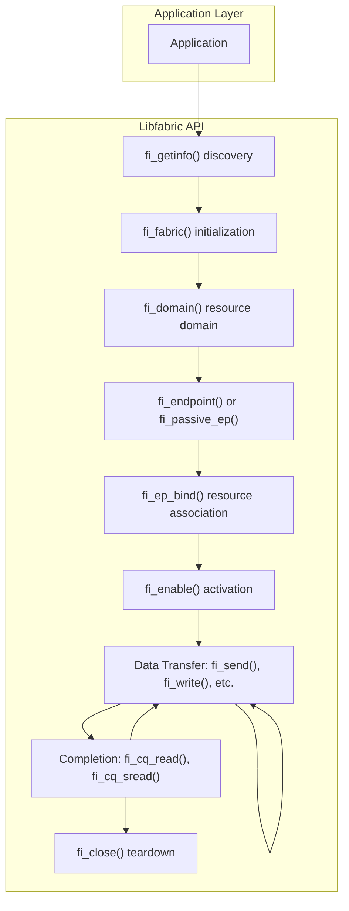
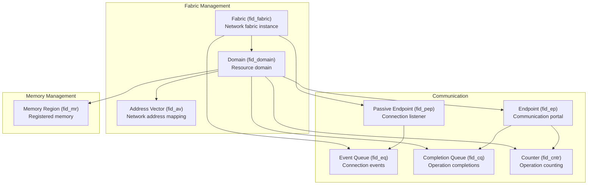
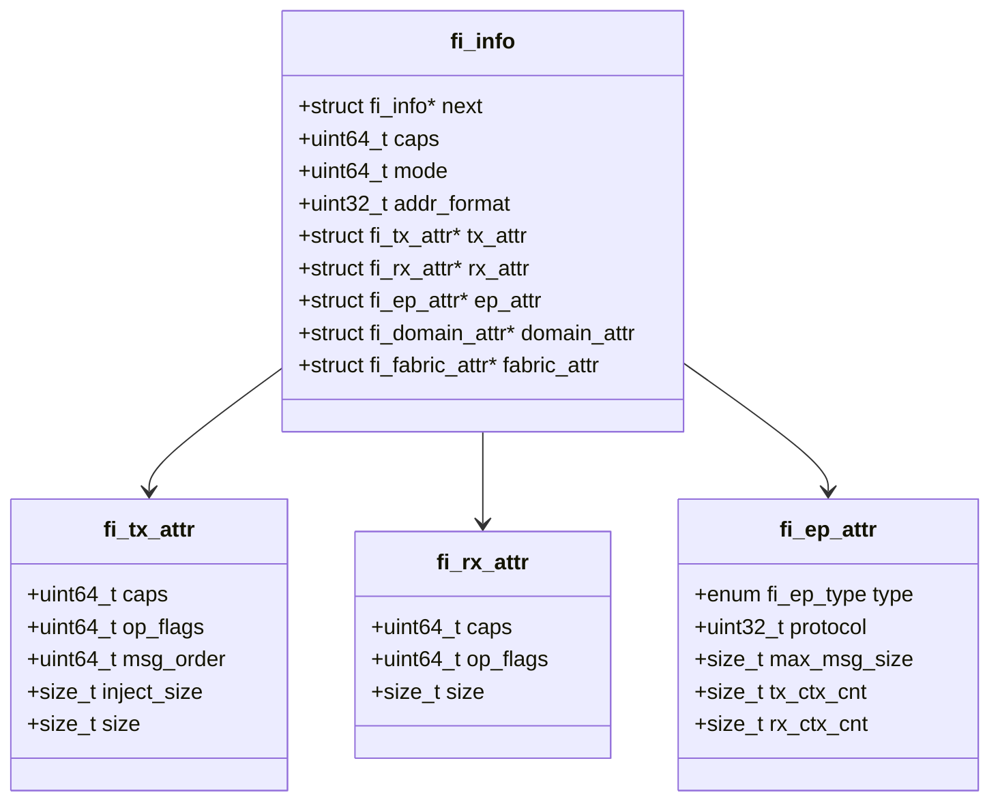
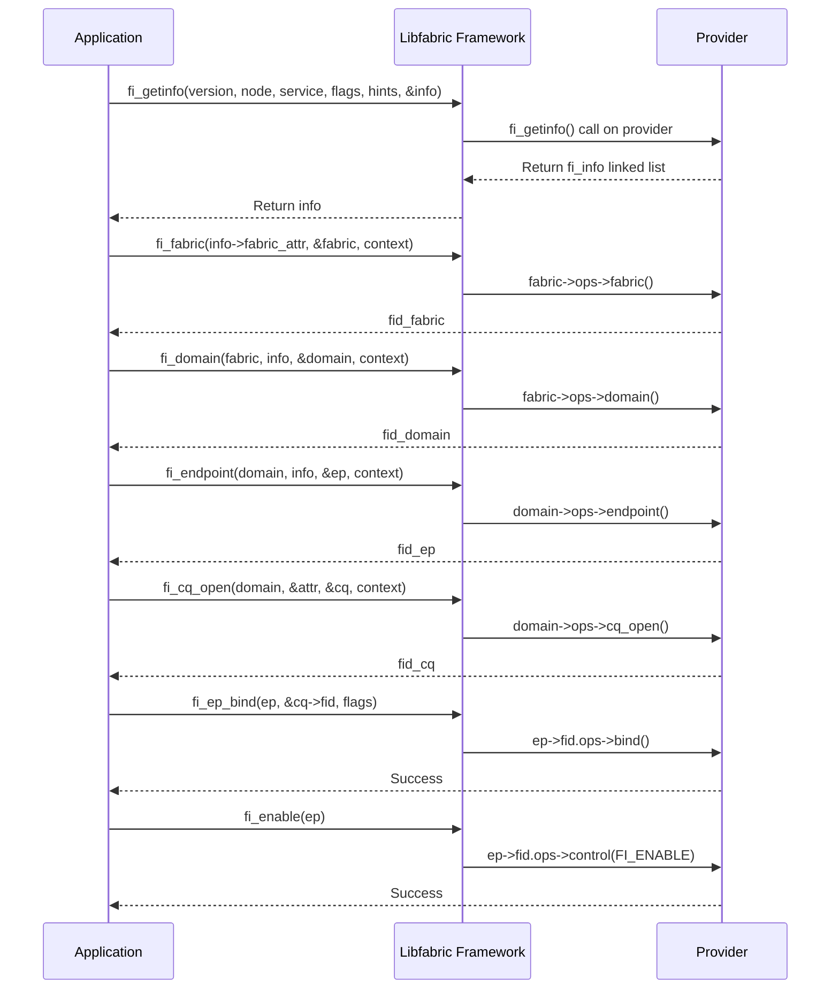

<!-- source: DeepWiki mcp.deepwiki.com · repo ofiwg/libfabric · page 1.2 API Introduction · fetched 2026-11-11 -->

# API Introduction

<details>
<summary>Relevant source files</summary>

The following files were used as context for generating this wiki page:

- [include/rdma/fabric.h](include/rdma/fabric.h)
- [include/rdma/fi_atomic.h](include/rdma/fi_atomic.h)
- [include/rdma/fi_cm.h](include/rdma/fi_cm.h)
- [include/rdma/fi_domain.h](include/rdma/fi_domain.h)
- [include/rdma/fi_endpoint.h](include/rdma/fi_endpoint.h)
- [include/rdma/fi_eq.h](include/rdma/fi_eq.h)
- [include/rdma/fi_errno.h](include/rdma/fi_errno.h)
- [include/rdma/fi_rma.h](include/rdma/fi_rma.h)
- [include/rdma/fi_tagged.h](include/rdma/fi_tagged.h)
- [man/fi_atomic.3.md](man/fi_atomic.3.md)
- [man/fi_av.3.md](man/fi_av.3.md)
- [man/fi_cm.3.md](man/fi_cm.3.md)
- [man/fi_cntr.3.md](man/fi_cntr.3.md)
- [man/fi_cq.3.md](man/fi_cq.3.md)
- [man/fi_domain.3.md](man/fi_domain.3.md)
- [man/fi_endpoint.3.md](man/fi_endpoint.3.md)
- [man/fi_eq.3.md](man/fi_eq.3.md)
- [man/fi_fabric.3.md](man/fi_fabric.3.md)
- [man/fi_getinfo.3.md](man/fi_getinfo.3.md)
- [man/fi_mr.3.md](man/fi_mr.3.md)
- [man/fi_msg.3.md](man/fi_msg.3.md)
- [man/fi_poll.3.md](man/fi_poll.3.md)
- [man/fi_rma.3.md](man/fi_rma.3.md)
- [man/fi_tagged.3.md](man/fi_tagged.3.md)
- [man/fi_version.3.md](man/fi_version.3.md)
- [man/man3/fi_atomic.3](man/man3/fi_atomic.3)
- [man/man3/fi_av.3](man/man3/fi_av.3)
- [man/man3/fi_cntr.3](man/man3/fi_cntr.3)
- [man/man3/fi_cq.3](man/man3/fi_cq.3)
- [man/man3/fi_domain.3](man/man3/fi_domain.3)
- [man/man3/fi_endpoint.3](man/man3/fi_endpoint.3)
- [man/man3/fi_eq.3](man/man3/fi_eq.3)
- [man/man3/fi_getinfo.3](man/man3/fi_getinfo.3)
- [man/man3/fi_mr.3](man/man3/fi_mr.3)
- [man/man3/fi_msg.3](man/man3/fi_msg.3)
- [man/man3/fi_poll.3](man/man3/fi_poll.3)
- [man/man3/fi_rma.3](man/man3/fi_rma.3)
- [man/man3/fi_tagged.3](man/man3/fi_tagged.3)
- [src/fi_tostr.c](src/fi_tostr.c)

</details>


This document provides an introduction to the libfabric API, which offers a framework for accessing high-performance fabric interfaces. Libfabric abstracts the underlying network hardware details, presenting applications with a consistent interface for data transfers across different fabric technologies.

## Purpose and Scope

The Libfabric API serves as a user-level interface for accessing various fabric providers such as InfiniBand, TCP, shared memory, and proprietary networks. It is designed to support high-performance computing, data centers, and enterprise applications with efficient, scalable communication capabilities.

This page covers the fundamental API concepts, key data structures, initialization process, and data transfer models. Reference is made to the public header files such as `rdma/fabric.h`, `rdma/fi_domain.h`, and `rdma/fi_endpoint.h`.

## API Structure Overview

The following diagram illustrates the typical application interaction flow with the libfabric API, from discovery to cleanup.



Sources: [man/fi_getinfo.3.md:19-20](), [man/fi_fabric.3.md:19-20](), [man/fi_domain.3.md:19-20](), [man/fi_endpoint.3.md:59-69](), [man/fi_endpoint.3.md:89-95](), [man/fi_cq.3.md:43-55]()

## Key Abstractions

Libfabric uses Fabric Identifiers (`fid`) to represent various resources. All resource structures begin with a common `struct fid`.



Sources: [include/rdma/fabric.h:100-114](), [man/fi_domain.3.md:65-71](), [man/fi_endpoint.3.md:172-181](), [man/fi_mr.3.md:133-142]()

### Key Abstractions Explained

| Abstraction | Code Entity | Description |
|-------------|-------------|--------------|
| **Fabric** | `struct fid_fabric` | Represents a fabric domain or a collection of hardware resources. |
| **Domain** | `struct fid_domain` | Represents hardware resources, typically associated with a network adapter. |
| **Endpoint** | `struct fid_ep` | Communication portal for sending and receiving data (Active). |
| **Passive Endpoint** | `struct fid_pep` | Listens for incoming connection requests. |
| **Address Vector** | `struct fid_av` | Maps transport/network addresses to fabric addresses (`fi_addr_t`). |
| **Memory Region** | `struct fid_mr` | Local memory registered for direct fabric access (RMA/Atomics). |
| **Completion Queue** | `struct fid_cq` | Reports completion of asynchronous data transfer operations. |
| **Event Queue** | `struct fid_eq` | Reports connection management and asynchronous control events. |
| **Counter** | `struct fid_cntr` | Tracks the number of completed operations for low-overhead progress. |

Sources: [include/rdma/fabric.h:100-114](), [include/rdma/fi_domain.h:114-117](), [include/rdma/fi_domain.h:131-135](), [include/rdma/fi_endpoint.h:149-164]()

## Core Data Structures

The `fi_info` structure is the central descriptor for fabric capabilities and endpoint attributes.



Sources: [man/fi_getinfo.3.md:130-146](), [man/fi_getinfo.3.md:313-324](), [man/fi_getinfo.3.md:378-386](), [man/fi_getinfo.3.md:428-442]()

## API Initialization Flow

Applications follow a specific sequence to establish a communication path.



Sources: [man/fi_getinfo.3.md:54-68](), [man/fi_domain.3.md:19-20](), [man/fi_endpoint.3.md:59-60](), [man/fi_cq.3.md:36-37](), [man/fi_endpoint.3.md:89](), [man/fi_endpoint.3.md:95]()

## Data Transfer Models

Libfabric defines four primary data transfer interfaces, accessed via function pointers in the `fid_ep` structure.

### 1. Message Operations (`fi_msg`)
Standard send/receive semantics. Source/destination addresses are managed via Address Vectors for connectionless endpoints.
*   **Functions**: `fi_send()`, `fi_recv()`, `fi_sendmsg()`, `fi_recvmsg()`.
*   **Header**: `rdma/fi_endpoint.h`

### 2. Tagged Message Operations (`fi_tagged`)
Extends message operations with a `uint64_t` tag for matching.
*   **Functions**: `fi_tsend()`, `fi_trecv()`, `fi_tmatch()`.
*   **Header**: `rdma/fi_tagged.h`

### 3. Remote Memory Access (`fi_rma`)
One-sided operations where the initiator specifies the remote memory address and access key.
*   **Functions**: `fi_read()`, `fi_write()`, `fi_readmsg()`, `fi_writemsg()`.
*   **Header**: `rdma/fi_rma.h`

### 4. Atomic Operations (`fi_atomic`)
Operations that perform an atomic read-modify-write on remote memory.
*   **Functions**: `fi_atomic()`, `fi_fetch_atomic()`, `fi_compare_atomic()`.
*   **Header**: `rdma/fi_atomic.h`

Sources: [include/rdma/fi_endpoint.h:112-132](), [man/fi_msg.3.md:20-54](), [man/fi_tagged.3.md:20-52](), [man/fi_rma.3.md:20-54](), [man/fi_atomic.3.md:29-50]()

## Memory Registration (MR)

Memory must be registered with a domain before it can be used as a target for RMA or atomic operations.

```c
int fi_mr_reg(struct fid_domain *domain, const void *buf, size_t len,
    uint64_t access, uint64_t offset, uint64_t requested_key,
    uint64_t flags, struct fid_mr **mr, void *context);
```

The `access` flags (e.g., `FI_REMOTE_READ`, `FI_REMOTE_WRITE`) define what operations peers can perform on the registered region.

Sources: [man/fi_mr.3.md:51-53](), [include/rdma/fabric.h:133-140]()

## Completion and Event Handling

*   **Completion Queues (CQ)**: Used for high-frequency data transfer completions. Applications read `fi_cq_entry` (or variant) structures from the CQ.
*   **Event Queues (EQ)**: Used for low-frequency control events, such as `FI_CONNECTED` or `FI_SHUTDOWN`.
*   **Wait Objects**: CQs and EQs can be associated with wait objects (e.g., file descriptors) to allow blocking until an event occurs.

Sources: [man/fi_cq.3.md:116-121](), [man/fi_cq.3.md:153-161](), [man/fi_eq.3.md:103-112]()

## Progress and Threading Models

| Concept | Options | Description |
|---------|---------|-------------|
| **Progress** | `FI_PROGRESS_AUTO`, `FI_PROGRESS_MANUAL` | Defines if the provider handles background tasks automatically or if the app must call a progress function (like `fi_cq_read`). |
| **Threading** | `FI_THREAD_SAFE`, `FI_THREAD_DOMAIN`, `FI_THREAD_COMPLETION` | Defines the level of locking provided by the provider for concurrent access. |

Sources: [include/rdma/fabric.h:247-252](), [include/rdma/fabric.h:254-261](), [src/fi_tostr.c:135-146](), [src/fi_tostr.c:149-160]()

---

