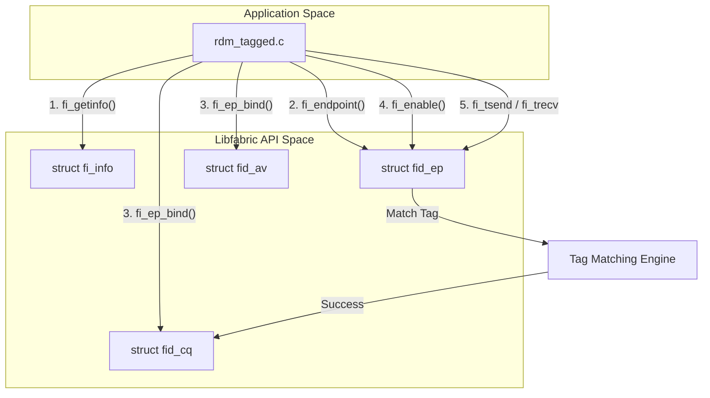
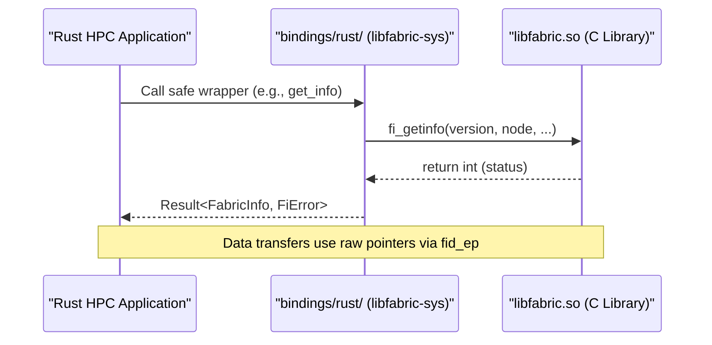

<!-- source: DeepWiki mcp.deepwiki.com · repo ofiwg/libfabric · page 1.3 Examples and Bindings · fetched 2026-11-11 -->

# Examples and Bindings

Relevant source files

The following files were used as context for generating this wiki page:

- [.gitignore](.gitignore)
- [examples/Makefile](examples/Makefile)
- [examples/README.md](examples/README.md)
- [examples/msg.c](examples/msg.c)
- [examples/rdm.c](examples/rdm.c)
- [examples/rdm_rma.c](examples/rdm_rma.c)
- [examples/rdm_tagged.c](examples/rdm_tagged.c)
- [examples/tcp_socket.c](examples/tcp_socket.c)
- [fabtests/component/dmabuf-rdma/check_cuda_dmabuf.c](fabtests/component/dmabuf-rdma/check_cuda_dmabuf.c)
- [fabtests/unit/check_hmem.c](fabtests/unit/check_hmem.c)
- [include/rdma/fabric.h](include/rdma/fabric.h)
- [include/rdma/fi_domain.h](include/rdma/fi_domain.h)
- [man/fi_atomic.3.md](man/fi_atomic.3.md)
- [man/fi_domain.3.md](man/fi_domain.3.md)
- [man/fi_endpoint.3.md](man/fi_endpoint.3.md)
- [man/fi_getinfo.3.md](man/fi_getinfo.3.md)
- [man/fi_mr.3.md](man/fi_mr.3.md)
- [man/fi_msg.3.md](man/fi_msg.3.md)
- [man/fi_rma.3.md](man/fi_rma.3.md)
- [man/fi_tagged.3.md](man/fi_tagged.3.md)
- [src/fi_tostr.c](src/fi_tostr.c)

This section describes the standalone code examples provided in the libfabric repository and the official Rust language bindings. These resources serve as the primary entry point for developers to understand common libfabric usage patterns and to integrate the library into high-performance applications written in Rust.

## Code Examples

The `examples/` directory contains standalone C programs that demonstrate the core communication paradigms supported by libfabric. These examples are designed to be pedagogical, showing the minimum boilerplate required to initialize the library, discover providers, and perform data transfers.

### Common Usage Patterns

Libfabric examples typically follow a standard lifecycle:
1.  **Discovery**: Calling `fi_getinfo` to find a provider matching the application's requirements [man/fi_getinfo.3.md:19-20]().
2.  **Resource Allocation**: Opening a fabric, domain, and endpoint [man/fi_domain.3.md:19-20](), [man/fi_endpoint.3.md:59-60]().
3.  **Binding**: Associating the endpoint with Event Queues (EQ), Completion Queues (CQ), and Address Vectors (AV) [man/fi_endpoint.3.md:89-93]().
4.  **Activation**: Enabling the endpoint via `fi_enable` [man/fi_endpoint.3.md:95]().
5.  **Data Transfer**: Executing MSG, RDM, RMA, or Tagged operations.

### Example Implementation Mapping

| Example File | Pattern | Description | Key Functions Used |
| :--- | :--- | :--- | :--- |
| `examples/rdm.c` | **RDM** | Reliable Datagram Messaging. | `fi_send`, `fi_recv` |
| `examples/msg.c` | **MSG** | Connection-oriented byte streams. | `fi_connect`, `fi_accept` |
| `examples/rdm_tagged.c` | **Tagged** | Matching sends to receives via 64-bit tags. | `fi_tsend`, `fi_trecv` |
| `examples/rdm_rma.c` | **RMA** | One-sided Remote Memory Access. | `fi_read`, `fi_write` |

### Data Flow: Tagged Messaging (RDM)
The following diagram illustrates the data flow and entity relationships in a tagged messaging example, such as `rdm_tagged.c`.

**Tagged Communication Entity Map**

Sources: [man/fi_tagged.3.md:23-52](), [man/fi_endpoint.3.md:89-95](), [examples/rdm_tagged.c]()

---

## Rust Bindings

The `bindings/rust/` directory provides the official Foreign Function Interface (FFI) to libfabric for Rust-based HPC applications. These bindings allow Rust developers to leverage libfabric's high-performance capabilities while maintaining the safety and expressive power of the Rust language.

### Structure and Implementation
The bindings are typically generated or maintained to wrap the core headers found in `include/rdma/`.

*   **Core FFI**: Maps C structures like `fi_info` [include/rdma/fabric.h:130-146]() and `fid_domain` [include/rdma/fi_domain.h:131-135]() to Rust `struct` representations.
*   **Constants**: Exports bitflags for capabilities such as `FI_MSG` [include/rdma/fabric.h:125](), `FI_RMA` [include/rdma/fabric.h:126](), and `FI_TAGGED` [include/rdma/fabric.h:127]().
*   **Function Mapping**: Provides safe or unsafe wrappers around the primary API entry points like `fi_getinfo` and `fi_fabric`.

### Rust Integration Flow
This diagram shows how a Rust application interacts with the underlying libfabric C library through the provided bindings.

**Rust-to-C FFI Bridge**

Sources: [bindings/rust/]() (referenced by path), [include/rdma/fabric.h:98-113]()

---

## Technical Detail: Data Transfer Interfaces

The examples demonstrate four primary data transfer interfaces defined in the libfabric specification.

### 1. Message (MSG)
Standard two-sided communication. The receiver must post a buffer before the sender initiates the transfer.
*   **Functions**: `fi_send`, `fi_recv` [man/fi_msg.3.md:24-34]().
*   **Usage**: Demonstrated in `examples/msg.c`.

### 2. Tagged Messaging (TAGGED)
An extension of the message interface where buffers are matched using a 64-bit tag and an ignore mask [man/fi_tagged.3.md:112-116]().
*   **Matching Logic**: `(send_tag & ~ignore) == (recv_tag & ~ignore)` [man/fi_tagged.3.md:119]().
*   **Usage**: Demonstrated in `examples/rdm_tagged.c`.

### 3. Remote Memory Access (RMA)
One-sided operations where a process can directly read from or write to a remote process's memory without its active involvement in the transfer [man/fi_rma.3.md:111-114]().
*   **Key Requirements**: Requires memory registration (`fi_mr_reg`) and a protection key (`key`) [man/fi_mr.3.md:51-53]().
*   **Functions**: `fi_read`, `fi_write` [man/fi_rma.3.md:24-36]().

### 4. Atomics
Operations that perform a read-modify-write sequence on a remote memory location atomically [man/fi_atomic.3.md:152-155]().
*   **Supported Types**: Includes `FI_INT64`, `FI_FLOAT`, `FI_DOUBLE`, etc [man/fi_atomic.3.md:169-203]().
*   **Operations**: `FI_SUM`, `FI_MIN`, `FI_MAX`, `FI_CSWAP` [include/rdma/fi_domain.h:247-271]().

Sources: [man/fi_msg.3.md](), [man/fi_tagged.3.md](), [man/fi_rma.3.md](), [man/fi_atomic.3.md](), [include/rdma/fi_domain.h]()

---

