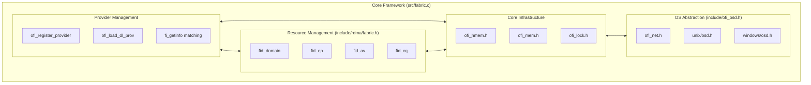
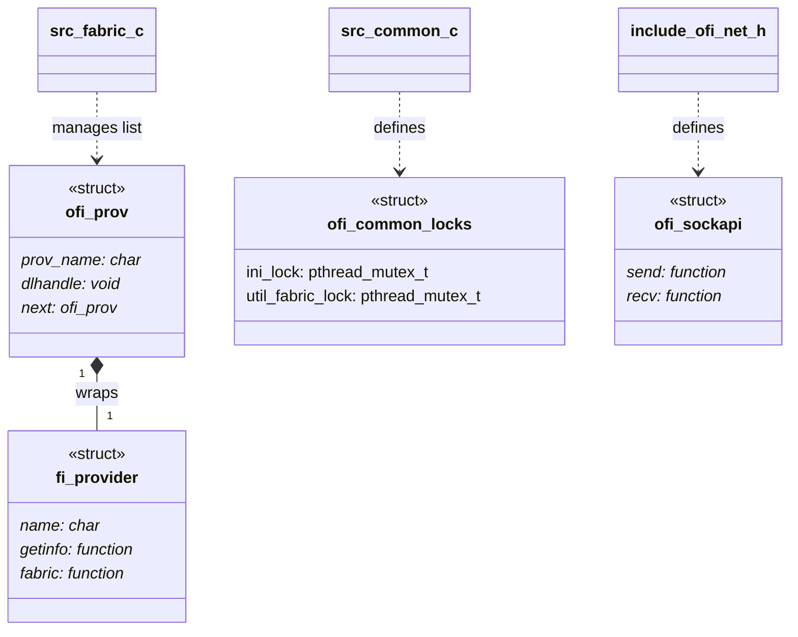

<!-- source: DeepWiki mcp.deepwiki.com · repo ofiwg/libfabric · page 2 Core Framework · fetched 2026-11-11 -->

# Core Framework

Relevant source files

The following files were used as context for generating this wiki page:

- [Makefile.am](Makefile.am)
- [include/freebsd/osd.h](include/freebsd/osd.h)
- [include/linux/osd.h](include/linux/osd.h)
- [include/ofi.h](include/ofi.h)
- [include/ofi_atom.h](include/ofi_atom.h)
- [include/ofi_epoll.h](include/ofi_epoll.h)
- [include/ofi_list.h](include/ofi_list.h)
- [include/ofi_lock.h](include/ofi_lock.h)
- [include/ofi_mem.h](include/ofi_mem.h)
- [include/ofi_net.h](include/ofi_net.h)
- [include/ofi_osd.h](include/ofi_osd.h)
- [include/ofi_signal.h](include/ofi_signal.h)
- [include/osx/osd.h](include/osx/osd.h)
- [include/rdma/providers/fi_prov.h](include/rdma/providers/fi_prov.h)
- [include/unix/osd.h](include/unix/osd.h)
- [include/windows/ifaddrs.h](include/windows/ifaddrs.h)
- [include/windows/osd.h](include/windows/osd.h)
- [libfabric.vcxproj](libfabric.vcxproj)
- [libfabric.vcxproj.filters](libfabric.vcxproj.filters)
- [man/fi_info.1.md](man/fi_info.1.md)
- [prov/util/src/util_buf.c](prov/util/src/util_buf.c)
- [src/common.c](src/common.c)
- [src/fabric.c](src/fabric.c)
- [src/iouring.c](src/iouring.c)
- [src/linux/osd.c](src/linux/osd.c)
- [src/log.c](src/log.c)
- [src/mem.c](src/mem.c)
- [src/osx/osd.c](src/osx/osd.c)
- [src/unix/osd.c](src/unix/osd.c)
- [src/var.c](src/var.c)
- [src/windows/osd.c](src/windows/osd.c)
- [util/info.c](util/info.c)

The Core Framework of libfabric provides the foundation for the fabric interface abstraction. It manages provider registration, discovery, and selection while implementing the data structures and mechanisms needed to support the libfabric API. This page describes the architecture and key components of the framework that enables communication between applications and diverse fabric providers.

## Core Framework Architecture

The Core Framework connects applications to fabric providers through a consistent API while managing resource lifecycle, data transfer operations, and event completions.

Sources: [src/fabric.c:1-69](), [include/rdma/fabric.h:571-588](), [Makefile.am:45-108]()

## Provider Management
The provider management subsystem is responsible for registering, discovering, and selecting appropriate fabric providers. Providers are maintained in a linked list defined by `struct ofi_prov`.

*   **Discovery**: The framework discovers providers through static registration or dynamic loading via `dlopen` in `ofi_load_dl_prov`.
*   **Filtering**: Applications can filter providers using environment variables like `FI_PROVIDER` or through `fi_getinfo` hints.
*   **Ordering**: Providers are ordered based on version and preference flags in `ofi_insert_prov`.

For details, see [Provider Management](#2.1).

Sources: [src/fabric.c:62-83](), [src/fabric.c:153-183](), [src/fabric.c:922-1010]()

## Utility Provider Framework
To simplify provider development, libfabric includes a utility framework (`prov/util/`). This framework provides common implementations for complex objects like completion queues (`util_cq`), address vectors (`util_av`), and endpoints (`util_ep`). It also includes the `ofi_bufpool` for high-performance memory management.

For details, see [Utility Provider Framework](#2.2).

Sources: [Makefile.am:66-86](), [prov/util/src/util_buf.c:63-133]()

## OS Abstraction Layer (OSD)
Libfabric uses an OS Abstraction Layer to maintain portability across Linux, Windows, macOS, and FreeBSD. 
*   **Network**: `include/ofi_net.h` defines cross-platform socket operations like `ofi_send_socket`.
*   **Platform Specifics**: Platform-specific headers (e.g., `include/unix/osd.h`, `include/windows/osd.h`) abstract threading (`OFI_THREAD_LOCAL`), memory mapping (`ofi_mmap_anon_pages`), and error handling (`ofi_sockerr`).

For details, see [OS Abstraction Layer](#2.3).

Sources: [include/ofi_net.h:162-183](), [include/unix/osd.h:34-111](), [include/windows/osd.h:17-44]()

## Memory Registration and HMEM
The framework manages memory registration (MR) through a caching subsystem and monitors memory events (e.g., via `uffd` or `kdreg2`). The Heterogeneous Memory (HMEM) framework enables libfabric to support specialized memory types, such as CUDA, ROCm, and Ze, allowing providers to transparently handle GPU buffers.

For details, see [Memory Registration and HMEM](#2.4).

Sources: [src/hmem.c:47-56](), [include/ofi_mr.h:53-79](), [Makefile.am:84-96]()

## Collective Operations
Libfabric provides an interface for hardware-accelerated and software-emulated collective operations (e.g., `barrier`, `allreduce`). The framework handles AV sets and collective attributes to coordinate operations across multiple endpoints.

For details, see [Collective Operations](#2.5).

Sources: [prov/coll/src/coll_init.c:107-108](), [include/rdma/fi_collective.h:246-246](), [Makefile.am:98-108]()

## Code Entity Map

The following diagram maps high-level framework concepts to specific code entities within the libfabric source tree.

Sources: [src/fabric.c:62-69](), [src/common.c:77-86](), [include/ofi_net.h:162-183]()

---

