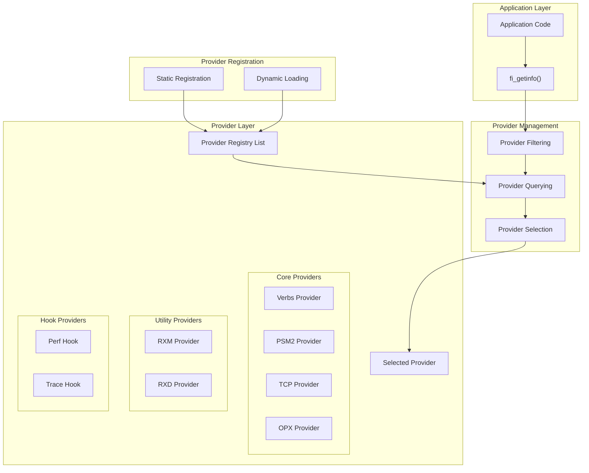
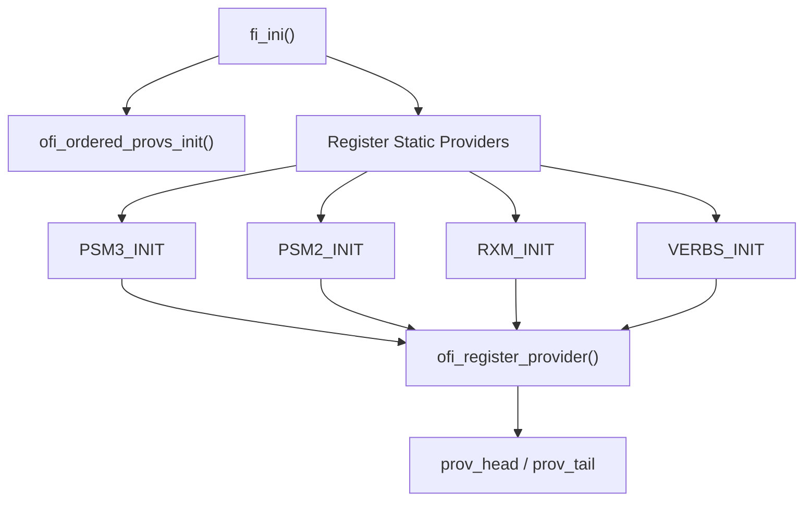
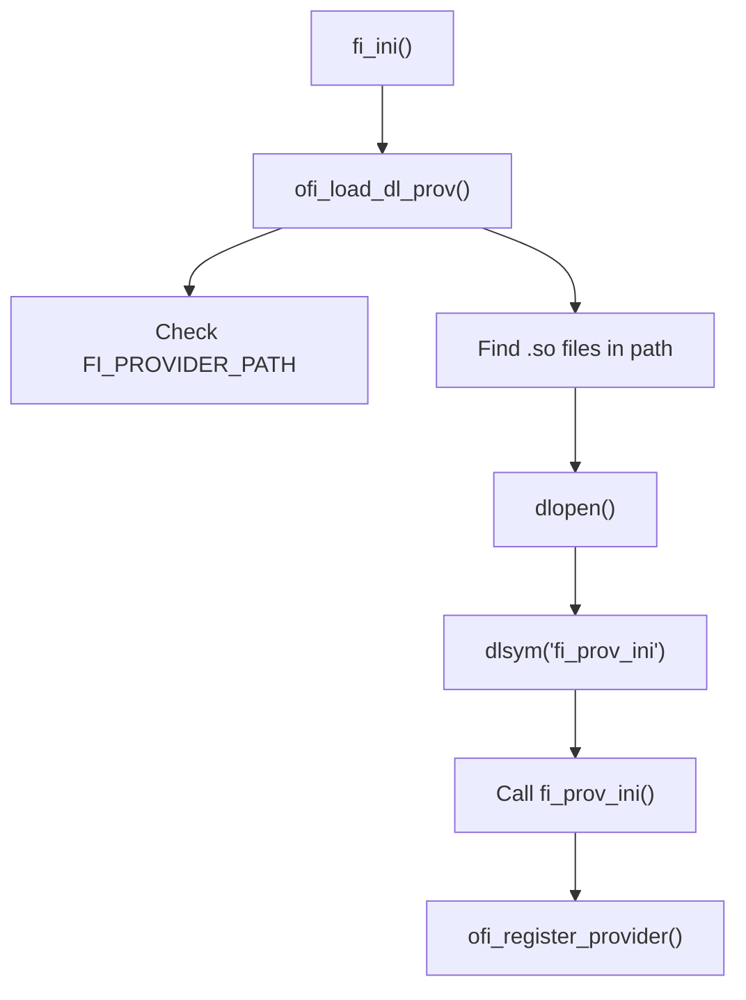
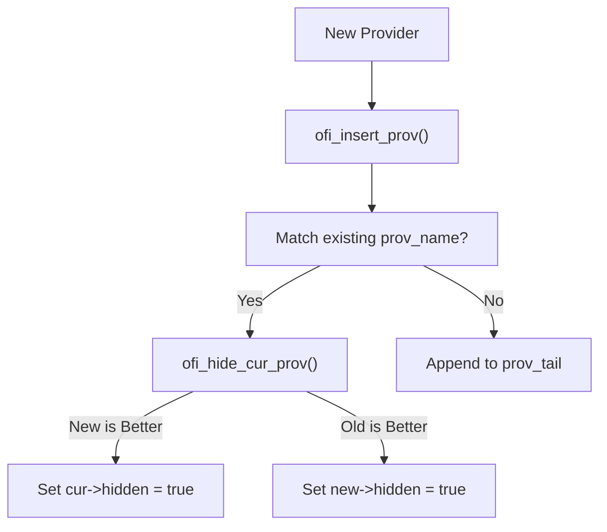
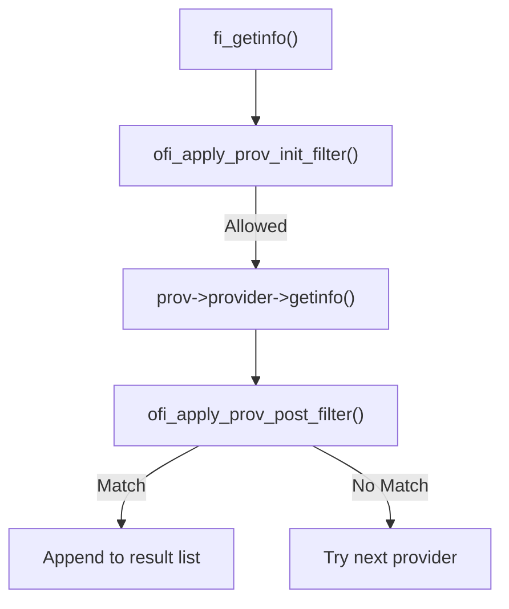
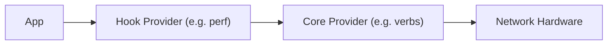
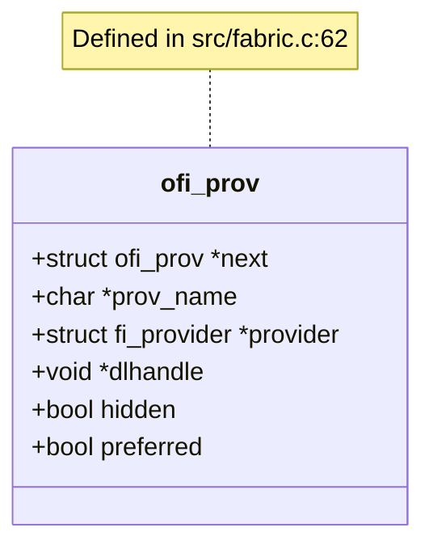
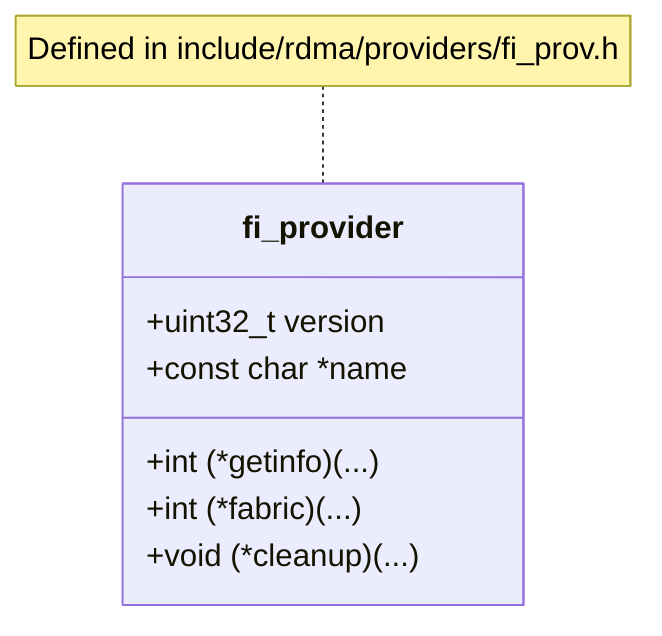

<!-- source: DeepWiki mcp.deepwiki.com · repo ofiwg/libfabric · page 2.1 Provider Management · fetched 2026-11-11 -->

# Provider Management

Relevant source files

The following files were used as context for generating this wiki page:

- [AUTHORS](AUTHORS)
- [COPYING](COPYING)
- [Makefile.am](Makefile.am)
- [NEWS.md](NEWS.md)
- [README](README)
- [configure.ac](configure.ac)
- [docs/windows.txt](docs/windows.txt)
- [fabtests/AUTHORS](fabtests/AUTHORS)
- [fabtests/COPYING](fabtests/COPYING)
- [fabtests/README](fabtests/README)
- [fabtests/configure.ac](fabtests/configure.ac)
- [include/ofi.h](include/ofi.h)
- [include/ofi_abi.h](include/ofi_abi.h)
- [include/ofi_mem.h](include/ofi_mem.h)
- [include/ofi_osd.h](include/ofi_osd.h)
- [include/rdma/fi_ext.h](include/rdma/fi_ext.h)
- [include/rdma/providers/fi_peer.h](include/rdma/providers/fi_peer.h)
- [include/rdma/providers/fi_prov.h](include/rdma/providers/fi_prov.h)
- [include/windows/config.h](include/windows/config.h)
- [libfabric.map.in](libfabric.map.in)
- [libfabric.vcxproj](libfabric.vcxproj)
- [libfabric.vcxproj.filters](libfabric.vcxproj.filters)
- [man/fi_info.1.md](man/fi_info.1.md)
- [man/fi_peer.3.md](man/fi_peer.3.md)
- [man/fi_provider.3.md](man/fi_provider.3.md)
- [prov/util/src/util_buf.c](prov/util/src/util_buf.c)
- [prov/util/src/util_srx.c](prov/util/src/util_srx.c)
- [src/abi_1_0.c](src/abi_1_0.c)
- [src/fabric.c](src/fabric.c)
- [src/log.c](src/log.c)
- [src/var.c](src/var.c)
- [util/info.c](util/info.c)

This page describes the provider management system in libfabric, which handles the registration, discovery, and selection of providers. A provider in libfabric is an implementation that gives access to an underlying fabric (network transport) service. Provider management is central to libfabric's ability to abstract different network technologies behind a common API.

## Provider Overview

Providers in libfabric are implementations of the libfabric API, each targeting a specific network technology or transport. The provider management system enables applications to select and use the most appropriate provider for their needs based on capability, performance, and availability.

Sources: [src/fabric.c:62-81](), [include/rdma/providers/fi_prov.h:50-70]()

## Provider Types

Libfabric providers are categorized into different types based on their role in the provider hierarchy. These types are defined in the internal provider context:

| Provider Type | Description | Internal Constant |
|---------------|-------------|-------------------|
| Core | Direct implementations for hardware or transport | `OFI_PROV_CORE` |
| Utility | Add functionality (layering) on top of core providers | `OFI_PROV_UTIL` |
| Hook | Intercept calls for instrumentation/debugging | `OFI_PROV_HOOK` |
| LNX | Linux-specific multi-rail or specialized providers | `OFI_PROV_LNX` |

The provider management system uses these types to determine how providers interact and how they should be ordered in the provider chain.

Sources: [src/fabric.c:250-268](), [include/rdma/providers/fi_prov.h:54-61]()

## Provider Registration

Providers are registered with the libfabric framework through two primary mechanisms during the execution of `fi_ini`.

### Static Registration

Built-in providers are statically registered in `fi_ini()` [src/fabric.c:922-1002]() with explicit calls to initialization functions (e.g., `psm3_ini`, `verbs_ini`). These calls eventually invoke `ofi_register_provider` to add the provider to the global linked list.

### Dynamic Loading

Dynamically loaded providers (DSOs) are discovered via `dlopen` in `ofi_load_dl_prov` [src/fabric.c:512-591](). Libfabric searches `FI_PROVIDER_PATH` or the default `PROVDLDIR` [Makefile.am:15-15]().

Sources: [src/fabric.c:512-591](), [src/fabric.c:977-1002](), [Makefile.am:15-15]()

## Provider Ordering

Providers are ordered based on either their version or registration order. This affects which provider is returned first by `fi_getinfo`.

The ordering logic in `ofi_hide_cur_prov` [src/fabric.c:140-151]() considers:
- **Preferred status**: Providers loaded with a `+` prefix in `FI_PROVIDER_PATH` [src/fabric.c:481-483]().
- **Version**: If `prov_order` is `OFI_PROV_ORDER_VERSION`, higher versions are preferred [src/fabric.c:149-150]().

Sources: [src/fabric.c:140-183](), [src/fabric.c:464-497]()

## Discovery Engine: fi_getinfo

The matching engine in `fi_getinfo` [src/fabric.c:356-412]() iterates through the registered providers and invokes their specific `getinfo` implementations.

### Matching Logic
1. **Initial Filter**: Checks `FI_PROVIDER` environment variable to see if the provider is explicitly included or excluded [src/fabric.c:270-291]().
2. **Provider Query**: Calls `prov->provider->getinfo(...)`.
3. **Post Filter**: If the application provided a specific `prov_name`, `fabric_attr->name`, or `domain_attr->name` in hints, libfabric filters the returned results to ensure they match [src/fabric.c:293-333]().

Sources: [src/fabric.c:356-412](), [src/fabric.c:270-333]()

## Provider Hooks

Hooks allow intercepting API calls. They are enabled via the `FI_HOOK` environment variable. When `fi_fabric` is called, libfabric checks for hooks and layers them over the core provider using `ofi_hook_install` [src/fabric.c:865-920]().

Sources: [src/fabric.c:865-920](), [src/fabric.c:427-457]()

## Key Data Structures

### Provider Entry (`struct ofi_prov`)
This internal structure tracks each registered provider within the core framework.

### Public Provider Interface (`struct fi_provider`)
The structure that every provider must implement and register.

Sources: [src/fabric.c:62-69](), [include/rdma/providers/fi_prov.h:72-83]()

## Configuration and Filtering

The management system respects several environment variables to control provider behavior:

| Variable | Description | Implementation |
|----------|-------------|----------------|
| `FI_PROVIDER` | Comma-separated list of providers to include or exclude (using `^`) | `prov_filter` [src/fabric.c:87-87]() |
| `FI_PROVIDER_PATH` | Search path for dynamic providers. `@` prefix sets registration order. | `ofi_load_dl_prov` [src/fabric.c:512-591]() |
| `FI_HOOK` | Semicolon-separated list of hook providers to install. | `ofi_hook_init` [src/fabric.c:427-457]() |

Sources: [src/fabric.c:270-356](), [src/fabric.c:512-591](), [src/fabric.c:427-457]()

---

