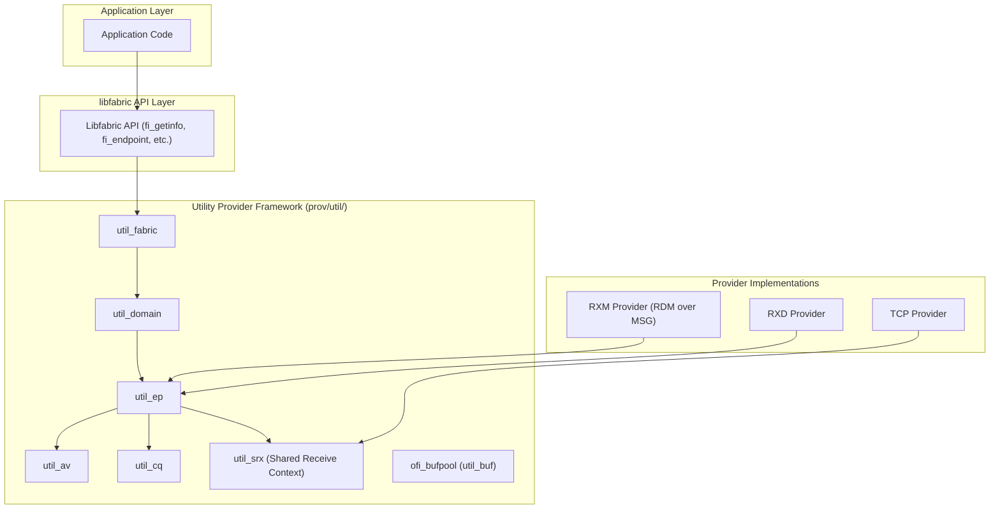
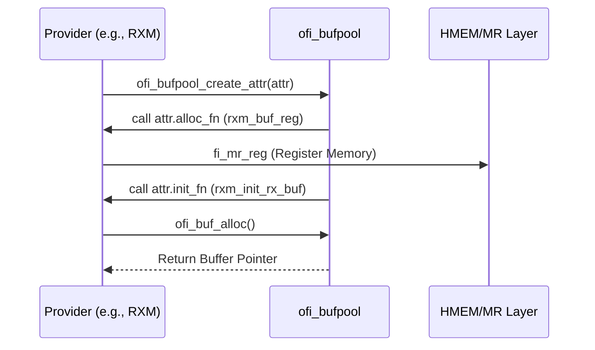
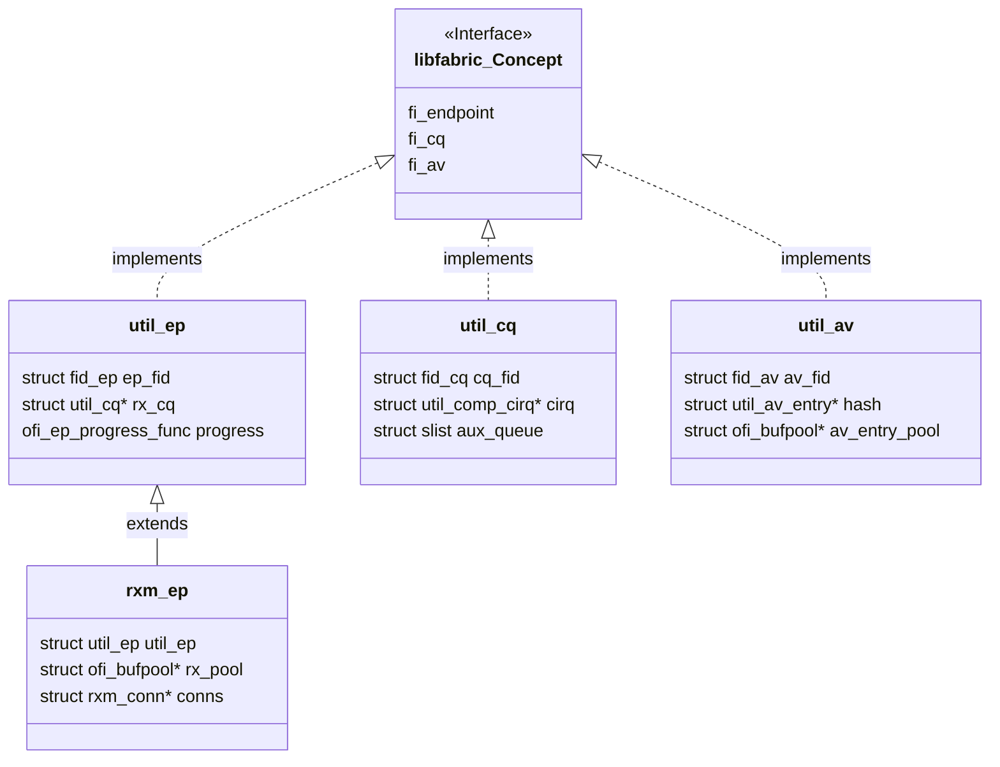

<!-- source: DeepWiki mcp.deepwiki.com · repo ofiwg/libfabric · page 2.2 Utility Provider Framework · fetched 2026-11-11 -->

# Utility Provider Framework

Relevant source files

The following files were used as context for generating this wiki page:

- [fabtests/functional/rdm_multi_client.c](fabtests/functional/rdm_multi_client.c)
- [fabtests/multinode/src/core_coll.c](fabtests/multinode/src/core_coll.c)
- [fabtests/prov/efa/src/efa_implicit_av_test.c](fabtests/prov/efa/src/efa_implicit_av_test.c)
- [include/ofi_bitmask.h](include/ofi_bitmask.h)
- [include/ofi_coll.h](include/ofi_coll.h)
- [include/ofi_enosys.h](include/ofi_enosys.h)
- [include/ofi_util.h](include/ofi_util.h)
- [include/rdma/fi_collective.h](include/rdma/fi_collective.h)
- [include/windows/poll.h](include/windows/poll.h)
- [man/fi_av_set.3.md](man/fi_av_set.3.md)
- [man/fi_collective.3.md](man/fi_collective.3.md)
- [man/man3/fi_allgather.3](man/man3/fi_allgather.3)
- [prov/rxd/src/rxd_cntr.c](prov/rxd/src/rxd_cntr.c)
- [prov/rxm/Makefile.include](prov/rxm/Makefile.include)
- [prov/rxm/src/rxm.h](prov/rxm/src/rxm.h)
- [prov/rxm/src/rxm_atomic.c](prov/rxm/src/rxm_atomic.c)
- [prov/rxm/src/rxm_attr.c](prov/rxm/src/rxm_attr.c)
- [prov/rxm/src/rxm_conn.c](prov/rxm/src/rxm_conn.c)
- [prov/rxm/src/rxm_cq.c](prov/rxm/src/rxm_cq.c)
- [prov/rxm/src/rxm_domain.c](prov/rxm/src/rxm_domain.c)
- [prov/rxm/src/rxm_ep.c](prov/rxm/src/rxm_ep.c)
- [prov/rxm/src/rxm_fabric.c](prov/rxm/src/rxm_fabric.c)
- [prov/rxm/src/rxm_init.c](prov/rxm/src/rxm_init.c)
- [prov/rxm/src/rxm_msg.c](prov/rxm/src/rxm_msg.c)
- [prov/rxm/src/rxm_rma.c](prov/rxm/src/rxm_rma.c)
- [prov/rxm/src/rxm_tagged.c](prov/rxm/src/rxm_tagged.c)
- [prov/udp/Makefile.include](prov/udp/Makefile.include)
- [prov/udp/src/udpx.h](prov/udp/src/udpx.h)
- [prov/udp/src/udpx_attr.c](prov/udp/src/udpx_attr.c)
- [prov/udp/src/udpx_cq.c](prov/udp/src/udpx_cq.c)
- [prov/udp/src/udpx_domain.c](prov/udp/src/udpx_domain.c)
- [prov/udp/src/udpx_ep.c](prov/udp/src/udpx_ep.c)
- [prov/udp/src/udpx_fabric.c](prov/udp/src/udpx_fabric.c)
- [prov/udp/src/udpx_init.c](prov/udp/src/udpx_init.c)
- [prov/util/src/rxm_av.c](prov/util/src/rxm_av.c)
- [prov/util/src/util_attr.c](prov/util/src/util_attr.c)
- [prov/util/src/util_av.c](prov/util/src/util_av.c)
- [prov/util/src/util_cntr.c](prov/util/src/util_cntr.c)
- [prov/util/src/util_cq.c](prov/util/src/util_cq.c)
- [prov/util/src/util_domain.c](prov/util/src/util_domain.c)
- [prov/util/src/util_ep.c](prov/util/src/util_ep.c)
- [prov/util/src/util_eq.c](prov/util/src/util_eq.c)
- [prov/util/src/util_fabric.c](prov/util/src/util_fabric.c)
- [prov/util/src/util_main.c](prov/util/src/util_main.c)
- [prov/util/src/util_poll.c](prov/util/src/util_poll.c)
- [prov/util/src/util_wait.c](prov/util/src/util_wait.c)
- [src/enosys.c](src/enosys.c)

The Utility Provider Framework (found in `prov/util/`) provides a set of common infrastructure components that simplify the development of libfabric providers. It offers reusable implementations of core libfabric abstractions like fabrics, domains, endpoints, address vectors, completion queues, and shared receive contexts. By leveraging this framework, providers can focus on their unique transport logic while maintaining consistent behavior and reducing code duplication.

## Architecture Overview

The Utility Provider Framework sits between the libfabric core API and the specific provider implementations (like RXM, RXD, or TCP).

Sources: [include/ofi_util.h:160-166](), [include/ofi_util.h:177-186](), [include/ofi_util.h:198-219](), [include/ofi_util.h:279-309]()

## Core Framework Components

### Utility Fabric and Domain
The `util_fabric` and `util_domain` structures provide base management for fabric and domain resources, including reference counting and locking.

*   **util_fabric**: Manages a list of domains and provider-specific attributes. [include/ofi_util.h:177-186]()
*   **util_domain**: Handles memory registration (MR) mapping via `ofi_mr_map` and coordinates with the Shared Receive Context (SRX). [include/ofi_util.h:198-219]()

### Utility Endpoint (util_ep)
The `util_ep` is the central structure for endpoint management. It tracks bound CQs, AVs, and counters, and provides a hook for a progress engine.

| Field | Description |
| :--- | :--- |
| `ep_fid` | The base libfabric endpoint FID. |
| `rx_cq` / `tx_cq` | Pointers to utility CQs for completion tracking. |
| `cntrs` | Array of utility counters (`util_cntr`) for various operations (TX, RX, READ, WRITE). |
| `progress` | A function pointer (`ofi_ep_progress_func`) called to drive provider progress. |

Sources: [include/ofi_util.h:279-309](), [prov/util/src/util_ep.c:40-73]()

### Utility Completion Queue (util_cq)
`util_cq` implements a completion queue that supports software-based overflow handling via an `aux_queue`.

*   **Implementation**: It uses a circular queue (`ofi_comp_cirq`) for standard completions. [include/ofi_util.h:525]()
*   **Overflow**: If the hardware or primary queue is full, entries are moved to `aux_queue`. [prov/util/src/util_cq.c:45-55]()
*   **Error Handling**: Provides `ofi_cq_write_error` for reporting failed operations to the application. [prov/util/src/util_cq.c:113-125]()

### Utility Address Vector (util_av)
The `util_av` handles the mapping between `fi_addr_t` and provider-specific address data.

*   **util_av_entry**: Internal structure stored in a hash table or bufpool to resolve addresses. [include/ofi_util.h:879-902]()
*   **Key Functions**: `ofi_av_insert_addr` [prov/util/src/util_av.c:301-331]() and `ofi_av_lookup_fi_addr` [prov/util/src/util_av.c:248-257]().

### Shared Receive Context (util_srx)
The `util_srx` allows multiple endpoints to share a single pool of receive buffers. This is critical for scalability in providers like RXM and TCP.

*   **Mechanism**: It manages a `fi_peer_rx_entry` list. When a message arrives, the SRX determines which endpoint's context should receive the data. [prov/rxm/src/rxm_ep.c:178-181](), [prov/rxm/src/rxm_cq.c:189-208]()

## Memory Management: ofi_bufpool
The utility framework provides `ofi_bufpool` (often referred to as `util_buf`) for high-performance buffer management. It supports regions, alignment, and custom initialization/registration functions.

Sources: [prov/rxm/src/rxm_ep.c:45-77](), [prov/rxm/src/rxm_ep.c:117-174]()

## Mapping Code Entities to System Concepts

This diagram illustrates how specific C structures in `prov/util/` and `prov/rxm/` relate to libfabric concepts.

Sources: [include/ofi_util.h:279-309](), [prov/rxm/src/rxm.h:258-300](), [include/ofi_util.h:502-528](), [include/ofi_util.h:879-902]()

## Data Flow: Completion Handling
When a provider receives a completion from the underlying transport (e.g., a TCP socket or Verbs CQ), it uses the utility framework to notify the application.

1.  **Provider Progress**: The provider's progress engine (e.g., `rxm_conn_progress`) is triggered. [prov/rxm/src/rxm_conn.c:88-107]()
2.  **Completion Processing**: The provider identifies the `util_cq` associated with the operation.
3.  **CQ Write**: The provider calls `ofi_peer_cq_write` or `ofi_cq_write`. [prov/rxm/src/rxm_cq.c:120-128]()
4.  **Auxiliary Handling**: If the application's CQ is full, `util_cq` automatically places the entry into the `aux_queue`. [prov/util/src/util_cq.c:45-55]()
5.  **Application Poll**: When the application calls `fi_cq_read`, the utility framework first checks the `aux_queue` before the primary circular queue. [prov/util/src/util_cq.c:239-260]()

Sources: [prov/rxm/src/rxm_cq.c:104-132](), [prov/util/src/util_cq.c:42-82](), [include/ofi_util.h:502-528]()

---

