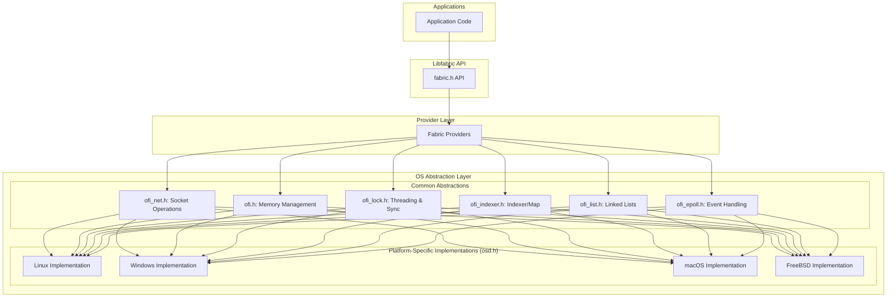
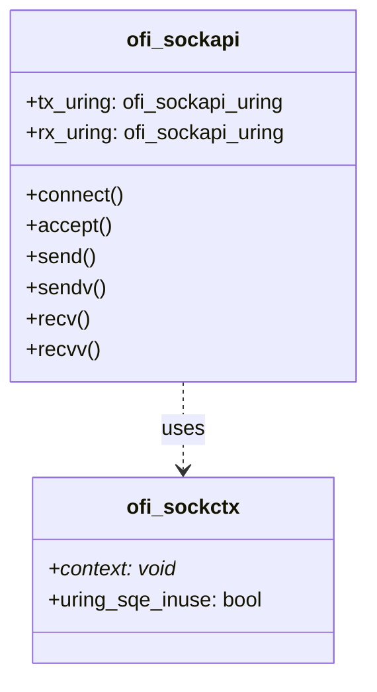
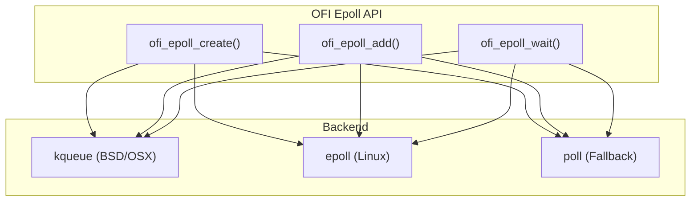

<!-- source: DeepWiki mcp.deepwiki.com · repo ofiwg/libfabric · page 2.3 OS Abstraction Layer · fetched 2026-11-11 -->

# OS Abstraction Layer

Relevant source files

The following files were used as context for generating this wiki page:

- [include/freebsd/osd.h](include/freebsd/osd.h)
- [include/linux/osd.h](include/linux/osd.h)
- [include/ofi_atom.h](include/ofi_atom.h)
- [include/ofi_epoll.h](include/ofi_epoll.h)
- [include/ofi_indexer.h](include/ofi_indexer.h)
- [include/ofi_list.h](include/ofi_list.h)
- [include/ofi_lock.h](include/ofi_lock.h)
- [include/ofi_net.h](include/ofi_net.h)
- [include/ofi_signal.h](include/ofi_signal.h)
- [include/osx/osd.h](include/osx/osd.h)
- [include/unix/osd.h](include/unix/osd.h)
- [include/windows/ifaddrs.h](include/windows/ifaddrs.h)
- [include/windows/osd.h](include/windows/osd.h)
- [src/common.c](src/common.c)
- [src/indexer.c](src/indexer.c)
- [src/iouring.c](src/iouring.c)
- [src/linux/osd.c](src/linux/osd.c)
- [src/mem.c](src/mem.c)
- [src/osx/osd.c](src/osx/osd.c)
- [src/unix/osd.c](src/unix/osd.c)
- [src/windows/osd.c](src/windows/osd.c)

The OS Abstraction Layer (OSD) in libfabric provides a unified cross-platform interface that allows the library to function consistently across different operating systems. It abstracts platform-specific functionality including file operations, socket communications, memory management, threading, network address handling, and synchronization primitives. This abstraction enables libfabric providers to use a common API regardless of the underlying operating system.

## Architecture

The OS Abstraction Layer sits at the foundation of the libfabric architecture, providing core capabilities that higher layers of the library depend on. It ensures that code can be written once and run consistently across Linux, Windows, macOS, and FreeBSD.

Sources: [include/unix/osd.h:1-250](), [include/windows/osd.h:1-280](), [include/osx/osd.h:1-100](), [include/ofi_net.h:1-100](), [include/ofi_lock.h:1-50]()

### Platform Abstraction Headers

The OSD layer is implemented through a set of platform-specific header files that define common interfaces with platform-specific implementations. The system uses `ofi_osd.h` as a top-level wrapper that includes the correct variant based on build-time definitions.

| Platform | Primary Header | Implementation Files |
|----------|---------------|---------------------|
| Unix (Base) | `include/unix/osd.h` | `src/unix/osd.c` |
| Linux | `include/linux/osd.h` | `src/linux/osd.c` |
| Windows | `include/windows/osd.h` | `src/windows/osd.c` |
| macOS | `include/osx/osd.h` | `src/osx/osd.c` |
| FreeBSD | `include/freebsd/osd.h` | (extends Unix) |

Sources: [include/unix/osd.h:34-111](), [include/windows/osd.h:17-43](), [include/osx/osd.h:36-57](), [src/unix/osd.c:54-61](), [src/windows/osd.c:44-50]()

## Key Components

### Socket Operations (`ofi_net.h`)

The socket abstraction provides a unified interface for network communication, handling differences between Windows (Winsock) and POSIX systems. It includes `ofi_sockapi` which abstracts the backend implementation (e.g., standard sockets vs `io_uring`).

The socket operations include:
- **Standard Sockets**: Wrappers like `ofi_sockapi_send_socket` [include/ofi_net.h:224-243]() and `ofi_sockapi_recv_socket` [include/ofi_net.h:267-286]().
- **Utility Functions**: `ofi_recvall_socket` [include/ofi_net.h:113-119]() and `ofi_sendall_socket` [include/ofi_net.h:121-133]() ensure complete data transfer.
- **Error Handling**: `ofi_sockerr()` [include/unix/osd.h:185-188]() maps platform-specific errors to standard codes.

Sources: [include/ofi_net.h:113-286](), [include/unix/osd.h:142-188]()

### Memory Management and Utilities

The memory component provides primitives for allocation, shared memory, and huge pages.

- **Allocation**: `ofi_memalign` [include/unix/osd.h:116-119]() and `ofi_freealign` [include/unix/osd.h:131-134]().
- **Anonymous Pages**: `ofi_mmap_anon_pages` [src/unix/osd.c:126-134]() provides a platform-independent way to allocate large memory regions.
- **Shared Memory**: The `util_shm` struct and `ofi_shm_map` [src/unix/osd.c:144-210]() / [src/windows/osd.c:235-273]() functions handle inter-process communication segments.

Sources: [include/unix/osd.h:105-134](), [src/unix/osd.c:126-221](), [src/windows/osd.c:235-273]()

### Event Polling (`ofi_epoll.h`)

The event polling component provides a unified interface for I/O event notification, using the most efficient mechanism available.

- **Linux**: Uses `epoll` via `ofi_epoll_create` [include/ofi_epoll.h:218-222]().
- **macOS/FreeBSD**: Uses `kqueue` via `ofi_epoll_create` [include/ofi_epoll.h:69-73]().
- **Fallback**: Uses standard `poll()` [include/ofi_epoll.h:272-284]().

Sources: [include/ofi_epoll.h:49-196](), [include/ofi_epoll.h:206-298]()

### I/O Enhancements (`io_uring`)

Libfabric supports Linux `io_uring` for high-performance asynchronous socket I/O. This is integrated into the `ofi_sockapi` structure.

- **Initialization**: `ofi_uring_init` [src/iouring.c:184-215]().
- **Operations**: `ofi_sockapi_send_uring` and `ofi_sockapi_recv_uring` allow providers to queue I/O without immediate blocking.

Sources: [src/iouring.c:40-254](), [include/ofi_net.h:140-161]()

### Synchronization and Primitive Types

- **Locks**: `ofi_lock.h` defines `ofi_spin_t` and `ofi_mutex_t` [include/ofi_lock.h:77-208](). The `ofi_genlock` structure [src/common.c:103-142]() provides a generic wrapper that can switch between spinlocks, mutexes, or no-ops at runtime.
- **Lists**: `ofi_list.h` provides a circular doubly-linked list (`dlist_entry`) [include/ofi_list.h:57-60]() with extensive macros for traversal (`dlist_foreach`) [include/ofi_list.h:117-118]().
- **Indexer**: `ofi_indexer.h` manages associations between pointers and integer IDs [include/ofi_indexer.h:49-84](). It uses a chunked array approach to grow dynamically [src/indexer.c:55-84]().

Sources: [include/ofi_lock.h:77-208](), [src/common.c:103-142](), [include/ofi_list.h:55-138](), [include/ofi_indexer.h:49-115](), [src/indexer.c:55-157]()

## Platform-Specific Implementation Details

### Windows (`src/windows/osd.c`)
- Implements `socketpair` [src/windows/osd.c:58-117]() using a local loopback connection, as Windows lacks native support.
- Handles library initialization via `DllMain` [src/windows/osd.c:211-233]().
- Maps POSIX-style file reads to `CreateFileA` and `ReadFile` [src/windows/osd.c:153-196]().

### Unix/Linux (`src/unix/osd.c`)
- Implements `fi_fd_nonblock` [src/unix/osd.c:82-95]() using `fcntl`.
- Provides `ofi_set_thread_affinity` [src/unix/osd.c:266-310]() for pinning threads to specific CPUs.
- Uses `shm_open` and `mmap` for shared memory [src/unix/osd.c:144-221]().

### macOS (`include/osx/osd.h`)
- Implements spinlocks using `os_unfair_lock` [include/osx/osd.h:201-233]().
- Maps `pthread_yield` to `pthread_yield_np` [include/osx/osd.h:59]().

Sources: [src/windows/osd.c:58-233](), [src/unix/osd.c:82-310](), [include/osx/osd.h:59-233]()

---

