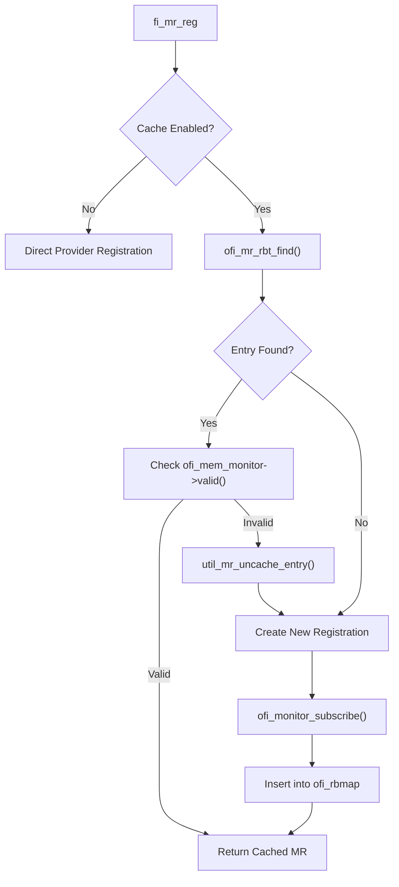
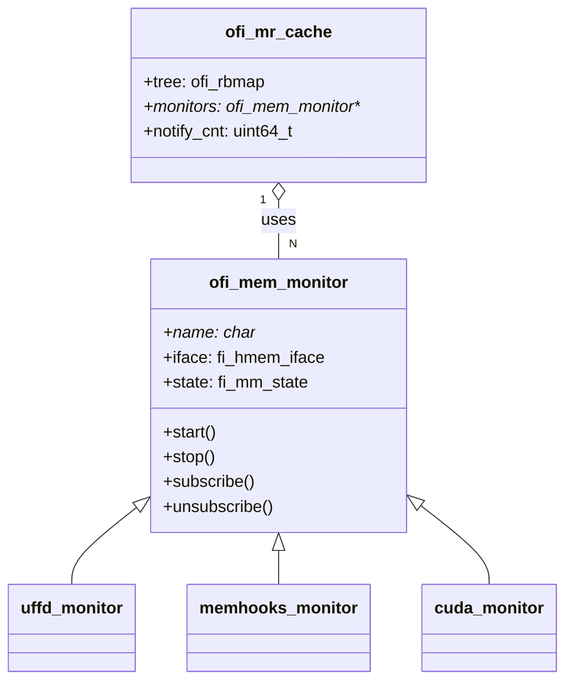
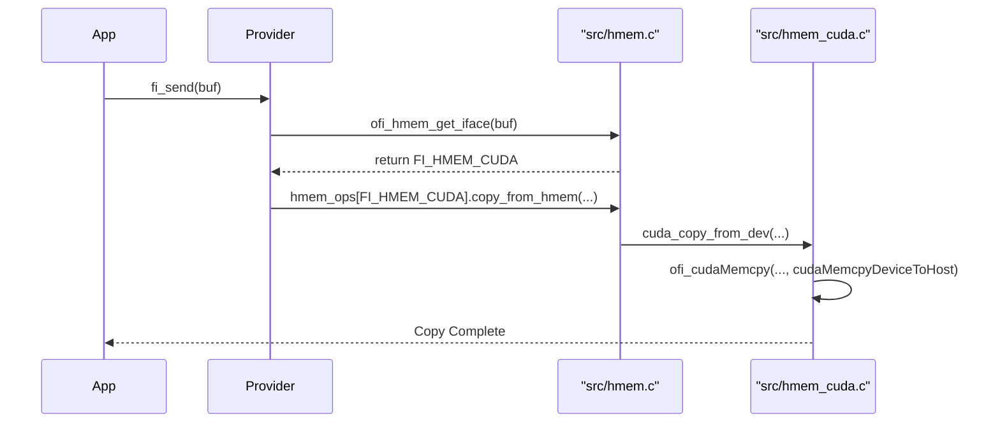

<!-- source: DeepWiki mcp.deepwiki.com · repo ofiwg/libfabric · page 2.4 Memory Registration and HMEM · fetched 2026-11-11 -->

# Memory Registration and HMEM

Relevant source files

The following files were used as context for generating this wiki page:

- [AUTHORS](AUTHORS)
- [COPYING](COPYING)
- [NEWS.md](NEWS.md)
- [README](README)
- [configure.ac](configure.ac)
- [docs/windows.txt](docs/windows.txt)
- [fabtests/AUTHORS](fabtests/AUTHORS)
- [fabtests/COPYING](fabtests/COPYING)
- [fabtests/README](fabtests/README)
- [fabtests/configure.ac](fabtests/configure.ac)
- [include/ofi_hmem.h](include/ofi_hmem.h)
- [include/ofi_mr.h](include/ofi_mr.h)
- [include/ofi_tree.h](include/ofi_tree.h)
- [include/windows/config.h](include/windows/config.h)
- [prov/sockets/src/sock_mr.c](prov/sockets/src/sock_mr.c)
- [prov/util/src/cuda_ipc_monitor.c](prov/util/src/cuda_ipc_monitor.c)
- [prov/util/src/cuda_mem_monitor.c](prov/util/src/cuda_mem_monitor.c)
- [prov/util/src/import_mem_monitor.c](prov/util/src/import_mem_monitor.c)
- [prov/util/src/rocr_ipc_monitor.c](prov/util/src/rocr_ipc_monitor.c)
- [prov/util/src/rocr_mem_monitor.c](prov/util/src/rocr_mem_monitor.c)
- [prov/util/src/uffd_mem_monitor.c](prov/util/src/uffd_mem_monitor.c)
- [prov/util/src/util_mem_hooks.c](prov/util/src/util_mem_hooks.c)
- [prov/util/src/util_mem_monitor.c](prov/util/src/util_mem_monitor.c)
- [prov/util/src/util_mr_cache.c](prov/util/src/util_mr_cache.c)
- [prov/util/src/util_mr_map.c](prov/util/src/util_mr_map.c)
- [prov/util/src/xpmem_monitor.c](prov/util/src/xpmem_monitor.c)
- [prov/util/src/ze_mem_monitor.c](prov/util/src/ze_mem_monitor.c)
- [prov/verbs/src/verbs_mr.c](prov/verbs/src/verbs_mr.c)
- [src/hmem.c](src/hmem.c)
- [src/hmem_cuda.c](src/hmem_cuda.c)
- [src/hmem_cuda_gdrcopy.c](src/hmem_cuda_gdrcopy.c)
- [src/hmem_neuron.c](src/hmem_neuron.c)
- [src/hmem_rocr.c](src/hmem_rocr.c)
- [src/hmem_synapseai.c](src/hmem_synapseai.c)
- [src/hmem_ze.c](src/hmem_ze.c)
- [src/tree.c](src/tree.c)

The Memory Registration (MR) and Heterogeneous Memory (HMEM) subsystems provide a unified framework for managing memory access across diverse hardware types, including standard system RAM and accelerator memory (GPUs/TPUs). This architecture allows providers to efficiently track memory validity, cache registrations, and perform cross-device data transfers.

## Memory Registration (MR) Cache

The MR cache is a utility component designed to reduce the overhead of pinning and registering memory with hardware. It stores active and inactive memory regions in a Red-Black tree for fast lookups.

### Architecture and Data Flow
When an application requests memory registration, the provider checks the `ofi_mr_cache` [include/ofi_mr.h:140](). If a matching entry exists and is still valid, the cached registration is returned. If not, a new registration is performed and added to the cache.

The cache interacts with **Memory Monitors** to ensure that if the underlying virtual-to-physical mapping changes (e.g., via `free()` or `munmap()`), the cached entry is invalidated.

### Key Components
- `ofi_mr_cache`: The primary structure managing cached registrations [prov/util/src/util_mr_cache.c:47]().
- `ofi_mr_entry`: Represents a single cached registration, including its `iovec` and HMEM metadata [include/ofi_mr.h:153-160]().
- `ofi_rbmap`: A Red-Black tree used for $O(\log n)$ lookup of memory ranges [prov/util/src/util_mr_cache.c:158-168]().

**MR Cache Lookup Logic**

*Sources: [prov/util/src/util_mr_cache.c:158-184](), [include/ofi_mr.h:170-195]()*

---

## Memory Monitors

Memory monitors track the state of virtual memory regions. They notify the MR cache when memory is invalidated so that stale entries can be purged.

### Monitor Implementations
Libfabric supports multiple monitor backends depending on OS capabilities:
1.  **Userfaultfd (uffd)**: Uses the Linux `userfaultfd` mechanism to intercept page events [prov/util/src/util_mem_monitor.c:200]().
2.  **Memhooks**: Intercepts standard library calls like `free`, `malloc`, and `munmap` [prov/util/src/util_mem_monitor.c:207]().
3.  **kdreg2**: A Linux kernel module-based monitor for high-performance notification [include/ofi_mr.h:55-61]().
4.  **Device-Specific Monitors**: Specialized monitors for CUDA, ROCm, and Level Zero memory [prov/util/src/util_mem_monitor.c:166-178]().

### Monitor Lifecycle
Monitors transition through states defined in `fi_mm_state` [include/ofi_mr.h:162-168](). The `ofi_monitors_update` function coordinates starting and stopping monitors to avoid deadlocks during memory-intensive operations [prov/util/src/util_mem_monitor.c:99-144]().

**Monitor to Cache Association**

*Sources: [include/ofi_mr.h:170-195](), [prov/util/src/util_mem_monitor.c:159-187]()*

---

## Heterogeneous Memory (HMEM) Framework

The HMEM framework abstracts the complexities of different accelerator memory types. It provides a consistent interface (`ofi_hmem_ops`) for providers to perform copies and query address properties regardless of the underlying hardware.

### Supported Interfaces
Defined in `fi_hmem_iface` [include/ofi_hmem.h:97-135]():
- `FI_HMEM_SYSTEM`: Standard RAM.
- `FI_HMEM_CUDA`: NVIDIA GPUs.
- `FI_HMEM_ROCR`: AMD GPUs (ROCm).
- `FI_HMEM_ZE`: Intel GPUs (OneAPI Level Zero).
- `FI_HMEM_NEURON`: AWS Trainium/Inferentia.
- `FI_HMEM_SYNAPSEAI`: Habana Gaudi.

### Core Operations
The `hmem_ops` array contains function pointers for each interface [src/hmem.c:119-215](). Key operations include:
- `copy_to_hmem` / `copy_from_hmem`: Synchronous data transfer [include/ofi_hmem.h:111-114]().
- `is_addr_valid`: Determines if an address belongs to a specific device [include/ofi_hmem.h:115]().
- `get_dmabuf_fd`: Exports memory as a Linux DMA-BUF file descriptor for peer-to-peer transfers [include/ofi_hmem.h:132]().

### HMEM Implementation Example: CUDA
The CUDA implementation (`src/hmem_cuda.c`) uses `dlopen` (if enabled) to load `libcuda.so` and `libcudart.so` [src/hmem_cuda.c:48-51](). It maps libfabric calls to CUDA-specific functions:
- `ofi_cudaMemcpy` wraps `cudaMemcpy` and ensures synchronization if the context is not registered [src/hmem_cuda.c:178-204]().
- `cuda_get_dmabuf_fd` utilizes `cuMemGetHandleForAddressRange` to support GPUDirect RDMA via DMA-BUF [src/hmem_cuda.c:57-62]().

**HMEM Data Flow (Copy Operation)**

*Sources: [src/hmem.c:146-172](), [src/hmem_cuda.c:178-204](), [include/ofi_hmem.h:97-135]()*

---

## Peer-to-Peer (P2P) and DMA-BUF
Libfabric leverages Linux DMA-BUF to enable direct hardware-to-hardware transfers, bypassing host memory.
- Providers like **Verbs** check for DMA-BUF support during registration [prov/verbs/src/verbs_mr.c:60-118]().
- If `FI_MR_DMABUF` is requested, the provider uses `ofi_hmem_get_dmabuf_fd` to retrieve a file descriptor which is then passed to the NIC driver via `ibv_reg_dmabuf_mr` [prov/verbs/src/verbs_mr.c:141-145]().

*Sources: [prov/verbs/src/verbs_mr.c:141-152](), [include/ofi_hmem.h:132-134](), [NEWS.md:35]()*

---

