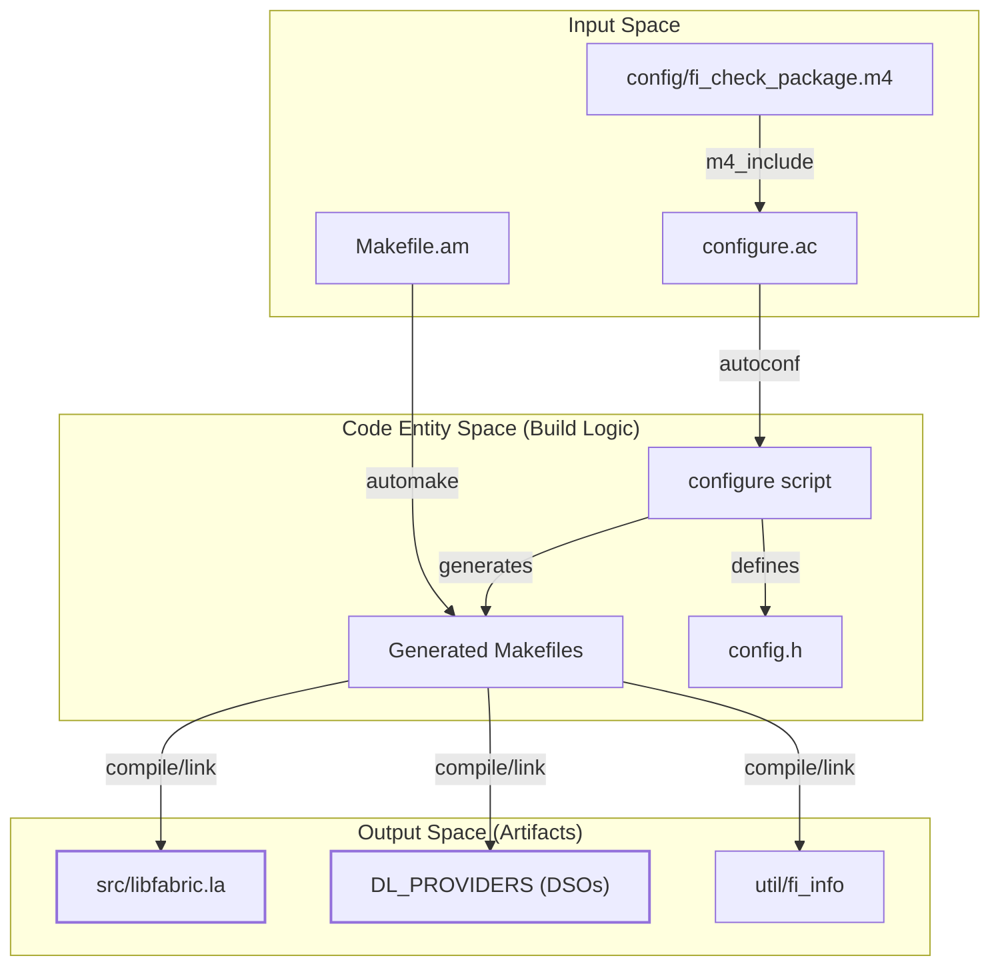
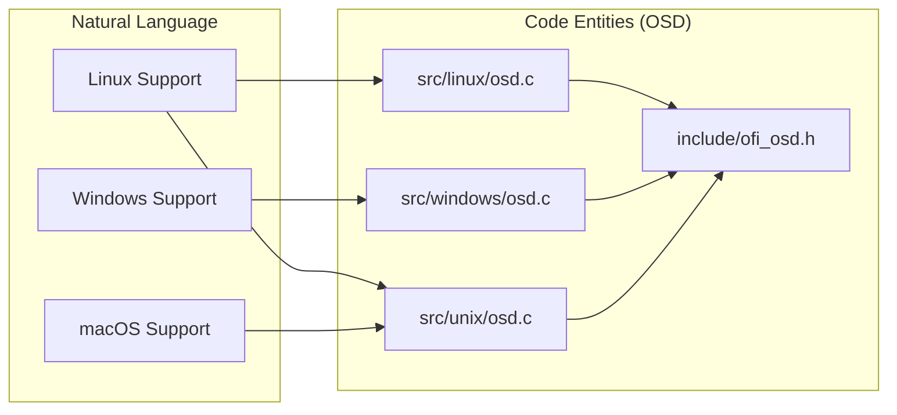

<!-- source: DeepWiki mcp.deepwiki.com · repo ofiwg/libfabric · page 3 Building and Configuration · fetched 2026-11-11 -->

# Building and Configuration

<details>
<summary>Relevant source files</summary>

The following files were used as context for generating this wiki page:

- [AUTHORS](AUTHORS)
- [COPYING](COPYING)
- [Makefile.am](Makefile.am)
- [NEWS.md](NEWS.md)
- [README](README)
- [configure.ac](configure.ac)
- [docs/windows.txt](docs/windows.txt)
- [fabtests/AUTHORS](fabtests/AUTHORS)
- [fabtests/COPYING](fabtests/COPYING)
- [fabtests/README](fabtests/README)
- [fabtests/configure.ac](fabtests/configure.ac)
- [include/ofi.h](include/ofi.h)
- [include/ofi_mem.h](include/ofi_mem.h)
- [include/ofi_osd.h](include/ofi_osd.h)
- [include/rdma/providers/fi_prov.h](include/rdma/providers/fi_prov.h)
- [include/windows/config.h](include/windows/config.h)
- [libfabric.vcxproj](libfabric.vcxproj)
- [libfabric.vcxproj.filters](libfabric.vcxproj.filters)
- [man/fi_info.1.md](man/fi_info.1.md)
- [prov/util/src/util_buf.c](prov/util/src/util_buf.c)
- [src/fabric.c](src/fabric.c)
- [src/log.c](src/log.c)
- [src/var.c](src/var.c)
- [util/info.c](util/info.c)

</details>


This page provides a high-level overview of how to build and configure the libfabric library for different environments and requirements. Libfabric uses an Autotools-based system on Unix-like platforms and Visual Studio solutions for Windows.

## Build System Architecture

Libfabric is designed to be highly modular. The build system manages the core framework, utility components, and a diverse set of providers. It supports both static linking and dynamic loading of providers via `dlopen`.

Title: Build System Flow and Entity Association

Sources: [configure.ac:10-22](), [Makefile.am:17-30](), [Makefile.am:153-156]()

## Build Options and Customization

The configuration process allows users to tailor the library to specific hardware and performance needs. Key categories of options include:

*   **Provider Selection**: Use `--enable-[provider]` to include specific backends like `tcp`, `verbs`, or `efa`. The `--enable-only` flag restricts the build to explicitly requested providers [configure.ac:92-97]().
*   **Performance Optimization**: The `--enable-direct` option allows applications to bypass the standard provider switchboard for a specific provider, reducing latency [configure.ac:85-90]().
*   **Heterogeneous Memory (HMEM)**: Support for GPU and accelerator memory is configured using flags such as `--with-cuda`, `--with-rocr`, and `--with-ze` [Makefile.am:47-53]().
*   **Debug and Sanitizers**: Developers can enable deep instrumentation using `--enable-debug` or various LLVM/GCC sanitizers like ASan and TSan [configure.ac:128-133](), [configure.ac:170-192]().

For a detailed breakdown of all available flags and their impacts on the library, see **[Build Options](#3.1)**.

## Platform Support

### Unix-like (Linux, macOS, FreeBSD)
Libfabric detects the host OS during the `configure` stage to include platform-specific abstraction layers [configure.ac:23-42](). On Linux, it can leverage advanced features like `io_uring` [Makefile.am:134-136]().

### Windows
Windows builds are managed via Visual Studio project files (`libfabric.vcxproj`). The configuration is largely defined in a manual `config.h` located in the `include/windows/` directory [libfabric.vcxproj:1-49](), [include/windows/config.h:1-20]().

Title: OS Abstraction Mapping

Sources: [Makefile.am:110-132](), [include/ofi_osd.h:1-20](), [libfabric.vcxproj.filters:46-48]()

## CI/CD Pipeline

Libfabric maintains a rigorous testing regime across multiple environments:
*   **GitHub Actions**: Handles PR-level checks, static analysis (CodeQL), and security scanning [NEWS.md:121-121]().
*   **Jenkins Pipelines**: Intel, Cray, and AWS maintain specialized pipelines to test against specific high-performance fabrics and hardware that are not available in standard cloud CI environments.

For more information on the automated testing and release process, see **[CI/CD Pipeline](#3.2)**.

## Runtime Verification

After building, the `fi_info` utility is the primary tool used to verify which providers were successfully compiled and are available on the current system [util/info.c:1-165]().

```bash
# List all available providers and their attributes
./util/fi_info -l
```
Sources: [Makefile.am:164-166](), [util/info.c:164-165]()

---

