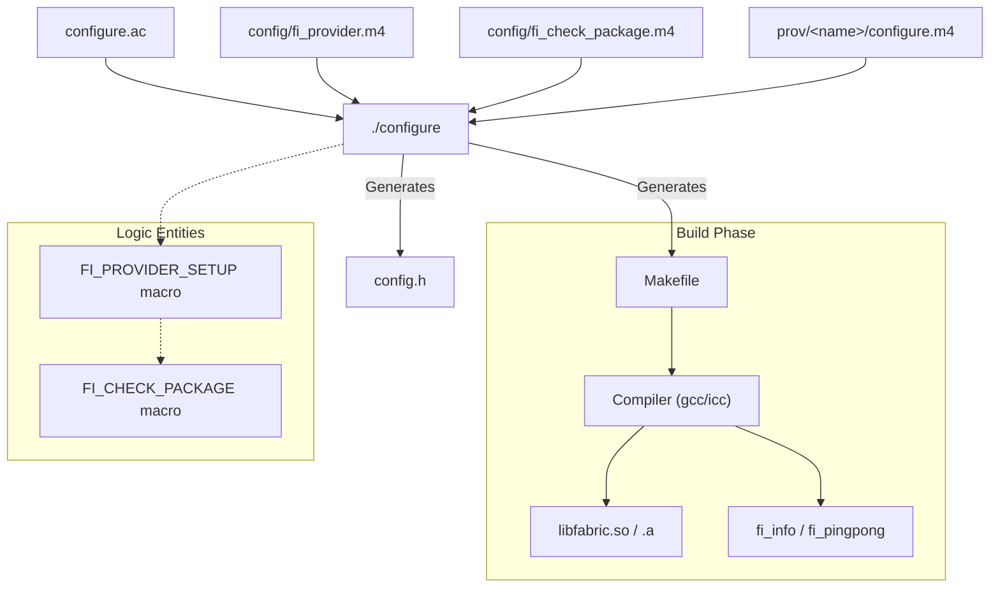
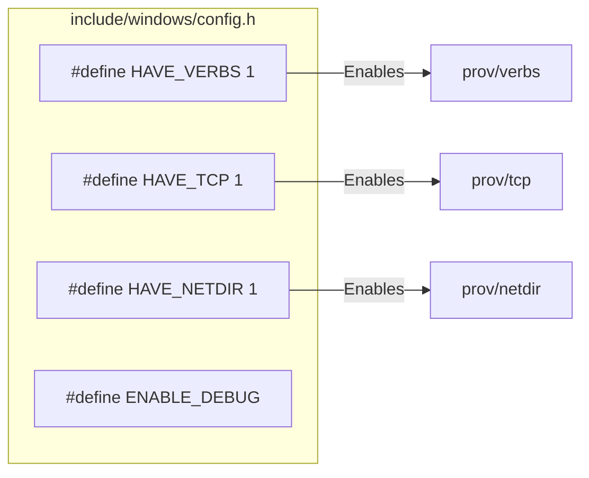

<!-- source: DeepWiki mcp.deepwiki.com · repo ofiwg/libfabric · page 3.1 Build Options · fetched 2026-11-11 -->

# Build Options

Relevant source files

The following files were used as context for generating this wiki page:

- [AUTHORS](AUTHORS)
- [COPYING](COPYING)
- [NEWS.md](NEWS.md)
- [README](README)
- [config/cron-make-nightly-tarball.pl](config/cron-make-nightly-tarball.pl)
- [config/distscript.pl](config/distscript.pl)
- [config/fi_check_package.m4](config/fi_check_package.m4)
- [config/fi_provider.m4](config/fi_provider.m4)
- [config/md2nroff.pl](config/md2nroff.pl)
- [configure.ac](configure.ac)
- [docs/windows.txt](docs/windows.txt)
- [fabtests/AUTHORS](fabtests/AUTHORS)
- [fabtests/COPYING](fabtests/COPYING)
- [fabtests/README](fabtests/README)
- [fabtests/configure.ac](fabtests/configure.ac)
- [include/windows/config.h](include/windows/config.h)
- [libfabric.pc.in](libfabric.pc.in)
- [prov/psm2/Makefile.include](prov/psm2/Makefile.include)
- [prov/psm2/configure.m4](prov/psm2/configure.m4)
- [prov/psm2/src/version.h](prov/psm2/src/version.h)
- [prov/sockets/Makefile.include](prov/sockets/Makefile.include)
- [prov/sockets/configure.m4](prov/sockets/configure.m4)
- [prov/sockets/include/sock_util.h](prov/sockets/include/sock_util.h)
- [prov/usnic/configure.m4](prov/usnic/configure.m4)
- [prov/verbs/configure.m4](prov/verbs/configure.m4)

This page details the various configuration and build options available for libfabric. Understanding these options is essential for customizing the build to suit specific hardware, operating systems, and performance requirements. This document focuses on compile-time build options; for runtime configuration, see [Environment Variables](#6.2).

## Overview of the Build System

Libfabric uses the GNU Autotools build system (`autoconf`, `automake`, and `libtool`) for configuring and building the library on Linux, macOS, and FreeBSD [configure.ac:25-42](). For Windows, a separate solution and header configuration are provided [include/windows/config.h:1-10]().

The build system allows for extensive customization including enabling/disabling specific providers, hardware acceleration features, debugging options, and more.

### Build System Data Flow
The diagram below illustrates how configuration inputs from the user and the environment are processed by Autotools macros to generate the final build artifacts.

**Sources:** [configure.ac:12-22](), [config/fi_provider.m4:51-106](), [config/fi_check_package.m4:1-50]()

## Provider Selection and Management

Libfabric's architecture is built around providers. The build system provides granular control over which providers are included and how they are linked.

### Core Selection Flags
*   `--enable-direct=[provider]`: Enables direct calls to a specific fabric provider, bypassing the standard function pointer table for reduced latency [configure.ac:85-90](). This requires the provider to have a `fi_direct.h` header [config/fi_provider.m4:149-159]().
*   `--enable-only`: When set, only explicitly specified providers are built; all others default to disabled [configure.ac:92-97]().
*   `--enable-[provider]=dl`: Builds the specified provider as a Dynamic Shared Object (DSO/plugin) instead of linking it statically into `libfabric.so` [config/fi_provider.m4:60-68]().

### Provider Setup Logic
The `FI_PROVIDER_SETUP` macro in `config/fi_provider.m4` manages the lifecycle of provider discovery during configuration.

| Variable/Macro | Role |
|:---|:---|
| `FI_PROVIDER_SETUP` | Main entry point for a provider's config logic [config/fi_provider.m4:51](). |
| `[provider]_happy` | Shell variable set to `1` if the provider's dependencies are met [config/fi_provider.m4:108](). |
| `PROVIDERS_TO_BUILD` | Aggregated list of all enabled providers [config/fi_provider.m4:109](). |
| `HAVE_[PROV]_DL` | C macro defined if the provider is built as a plugin [config/fi_provider.m4:132](). |

**Sources:** [configure.ac:85-97](), [config/fi_provider.m4:51-171]()

## Heterogeneous Memory (HMEM) Options

Libfabric supports various accelerator memory types. These are configured via `--with-[package]` flags.

| Option | Description | Implementation Detail |
|:---|:---|:---|
| `--with-cuda=DIR` | Enable NVIDIA CUDA support | Checks for `cuda_runtime.h` [fabtests/configure.ac:152-163](). |
| `--with-rocr=DIR` | Enable AMD ROCm support | Checks for `hsa/hsa.h` [fabtests/configure.ac:201-214](). |
| `--with-ze=DIR` | Enable Intel OneAPI Level Zero | Used for GPU memory peer-to-peer [NEWS.md:149-157](). |
| `--with-neuron` | Enable AWS Neuron support | Includes `nrt_get_dmabuf_fd_v2` support [NEWS.md:14-15](). |

### Memory Monitor Selection
Memory monitors track memory registrations to support caching.
*   `--disable-memhooks-monitor`: Disables the standard glibc-based memory hook monitor.
*   `--disable-uffd-monitor`: Disables the Linux `userfaultfd` based monitor.
*   `--disable-kdreg2`: Disables the kernel-assisted registration monitor.

**Sources:** [fabtests/configure.ac:149-214](), [NEWS.md:14-43](), [configure.ac:700-800]()

## Debugging and Profiling

Configuration flags for development and performance analysis:

*   `--enable-debug`: Sets `CFLAGS` to `-g -O0`, defines `ENABLE_DEBUG`, and enables internal assertions [configure.ac:128-158]().
*   `--enable-profile`: Defines `HAVE_FABRIC_PROFILE` to enable internal timing and counter instrumentation [configure.ac:159-168]().
*   `--with-valgrind`: Defines `INCLUDE_VALGRIND` to enable memory annotations for Valgrind tools [configure.ac:73-83]().
*   **Sanitizers**: Libfabric supports Address (`asan`), Leak (`lsan`), Thread (`tsan`), and Undefined Behavior (`ubsan`) sanitizers via the `FI_ARG_ENABLE_SANITIZER` macro [configure.ac:170-199]().

**Sources:** [configure.ac:128-199]()

## Windows Build Configuration

The Windows build does not use Autotools. Instead, it relies on a static `config.h` located in `include/windows/config.h`.

### Windows Feature Mapping

Windows builds typically enable a subset of providers: `sockets`, `udp`, `tcp`, `rxm`, `rxd`, `verbs`, and the Windows-specific `netdir` (NetworkDirect) provider [include/windows/config.h:139-191]().

**Sources:** [include/windows/config.h:1-240]()

## Core M4 Macros and Config Files

The `config/` directory contains the logic that drives the `configure` script:

*   `fi_check_package.m4`: A generic macro to check for headers and libraries (e.g., `ibverbs`, `rdmacm`) and set appropriate `CPPFLAGS` and `LIBS` [config/fi_check_package.m4:1-50]().
*   `fi_provider.m4`: Contains the core logic for provider registration and the `--enable-[provider]` command-line interface [config/fi_provider.m4:7-171]().
*   `distscript.pl`: A script invoked during `make dist` to ensure the distribution tarball is clean and includes generated files [config/distscript.pl:1-50]().
*   `cron-make-nightly-tarball.pl`: Automates the creation of nightly builds by updating the version string in `configure.ac` with `git describe` output [config/cron-make-nightly-tarball.pl:138-165]().

**Sources:** [config/fi_provider.m4:7-171](), [config/cron-make-nightly-tarball.pl:138-165](), [configure.ac:12-22]()

---

