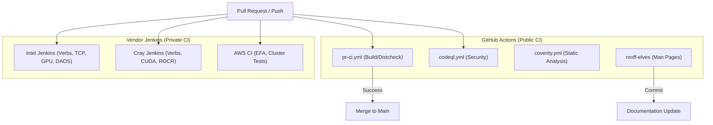
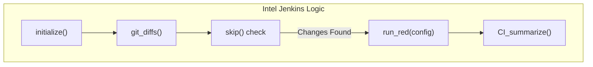
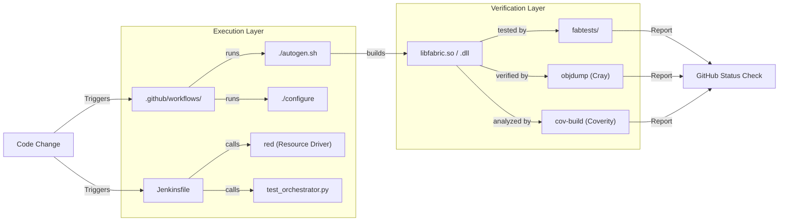

<!-- source: DeepWiki mcp.deepwiki.com · repo ofiwg/libfabric · page 3.2 CI/CD Pipeline · fetched 2026-11-11 -->

# CI/CD Pipeline

Relevant source files

The following files were used as context for generating this wiki page:

- [.appveyor.ps1](.appveyor.ps1)
- [.appveyor.yml](.appveyor.yml)
- [.github/workflows/auto-release.yml](.github/workflows/auto-release.yml)
- [.github/workflows/binding-checks.yaml](.github/workflows/binding-checks.yaml)
- [.github/workflows/build-dist-tarballs.yml](.github/workflows/build-dist-tarballs.yml)
- [.github/workflows/clang-format-check.yml](.github/workflows/clang-format-check.yml)
- [.github/workflows/codeql.yml](.github/workflows/codeql.yml)
- [.github/workflows/configure-checks.yml](.github/workflows/configure-checks.yml)
- [.github/workflows/coverity.yml](.github/workflows/coverity.yml)
- [.github/workflows/gh-man.sh](.github/workflows/gh-man.sh)
- [.github/workflows/gh-man.yaml](.github/workflows/gh-man.yaml)
- [.github/workflows/nroff-elves.sh](.github/workflows/nroff-elves.sh)
- [.github/workflows/nroff-elves.yaml](.github/workflows/nroff-elves.yaml)
- [.github/workflows/pr-character-safety.yml](.github/workflows/pr-character-safety.yml)
- [.github/workflows/pr-ci.yml](.github/workflows/pr-ci.yml)
- [.github/workflows/scorecard.yml](.github/workflows/scorecard.yml)
- [.github/workflows/scripts/check_nonprintable.sh](.github/workflows/scripts/check_nonprintable.sh)
- [.github/workflows/scripts/check_text_to_binary.sh](.github/workflows/scripts/check_text_to_binary.sh)
- [.github/workflows/scripts/test_pr_character_safety.sh](.github/workflows/scripts/test_pr_character_safety.sh)
- [.github/workflows/stale.yml](.github/workflows/stale.yml)
- [.travis.yml](.travis.yml)
- [Libfabric.Build.Default.props](Libfabric.Build.Default.props)
- [contrib/aws/Jenkinsfile](contrib/aws/Jenkinsfile)
- [contrib/cray/Jenkinsfile.verbs](contrib/cray/Jenkinsfile.verbs)
- [contrib/cray/bats/batsgenerator.sh](contrib/cray/bats/batsgenerator.sh)
- [contrib/cray/bats/benchmark.template](contrib/cray/bats/benchmark.template)
- [contrib/cray/bats/imb.bats](contrib/cray/bats/imb.bats)
- [contrib/cray/bats/omb.bats](contrib/cray/bats/omb.bats)
- [contrib/cray/bats/smoketests.bats](contrib/cray/bats/smoketests.bats)
- [contrib/cray/bats/test_helper.bash](contrib/cray/bats/test_helper.bash)
- [contrib/cray/bin/common.sh](contrib/cray/bin/common.sh)
- [contrib/cray/bin/fabtest_wrapper.sh](contrib/cray/bin/fabtest_wrapper.sh)
- [contrib/cray/bin/logwrap](contrib/cray/bin/logwrap)
- [contrib/cray/bin/parse_logfiles.sh](contrib/cray/bin/parse_logfiles.sh)
- [contrib/cray/bin/run_libfabric_pipeline](contrib/cray/bin/run_libfabric_pipeline)
- [contrib/cray/bin/setup.sh](contrib/cray/bin/setup.sh)
- [contrib/cray/bin/verify_requirements.sh](contrib/cray/bin/verify_requirements.sh)
- [contrib/cray/sft_test_results_baseline.txt](contrib/cray/sft_test_results_baseline.txt)
- [contrib/intel/jenkins/Jenkinsfile](contrib/intel/jenkins/Jenkinsfile)
- [contrib/intel/jenkins/Jenkinsfile_daos.nightly](contrib/intel/jenkins/Jenkinsfile_daos.nightly)
- [fabtests/test_configs/shm/cuda.exclude](fabtests/test_configs/shm/cuda.exclude)
- [include/windows/sys/socket.h](include/windows/sys/socket.h)
- [include/windows/sys/wait.h](include/windows/sys/wait.h)
- [info.vcxproj](info.vcxproj)
- [info.vcxproj.filters](info.vcxproj.filters)
- [libfabric.def](libfabric.def)
- [libfabric.sln](libfabric.sln)
- [man/man3/fi_fabric2.3](man/man3/fi_fabric2.3)
- [pingpong.vcxproj](pingpong.vcxproj)
- [pingpong.vcxproj.filters](pingpong.vcxproj.filters)
- [strerror.vcxproj](strerror.vcxproj)
- [strerror.vcxproj.filters](strerror.vcxproj.filters)
- [util/windows/getopt/getopt.cpp](util/windows/getopt/getopt.cpp)

This document describes the Continuous Integration/Continuous Deployment (CI/CD) pipeline for libfabric, covering GitHub Actions, multi-vendor Jenkins pipelines (Intel, Cray, AWS), and specialized security and static analysis workflows. For information about the testing framework itself, see [Testing Framework](#5.1).

## Overview

The libfabric CI/CD infrastructure is a distributed system involving multiple providers' infrastructure to ensure compatibility across a wide range of high-performance computing (HPC) hardware and software stacks.

Sources: [.github/workflows/pr-ci.yml:1-2](), [contrib/intel/jenkins/Jenkinsfile:148-169](), [contrib/cray/Jenkinsfile.verbs:12-28](), [contrib/aws/Jenkinsfile:141-152]()

## GitHub Actions Workflows

GitHub Actions provides the primary public-facing validation for every pull request and push to the `main` branch.

### Build and Distribution Checks (`pr-ci.yml`)
The `pr-ci.yml` workflow performs exhaustive build checks across Linux (Ubuntu) and macOS. It verifies:
* **Standard Builds**: Compiles with `gcc` and `clang` using a wide array of provider flags `OFI_PROVIDER_FLAGS` [.github/workflows/pr-ci.yml:27-40]().
* **Distcheck**: Runs `make distcheck` to ensure the distribution tarball is complete and buildable [.github/workflows/pr-ci.yml:70-70]().
* **HMEM Support**: Specifically validates Heterogeneous Memory (HMEM) builds by installing `nvidia-cuda-toolkit` and Intel `level-zero` headers, then configuring with `--with-cuda` and `--with-ze` [.github/workflows/pr-ci.yml:110-152]().
* **Compiler Compatibility**: Includes a specific job for `gcc-15` to catch forward-compatibility issues [.github/workflows/pr-ci.yml:78-103]().

### Security and Static Analysis
* **CodeQL**: Scans `c-cpp`, `python`, and `ruby` code for vulnerabilities on a nightly schedule and per PR [.github/workflows/codeql.yml:16-45]().
* **Coverity**: A nightly scan that downloads Coverity tools, configures with `clang`, and submits a build bundle to the Coverity Scan service [.github/workflows/coverity.yml:58-97]().
* **Scorecard**: Evaluates the repository against OpenSSF security best practices, including branch protection and dependency pinning [.github/workflows/scorecard.yml:5-42]().

### Documentation Automation
* **Nroff Elves**: Automatically converts Markdown man pages in `man/*.md` to nroff format using `pandoc` whenever they are modified [.github/workflows/nroff-elves.yaml:5-34]().
* **GH Man Page Updater**: Syncs the rendered man pages to the `gh-pages` branch for web viewing [.github/workflows/gh-man.yaml:1-36]().

Sources: [.github/workflows/pr-ci.yml:1-185](), [.github/workflows/codeql.yml:1-87](), [.github/workflows/coverity.yml:1-103](), [.github/workflows/scorecard.yml:1-75](), [.github/workflows/nroff-elves.yaml:1-39]()

## Intel Jenkins Pipeline

The Intel Jenkins pipeline handles complex integration testing, including GPU (Level Zero) and DAOS environments.

### Logic and Opt-out
The pipeline includes a `skip()` function that identifies if a PR only contains changes to documentation or specific providers (like `efa` or `opx`) that are handled by other CI systems. If such changes are detected, the Intel CI may opt out of the full run to save resources [contrib/intel/jenkins/Jenkinsfile:122-146]().

### Pipeline Stages
1. **Init**: Initializes workspaces and clones the `ci` resource repository [contrib/intel/jenkins/Jenkinsfile:170-189]().
2. **Opt-out**: Executes `git_diffs()` and the `authorize.py` script to validate the PR author and change set [contrib/intel/jenkins/Jenkinsfile:190-204]().
3. **Run**: Executes the `red` (Resource Execution Driver) tool. This tool uses JSON configurations (e.g., `MAIN_CONFIG`, `LEVEL_ZERO_CONFIG`) to orchestrate tests across different clusters [contrib/intel/jenkins/Jenkinsfile:205-236]().
4. **Summary**: Uses `summarize.py` to aggregate logs and post results back to GitHub [contrib/intel/jenkins/Jenkinsfile:55-70]().

Sources: [contrib/intel/jenkins/Jenkinsfile:9-146](), [contrib/intel/jenkins/Jenkinsfile:170-245]()

## Cray Jenkins Pipeline

The Cray pipeline focuses on the Verbs provider and its integration with specialized HPC hardware and memory monitors.

### Implementation Detail
* **Build Verification**: Unlike standard CI, the Cray pipeline uses `objdump` to verify that the resulting `libfabric.so` is correctly linked against `cuda` and `hsa` (ROCR) libraries [contrib/cray/Jenkinsfile.verbs:73-86]().
* **DLOpen Testing**: It explicitly tests two build modes: standard linking and `dlopen` mode (`--enable-cuda-dlopen`), ensuring that libfabric can load these dependencies at runtime without hard links [contrib/cray/Jenkinsfile.verbs:88-124]().
* **External Test Suites**: Integrates with `libfabric-test-utils` (LTU) and `libfabric-sft` (Software Functional Testing) [contrib/cray/Jenkinsfile.verbs:125-169]().

Sources: [contrib/cray/Jenkinsfile.verbs:1-169]()

## AWS CI (EFA Provider)

The AWS CI pipeline validates the EFA (Elastic Fabric Adapter) provider using a tool called **PortaFiducia**.

### PortaFiducia Orchestration
PortaFiducia is a test orchestrator that manages AWS resources to run libfabric tests in a real cloud environment.
* **Cluster Management**: The pipeline can create and delete "manual clusters" for testing, particularly for large instances like `trn1.32xlarge` [contrib/aws/Jenkinsfile:48-54]().
* **Test Orchestrator**: Runs `test_orchestrator.py` which executes a suite of tests including `test_efa_ut` (EFA unit tests), `test_fabtests_functional`, and `test_fork_support` [contrib/aws/Jenkinsfile:182-190]().
* **Windows Support**: Includes a specialized stage for Windows testing using `test_orchestrator_windows.py` [contrib/aws/Jenkinsfile:101-118]().

Sources: [contrib/aws/Jenkinsfile:15-190]()

## Windows CI (AppVeyor)

For Windows environments, libfabric uses AppVeyor to build the Visual Studio solution (`libfabric.sln`) and run functional tests.
* **Configurations**: Builds both `Debug-v142` and `Release-v142` [.appveyor.yml:7-9]().
* **Test Script**: Uses `runfabtests.cmd` to execute `unit`, `functional`, and `multinode` tests over the `tcp` provider [.appveyor.yml:29-34]().

Sources: [.appveyor.yml:1-43]()

## Data Flow: Code to Result

The following diagram maps the transition from code changes to CI results, highlighting the specific scripts and entities involved.

Sources: [.github/workflows/pr-ci.yml:61-71](), [contrib/intel/jenkins/Jenkinsfile:35-44](), [contrib/cray/Jenkinsfile.verbs:73-76](), [contrib/aws/Jenkinsfile:67-68]()

---

