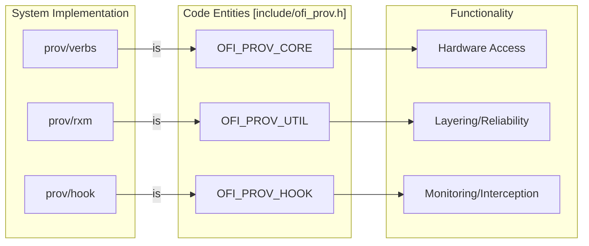

<!-- source: DeepWiki mcp.deepwiki.com · repo ofiwg/libfabric · page 4 Providers · fetched 2026-11-11 -->

# Providers

<details>
<summary>Relevant source files</summary>

The following files were used as context for generating this wiki page:

- [Makefile.am](Makefile.am)
- [docs/providers](docs/providers)
- [include/ofi.h](include/ofi.h)
- [include/ofi_mem.h](include/ofi_mem.h)
- [include/ofi_osd.h](include/ofi_osd.h)
- [include/rdma/providers/fi_prov.h](include/rdma/providers/fi_prov.h)
- [libfabric.vcxproj](libfabric.vcxproj)
- [libfabric.vcxproj.filters](libfabric.vcxproj.filters)
- [man/fabric.7.md](man/fabric.7.md)
- [man/fi_info.1.md](man/fi_info.1.md)
- [man/fi_provider.7.md](man/fi_provider.7.md)
- [man/fi_psm2.7.md](man/fi_psm2.7.md)
- [man/fi_rxm.7.md](man/fi_rxm.7.md)
- [man/fi_sockets.7.md](man/fi_sockets.7.md)
- [man/fi_usnic.7.md](man/fi_usnic.7.md)
- [man/fi_verbs.7.md](man/fi_verbs.7.md)
- [man/man3/fi_av_set.3](man/man3/fi_av_set.3)
- [man/man3/fi_cm.3](man/man3/fi_cm.3)
- [man/man3/fi_collective.3](man/man3/fi_collective.3)
- [man/man3/fi_control.3](man/man3/fi_control.3)
- [man/man3/fi_fabric.3](man/man3/fi_fabric.3)
- [man/man3/fi_trigger.3](man/man3/fi_trigger.3)
- [man/man7/fabric.7](man/man7/fabric.7)
- [man/man7/fi_direct.7](man/man7/fi_direct.7)
- [man/man7/fi_provider.7](man/man7/fi_provider.7)
- [man/man7/fi_psm2.7](man/man7/fi_psm2.7)
- [man/man7/fi_rxm.7](man/man7/fi_rxm.7)
- [man/man7/fi_sockets.7](man/man7/fi_sockets.7)
- [man/man7/fi_usnic.7](man/man7/fi_usnic.7)
- [man/man7/fi_verbs.7](man/man7/fi_verbs.7)
- [prov/util/src/util_buf.c](prov/util/src/util_buf.c)
- [src/fabric.c](src/fabric.c)
- [src/log.c](src/log.c)
- [src/var.c](src/var.c)
- [util/info.c](util/info.c)

</details>


Providers in libfabric are implementations of the libfabric API that abstract away the specific details of different network fabrics and protocols. Each provider offers the `fabric.h` API over a specific networking hardware or protocol, presenting applications with a uniform interface while handling the unique characteristics of the underlying transport mechanism.

This page covers the provider architecture in libfabric, the classification of providers, their capabilities, and how they interact with applications and other libfabric components. For information on the overall libfabric architecture, see [Overview](#1) and [Architecture](#1.1).

## Provider Architecture

Providers form a critical layer in the libfabric architecture, sitting between the API layer that applications use and the various network transports:

**Provider Architecture in Libfabric**
```mermaid
graph TD
    subgraph "Applications"
        [app_code] --> [fi_getinfo]
    end
    
    subgraph "Libfabric Core [src/fabric.c]"
        [fi_getinfo] --> [ofi_prov_mgr]
        [ofi_prov_mgr] --> [ofi_filter]
    end
    
    subgraph "Provider Layer [prov/]"
        [ofi_prov_mgr] --> [prov_verbs]
        [ofi_prov_mgr] --> [prov_tcp]
        [ofi_prov_mgr] --> [prov_rxm]
        [ofi_prov_mgr] --> [prov_shm]
        
        [prov_rxm] -- "util_ep" --> [prov_verbs]
        [prov_rxm] -- "util_ep" --> [prov_tcp]
    end
    
    subgraph "Hardware/Kernel Interface"
        [prov_verbs] --> [librdmacm]
        [prov_tcp] --> [sockets_api]
        [prov_shm] --> [posix_shm]
    end
```

Sources:
- [src/fabric.c:62-81]()
- [src/fabric.c:153-183]()
- [include/rdma/providers/fi_prov.h:74-105]()

Applications interact with the libfabric API, which uses the Provider Framework to manage and select appropriate providers based on the application's requirements. The providers then handle communication with the underlying network hardware or transport protocols.

## Provider Classification and Relationships

Providers in libfabric are classified into several types, primarily defined by their `ofi_prov_ctx` type:

1.  **Core Providers** (`OFI_PROV_CORE`): Interface directly with network hardware or low-level communication libraries (e.g., Verbs, EFA, PSM2).
2.  **Utility Providers** (`OFI_PROV_UTIL`): Build on core providers to add functionality (e.g., RXM, RXD).
3.  **Hook Providers** (`OFI_PROV_HOOK`): Intercept API calls for monitoring or debugging (e.g., dmabuf_peer_mem).

**Provider Classification Bridge**


Sources:
- [src/fabric.c:250-268]()
- [include/rdma/providers/fi_prov.h:110-125]()

## Core Providers

### Verbs Provider
The Verbs provider enables applications to run over RDMA hardware (InfiniBand, iWARP, RoCE). It translates libfabric calls to `ibverbs` and `librdmacm` operations.
- **Endpoint Types**: `FI_EP_MSG`, `FI_EP_DGRAM`, and `FI_EP_RDM` (via layering).
- **Key Files**: `prov/verbs/src/verbs_info.c`, `prov/verbs/src/verbs_ep.c`.
- For details, see [Verbs Provider](#4.2).

Sources:
- [man/man7/fi_verbs.7:22-29]()
- [man/fi_verbs.7.md:14-18]()

### TCP Provider
Internally known as `xnet`, the TCP provider enables libfabric communication over standard TCP/IP networks. It is optimized for high-performance messaging over sockets.
- **Endpoint Types**: Primarily `FI_EP_MSG`.
- For details, see [TCP Provider](#4.4).

Sources:
- [Makefile.am:82-83]()

### Sockets Provider
A general-purpose provider that implements the libfabric API over standard UDP and TCP sockets. It is often used for development and environments without RDMA hardware.
- **Endpoint Types**: `FI_EP_MSG`, `FI_EP_DGRAM`, `FI_EP_RDM`.
- For details, see [Sockets Provider](#4.3).

Sources:
- [man/man7/fi_sockets.7:1-15]()

### SHM Provider
The Shared Memory provider is optimized for intra-node communication. It uses mechanisms like `XPMEM` or POSIX shared memory to allow processes on the same host to communicate with minimal overhead.
- **Endpoint Types**: `FI_EP_RDM`.
- For details, see [SHM Provider](#4.5).

Sources:
- [src/fabric.c:54]()
- [Makefile.am:55-56]()

### EFA Provider
The Elastic Fabric Adapter provider is designed specifically for AWS EFA hardware. it provides low-latency, high-bandwidth communication in the cloud.
- **Endpoint Types**: `FI_EP_RDM`.
- For details, see [EFA Provider](#4.7).

Sources:
- [Makefile.am:4]()

### PSM2 Provider
Supports Intel's Performance Scaled Messaging 2 interface, used with Intel Omni-Path (OPA) hardware.
- **Endpoint Types**: `FI_EP_RDM`.
- For details, see [PSM2 Provider](#4.9).

Sources:
- [man/man7/fi_psm2.7:1-15]()

## Utility Providers

### RXM Provider
The RXM (RDM over MSG) provider is a utility layer that provides Reliable Datagram (RDM) semantics over connection-oriented Message (MSG) endpoints. It handles connection management, segmentation, and reassembly (SAR).
- **Implementation**: Layers over `verbs`, `tcp`, or `sockets`.
- For details, see [RXM Provider](#4.1).

Sources:
- [man/man7/fi_rxm.7:1-15]()
- [Makefile.am:69]()

### RXD Provider
The RXD (Reliable Datagram over Datagram) provider implements a reliability protocol over unreliable datagram transports like UDP.
- **Implementation**: Layers over `udp` or `verbs` (DGRAM).
- For details, see [RXD Provider](#4.6).

Sources:
- [libfabric.vcxproj.filters:73-81]()

## Additional Providers
Libfabric includes several other specialized providers:
- **OPX**: Optimized for Omni-Path Express. See [OPX Provider](#4.8).
- **CXI**: For HPE Slingshot fabrics. See [CXI Provider](#4.10).
- **GNI, usNIC, UDP, LNX**: Brief descriptions of these and others are available in [Additional Providers](#4.11).

Sources:
- [Makefile.am:5-6]()
- [man/fi_usnic.7.md:1-10]()

## Provider Selection and Management

Providers are managed by the core libfabric library. The discovery engine in `src/fabric.c` handles `fi_getinfo` requests by iterating through registered providers and matching their capabilities against application hints.

| Function | Description | Source |
| :--- | :--- | :--- |
| `fi_getinfo` | Entry point for discovering available providers. | [src/fabric.c:96-140]() |
| `fi_param_define` | Allows providers to export runtime environment variables. | [src/var.c:188-252]() |
| `fi_log` | Centralized logging system for all providers. | [src/log.c:166-214]() |

### Provider Filtering
Applications can filter providers using the `FI_PROVIDER` environment variable. The core framework uses `ofi_apply_filter` to include or exclude specific implementations during the discovery phase.

Sources:
- [src/fabric.c:270-276]()
- [src/log.c:189-194]()

### Memory Management and HMEM
Many providers utilize the common memory registration and HMEM (Heterogeneous Memory) framework to support GPU and accelerator memory (CUDA, ROCm, Ze).

Sources:
- [src/hmem.c:47-53]()
- [prov/util/src/util_mr_cache.c:86]()

---

