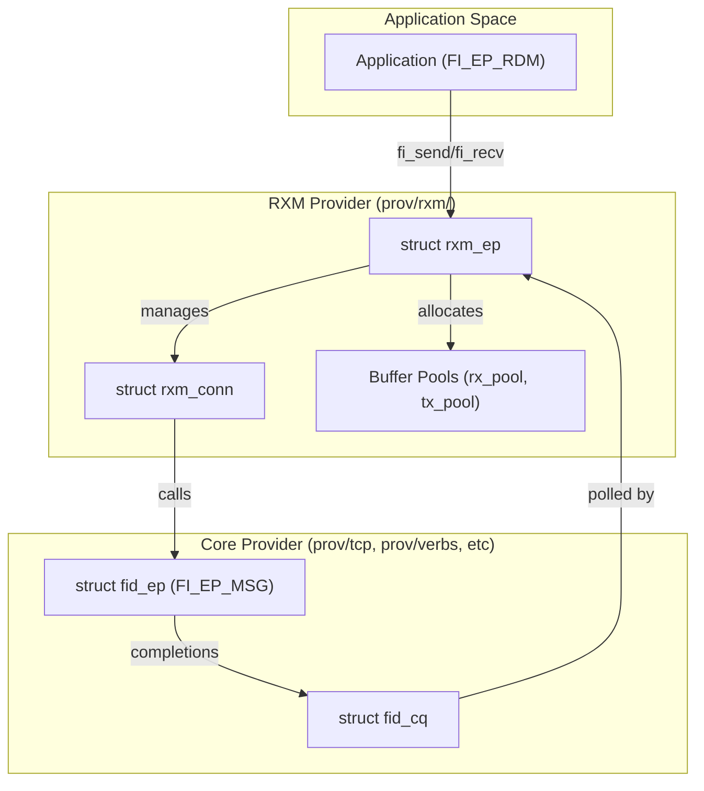
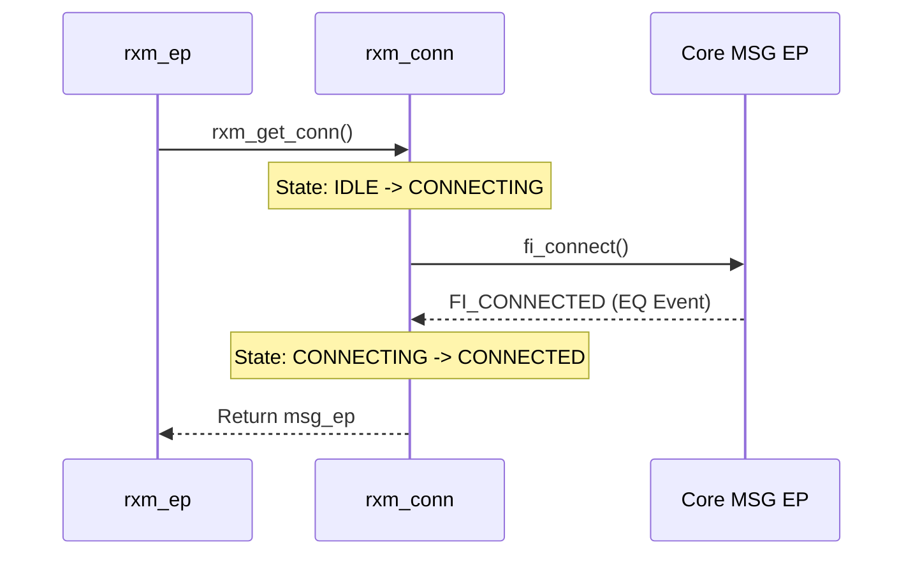

<!-- source: DeepWiki mcp.deepwiki.com · repo ofiwg/libfabric · page 4.1 RXM Provider · fetched 2026-11-11 -->

# RXM Provider

Relevant source files

The following files were used as context for generating this wiki page:

- [include/ofi_util.h](include/ofi_util.h)
- [prov/rxd/src/rxd_cntr.c](prov/rxd/src/rxd_cntr.c)
- [prov/rxm/Makefile.include](prov/rxm/Makefile.include)
- [prov/rxm/src/rxm.h](prov/rxm/src/rxm.h)
- [prov/rxm/src/rxm_atomic.c](prov/rxm/src/rxm_atomic.c)
- [prov/rxm/src/rxm_attr.c](prov/rxm/src/rxm_attr.c)
- [prov/rxm/src/rxm_conn.c](prov/rxm/src/rxm_conn.c)
- [prov/rxm/src/rxm_cq.c](prov/rxm/src/rxm_cq.c)
- [prov/rxm/src/rxm_domain.c](prov/rxm/src/rxm_domain.c)
- [prov/rxm/src/rxm_ep.c](prov/rxm/src/rxm_ep.c)
- [prov/rxm/src/rxm_fabric.c](prov/rxm/src/rxm_fabric.c)
- [prov/rxm/src/rxm_init.c](prov/rxm/src/rxm_init.c)
- [prov/rxm/src/rxm_msg.c](prov/rxm/src/rxm_msg.c)
- [prov/rxm/src/rxm_rma.c](prov/rxm/src/rxm_rma.c)
- [prov/rxm/src/rxm_tagged.c](prov/rxm/src/rxm_tagged.c)
- [prov/util/src/rxm_av.c](prov/util/src/rxm_av.c)
- [prov/util/src/util_attr.c](prov/util/src/util_attr.c)
- [prov/util/src/util_av.c](prov/util/src/util_av.c)
- [prov/util/src/util_cntr.c](prov/util/src/util_cntr.c)
- [prov/util/src/util_cq.c](prov/util/src/util_cq.c)
- [prov/util/src/util_ep.c](prov/util/src/util_ep.c)
- [prov/util/src/util_eq.c](prov/util/src/util_eq.c)
- [prov/util/src/util_main.c](prov/util/src/util_main.c)
- [prov/util/src/util_wait.c](prov/util/src/util_wait.c)

The RXM (RDM over MSG) provider is a utility provider in the libfabric framework that emulates `FI_EP_RDM` (Reliable Datagram) endpoints over `FI_EP_MSG` (Message) endpoints. It serves as a translation layer that provides Reliable Datagram semantics while using underlying Message-based providers such as `tcp` or `verbs`. The RXM provider handles connection management, segmentation and reassembly (SAR), and rendezvous protocols, while optionally hiding memory registration requirements from applications.

Sources: [prov/rxm/src/rxm.h:183-193](), [prov/rxm/src/rxm_init.c:70-73]()

## Architecture Overview

The RXM provider is designed as a layering provider that sits between application code and core providers. It translates RDM endpoint operations into MSG endpoint operations.

### Layering Architecture
The RXM provider wraps a core provider's MSG endpoint. It manages a set of internal connection structures (`struct rxm_conn`) to map logical `fi_addr_t` addresses to specific underlying MSG connections.

Sources: [prov/rxm/src/rxm.h:638-694](), [prov/rxm/src/rxm_ep.c:1166-1177]()

### Provider Capabilities
RXM maps requested capabilities to the underlying provider. It supports `FI_MSG`, `FI_TAGGED`, `FI_RMA`, and `FI_ATOMIC`.

| Capability | Support Status | Code Entity |
|------------|----------------|-------------|
| `FI_MSG` | Supported | `rxm_msg_ops` [prov/rxm/src/rxm.h:186]() |
| `FI_TAGGED` | Supported | `rxm_tagged_ops` [prov/rxm/src/rxm.h:188]() |
| `FI_RMA` | Supported | `rxm_rma_ops` [prov/rxm/src/rxm.h:190]() |
| `FI_ATOMIC` | Supported | `rxm_ops_atomic` [prov/rxm/src/rxm.h:192]() |

## Connection Manager

Since RXM emulates a connectionless RDM endpoint over connection-oriented MSG endpoints, it maintains an internal Connection Manager (CM).

### Connection States
Connections transition through states defined in `enum rxm_cm_state`:
*   `RXM_CM_IDLE`: No active connection.
*   `RXM_CM_CONNECTING`: Connection request sent.
*   `RXM_CM_ACCEPTING`: Responding to a remote request.
*   `RXM_CM_CONNECTED`: Data transfer allowed.

Sources: [prov/rxm/src/rxm.h:215-220](), [prov/rxm/src/rxm_conn.c:87-91]()

### Data Flow for Connection Setup
When an application calls a transmit function to a new `fi_addr_t`, RXM triggers `rxm_get_conn` which initiates a connection if one does not exist.

Sources: [prov/rxm/src/rxm_conn.c:170-226](), [prov/rxm/src/rxm_conn.c:425-460]()

## Segmentation and Reassembly (SAR)

The SAR protocol is used for medium-sized messages that exceed the eager limit but are smaller than the rendezvous threshold.

*   **Fragmentation**: The sender splits the message into segments, marking them as `RXM_SAR_SEG_FIRST`, `MIDDLE`, or `LAST` via `rxm_sar_get_seg_type`.
*   **Reassembly**: The receiver uses `deferred_sar_segments` in `struct rxm_conn` to hold out-of-order or partial segments until the full message is reconstructed.

Sources: [prov/rxm/src/rxm.h:125-127](), [prov/rxm/src/rxm_cq.c:139-144](), [prov/rxm/src/rxm_conn.c:72-76]()

## Rendezvous Protocol

For large messages, RXM employs a rendezvous protocol to minimize memory copies and utilize RDMA capabilities of the underlying transport.

1.  **RNDV REQ**: Sender transmits a control packet with memory keys and metadata.
2.  **Data Transfer**:
    *   **RMA Read**: The receiver issues an `fi_read` to pull data from the sender.
    *   **RMA Write**: The receiver sends a "Ready to Receive" (RTR), and the sender issues an `fi_write`.
3.  **RNDV DONE**: A final control packet signals completion.

Sources: [prov/rxm/src/rxm_cq.c:151-154](), [prov/rxm/src/rxm_rma.c:90-104]()

## Buffer Pools and Memory Management

RXM utilizes `ofi_bufpool` for managing internal transmit and receive buffers.

*   **rx_pool**: Used for receiving control packets and eager data. [prov/rxm/src/rxm_ep.c:131]()
*   **tx_pool**: Used for sending headers and small message payloads. [prov/rxm/src/rxm_ep.c:140]()
*   **Registration**: Buffers are registered with the core provider via `rxm_buf_reg`. If `FI_HMEM` is enabled, it also handles host registration for device memory. [prov/rxm/src/rxm_ep.c:45-77]()

## Passthru Mode

RXM supports a "passthru" mode, typically used with the TCP provider (`FI_PROTO_RXM_TCP`). In this mode, RXM minimizes its own overhead by passing operations directly to the underlying MSG provider when possible.

*   **Check**: `rxm_passthru_info` determines if the protocol supports passthru. [prov/rxm/src/rxm_init.c:69-73]()
*   **Ops**: Passthru operations use `rxm_msg_thru_ops`, `rxm_tagged_thru_ops`, and `rxm_rma_thru_ops`. [prov/rxm/src/rxm.h:187-191]()

## RXM Address Vector (rxm_av)

The `rxm_av` manages the mapping of libfabric addresses to RXM-specific peer information.

*   **Structure**: `struct rxm_av` contains a `util_av` and a `fid_peer_av`. [prov/rxm/src/rxm_domain.c:177-185]()
*   **Lookup**: `rxm_peer_av_ep_addr` allows looking up the `fi_addr_t` associated with a specific endpoint. [prov/rxm/src/rxm_domain.c:187-216]()
*   **SRX Integration**: If a Shared Receive Context (SRX) is used, `rxm_foreach_ep` iterates over endpoints to progress unspec addresses. [prov/rxm/src/rxm_domain.c:234-246]()

Sources: [prov/rxm/src/rxm_domain.c:218-222](), [prov/util/src/util_av.c:248-257]()

---

