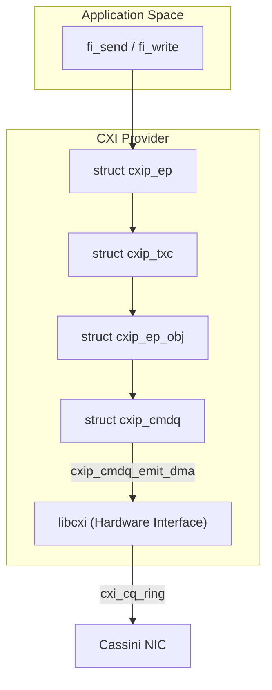
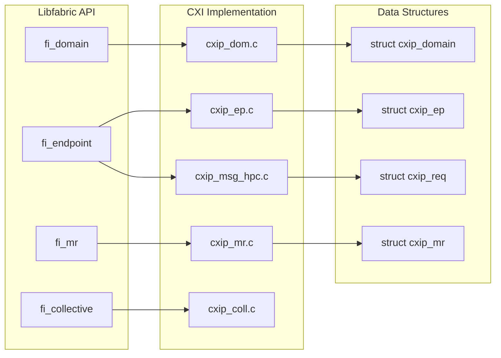

<!-- source: DeepWiki mcp.deepwiki.com · repo ofiwg/libfabric · page 4.10 CXI Provider · fetched 2026-11-11 -->

# CXI Provider

Relevant source files

The following files were used as context for generating this wiki page:

- [man/cxi_collectives.7.md](man/cxi_collectives.7.md)
- [man/fi_cxi.7.md](man/fi_cxi.7.md)
- [man/man3/fi_peer.3](man/man3/fi_peer.3)
- [man/man3/fi_provider.3](man/man3/fi_provider.3)
- [man/man7/cxi_collectives.7](man/man7/cxi_collectives.7)
- [man/man7/fi_cxi.7](man/man7/fi_cxi.7)
- [prov/cxi/Makefile.include](prov/cxi/Makefile.include)
- [prov/cxi/configure.m4](prov/cxi/configure.m4)
- [prov/cxi/include/cxip.h](prov/cxi/include/cxip.h)
- [prov/cxi/include/fi_cxi_ext.h](prov/cxi/include/fi_cxi_ext.h)
- [prov/cxi/src/cxip_atomic.c](prov/cxi/src/cxip_atomic.c)
- [prov/cxi/src/cxip_cmdq.c](prov/cxi/src/cxip_cmdq.c)
- [prov/cxi/src/cxip_coll.c](prov/cxi/src/cxip_coll.c)
- [prov/cxi/src/cxip_coll_trace.c](prov/cxi/src/cxip_coll_trace.c)
- [prov/cxi/src/cxip_ctrl.c](prov/cxi/src/cxip_ctrl.c)
- [prov/cxi/src/cxip_curl.c](prov/cxi/src/cxip_curl.c)
- [prov/cxi/src/cxip_dom.c](prov/cxi/src/cxip_dom.c)
- [prov/cxi/src/cxip_ep.c](prov/cxi/src/cxip_ep.c)
- [prov/cxi/src/cxip_evtq.c](prov/cxi/src/cxip_evtq.c)
- [prov/cxi/src/cxip_if.c](prov/cxi/src/cxip_if.c)
- [prov/cxi/src/cxip_info.c](prov/cxi/src/cxip_info.c)
- [prov/cxi/src/cxip_iomm.c](prov/cxi/src/cxip_iomm.c)
- [prov/cxi/src/cxip_mr.c](prov/cxi/src/cxip_mr.c)
- [prov/cxi/src/cxip_msg.c](prov/cxi/src/cxip_msg.c)
- [prov/cxi/src/cxip_msg_hpc.c](prov/cxi/src/cxip_msg_hpc.c)
- [prov/cxi/src/cxip_msg_rnr.c](prov/cxi/src/cxip_msg_rnr.c)
- [prov/cxi/src/cxip_nic.c](prov/cxi/src/cxip_nic.c)
- [prov/cxi/src/cxip_portals_table.c](prov/cxi/src/cxip_portals_table.c)
- [prov/cxi/src/cxip_ptelist_buf.c](prov/cxi/src/cxip_ptelist_buf.c)
- [prov/cxi/src/cxip_req_buf.c](prov/cxi/src/cxip_req_buf.c)
- [prov/cxi/src/cxip_rma.c](prov/cxi/src/cxip_rma.c)
- [prov/cxi/src/cxip_rxc.c](prov/cxi/src/cxip_rxc.c)
- [prov/cxi/src/cxip_telemetry.c](prov/cxi/src/cxip_telemetry.c)
- [prov/cxi/src/cxip_txc.c](prov/cxi/src/cxip_txc.c)
- [prov/cxi/src/cxip_zbcoll.c](prov/cxi/src/cxip_zbcoll.c)
- [prov/cxi/test/auth_key.c](prov/cxi/test/auth_key.c)
- [prov/cxi/test/av.c](prov/cxi/test/av.c)
- [prov/cxi/test/coll.c](prov/cxi/test/coll.c)
- [prov/cxi/test/curl.c](prov/cxi/test/curl.c)
- [prov/cxi/test/domain.c](prov/cxi/test/domain.c)
- [prov/cxi/test/fabric.c](prov/cxi/test/fabric.c)
- [prov/cxi/test/mr.c](prov/cxi/test/mr.c)
- [prov/cxi/test/mr_cache.c](prov/cxi/test/mr_cache.c)
- [prov/cxi/test/multinode/test_coll.c](prov/cxi/test/multinode/test_coll.c)
- [prov/cxi/test/test.sh](prov/cxi/test/test.sh)
- [prov/cxi/test/writedata.c](prov/cxi/test/writedata.c)

The CXI provider enables libfabric on HPE Slingshot networks, which consist of the Rosetta switch and Cassini NIC [man/fi_cxi.7.md:14-16](). While Slingshot is Ethernet-compliant, the provider leverages proprietary hardware extensions to support high-performance computing (HPC) applications, including hardware-offloaded message matching, one-sided RMA/AMO, and fabric-accelerated collectives [man/fi_cxi.7.md:16-23]().

## Architecture and Endpoint Types

The provider primarily supports the `FI_EP_RDM` (Reliable Datagram) endpoint type [man/fi_cxi.7.md:39-39](). It interfaces with the hardware via `libCXI` for control operations and uses Cassini-specific headers for direct hardware access in the data path [man/fi_cxi.7.md:30-31]().

### CXI Endpoint Object Model
The `cxip_ep_obj` represents the core hardware resource, while `cxip_ep` is the libfabric-facing structure.

| Entity | Description |
| --- | --- |
| `cxip_ep_obj` | Shared hardware context containing locks, address info, and command queues [prov/cxi/src/cxip_ep.c:58-75](). |
| `cxip_txc` | Transmit context managing outgoing operations and inject buffers [prov/cxi/src/cxip_txc.c:8-15](). |
| `cxip_rxc` | Receive context managing incoming message matching and unexpected queues [prov/cxi/src/cxip_rxc.c:8-15](). |
| `cxip_cmdq` | Hardware command queue used to issue DMA and IDC commands [prov/cxi/src/cxip_dom.c:38-41](). |

### Data Flow: Application to Hardware
The following diagram illustrates how a libfabric operation travels through the CXI provider structures to the hardware command queues.

**CXI Command Submission Path**

Sources: [prov/cxi/src/cxip_ep.c:179-196](), [prov/cxi/src/cxip_dom.c:181-212](), [prov/cxi/src/cxip_txc.c:246-276]()

## Message Handling Modes

The CXI provider supports two primary protocols for message handling, selected based on resource availability and performance requirements.

### HPC Mode (High Performance)
In HPC mode, message matching is offloaded to the Cassini NIC hardware [man/fi_cxi.7.md:32-33]().
- **Eager Protocol**: Small messages are sent directly to the target's unexpected buffers.
- **Rendezvous Protocol**: Larger messages use a handshake. The source sends a `RENDEZVOUS` header; the target responds with a `GET` operation once a matching receive buffer is posted [prov/cxi/src/cxip_msg_hpc.c:180-195]().
- **Hybrid/Software Fallback**: If hardware resources (Portal Table Entries - PTEs) are exhausted, the provider can transition to software-managed matching [prov/cxi/src/cxip_rxc.c:40-47]().

### RNR Mode (Retry on No Receive)
The RNR protocol (`FI_PROTO_CXI_RNR`) is used when the target may not have receive buffers ready. It relies on hardware-level retries if a message arrives and no match is found, avoiding software-level flow control overhead for certain workloads [prov/cxi/src/cxip_msg.c:198-200]().

Sources: [prov/cxi/src/cxip_msg_hpc.c:1-25](), [prov/cxi/src/cxip_rxc.c:21-22](), [prov/cxi/src/cxip_msg.c:190-200]()

## Domain and Command Queues

The `cxip_domain` manages shared resources across multiple endpoints, including the Logical Network Interface (LNI) and shared Transmit Command Queues (TXCQs) [prov/cxi/src/cxip_dom.c:1-16]().

- **Resource Management**: The hardware allows 16 command profiles per RGID. The provider reserves one for triggered commands and one for the endpoint, leaving 14 for general use [prov/cxi/src/cxip_dom.c:83-88]().
- **Command Emission**: Operations like `fi_write` or `fi_inject` result in calls to `cxip_domain_emit_idc_put` or `cxip_domain_emit_dma`, which find or allocate a command queue with the appropriate Virtual Network ID (VNI) and Traffic Class (TC) [prov/cxi/src/cxip_dom.c:146-179]().

Sources: [prov/cxi/src/cxip_dom.c:83-144](), [prov/cxi/src/cxip_dom.c:23-36]()

## RMA and Atomics

CXI provides robust support for one-sided operations and hardware-accelerated atomics [man/fi_cxi.7.md:59-61]().
- **RMA**: Supports `fi_read`, `fi_write`, and `fi_writedata`.
- **Atomics**: Supports standard libfabric atomic operations (e.g., `FI_SUM`, `FI_MIN`, `FI_MAX`) offloaded to the NIC [prov/cxi/src/cxip_dom.c:214-248]().
- **Memory Registration**: Supports `FI_MR_ENDPOINT`. Users can choose between client-specified 32-bit keys or provider-generated 64-bit keys (`FI_MR_PROV_KEY`) [man/fi_cxi.7.md:43-55]().

Sources: [man/fi_cxi.7.md:59-72](), [prov/cxi/src/cxip_dom.c:214-248]()

## Collective Operations

CXI features hardware acceleration for collective reductions (e.g., `allreduce`, `barrier`) [prov/cxi/src/cxip_coll.c:1-8]().

### Acceleration Mechanisms
1. **cxip_coll**: Implements the `fi_collective` API using fabric-accelerated small reductions. It uses a 12-byte reduction header containing sequence numbers (`rt_seqno`), operation types (`rt_op`), and result codes (`rt_rc`) [prov/cxi/src/cxip_coll.c:144-163]().
2. **zbcoll (Zero-Byte Collectives)**: Optimized for barrier operations and small synchronization tasks [prov/cxi/src/cxip_zbcoll.c:1-10]().

**Collective Reduction Packet Structure**
| Offset (Bytes) | Field | Description |
| --- | --- | --- |
| 17-48 | `RED_PAYLOAD` | 32-byte reduction data payload [prov/cxi/src/cxip_coll.c:140-140](). |
| 5-16 | `RED_HDR` | 12-byte hardware reduction header [prov/cxi/src/cxip_coll.c:141-141](). |
| 0-4 | `RED_PADDING` | Padding for alignment [prov/cxi/src/cxip_coll.c:142-142](). |

Sources: [prov/cxi/src/cxip_coll.c:134-163](), [prov/cxi/include/cxip.h:188-195]()

## Extension Interface (`fi_cxi_ext.h`)

The CXI provider exposes Slingshot-specific features through an extension interface. This includes:
- **Auth Keys**: `struct cxi_auth_key` allows applications to specify `svc_id` and `vni` for network isolation [man/fi_cxi.7.md:179-183]().
- **Address Format**: `struct cxip_addr` includes NIC address and Port ID (PID) [man/fi_cxi.7.md:113-118]().
- **Performance Counters**: Access to hardware-level telemetry and fault injection via `cxip_telemetry.c` and `cxip_faults.h` [prov/cxi/include/cxip.h:48-49]().

Sources: [man/fi_cxi.7.md:172-183](), [prov/cxi/include/cxip.h:47-50]()

## Implementation Mapping

The following diagram maps libfabric API concepts to the internal CXI provider implementation files and structures.

**CXI Provider Implementation Map**

Sources: [prov/cxi/src/cxip_dom.c:16-20](), [prov/cxi/src/cxip_ep.c:17-22](), [prov/cxi/src/cxip_mr.c:1-10](), [prov/cxi/src/cxip_coll.c:21-27]()

---

