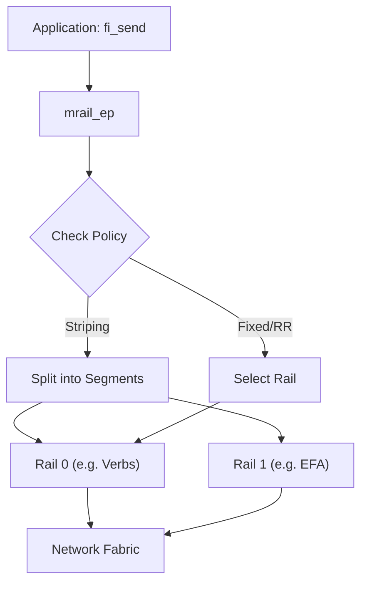
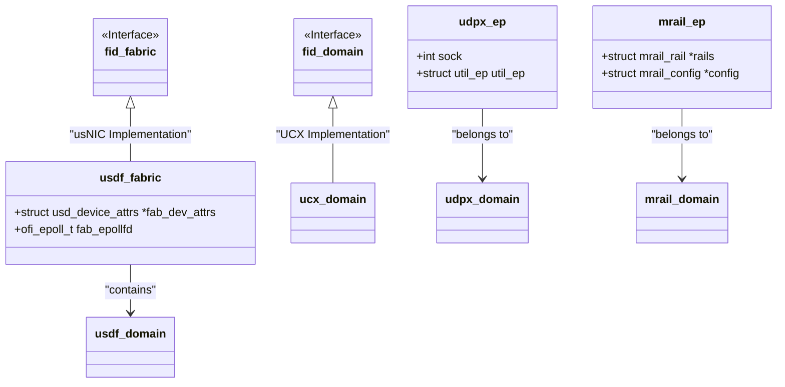

<!-- source: DeepWiki mcp.deepwiki.com · repo ofiwg/libfabric · page 4.11 Additional Providers · fetched 2026-11-11 -->

# Additional Providers

Relevant source files

The following files were used as context for generating this wiki page:

- [include/windows/poll.h](include/windows/poll.h)
- [man/fi_lnx.7.md](man/fi_lnx.7.md)
- [man/fi_ucx.7.md](man/fi_ucx.7.md)
- [prov/lnx/Makefile.include](prov/lnx/Makefile.include)
- [prov/lnx/include/lnx.h](prov/lnx/include/lnx.h)
- [prov/lnx/src/lnx_av.c](prov/lnx/src/lnx_av.c)
- [prov/lnx/src/lnx_cq.c](prov/lnx/src/lnx_cq.c)
- [prov/lnx/src/lnx_domain.c](prov/lnx/src/lnx_domain.c)
- [prov/lnx/src/lnx_ep.c](prov/lnx/src/lnx_ep.c)
- [prov/lnx/src/lnx_init.c](prov/lnx/src/lnx_init.c)
- [prov/lnx/src/lnx_ops.c](prov/lnx/src/lnx_ops.c)
- [prov/mrail/Makefile.include](prov/mrail/Makefile.include)
- [prov/mrail/src/mrail.h](prov/mrail/src/mrail.h)
- [prov/mrail/src/mrail_attr.c](prov/mrail/src/mrail_attr.c)
- [prov/mrail/src/mrail_av.c](prov/mrail/src/mrail_av.c)
- [prov/mrail/src/mrail_cq.c](prov/mrail/src/mrail_cq.c)
- [prov/mrail/src/mrail_domain.c](prov/mrail/src/mrail_domain.c)
- [prov/mrail/src/mrail_ep.c](prov/mrail/src/mrail_ep.c)
- [prov/mrail/src/mrail_init.c](prov/mrail/src/mrail_init.c)
- [prov/mrail/src/mrail_rma.c](prov/mrail/src/mrail_rma.c)
- [prov/ucx/Makefile.include](prov/ucx/Makefile.include)
- [prov/ucx/configure.m4](prov/ucx/configure.m4)
- [prov/ucx/src/ucx.h](prov/ucx/src/ucx.h)
- [prov/ucx/src/ucx_av.c](prov/ucx/src/ucx_av.c)
- [prov/ucx/src/ucx_callbacks.c](prov/ucx/src/ucx_callbacks.c)
- [prov/ucx/src/ucx_cm.c](prov/ucx/src/ucx_cm.c)
- [prov/ucx/src/ucx_core.c](prov/ucx/src/ucx_core.c)
- [prov/ucx/src/ucx_core.h](prov/ucx/src/ucx_core.h)
- [prov/ucx/src/ucx_domain.c](prov/ucx/src/ucx_domain.c)
- [prov/ucx/src/ucx_ep.c](prov/ucx/src/ucx_ep.c)
- [prov/ucx/src/ucx_fabric.c](prov/ucx/src/ucx_fabric.c)
- [prov/ucx/src/ucx_init.c](prov/ucx/src/ucx_init.c)
- [prov/ucx/src/ucx_msg.c](prov/ucx/src/ucx_msg.c)
- [prov/ucx/src/ucx_rma.c](prov/ucx/src/ucx_rma.c)
- [prov/ucx/src/ucx_tagged.c](prov/ucx/src/ucx_tagged.c)
- [prov/udp/Makefile.include](prov/udp/Makefile.include)
- [prov/udp/src/udpx.h](prov/udp/src/udpx.h)
- [prov/udp/src/udpx_attr.c](prov/udp/src/udpx_attr.c)
- [prov/udp/src/udpx_cq.c](prov/udp/src/udpx_cq.c)
- [prov/udp/src/udpx_domain.c](prov/udp/src/udpx_domain.c)
- [prov/udp/src/udpx_ep.c](prov/udp/src/udpx_ep.c)
- [prov/udp/src/udpx_fabric.c](prov/udp/src/udpx_fabric.c)
- [prov/udp/src/udpx_init.c](prov/udp/src/udpx_init.c)
- [prov/usnic/src/usdf.h](prov/usnic/src/usdf.h)
- [prov/usnic/src/usdf_av.c](prov/usnic/src/usdf_av.c)
- [prov/usnic/src/usdf_av.h](prov/usnic/src/usdf_av.h)
- [prov/usnic/src/usdf_cm.c](prov/usnic/src/usdf_cm.c)
- [prov/usnic/src/usdf_cm.h](prov/usnic/src/usdf_cm.h)
- [prov/usnic/src/usdf_cq.c](prov/usnic/src/usdf_cq.c)
- [prov/usnic/src/usdf_cq.h](prov/usnic/src/usdf_cq.h)
- [prov/usnic/src/usdf_dgram.c](prov/usnic/src/usdf_dgram.c)
- [prov/usnic/src/usdf_dgram.h](prov/usnic/src/usdf_dgram.h)
- [prov/usnic/src/usdf_domain.c](prov/usnic/src/usdf_domain.c)
- [prov/usnic/src/usdf_endpoint.c](prov/usnic/src/usdf_endpoint.c)
- [prov/usnic/src/usdf_endpoint.h](prov/usnic/src/usdf_endpoint.h)
- [prov/usnic/src/usdf_ep_dgram.c](prov/usnic/src/usdf_ep_dgram.c)
- [prov/usnic/src/usdf_eq.c](prov/usnic/src/usdf_eq.c)
- [prov/usnic/src/usdf_fabric.c](prov/usnic/src/usdf_fabric.c)
- [prov/usnic/src/usdf_pep.c](prov/usnic/src/usdf_pep.c)
- [prov/util/src/util_domain.c](prov/util/src/util_domain.c)
- [prov/util/src/util_fabric.c](prov/util/src/util_fabric.c)
- [prov/util/src/util_poll.c](prov/util/src/util_poll.c)

This page provides technical details for several specialized, legacy, or utility providers within the libfabric ecosystem. While some target specific high-performance hardware (GNI, usNIC), others provide software-defined connectivity (UDP, UCX) or advanced multi-rail capabilities (LNX, mrail).

---

## usNIC Provider (Cisco)

The `usNIC` (user-space NIC) provider is designed for Cisco UCS systems. It enables applications to bypass the kernel and communicate directly with Cisco VIC (Virtual Interface Card) hardware using standard UDP/IP framing.

### Implementation and Data Flow
The provider utilizes a low-level library, `libusd`, to interact with the VIC hardware. It implements the libfabric API by mapping `fi_endpoint` objects to hardware Queue Pairs (QPs).

*   **Fabric and Domain:** The fabric name is typically represented in CIDR notation (e.g., `192.168.10.0/24`) [prov/usnic/src/usdf_fabric.c:86-90](). Domains map to specific `usd_device` handles [prov/usnic/src/usdf_domain.c:236-239]().
*   **Endpoints:** Supports `FI_EP_DGRAM`. During `fi_enable`, it creates a hardware QP and allocates a header buffer region for receive operations [prov/usnic/src/usdf_ep_dgram.c:70-137]().
*   **Address Vector (AV):** The AV handles ARP resolution. If a destination MAC is unknown, the provider triggers an asynchronous ARP request via a internal timer and helper socket [prov/usnic/src/usdf_av.c:221-259]().

### Code Entity Map: usNIC Structures
| Libfabric Entity | usNIC Implementation Struct | File |
| :--- | :--- | :--- |
| `fid_fabric` | `struct usdf_fabric` | [prov/usnic/src/usdf.h:114]() |
| `fid_domain` | `struct usdf_domain` | [prov/usnic/src/usdf.h:141]() |
| `fid_ep` | `struct usdf_ep` | [prov/usnic/src/usdf.h:236]() |
| `fid_cq` | `struct usdf_cq` | [prov/usnic/src/usdf_cq.h:73]() |

**Sources:** [prov/usnic/src/usdf.h:1-250](), [prov/usnic/src/usdf_fabric.c:78-142](), [prov/usnic/src/usdf_ep_dgram.c:69-155](), [prov/usnic/src/usdf_av.c:201-265]().

---

## UDP Provider

The UDP provider is a pure software implementation that provides unreliable datagram services over standard UDP sockets. It is primarily used for functional testing or environments where RDMA hardware is unavailable.

### Technical Detail
*   **Endpoint Mapping:** Every `udpx_ep` encapsulates a standard Linux/Windows socket [prov/udp/src/udpx_ep.c:41-53]().
*   **Completion Engine:** It uses a circular queue (`ofi_cirque`) to manage completions. When a packet is received via `recvmsg`, a completion is committed to the RX CQ [prov/udp/src/udpx_ep.c:237-250]().
*   **Multicast:** Implements `fi_join` by performing `IP_ADD_MEMBERSHIP` socket options on the underlying file descriptor [prov/udp/src/udpx_ep.c:111-145]().

**Sources:** [prov/udp/src/udpx_ep.c:39-191](), [prov/udp/src/udpx_ep.c:218-255]().

---

## UCX Provider

The UCX provider acts as a bridge between the libfabric API and the **Unified Communication X (UCX)** framework. It allows libfabric applications to leverage UCX's transport selection logic (Shared Memory, Verbs, TCP, etc.).

### Architecture
UCX objects are wrapped within libfabric identifiers:
*   `fi_domain` maps to `ucp_worker_h` [prov/ucx/src/ucx_domain.c:44-55]().
*   `fi_endpoint` maps to a combination of UCX worker and address information [prov/ucx/src/ucx_ep.c:30-60]().

**Sources:** [prov/ucx/src/ucx.h:1-100](), [prov/ucx/src/ucx_domain.c:1-60]().

---

## Multi-Rail Providers: LNX and mrail

Libfabric provides two primary ways to aggregate multiple network interfaces (rails).

### 1. LNX (Multi-rail Linker)
LNX is a utility provider that "links" multiple underlying providers into a single logical endpoint. It handles the distribution of traffic across rails to increase bandwidth or provide fault tolerance.
*   **Discovery:** It searches for available core providers and presents them as a unified set of capabilities [prov/lnx/src/lnx_init.c:10-50]().

### 2. mrail
The `mrail` provider is an internal multi-rail implementation often used for layering.
*   **Policy Management:** Supports different distribution policies: `MRAIL_POLICY_FIXED`, `MRAIL_POLICY_ROUND_ROBIN`, and `MRAIL_POLICY_STRIPING` [prov/mrail/src/mrail_init.c:42-45]().
*   **Reprocessing:** It maintains an unexpected message list for each rail to handle out-of-order arrivals across different physical paths [prov/mrail/src/mrail_ep.c:135-175]().

### Data Flow: mrail Transmission

**Sources:** [prov/mrail/src/mrail_init.c:42-102](), [prov/mrail/src/mrail_ep.c:135-175](), [prov/lnx/src/lnx_init.c:1-100]().

---

## Legacy and Specialized Providers

### GNI (Cray Aries)
Designed for Cray XC systems. It interfaces with the `uGNI` library to provide low-level access to the Aries interconnect. It supports highly optimized RMA and Atomics.

### PSM (Original Intel PSM)
The predecessor to PSM2, supporting older QLogic/Intel InfiniPath hardware. It provides a tagged message interface that maps directly to the `FI_EP_RDM` endpoint type.

### BGQ (IBM Blue Gene/Q)
A specialized provider for the IBM Blue Gene/Q supercomputer architecture, utilizing the PAMI (Parallel Active Message Interface) or SPI (System Programming Interface).

### NetDir (NetworkDirect)
The Windows-specific RDMA provider. It allows libfabric to run on Windows over hardware that supports the Microsoft NetworkDirect SPI.

### rstream
A stream-based provider (utilizing `FI_EP_MSG`) that provides a socket-like interface over RDMA hardware, often used for applications transitioning from standard TCP sockets to high-performance fabrics.

### LPP (Low-latency Peer-to-Peer)
Experimental provider focused on minimizing latency for small peer-to-peer transfers, often bypassing standard queuing mechanisms where hardware allows.

---

## Provider Entity Mapping (Logical to Code)

This diagram illustrates how high-level provider concepts map to specific implementation structures across different "Additional Providers".

**Sources:** [prov/usnic/src/usdf.h:114-141](), [prov/udp/src/udpx_ep.c:41-44](), [prov/mrail/src/mrail.h:1-100](), [prov/ucx/src/ucx.h:50-80]().

---

