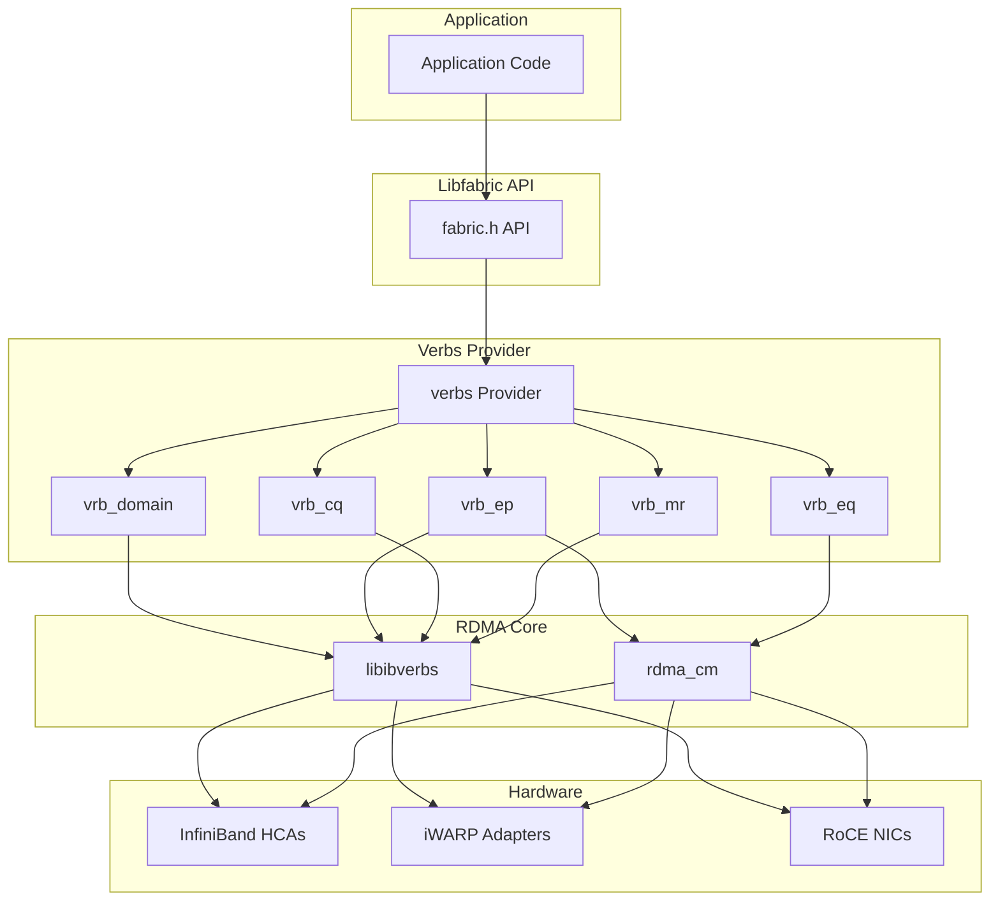
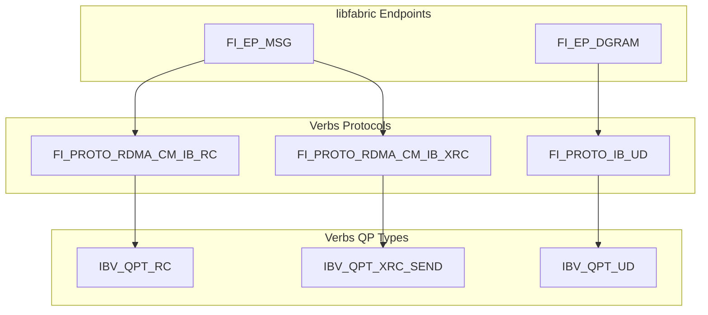
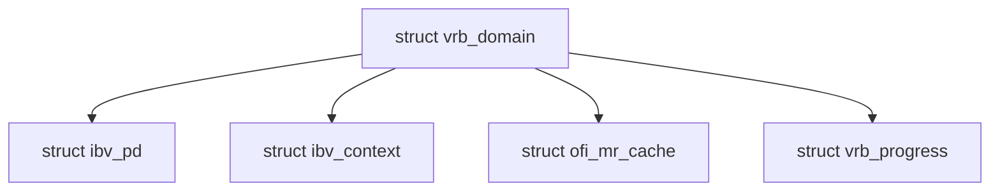
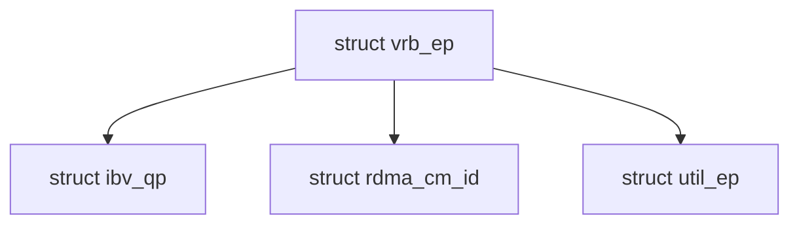
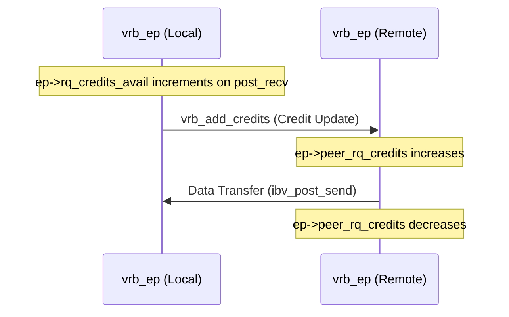
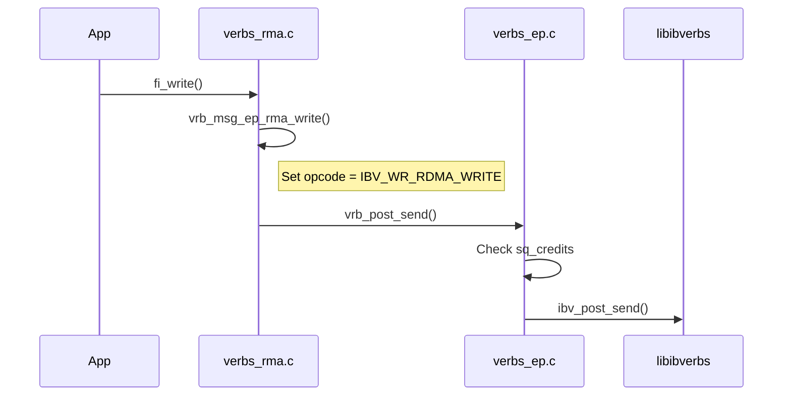

<!-- source: DeepWiki mcp.deepwiki.com · repo ofiwg/libfabric · page 4.2 Verbs Provider · fetched 2026-11-11 -->

# Verbs Provider

Relevant source files

The following files were used as context for generating this wiki page:

- [config/fi_check_package.m4](config/fi_check_package.m4)
- [config/fi_provider.m4](config/fi_provider.m4)
- [libfabric.pc.in](libfabric.pc.in)
- [prov/psm2/Makefile.include](prov/psm2/Makefile.include)
- [prov/psm2/configure.m4](prov/psm2/configure.m4)
- [prov/psm2/src/version.h](prov/psm2/src/version.h)
- [prov/sockets/Makefile.include](prov/sockets/Makefile.include)
- [prov/sockets/configure.m4](prov/sockets/configure.m4)
- [prov/sockets/include/sock_util.h](prov/sockets/include/sock_util.h)
- [prov/usnic/configure.m4](prov/usnic/configure.m4)
- [prov/verbs/Makefile.include](prov/verbs/Makefile.include)
- [prov/verbs/configure.m4](prov/verbs/configure.m4)
- [prov/verbs/src/verbs_cm.c](prov/verbs/src/verbs_cm.c)
- [prov/verbs/src/verbs_cm_xrc.c](prov/verbs/src/verbs_cm_xrc.c)
- [prov/verbs/src/verbs_cq.c](prov/verbs/src/verbs_cq.c)
- [prov/verbs/src/verbs_dgram_av.c](prov/verbs/src/verbs_dgram_av.c)
- [prov/verbs/src/verbs_dgram_ep_msg.c](prov/verbs/src/verbs_dgram_ep_msg.c)
- [prov/verbs/src/verbs_domain.c](prov/verbs/src/verbs_domain.c)
- [prov/verbs/src/verbs_domain_xrc.c](prov/verbs/src/verbs_domain_xrc.c)
- [prov/verbs/src/verbs_ep.c](prov/verbs/src/verbs_ep.c)
- [prov/verbs/src/verbs_eq.c](prov/verbs/src/verbs_eq.c)
- [prov/verbs/src/verbs_info.c](prov/verbs/src/verbs_info.c)
- [prov/verbs/src/verbs_init.c](prov/verbs/src/verbs_init.c)
- [prov/verbs/src/verbs_msg.c](prov/verbs/src/verbs_msg.c)
- [prov/verbs/src/verbs_ofi.h](prov/verbs/src/verbs_ofi.h)
- [prov/verbs/src/verbs_rma.c](prov/verbs/src/verbs_rma.c)

The Verbs Provider in libfabric implements the Fabric Interface (FI) API over InfiniBand verbs and RDMA (Remote Direct Memory Access) hardware. It provides high-performance, low-latency communication for applications using InfiniBand, iWARP, and RoCE (RDMA over Converged Ethernet) networks. It integrates with `libibverbs` for data path operations and `librdmacm` for connection management.

## Architecture Overview

The Verbs Provider translates libfabric operations into corresponding InfiniBand verbs operations. It leverages the underlying RDMA hardware capabilities through the `libibverbs`/`rdma-core` interfaces.

Sources: [prov/verbs/src/verbs_ofi.h:37-153](), [prov/verbs/src/verbs_info.c:45-178]()

## Endpoint Types and Communication Models

The Verbs Provider supports multiple endpoint types and protocols, mapping them to specific Verbs Queue Pair (QP) types.

Sources: [prov/verbs/src/verbs_info.c:138-155](), [prov/verbs/src/verbs_info.c:170-176]()

### Supported Endpoint Types

| libfabric Type | Protocol | Underlying Verbs Implementation |
|---------------|-------------|---------------------------|
| `FI_EP_MSG` | `FI_PROTO_RDMA_CM_IB_RC` | Reliable Connection (RC) QPs via `rdma_cm` |
| `FI_EP_MSG` | `FI_PROTO_RDMA_CM_IB_XRC` | eXtended Reliable Connection (XRC) QPs |
| `FI_EP_DGRAM` | `FI_PROTO_IB_UD` | Unreliable Datagram (UD) QPs |

Sources: [prov/verbs/src/verbs_info.c:139-155](), [prov/verbs/src/verbs_domain.c:256-265]()

## Core Components

### Domain

The `vrb_domain` represents the libfabric domain. It encapsulates the Verbs Protection Domain (`ibv_pd`) and the memory registration cache.

Sources: [prov/verbs/src/verbs_domain.c:150-155](), [prov/verbs/src/verbs_domain.c:218-225]()

The domain manages:
- **ODP (On-Demand Paging)**: Checked via `ibv_query_device_ex` in `vrb_odp_flag` [prov/verbs/src/verbs_domain.c:125-140]().
- **MR Cache**: Initialized to optimize memory registration performance [prov/verbs/src/verbs_domain.c:218]().
- **XRC Cleanup**: Handles resource deallocation for XRC domains [prov/verbs/src/verbs_domain.c:206-211]().

### Endpoints (`vrb_ep`)

Endpoints handle the data path and connection state. Connection-oriented endpoints use `rdma_cm_id` for handshake logic.

Sources: [prov/verbs/src/verbs_cm.c:61-63](), [prov/verbs/src/verbs_ep.c:43-45]()

- **Connection Management**: `vrb_msg_ep_connect` initiates the `rdma_resolve_addr` sequence [prov/verbs/src/verbs_cm.c:159-210]().
- **Data Posting**: `vrb_post_send` manages transmit credits and calls `ibv_post_send` [prov/verbs/src/verbs_ep.c:170-210]().

### Completion Queues (`vrb_cq`)

The `vrb_cq` wraps `ibv_cq`. It translates Verbs Work Completions (`ibv_wc`) into libfabric completion entries.

- **Opcode Mapping**: `vrb_get_cq_info` maps `IBV_WC_SEND`, `IBV_WC_RECV`, and `IBV_WC_RDMA_WRITE` to libfabric flags like `FI_SEND`, `FI_RECV`, and `FI_RMA` [prov/verbs/src/verbs_cq.c:56-107]().
- **Progress**: `vrb_poll_cq` retrieves completions and returns credits to the endpoint [prov/verbs/src/verbs_cq.c:215-259]().

## Memory Registration and HMEM

The provider uses a memory registration cache to mitigate the high cost of `ibv_reg_mr`. It also supports Heterogeneous Memory (HMEM) for GPU buffers.

- **HMEM Support**: The provider checks for `dmabuf` support (`vrb_gl_data.dmabuf_support`) [prov/verbs/src/verbs_ofi.h:212]().
- **Registration**: Memory is registered using `ibv_reg_mr` or `ibv_reg_dmabuf_mr` if available [prov/verbs/configure.m4:89-96]().

## Flow Control

The provider implements a credit-based flow control mechanism to prevent `RNR` (Receiver Not Ready) NAKs on RC connections.

Sources: [prov/verbs/src/verbs_ep.c:41-58](), [prov/verbs/src/verbs_ep.c:86-108]()

- **Credit Threshold**: Credits are only sent back to the peer when `rq_credits_avail` reaches a defined `threshold` [prov/verbs/src/verbs_ep.c:86-91]().
- **Send Constraint**: `vrb_post_send` checks `ep->peer_rq_credits` before allowing a transmission that consumes a receive buffer [prov/verbs/src/verbs_ep.c:193-200]().

## XRC (eXtended Reliable Connection)

XRC allows multiple endpoints on a node to share a single receive queue (SRQ), improving scalability for high-process-count jobs.

- **Shared INI Connection**: `vrb_get_shared_ini_conn` looks up or creates a shared physical connection to a remote node [prov/verbs/src/verbs_domain_xrc.c:84-138]().
- **Connection Tagging**: A `conn_tag` is used to multiplex libfabric endpoints over the shared XRC transport [prov/verbs/src/verbs_eq.c:67-77]().

## Communication Flow: RMA Write

Sources: [prov/verbs/src/verbs_rma.c:47-63](), [prov/verbs/src/verbs_ep.c:170-210]()

## Configuration and Build

The provider requires both `libibverbs` and `librdmacm`.

- **Check Logic**: `FI_VERBS_CONFIGURE` in `configure.m4` verifies headers and symbols like `ibv_open_device` and `rdma_create_qp` [prov/verbs/configure.m4:10-45]().
- **Feature Detection**: It checks for extended features like `ibv_query_device_ex` and `IBV_QPT_XRC_SEND` [prov/verbs/configure.m4:57-75]().

Sources: [prov/verbs/configure.m4:10-111](), [config/fi_provider.m4:51-171]()

---

