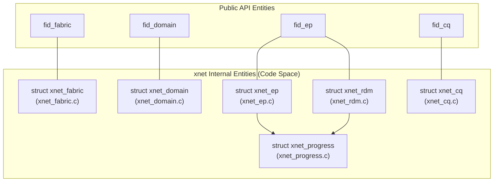
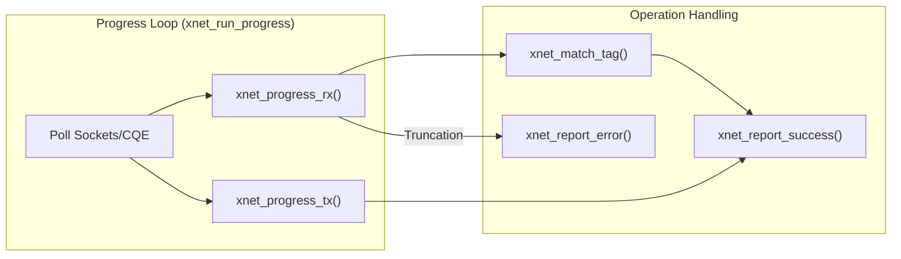

<!-- source: DeepWiki mcp.deepwiki.com · repo ofiwg/libfabric · page 4.4 TCP Provider · fetched 2026-11-11 -->

# TCP Provider

Relevant source files

The following files were used as context for generating this wiki page:

- [include/ofi_iov.h](include/ofi_iov.h)
- [prov/lpp/src/lpp_util.c](prov/lpp/src/lpp_util.c)
- [prov/sockets/src/sock_attr.c](prov/sockets/src/sock_attr.c)
- [prov/tcp/Makefile.include](prov/tcp/Makefile.include)
- [prov/tcp/src/xnet.h](prov/tcp/src/xnet.h)
- [prov/tcp/src/xnet_attr.c](prov/tcp/src/xnet_attr.c)
- [prov/tcp/src/xnet_cm.c](prov/tcp/src/xnet_cm.c)
- [prov/tcp/src/xnet_cq.c](prov/tcp/src/xnet_cq.c)
- [prov/tcp/src/xnet_domain.c](prov/tcp/src/xnet_domain.c)
- [prov/tcp/src/xnet_ep.c](prov/tcp/src/xnet_ep.c)
- [prov/tcp/src/xnet_eq.c](prov/tcp/src/xnet_eq.c)
- [prov/tcp/src/xnet_fabric.c](prov/tcp/src/xnet_fabric.c)
- [prov/tcp/src/xnet_init.c](prov/tcp/src/xnet_init.c)
- [prov/tcp/src/xnet_msg.c](prov/tcp/src/xnet_msg.c)
- [prov/tcp/src/xnet_pep.c](prov/tcp/src/xnet_pep.c)
- [prov/tcp/src/xnet_progress.c](prov/tcp/src/xnet_progress.c)
- [prov/tcp/src/xnet_proto.h](prov/tcp/src/xnet_proto.h)
- [prov/tcp/src/xnet_rdm.c](prov/tcp/src/xnet_rdm.c)
- [prov/tcp/src/xnet_rdm_cm.c](prov/tcp/src/xnet_rdm_cm.c)
- [prov/tcp/src/xnet_rma.c](prov/tcp/src/xnet_rma.c)
- [prov/tcp/src/xnet_srx.c](prov/tcp/src/xnet_srx.c)
- [src/iov.c](src/iov.c)

The TCP Provider (internally referred to as **xnet**) enables libfabric communications over standard TCP/IP networks. It serves as a high-performance, reliable transport that implements both `FI_EP_MSG` (connection-oriented) and `FI_EP_RDM` (reliable datagram) endpoint types. Beyond being a standalone provider, it frequently acts as the transport layer for the [RXM Provider](#4.1).

## Architecture and Internal Components

The xnet architecture is built on the libfabric Utility Provider Framework, abstracting standard POSIX sockets or the newer Linux `io_uring` interface for asynchronous I/O.

### Code Entity Map
The following diagram maps high-level libfabric concepts to the specific xnet implementation files and primary structures.

Sources: [prov/tcp/src/xnet.h:124-128](), [prov/tcp/src/xnet.h:239-270](), [prov/tcp/Makefile.include:2-21]()

## Progress Engine and I/O Abstraction

The xnet progress engine is the core of the provider, responsible for driving the state machine for all non-blocking socket operations.

### I/O Strategies: Sockets vs. io_uring
The provider can switch between standard synchronous socket calls and the asynchronous `io_uring` interface via the `xnet_io_uring` configuration variable [prov/tcp/src/xnet.h:117]().

*   **Socket API**: Uses `ofi_sockapi_send_socket` and `ofi_sockapi_recv_socket` [prov/tcp/src/xnet_progress.c:61-69]().
*   **io_uring API**: Uses `ofi_sockapi_send_uring` and `ofi_sockapi_recv_uring` [prov/tcp/src/xnet_progress.c:51-59]().

### Data Transfer Entry (`xnet_xfer_entry`)
All I/O operations are tracked using `struct xnet_xfer_entry`. This structure holds the message headers (`union xnet_hdrs`), IOVs, and completion context [prov/tcp/src/xnet.h:178-186]().

Sources: [prov/tcp/src/xnet_progress.c:49-70](), [prov/tcp/src/xnet_cq.c:127-191]()

## Reliable Datagram (RDM) Layer

The RDM layer (`xnet_rdm.c`) provides connectionless semantics over the underlying connection-oriented TCP streams. It maintains a cache of active connections to peers.

### Connection Management (RDM)
When an application calls `fi_send` on an RDM endpoint, xnet performs the following:
1.  **Address Lookup**: Resolves the `fi_addr_t` to a peer address [prov/tcp/src/xnet_rdm.c:78-81]().
2.  **Connection Retrieval**: Calls `xnet_get_conn()` to find an existing `xnet_conn` or initiate a new TCP handshake [prov/tcp/src/xnet_rdm.c:80]().
3.  **Internal EP Binding**: The RDM endpoint binds underlying `MSG` endpoints to the shared receive context (SRX) and CQs [prov/tcp/src/xnet_rdm_cm.c:109-182]().

Sources: [prov/tcp/src/xnet_rdm.c:70-88](), [prov/tcp/src/xnet_rdm_cm.c:46-51]()

## Shared Receive Context (SRX)

The SRX (`xnet_srx.c`) allows multiple endpoints to share a single pool of receive buffers, which is critical for scaling RDM endpoints over many TCP connections.

### Tag Matching and Unexpected Messages
*   **Matching**: SRX implements `xnet_match_tag` to search for matching receive buffers when a tagged message arrives [prov/tcp/src/xnet_srx.c:42-43]().
*   **Unexpected Messages**: If no buffer is posted, xnet can save the message data. `xnet_get_save_rx` allocates a temporary buffer and queues the message in `saved_msgs` [prov/tcp/src/xnet_progress.c:108-154]().
*   **Multi-Recv**: Supports `FI_MULTI_RECV` where a single posted buffer can satisfy multiple incoming small messages [prov/tcp/src/xnet_srx.c:109-119]().

Sources: [prov/tcp/src/xnet_srx.c:203-226](), [prov/tcp/src/xnet_progress.c:87-106]()

## IOV Utilities

The TCP provider relies heavily on IOV (Input/Output Vector) manipulation to handle zero-copy transfers and partial socket writes.

| Function | Description | Source |
| :--- | :--- | :--- |
| `ofi_copy_iov_buf` | Copies data between a flat buffer and an IOV based on direction. | [src/iov.c:40-61]() |
| `ofi_consume_iov` | Updates an IOV array to reflect that N bytes have been processed (e.g., after a partial `send`). | [src/iov.c:101-104]() |
| `ofi_total_iov_len` | Calculates the aggregate length of all segments in an IOV. | [include/ofi_iov.h:48-54]() |
| `ofi_iov_locate` | Finds the specific IOV index and offset for a given global offset. | [include/ofi_iov.h:228-250]() |

## Protocol and Framing

Because TCP is a byte-stream, xnet implements a framing protocol defined in `xnet_proto.h`. Every message starts with an `xnet_base_hdr`.

### Header Types
*   **`xnet_op_msg`**: Standard message transfer [prov/tcp/src/xnet_ep.c:48]().
*   **`xnet_op_tag`**: Tagged message transfer [prov/tcp/src/xnet_ep.c:49]().
*   **`xnet_op_read_req` / `xnet_op_read_rsp`**: RMA Read protocol [prov/tcp/src/xnet_ep.c:50-51]().
*   **`xnet_op_tag_rts` / `xnet_op_cts`**: Rendezvous protocol (Request to Send / Clear to Send) [prov/tcp/src/xnet_ep.c:53-54]().

### Byte Swapping
xnet handles endianness mismatches between peers. The `hdr_bswap` function pointer is set during connection based on the `endian_match` flag in the CM message [prov/tcp/src/xnet_cm.c:143-150]().

Sources: [prov/tcp/src/xnet_ep.c:47-56](), [prov/tcp/src/xnet_ep.c:70-82](), [prov/tcp/src/xnet_cm.c:46-62]()

## Connection Management (CM)

The `xnet_cm.c` file implements the handshake for `FI_EP_MSG` endpoints.

1.  **CM Message**: Peers exchange `struct xnet_cm_msg` containing versioning and connection data [prov/tcp/src/xnet_cm.c:46-62]().
2.  **Keepalives**: xnet can enable TCP keepalives to detect dead peers using `setsockopt` with `SO_KEEPALIVE` and `TCP_KEEPIDLE` [prov/tcp/src/xnet_ep.c:175-226]().
3.  **Zero-copy**: If `MSG_ZEROCOPY` is supported by the OS, xnet enables it for transfers exceeding `xnet_zerocopy_size` [prov/tcp/src/xnet_ep.c:111-137]().

Sources: [prov/tcp/src/xnet_cm.c:124-136](), [prov/tcp/src/xnet_ep.c:228-254]()

---

