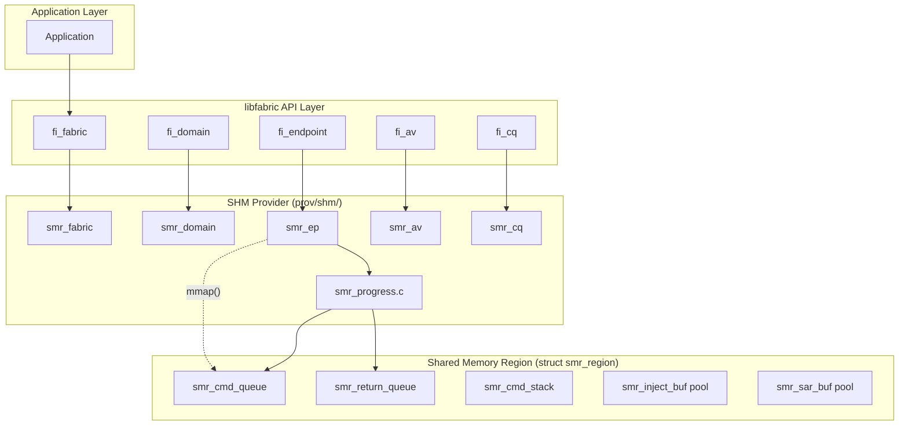
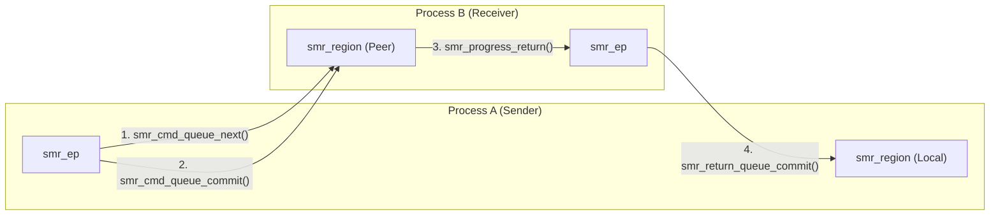
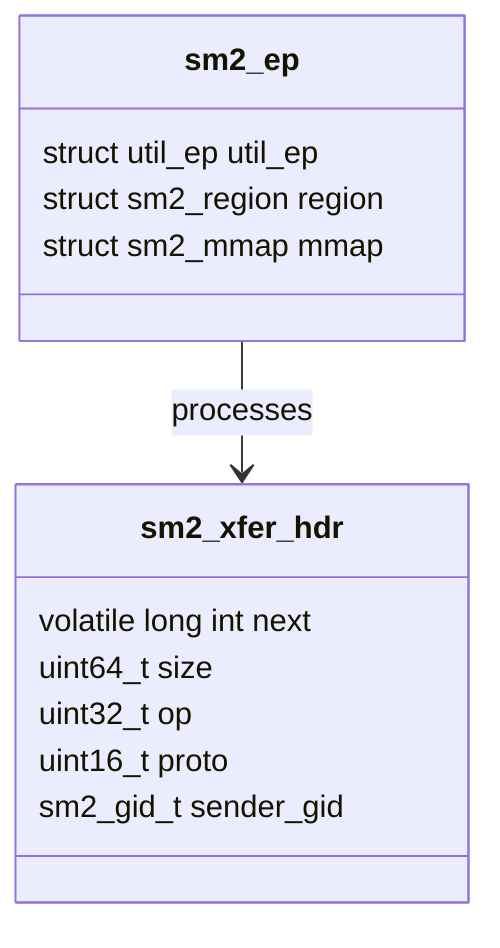

<!-- source: DeepWiki mcp.deepwiki.com · repo ofiwg/libfabric · page 4.5 SHM Provider · fetched 2026-11-11 -->

# SHM Provider

<details>
<summary>Relevant source files</summary>

The following files were used as context for generating this wiki page:

- [include/ofi_atomic_queue.h](include/ofi_atomic_queue.h)
- [man/fi_shm.7.md](man/fi_shm.7.md)
- [prov/shm/src/smr.h](prov/shm/src/smr.h)
- [prov/shm/src/smr_atomic.c](prov/shm/src/smr_atomic.c)
- [prov/shm/src/smr_attr.c](prov/shm/src/smr_attr.c)
- [prov/shm/src/smr_av.c](prov/shm/src/smr_av.c)
- [prov/shm/src/smr_cntr.c](prov/shm/src/smr_cntr.c)
- [prov/shm/src/smr_comp.c](prov/shm/src/smr_comp.c)
- [prov/shm/src/smr_cq.c](prov/shm/src/smr_cq.c)
- [prov/shm/src/smr_domain.c](prov/shm/src/smr_domain.c)
- [prov/shm/src/smr_dsa.c](prov/shm/src/smr_dsa.c)
- [prov/shm/src/smr_dsa.h](prov/shm/src/smr_dsa.h)
- [prov/shm/src/smr_ep.c](prov/shm/src/smr_ep.c)
- [prov/shm/src/smr_fabric.c](prov/shm/src/smr_fabric.c)
- [prov/shm/src/smr_init.c](prov/shm/src/smr_init.c)
- [prov/shm/src/smr_msg.c](prov/shm/src/smr_msg.c)
- [prov/shm/src/smr_progress.c](prov/shm/src/smr_progress.c)
- [prov/shm/src/smr_rma.c](prov/shm/src/smr_rma.c)
- [prov/shm/src/smr_signal.h](prov/shm/src/smr_signal.h)
- [prov/shm/src/smr_util.c](prov/shm/src/smr_util.c)
- [prov/shm/src/smr_util.h](prov/shm/src/smr_util.h)
- [prov/sm2/Makefile.include](prov/sm2/Makefile.include)
- [prov/sm2/configure.m4](prov/sm2/configure.m4)
- [prov/sm2/src/sm2.h](prov/sm2/src/sm2.h)
- [prov/sm2/src/sm2_atomic.c](prov/sm2/src/sm2_atomic.c)
- [prov/sm2/src/sm2_attr.c](prov/sm2/src/sm2_attr.c)
- [prov/sm2/src/sm2_av.c](prov/sm2/src/sm2_av.c)
- [prov/sm2/src/sm2_cntr.c](prov/sm2/src/sm2_cntr.c)
- [prov/sm2/src/sm2_comp.c](prov/sm2/src/sm2_comp.c)
- [prov/sm2/src/sm2_coordination.c](prov/sm2/src/sm2_coordination.c)
- [prov/sm2/src/sm2_coordination.h](prov/sm2/src/sm2_coordination.h)
- [prov/sm2/src/sm2_cq.c](prov/sm2/src/sm2_cq.c)
- [prov/sm2/src/sm2_domain.c](prov/sm2/src/sm2_domain.c)
- [prov/sm2/src/sm2_ep.c](prov/sm2/src/sm2_ep.c)
- [prov/sm2/src/sm2_fifo.h](prov/sm2/src/sm2_fifo.h)
- [prov/sm2/src/sm2_init.c](prov/sm2/src/sm2_init.c)
- [prov/sm2/src/sm2_msg.c](prov/sm2/src/sm2_msg.c)
- [prov/sm2/src/sm2_progress.c](prov/sm2/src/sm2_progress.c)

</details>


The Shared Memory (SHM) Provider implements the libfabric APIs for optimized communication between processes on the same node. It provides high-performance, low-latency data transfer by leveraging shared memory regions (SMR), cross-memory attach (CMA), XPMEM, and device-specific IPC mechanisms.

## Architecture Overview

The SHM provider (found in `prov/shm/`) is built upon a shared memory region (SMR) architecture. Each endpoint creates or maps into a shared memory file (typically under `/dev/shm`) that acts as the communication substrate between peers.



Sources: [prov/shm/src/smr.h:40-64](), [prov/shm/src/smr.h:208-214](), [prov/shm/src/smr_util.c:90-137]()

## Communication Model

The SHM provider uses a lockless command/return queue model. Communication involves writing a command into a peer's command queue and, for some protocols, receiving an acknowledgement via a return queue.

### Core Entities

| Entity | Struct/Type | Description |
|--------|-------------|-------------|
| **Endpoint** | `struct smr_ep` | Tracks local resources, buffer pools, and peer maps. [prov/shm/src/smr.h:40-64]() |
| **Region** | `struct smr_region` | The shared memory structure mapped into process space. [prov/shm/src/smr_util.h:122-154]() |
| **Command** | `struct smr_cmd` | Encapsulates the operation (OP), tags, and data pointers. [prov/shm/src/smr_util.h:176-210]() |
| **AV Map** | `struct smr_map` | Maps `fi_addr_t` to peer SMR regions. [prov/shm/src/smr.h:67-73]() |



Sources: [prov/shm/src/smr_progress.c:172-217](), [prov/shm/src/smr_msg.c:75-154]()

## Communication Protocols

The provider dynamically selects a protocol in `smr_select_proto` based on message size and capabilities like CMA or XPMEM.

1.  **Inline (`smr_proto_inline`)**: For messages $\le$ `SMR_MSG_DATA_LEN` (usually 128 bytes). Data is copied directly into the command header. [prov/shm/src/smr_msg.c:235-245]()
2.  **Inject (`smr_proto_inject`)**: For messages $\le$ `SMR_INJECT_SIZE`. Data is copied to a pre-allocated injection buffer in the SMR. [prov/shm/src/smr_msg.c:196-212]()
3.  **IOV/VMA (`smr_proto_iov`)**: Uses Cross-Memory Attach (`process_vm_readv`/`writev`) or XPMEM for direct zero-copy transfers between process address spaces. [prov/shm/src/smr_rma.c:53-105]()
4.  **SAR (`smr_proto_sar`)**: Segmentation and Reassembly. Large messages are broken into chunks and passed through shared buffers. [prov/shm/src/smr_progress.c:98-133]()
5.  **IPC (`smr_proto_ipc`)**: Used for HMEM (GPU) transfers, leveraging `cudaIpcMemHandle` or Level Zero IPC. [prov/shm/src/smr.h:181-182]()

Sources: [prov/shm/src/smr_msg.c:111-114](), [prov/shm/src/smr_ep.c:545-606]()

## Progress Engine

The progress engine (`smr_progress.c`) is manual. Applications must call `fi_cq_read` or similar, which triggers the internal progress functions.

- **`smr_progress_return`**: Checks the return queue for completed operations and triggers TX completions. [prov/shm/src/smr_progress.c:172-217]()
- **`smr_progress_overflow`**: Attempts to send commands that were previously queued in the `overflow_list` due to full peer command queues. [prov/shm/src/smr_progress.c:38-62]()
- **`smr_complete_tx` / `smr_complete_rx`**: Helper functions to increment counters and write to completion queues. [prov/shm/src/smr_comp.c:35-76]()

Sources: [prov/shm/src/smr_progress.c:1-217](), [prov/shm/src/smr_comp.c:35-76]()

## SM2 Provider (prov/sm2/)

The `sm2` provider is a newer implementation designed to remove dependencies on sockets for coordination, using a pure shared-memory coordination mechanism.

### Key Differences from SHM:
- **Coordination**: Uses `sm2_coordination.c` to manage peer discovery without out-of-band socket communication. [prov/sm2/src/sm2_coordination.c:1-50]()
- **FIFO Mechanism**: Implements a specialized FIFO for transfer entries. [prov/sm2/src/sm2_fifo.h:1-40]()
- **Addressing**: Uses `fi_sm2://` prefix. [prov/sm2/src/sm2.h:76]()



Sources: [prov/sm2/src/sm2.h:148-159](), [prov/sm2/src/sm2_ep.c:1-100]()

## Initialization and Configuration

The provider is initialized via `SHM_INI`. It performs a space check on `/dev/shm` to ensure the system can support the requested `tx_size` and `rx_size`.

```c
// Example from smr_init.c
fi_param_define(&smr_prov, "use_xpmem", FI_PARAM_BOOL,
                "Enable XPMEM over CMA when possible");
```

Sources: [prov/shm/src/smr_init.c:203-236](), [prov/shm/src/smr_init.c:92-124]()

### Environment Variables
- `FI_SHM_TX_SIZE`: Number of transmit slots (default 1024). [prov/shm/src/smr_init.c:209-211]()
- `FI_SHM_DISABLE_CMA`: Forces the provider to use SAR/Inject instead of CMA. [prov/shm/src/smr_init.c:215-216]()
- `FI_SHM_USE_DSA_SAR`: Enables Intel Data Streaming Accelerator for SAR copies. [prov/shm/src/smr_init.c:217-218]()

Sources: [prov/shm/src/smr_init.c:203-225]()

---

