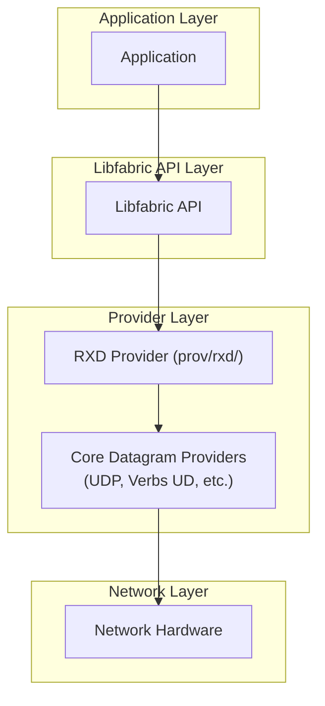
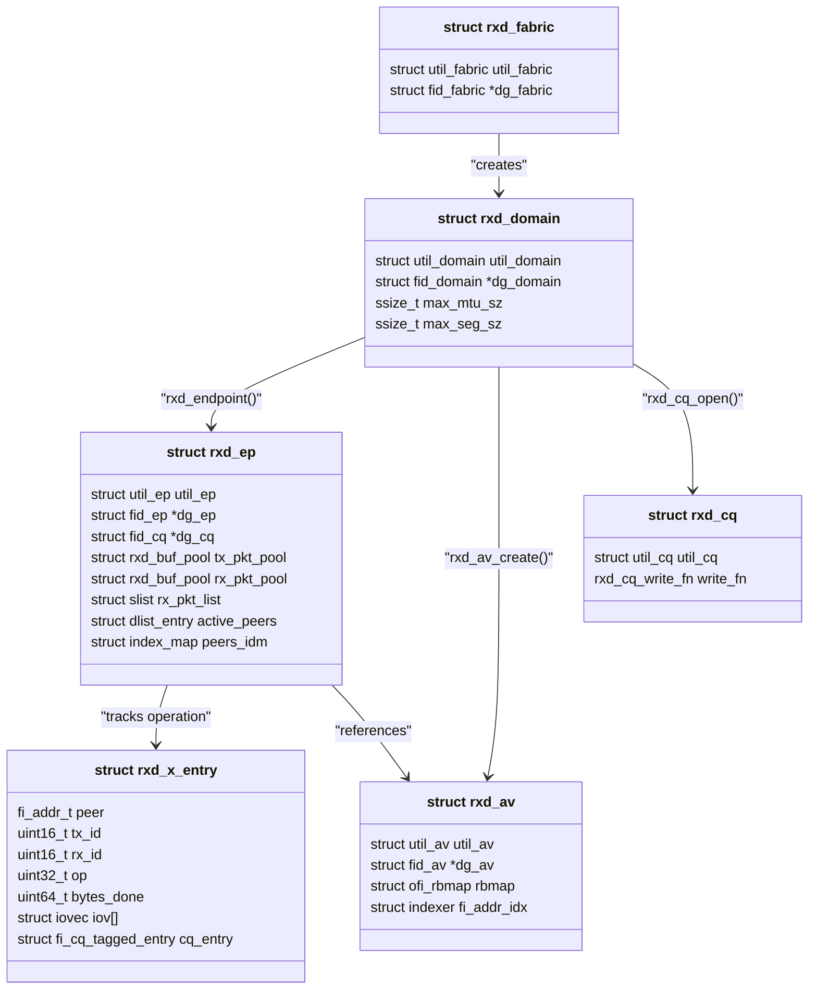
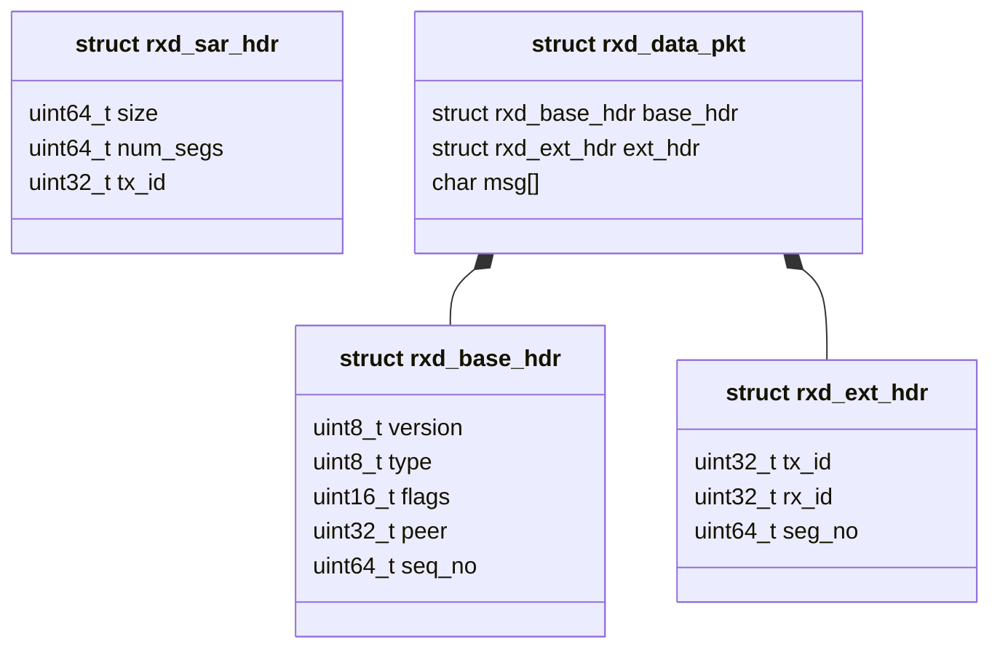
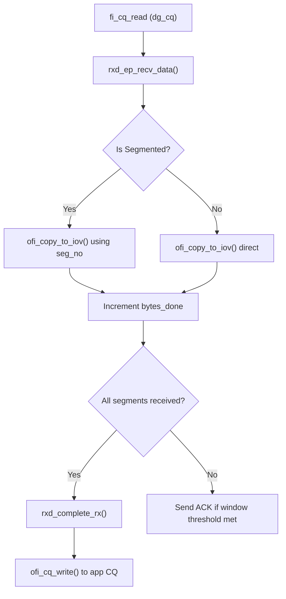

<!-- source: DeepWiki mcp.deepwiki.com · repo ofiwg/libfabric · page 4.6 RXD Provider · fetched 2026-11-11 -->

# RXD Provider

Relevant source files

The following files were used as context for generating this wiki page:

- [prov/rxd/Makefile.include](prov/rxd/Makefile.include)
- [prov/rxd/src/rxd.h](prov/rxd/src/rxd.h)
- [prov/rxd/src/rxd_atomic.c](prov/rxd/src/rxd_atomic.c)
- [prov/rxd/src/rxd_attr.c](prov/rxd/src/rxd_attr.c)
- [prov/rxd/src/rxd_av.c](prov/rxd/src/rxd_av.c)
- [prov/rxd/src/rxd_cq.c](prov/rxd/src/rxd_cq.c)
- [prov/rxd/src/rxd_domain.c](prov/rxd/src/rxd_domain.c)
- [prov/rxd/src/rxd_ep.c](prov/rxd/src/rxd_ep.c)
- [prov/rxd/src/rxd_fabric.c](prov/rxd/src/rxd_fabric.c)
- [prov/rxd/src/rxd_init.c](prov/rxd/src/rxd_init.c)
- [prov/rxd/src/rxd_msg.c](prov/rxd/src/rxd_msg.c)
- [prov/rxd/src/rxd_proto.h](prov/rxd/src/rxd_proto.h)
- [prov/rxd/src/rxd_rma.c](prov/rxd/src/rxd_rma.c)
- [prov/rxd/src/rxd_tagged.c](prov/rxd/src/rxd_tagged.c)

The RXD (Reliable Datagram) Provider is a utility provider in libfabric that implements a reliable transport protocol over unreliable datagram providers. It serves as a layer between applications and underlying datagram-based fabric providers, adding reliability, message segmentation, and reassembly capabilities. This page documents the architecture, protocol, and core components of the RXD provider.

## Overview

The RXD provider transforms unreliable datagram transports into reliable ones by implementing:

1.  Connection establishment via a handshake protocol
2.  Reliable message delivery through acknowledgments and retransmissions
3.  Message segmentation and reassembly for large transfers
4.  Flow control to prevent receiver buffer overflow

RXD operates as a utility provider, meaning it works on top of other core providers rather than directly interfacing with hardware. It is particularly useful when reliability features are needed over inherently unreliable transports like UDP or basic InfiniBand UD.

Sources: [prov/rxd/src/rxd_attr.c:35-117](), [prov/rxd/src/rxd_init.c:81-90]()

## Architecture

### Position in Libfabric Stack

The RXD provider sits between the libfabric API and the core providers, adding reliability protocols before forwarding operations to underlying datagram endpoints (`FI_EP_DGRAM`).

Sources: [prov/rxd/src/rxd_init.c:85-87](), [prov/rxd/src/rxd_domain.c:110-115]()

### Key Components and Code Entities

The following diagram maps the logical components of the RXD provider to their specific C structures and relationships.

Sources: [prov/rxd/src/rxd.h:108-122](), [prov/rxd/src/rxd.h:154-164](), [prov/rxd/src/rxd.h:169-172](), [prov/rxd/src/rxd.h:185-222](), [prov/rxd/src/rxd.h:249-272]()

## Protocol Details

### Packet Types

The RXD provider defines a specific wire protocol to manage reliability. The packet types are defined in `rxd_proto.h`.

| Packet Type | Code Symbol | Description |
| :--- | :--- | :--- |
| Ready To Send | `RXD_RTS` | Initiates a connection/handshake with a peer. |
| Clear To Send | `RXD_CTS` | Responds to an RTS, completing the handshake. |
| Acknowledgment | `RXD_ACK` | Confirms receipt of data packets for reliability. |
| Message | `RXD_MSG` | Carries standard message data. |
| Tagged Message | `RXD_TAGGED` | Carries tagged message data. |
| Data Segment | `RXD_DATA` | Carries segmented data for large transfers. |
| RMA Read | `RXD_READ_REQ` | Initiates a remote memory read. |
| Atomic | `RXD_ATOMIC` | Carries atomic operation data. |

Sources: [prov/rxd/src/rxd_proto.h:49-63](), [prov/rxd/src/rxd_init.c:49-51]()

### Packet Headers

Every RXD packet begins with a `rxd_base_hdr`. Depending on the operation, additional headers like `rxd_ext_hdr` (for segmentation) or `rxd_sar_hdr` (Segmentation and Reassembly) are appended.

Sources: [prov/rxd/src/rxd_proto.h:79-85](), [prov/rxd/src/rxd_proto.h:93-97](), [prov/rxd/src/rxd_proto.h:104-108](), [prov/rxd/src/rxd_proto.h:133-138]()

### Reliability and Flow Control

Reliability is maintained via a sliding window and sequence numbers tracked per peer in `struct rxd_peer`.

1.  **Sequence Numbers**: `tx_seq_no` and `rx_seq_no` ensure in-order delivery.
2.  **Handshake**: Connections are established using `RXD_RTS` and `RXD_CTS`.
3.  **ACKs**: Received data triggers an `RXD_ACK` packet. ACKs are sent periodically based on the `rx_window`.
4.  **Retransmission**: Unacknowledged packets in the `unacked` list are retransmitted.

Sources: [prov/rxd/src/rxd.h:124-147](), [prov/rxd/src/rxd_cq.c:193-198](), [prov/rxd/src/rxd_cq.c:206-220]()

## Implementation Details

### Data Flow: Receiving Data

When the underlying datagram provider completes a receive operation, the RXD provider processes the packet in its progress engine.

Sources: [prov/rxd/src/rxd_cq.c:168-204](), [prov/rxd/src/rxd_cq.c:110-140]()

### Address Vector (AV) Management

The RXD AV (`struct rxd_av`) maps libfabric addresses to underlying datagram addresses. It uses an `ofi_rbmap` (Red-Black Map) to track known addresses and an `indexer` to manage `fi_addr_t` identifiers.

*   **`rxd_av_insert`**: Inserts addresses into the underlying `dg_av` and local mapping structures.
*   **`rxd_av_set_addrlen`**: Dynamically determines the address length of the underlying datagram provider.

Sources: [prov/rxd/src/rxd_av.c:109-117](), [prov/rxd/src/rxd_av.c:187-212](), [prov/rxd/src/rxd_av.c:64-73]()

### Memory Management

RXD utilizes `ofi_bufpool` for managing both packet buffers and operation entries:
*   **`tx_pkt_pool` / `rx_pkt_pool`**: For the raw network packets (`struct rxd_pkt_entry`).
*   **`tx_entry_pool` / `rx_entry_pool`**: For tracking operation state (`struct rxd_x_entry`).

Sources: [prov/rxd/src/rxd_ep.c:39-51](), [prov/rxd/src/rxd_ep.c:53-71](), [prov/rxd/src/rxd_ep.c:73-91]()

## Operations

### Messaging and RMA

RXD supports Tagged, MSG, RMA, and Atomic APIs by segmenting large requests into MTU-sized datagrams.

*   **Segmentation**: Handled in `rxd_tx_entry_init_rma` and `rxd_tx_entry_init_atomic`.
*   **Inline Data**: Optimized path for small messages that fit within the MTU.
*   **Atomics**: Implemented using `RXD_ATOMIC` packets, supporting standard libfabric datatypes and operations.

Sources: [prov/rxd/src/rxd_rma.c:39-84](), [prov/rxd/src/rxd_atomic.c:40-101](), [prov/rxd/src/rxd_msg.c:196-220]()

## Configuration

RXD behavior is controlled via environment variables initialized in `rxd_init_env`.

| Parameter | Default | Description |
| :--- | :--- | :--- |
| `FI_RXD_SPIN_COUNT` | 1000 | Iterations to spin for packets before yielding. |
| `FI_RXD_RETRY` | 1 (True) | Toggles packet retransmission. |
| `FI_RXD_MAX_PEERS` | 1024 | Maximum number of remote peers to track. |
| `FI_RXD_MAX_UNACKED` | 128 | Max unacknowledged packets in flight. |

Sources: [prov/rxd/src/rxd_init.c:41-47](), [prov/rxd/src/rxd_init.c:53-60](), [prov/rxd/src/rxd_init.c:148-156]()

---

