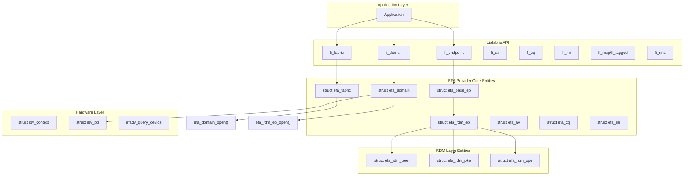
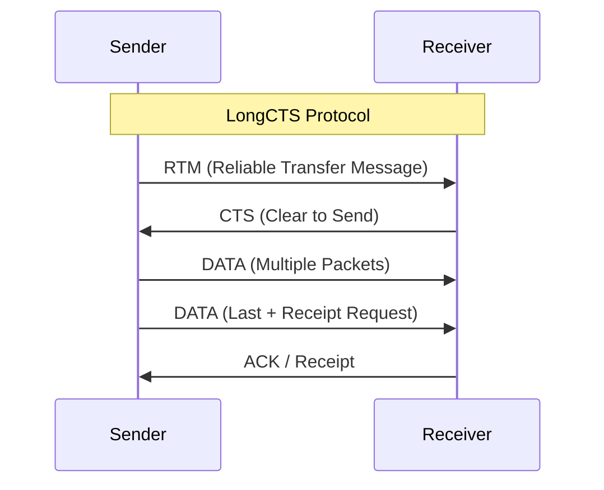
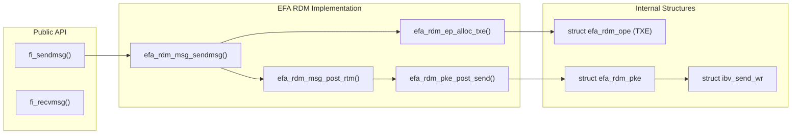

<!-- source: DeepWiki mcp.deepwiki.com · repo ofiwg/libfabric · page 4.7 EFA Provider · fetched 2026-11-11 -->

# EFA Provider

Relevant source files

The following files were used as context for generating this wiki page:

- [man/fi_efa.7.md](man/fi_efa.7.md)
- [prov/efa/docs/efa_rdm_protocol_v4.md](prov/efa/docs/efa_rdm_protocol_v4.md)
- [prov/efa/src/efa.h](prov/efa/src/efa.h)
- [prov/efa/src/efa_av.c](prov/efa/src/efa_av.c)
- [prov/efa/src/efa_av.h](prov/efa/src/efa_av.h)
- [prov/efa/src/efa_base_ep.c](prov/efa/src/efa_base_ep.c)
- [prov/efa/src/efa_base_ep.h](prov/efa/src/efa_base_ep.h)
- [prov/efa/src/efa_cq.c](prov/efa/src/efa_cq.c)
- [prov/efa/src/efa_cq.h](prov/efa/src/efa_cq.h)
- [prov/efa/src/efa_data_path_direct.c](prov/efa/src/efa_data_path_direct.c)
- [prov/efa/src/efa_data_path_direct.h](prov/efa/src/efa_data_path_direct.h)
- [prov/efa/src/efa_data_path_direct_entry.h](prov/efa/src/efa_data_path_direct_entry.h)
- [prov/efa/src/efa_data_path_direct_internal.h](prov/efa/src/efa_data_path_direct_internal.h)
- [prov/efa/src/efa_data_path_direct_structs.h](prov/efa/src/efa_data_path_direct_structs.h)
- [prov/efa/src/efa_data_path_ops.h](prov/efa/src/efa_data_path_ops.h)
- [prov/efa/src/efa_device.c](prov/efa/src/efa_device.c)
- [prov/efa/src/efa_device.h](prov/efa/src/efa_device.h)
- [prov/efa/src/efa_domain.c](prov/efa/src/efa_domain.c)
- [prov/efa/src/efa_domain.h](prov/efa/src/efa_domain.h)
- [prov/efa/src/efa_env.c](prov/efa/src/efa_env.c)
- [prov/efa/src/efa_env.h](prov/efa/src/efa_env.h)
- [prov/efa/src/efa_ep.c](prov/efa/src/efa_ep.c)
- [prov/efa/src/efa_fabric.c](prov/efa/src/efa_fabric.c)
- [prov/efa/src/efa_fork_support.c](prov/efa/src/efa_fork_support.c)
- [prov/efa/src/efa_fork_support.h](prov/efa/src/efa_fork_support.h)
- [prov/efa/src/efa_hmem.c](prov/efa/src/efa_hmem.c)
- [prov/efa/src/efa_hmem.h](prov/efa/src/efa_hmem.h)
- [prov/efa/src/efa_mr.c](prov/efa/src/efa_mr.c)
- [prov/efa/src/efa_mr.h](prov/efa/src/efa_mr.h)
- [prov/efa/src/efa_msg.c](prov/efa/src/efa_msg.c)
- [prov/efa/src/efa_prov.c](prov/efa/src/efa_prov.c)
- [prov/efa/src/efa_prov_info.c](prov/efa/src/efa_prov_info.c)
- [prov/efa/src/efa_prov_info.h](prov/efa/src/efa_prov_info.h)
- [prov/efa/src/efa_rma.c](prov/efa/src/efa_rma.c)
- [prov/efa/src/efa_shm.c](prov/efa/src/efa_shm.c)
- [prov/efa/src/efa_user_info.c](prov/efa/src/efa_user_info.c)
- [prov/efa/src/fi_ext_efa.h](prov/efa/src/fi_ext_efa.h)
- [prov/efa/src/rdm/efa_rdm_atomic.c](prov/efa/src/rdm/efa_rdm_atomic.c)
- [prov/efa/src/rdm/efa_rdm_atomic.h](prov/efa/src/rdm/efa_rdm_atomic.h)
- [prov/efa/src/rdm/efa_rdm_cq.c](prov/efa/src/rdm/efa_rdm_cq.c)
- [prov/efa/src/rdm/efa_rdm_ep.h](prov/efa/src/rdm/efa_rdm_ep.h)
- [prov/efa/src/rdm/efa_rdm_ep_fiops.c](prov/efa/src/rdm/efa_rdm_ep_fiops.c)
- [prov/efa/src/rdm/efa_rdm_ep_utils.c](prov/efa/src/rdm/efa_rdm_ep_utils.c)
- [prov/efa/src/rdm/efa_rdm_mr.c](prov/efa/src/rdm/efa_rdm_mr.c)
- [prov/efa/src/rdm/efa_rdm_mr.h](prov/efa/src/rdm/efa_rdm_mr.h)
- [prov/efa/src/rdm/efa_rdm_msg.c](prov/efa/src/rdm/efa_rdm_msg.c)
- [prov/efa/src/rdm/efa_rdm_ope.c](prov/efa/src/rdm/efa_rdm_ope.c)
- [prov/efa/src/rdm/efa_rdm_ope.h](prov/efa/src/rdm/efa_rdm_ope.h)
- [prov/efa/src/rdm/efa_rdm_peer.c](prov/efa/src/rdm/efa_rdm_peer.c)
- [prov/efa/src/rdm/efa_rdm_peer.h](prov/efa/src/rdm/efa_rdm_peer.h)
- [prov/efa/src/rdm/efa_rdm_pke.c](prov/efa/src/rdm/efa_rdm_pke.c)
- [prov/efa/src/rdm/efa_rdm_pke.h](prov/efa/src/rdm/efa_rdm_pke.h)
- [prov/efa/src/rdm/efa_rdm_pke_cmd.c](prov/efa/src/rdm/efa_rdm_pke_cmd.c)
- [prov/efa/src/rdm/efa_rdm_pke_cmd.h](prov/efa/src/rdm/efa_rdm_pke_cmd.h)
- [prov/efa/src/rdm/efa_rdm_pke_nonreq.c](prov/efa/src/rdm/efa_rdm_pke_nonreq.c)
- [prov/efa/src/rdm/efa_rdm_pke_nonreq.h](prov/efa/src/rdm/efa_rdm_pke_nonreq.h)
- [prov/efa/src/rdm/efa_rdm_pke_req.c](prov/efa/src/rdm/efa_rdm_pke_req.c)
- [prov/efa/src/rdm/efa_rdm_pke_req.h](prov/efa/src/rdm/efa_rdm_pke_req.h)
- [prov/efa/src/rdm/efa_rdm_pke_rtm.c](prov/efa/src/rdm/efa_rdm_pke_rtm.c)
- [prov/efa/src/rdm/efa_rdm_protocol.h](prov/efa/src/rdm/efa_rdm_protocol.h)
- [prov/efa/src/rdm/efa_rdm_rma.c](prov/efa/src/rdm/efa_rdm_rma.c)
- [prov/efa/src/rdm/efa_rdm_rma.h](prov/efa/src/rdm/efa_rdm_rma.h)
- [prov/efa/src/rdm/efa_rdm_srx.c](prov/efa/src/rdm/efa_rdm_srx.c)
- [prov/efa/src/rdm/efa_rdm_util.c](prov/efa/src/rdm/efa_rdm_util.c)
- [prov/efa/src/rdm/efa_rdm_util.h](prov/efa/src/rdm/efa_rdm_util.h)
- [prov/efa/test/efa_unit_test_av.c](prov/efa/test/efa_unit_test_av.c)
- [prov/efa/test/efa_unit_test_data_path_direct.c](prov/efa/test/efa_unit_test_data_path_direct.c)
- [prov/efa/test/efa_unit_test_device.c](prov/efa/test/efa_unit_test_device.c)
- [prov/efa/test/efa_unit_test_domain.c](prov/efa/test/efa_unit_test_domain.c)
- [prov/efa/test/efa_unit_test_hmem.c](prov/efa/test/efa_unit_test_hmem.c)
- [prov/efa/test/efa_unit_test_info.c](prov/efa/test/efa_unit_test_info.c)
- [prov/efa/test/efa_unit_test_mr.c](prov/efa/test/efa_unit_test_mr.c)
- [prov/efa/test/efa_unit_test_msg.c](prov/efa/test/efa_unit_test_msg.c)
- [prov/efa/test/efa_unit_test_ope.c](prov/efa/test/efa_unit_test_ope.c)
- [prov/efa/test/efa_unit_test_rdm_rma.c](prov/efa/test/efa_unit_test_rdm_rma.c)
- [prov/efa/test/efa_unit_test_rma.c](prov/efa/test/efa_unit_test_rma.c)
- [prov/efa/test/efa_unit_test_rnr.c](prov/efa/test/efa_unit_test_rnr.c)
- [prov/efa/test/efa_unit_test_srx.c](prov/efa/test/efa_unit_test_srx.c)

The EFA Provider enables applications to use Amazon's Elastic Fabric Adapter (EFA) network device through the libfabric interface. It provides high-performance, low-latency communication capabilities for distributed applications running on AWS. This document covers the architecture, components, and features of the EFA Provider within the libfabric framework.

## Architecture Overview

The EFA Provider implements the libfabric API for Amazon's Elastic Fabric Adapter hardware. It supports both reliable datagram (RDM) and unreliable datagram (DGRAM) endpoint types, with the RDM endpoint being the primary focus for most applications. The provider also offers an EFA-direct fabric mode for specialized use cases.

Sources: [prov/efa/src/efa.h:122-128](), [prov/efa/src/efa_domain.h:15-56](), [prov/efa/src/efa_domain.c:177-205](), [prov/efa/src/rdm/efa_rdm_ep.h:40-207]()

## Base EFA Layer

The base layer handles the fundamental interactions with the EFA hardware via `rdma-core` (ibverbs) and the EFA-specific extension library (`efadv`).

### Domain and Memory Registration
The `efa_domain` manages the Protection Domain (`ibv_pd`) and memory registration. EFA supports both host and HMEM (GPU/Neuron) memory.
- **MR Cache**: To minimize the overhead of `ibv_reg_mr`, the provider implements a memory registration cache [prov/efa/src/efa_domain.c:120-125]().
- **HMEM Support**: The provider detects HMEM interfaces (CUDA, Neuron, ROCm) and configures protocol thresholds (like `runt_size`) accordingly [prov/efa/src/efa_hmem.c:40-116]().
- **Registration Validation**: `efa_mr_regattr_validate` ensures requested flags like `FI_MR_DMABUF` are supported based on the API version [prov/efa/src/efa_mr.c:17-77]().

### Address Vector (AV)
The `efa_av` maps `fi_addr_t` to EFA-specific connection information (`struct efa_conn`).
- **Reverse Lookup**: Necessary for identifying the source of incoming packets. The provider maintains `cur_reverse_av` (current) and `prv_reverse_av` (previous) hashes to handle connection migrations or ID updates [prov/efa/src/efa_av.c:69-137]().
- **Implicit AV**: Supports a least-recently-used (LRU) mechanism for managing implicit address vectors [prov/efa/src/efa_av.c:207-220]().

### Completion Queues (CQ)
The base `efa_cq` interacts with `ibv_poll_cq`.
- **Error Handling**: When a hardware error occurs, `efa_cq_handle_error` translates the vendor-specific error code into a libfabric error and writes an error entry to the user's CQ [prov/efa/src/efa_cq.c:180-205]().

Sources: [prov/efa/src/efa_mr.c:92-124](), [prov/efa/src/efa_av.c:42-80](), [prov/efa/src/efa_cq.c:122-159]()

## RDM Layer and RXR Protocol

The Reliable Datagram (RDM) layer implements the core logic for reliability, segmentation, and reassembly.

### Endpoint and Packet Engine
The `efa_rdm_ep` manages several `ofi_bufpool` instances for different packet types:
- `efa_tx_pkt_pool`: For outgoing packets [prov/efa/src/rdm/efa_rdm_ep_fiops.c:154-162]().
- `efa_rx_pkt_pool`: For incoming packets [prov/efa/src/rdm/efa_rdm_ep_fiops.c:169-177]().
- `rx_ooo_pkt_pool`: Staging for out-of-order packets [prov/efa/src/rdm/efa_rdm_ep_fiops.c:202-213]().

### Operations (OPE)
Operations are tracked using `struct efa_rdm_ope`.
- **TXE (Transmit Entry)**: Created via `efa_rdm_txe_construct` to track a send/write/read operation [prov/efa/src/rdm/efa_rdm_ope.c:17-97]().
- **RXE (Receive Entry)**: Tracks incoming messages. It includes a mapping (`rxe_map`) to correlate fragments of the same message ID [prov/efa/src/rdm/efa_rdm_ope.c:160-211]().

### Protocol Selection
The provider selects a protocol based on message size and memory type:
- **Eager**: Small messages sent in a single packet.
- **Medium**: Multi-packet messages without a handshake.
- **LongCTS (Clear-to-Send)**: Receiver-throttled transfer for large messages.
- **LongRead**: Sender-side RDMA read for large transfers, often used for HMEM [prov/efa/src/rdm/efa_rdm_msg.c:46-102]().

Sources: [prov/efa/src/rdm/efa_rdm_msg.c:114-156](), [prov/efa/src/rdm/efa_rdm_ope.c:226-245]()

## EFA RDM Protocol v4

The v4 protocol introduces enhanced features for performance and compatibility:
- **Connection IDs**: Packets include a `connid` (QKEY) to distinguish between different incarnations of an endpoint at the same GID/QPN [prov/efa/src/efa_base_ep.c:212-228]().
- **Handshake**: Peers exchange capabilities (extra features) during connection establishment. If a peer doesn't support a feature, the sender falls back to a baseline protocol [prov/efa/src/rdm/efa_rdm_msg.c:125-156]().
- **RNR Handling**: If the receiver has no buffers, the hardware generates a Receiver-Not-Ready (RNR) error. The provider manages a `peer_backoff_list` to retry these operations with exponential backoff [prov/efa/src/efa_domain.c:154-157]().

## Fork Support

EFA provides specialized support for `fork()`. Because memory registration in `rdma-core` marks pages as `MADV_DONTFORK`, the child process cannot access parent buffers.
- **Bufpool Alignment**: The provider uses `OFI_BUFPOOL_HUGEPAGES` or `OFI_BUFPOOL_NONSHARED` to ensure buffer pools do not share pages with other memory regions, preventing accidental side effects from `MADV_DONTFORK` [prov/efa/src/rdm/efa_rdm_ep_fiops.c:109-115]().
- **Tracking**: If `efa_env.track_mr` is enabled, the provider tracks all in-flight operations. When an MR is closed, `efa_mr_close_check_inflight_ope` warns if operations are still referencing that memory [prov/efa/src/efa_mr.c:191-209]().

## Data Path Integration

The following diagram bridges the high-level data path functions to the internal RDM structures.

Sources: [prov/efa/src/rdm/efa_rdm_msg.c:159-209](), [prov/efa/src/rdm/efa_rdm_ope.c:17-62](), [prov/efa/src/rdm/efa_rdm_ep_fiops.c:132-144]()

## HMEM and Zero-Copy

EFA leverages P2P DMA for HMEM when available.
- **GDRCopy/CUDA**: The provider can use `gdrcopy` or `cudaMemcpy` for staging transfers. The `efa_rdm_ep` tracks `blocking_copy_rxe_num` to manage these synchronous operations [prov/efa/src/rdm/efa_rdm_ep.h:174-176]().
- **Zero-Copy RX**: Enabled via `use_zcpy_rx`, this allows data to be placed directly into application buffers if they are properly aligned and registered [prov/efa/src/rdm/efa_rdm_ep.h:68-70]().

Sources: [prov/efa/src/efa_hmem.c:118-183](), [prov/efa/src/rdm/efa_rdm_ep.h:150-170]()

---

