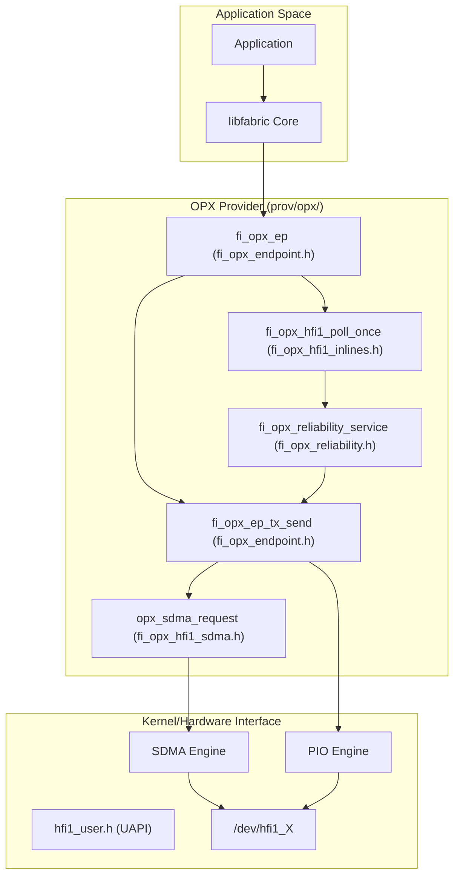
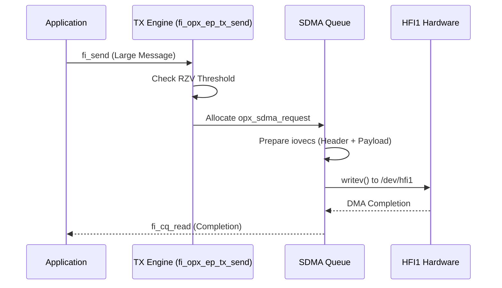

<!-- source: DeepWiki mcp.deepwiki.com · repo ofiwg/libfabric · page 4.8 OPX Provider · fetched 2026-11-11 -->

# OPX Provider

Relevant source files

The following files were used as context for generating this wiki page:

- [man/fi_opx.7.md](man/fi_opx.7.md)
- [man/man7/fi_opx.7](man/man7/fi_opx.7)
- [prov/opx/.gitignore](prov/opx/.gitignore)
- [prov/opx/Makefile.include](prov/opx/Makefile.include)
- [prov/opx/configure.m4](prov/opx/configure.m4)
- [prov/opx/include/fi_opx_tid.h](prov/opx/include/fi_opx_tid.h)
- [prov/opx/include/fi_opx_tid_cache.h](prov/opx/include/fi_opx_tid_cache.h)
- [prov/opx/include/opa_service.h](prov/opx/include/opa_service.h)
- [prov/opx/include/opa_user_gen1.h](prov/opx/include/opa_user_gen1.h)
- [prov/opx/include/opx_hmem_cache.h](prov/opx/include/opx_hmem_cache.h)
- [prov/opx/include/rdma/opx/fi_opx.h](prov/opx/include/rdma/opx/fi_opx.h)
- [prov/opx/include/rdma/opx/fi_opx_compiler.h](prov/opx/include/rdma/opx/fi_opx_compiler.h)
- [prov/opx/include/rdma/opx/fi_opx_debug_counters.h](prov/opx/include/rdma/opx/fi_opx_debug_counters.h)
- [prov/opx/include/rdma/opx/fi_opx_domain.h](prov/opx/include/rdma/opx/fi_opx_domain.h)
- [prov/opx/include/rdma/opx/fi_opx_endpoint.h](prov/opx/include/rdma/opx/fi_opx_endpoint.h)
- [prov/opx/include/rdma/opx/fi_opx_eq.h](prov/opx/include/rdma/opx/fi_opx_eq.h)
- [prov/opx/include/rdma/opx/fi_opx_hfi1.h](prov/opx/include/rdma/opx/fi_opx_hfi1.h)
- [prov/opx/include/rdma/opx/fi_opx_hfi1_inlines.h](prov/opx/include/rdma/opx/fi_opx_hfi1_inlines.h)
- [prov/opx/include/rdma/opx/fi_opx_hfi1_packet.h](prov/opx/include/rdma/opx/fi_opx_hfi1_packet.h)
- [prov/opx/include/rdma/opx/fi_opx_hfi1_progress.h](prov/opx/include/rdma/opx/fi_opx_hfi1_progress.h)
- [prov/opx/include/rdma/opx/fi_opx_hfi1_sdma.h](prov/opx/include/rdma/opx/fi_opx_hfi1_sdma.h)
- [prov/opx/include/rdma/opx/fi_opx_hfi1_transport.h](prov/opx/include/rdma/opx/fi_opx_hfi1_transport.h)
- [prov/opx/include/rdma/opx/fi_opx_hmem.h](prov/opx/include/rdma/opx/fi_opx_hmem.h)
- [prov/opx/include/rdma/opx/fi_opx_reliability.h](prov/opx/include/rdma/opx/fi_opx_reliability.h)
- [prov/opx/include/rdma/opx/fi_opx_rma.h](prov/opx/include/rdma/opx/fi_opx_rma.h)
- [prov/opx/include/rdma/opx/fi_opx_timer.h](prov/opx/include/rdma/opx/fi_opx_timer.h)
- [prov/opx/include/rdma/opx/opx_hfi1_rdma_core.h](prov/opx/include/rdma/opx/opx_hfi1_rdma_core.h)
- [prov/opx/src/fi_opx_atomic.c](prov/opx/src/fi_opx_atomic.c)
- [prov/opx/src/fi_opx_cq.c](prov/opx/src/fi_opx_cq.c)
- [prov/opx/src/fi_opx_domain.c](prov/opx/src/fi_opx_domain.c)
- [prov/opx/src/fi_opx_ep.c](prov/opx/src/fi_opx_ep.c)
- [prov/opx/src/fi_opx_hfi1.c](prov/opx/src/fi_opx_hfi1.c)
- [prov/opx/src/fi_opx_hfi1_sdma.c](prov/opx/src/fi_opx_hfi1_sdma.c)
- [prov/opx/src/fi_opx_init.c](prov/opx/src/fi_opx_init.c)
- [prov/opx/src/fi_opx_mr.c](prov/opx/src/fi_opx_mr.c)
- [prov/opx/src/fi_opx_reliability.c](prov/opx/src/fi_opx_reliability.c)
- [prov/opx/src/fi_opx_rma.c](prov/opx/src/fi_opx_rma.c)
- [prov/opx/src/fi_opx_service.c](prov/opx/src/fi_opx_service.c)
- [prov/opx/src/fi_opx_tid_cache.c](prov/opx/src/fi_opx_tid_cache.c)
- [prov/opx/src/opa_proto.c](prov/opx/src/opa_proto.c)
- [prov/opx/src/opx_hfi1_rdma_core.c](prov/opx/src/opx_hfi1_rdma_core.c)
- [prov/opx/src/opx_hmem_cache.c](prov/opx/src/opx_hmem_cache.c)

The OPX (Omni-Path Express) Provider is a native libfabric provider designed specifically for Cornelis Networks Omni-Path fabrics. It delivers high-performance, scalable communication by interfacing directly with the Host Fabric Interface (HFI1) hardware. It supports reliable datagram (RDM) endpoints, leveraging hardware-level features like SDMA, PIO, and TID-based rendezvous protocols.

## Architecture Overview

The OPX provider is built with a layered architecture that bridges the libfabric API to the HFI1 kernel and hardware interfaces. It implements a custom reliability protocol on top of the HFI1 transport to provide `FI_EP_RDM` semantics.

### System Components Diagram

The following diagram maps high-level system components to their respective code entities.

Sources:
- [prov/opx/include/rdma/opx/fi_opx_endpoint.h:442-508]()
- [prov/opx/include/rdma/opx/fi_opx_hfi1_sdma.h:133-150]()
- [prov/opx/src/fi_opx_hfi1.c:173-187]()
- [prov/opx/include/rdma/opx/fi_opx_reliability.h:177-210]()

## Endpoint Architecture

The OPX endpoint (`struct fi_opx_ep`) manages the state for communication, including hardware contexts, reliability queues, and transmit/receive descriptors.

### Key Data Structures

| Structure | File | Description |
|-----------|------|-------------|
| `struct fi_opx_ep` | [prov/opx/include/rdma/opx/fi_opx_endpoint.h:442-508]() | Primary endpoint object containing TX/RX contexts. |
| `struct fi_opx_hfi1_context` | [prov/opx/include/rdma/opx/fi_opx_hfi1.h:306-396]() | Internal hardware context, managing file descriptors for `/dev/hfi1`. |
| `struct fi_opx_ep_tx` | [prov/opx/include/rdma/opx/fi_opx_endpoint.h:184-269]() | Transmit context, managing SDMA queues and PIO credits. |
| `struct fi_opx_ep_rx` | [prov/opx/include/rdma/opx/fi_opx_endpoint.h:298-396]() | Receive context, managing header queues and unexpected packet buffers. |

### Endpoint Initialization
The provider uses `fi_opx_hfi1_context_open` to initialize the hardware interface. This involves:
1. **NUMA Locality**: Determining the NUMA node of the process and selecting the closest HFI unit [prov/opx/src/fi_opx_hfi1.c:85-100]().
2. **Context Sharing**: Optionally sharing HFI contexts between multiple endpoints to conserve hardware resources [prov/opx/src/fi_opx_hfi1.c:123-170]().
3. **Memory Mapping**: Mapping hardware registers and queues (PIO, Receive Header Queue) into user space [prov/opx/src/fi_opx_hfi1.c:837-940]().

Sources:
- [prov/opx/src/fi_opx_hfi1.c:85-170]()
- [prov/opx/include/rdma/opx/fi_opx_endpoint.h:442-508]()

## Transport and Data Flow

OPX uses a combination of **PIO (Programmed I/O)** and **SDMA (System DMA)** for data transfer.

### Transmission Modes
- **Inject**: Uses PIO for very small messages to minimize latency [prov/opx/src/fi_opx_ep.c:179-194]().
- **Eager**: Messages are sent immediately. If they exceed the MTU, they use the **Multi-Packet Eager** protocol [prov/opx/include/rdma/opx/fi_opx_hfi1.h:99-103]().
- **Rendezvous (RZV)**: For large messages, a handshake (RTS/CTS) is performed before data is moved via SDMA or TID [prov/opx/src/fi_opx_ep.c:167-171]().

### SDMA Engine
The SDMA engine handles large asynchronous transfers. OPX manages an `opx_sdma_request` queue and uses `writev()` to submit work to the HFI1 driver [prov/opx/include/rdma/opx/fi_opx_hfi1_sdma.h:133-150]().

Sources:
- [prov/opx/include/rdma/opx/fi_opx_hfi1_sdma.h:133-150]()
- [prov/opx/src/fi_opx_hfi1_sdma.c:33-45]()
- [prov/opx/include/rdma/opx/fi_opx_hfi1.h:126-145]()

## Reliability Protocol

Since Omni-Path hardware does not provide a native reliable transport for all modes, OPX implements an "Onload" reliability layer (`OFI_RELIABILITY_KIND_ONLOAD`) [prov/opx/src/fi_opx_ep.c:71-86]().

### Protocol Mechanics
- **PSN (Packet Sequence Number)**: Every packet is assigned a PSN [prov/opx/include/rdma/opx/fi_opx_reliability.h:238-302]().
- **ACK/NACK**: The receiver sends ACKs for successful delivery and NACKs for missing packets [prov/opx/src/fi_opx_reliability.c:55-72]().
- **Replay Buffer**: The sender maintains a replay buffer of unacknowledged packets [prov/opx/include/rdma/opx/fi_opx_reliability.h:155-162]().
- **Timers**: If an ACK is not received within a timeout, the `fi_opx_timer` triggers a retransmission [prov/opx/include/rdma/opx/fi_opx_timer.h:33-55]().

Sources:
- [prov/opx/src/fi_opx_reliability.c:55-150]()
- [prov/opx/include/rdma/opx/fi_opx_reliability.h:132-194]()
- [prov/opx/src/fi_opx_ep.c:71-86]()

## RMA and TID Cache

OPX supports Remote Memory Access (RMA) through `fi_write`, `fi_read`, and `fi_atomic` [prov/opx/src/fi_opx_rma.c:1-50]().

### TID (Tag Identifier) Protocol
For high-performance zero-copy transfers, OPX uses the HFI1 TID protocol.
- **TID Cache**: The provider maintains a cache of pinned memory regions to accelerate hardware-level address translation [prov/opx/src/fi_opx_tid_cache.c:1-50]().
- **Alignment**: Small messages might fall back to the Eager Ring if buffers are misaligned beyond the `FI_OPX_TID_MISALIGNED_THRESHOLD` [prov/opx/src/fi_opx_hfi1.c:60-79]().

### Packet Opcodes
The protocol uses specific BTH (Base Transport Header) opcodes:
| Opcode | Value | Description |
|--------|-------|-------------|
| `FI_OPX_HFI_BTH_OPCODE_RZV_CTS` | `0xC1` | Clear to Send for Rendezvous [prov/opx/include/rdma/opx/fi_opx_hfi1_packet.h:83]() |
| `FI_OPX_HFI_BTH_OPCODE_RMA_RTS` | `0xC3` | Request to Send for RMA [prov/opx/include/rdma/opx/fi_opx_hfi1_packet.h:85]() |
| `FI_OPX_HFI_BTH_OPCODE_ACK` | `0xC5` | Reliability Acknowledgment [prov/opx/include/rdma/opx/fi_opx_hfi1_packet.h:87]() |

Sources:
- [prov/opx/include/rdma/opx/fi_opx_hfi1_packet.h:81-130]()
- [prov/opx/src/fi_opx_hfi1.c:60-79]()
- [prov/opx/include/fi_opx_tid_cache.h:1-50]()

## Configuration and Tuning

OPX behavior is controlled via environment variables:
- `FI_OPX_TID_ENABLE`: Enables/disables the TID protocol [prov/opx/src/fi_opx_ep.c:68-69]().
- `FI_OPX_ENDPOINTS_PER_HFI_CONTEXT`: Sets the degree of context sharing [prov/opx/src/fi_opx_hfi1.c:144-169]().
- `FI_OPX_RZV_MIN_PAYLOAD_BYTES`: Threshold for switching from Eager to Rendezvous [prov/opx/include/rdma/opx/fi_opx_hfi1.h:106-114]().

Sources:
- [prov/opx/src/fi_opx_hfi1.c:123-170]()
- [prov/opx/include/rdma/opx/fi_opx_hfi1.h:99-120]()
- [prov/opx/configure.m4:96-104]()

---

