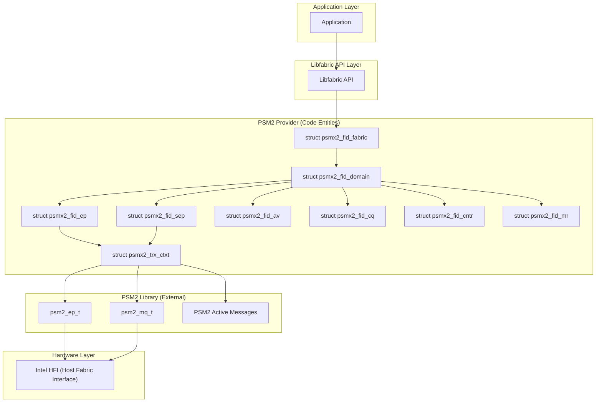
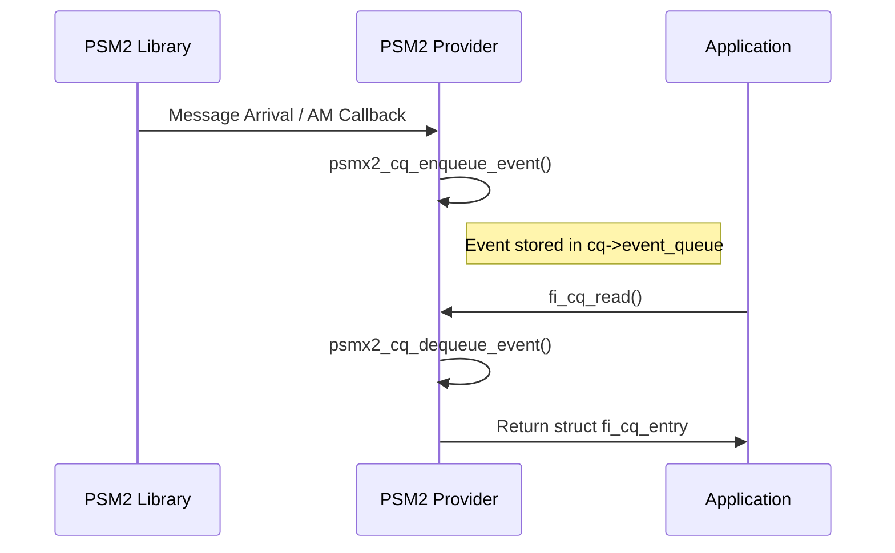

<!-- source: DeepWiki mcp.deepwiki.com · repo ofiwg/libfabric · page 4.9 PSM2 Provider · fetched 2026-11-11 -->

# PSM2 Provider

Relevant source files

The following files were used as context for generating this wiki page:

- [config/fi_check_package.m4](config/fi_check_package.m4)
- [config/fi_provider.m4](config/fi_provider.m4)
- [config/fi_strip_optflags.m4](config/fi_strip_optflags.m4)
- [libfabric.pc.in](libfabric.pc.in)
- [prov/psm2/Makefile.include](prov/psm2/Makefile.include)
- [prov/psm2/configure.m4](prov/psm2/configure.m4)
- [prov/psm2/src/psmx2.h](prov/psm2/src/psmx2.h)
- [prov/psm2/src/psmx2_am.c](prov/psm2/src/psmx2_am.c)
- [prov/psm2/src/psmx2_atomic.c](prov/psm2/src/psmx2_atomic.c)
- [prov/psm2/src/psmx2_attr.c](prov/psm2/src/psmx2_attr.c)
- [prov/psm2/src/psmx2_av.c](prov/psm2/src/psmx2_av.c)
- [prov/psm2/src/psmx2_cntr.c](prov/psm2/src/psmx2_cntr.c)
- [prov/psm2/src/psmx2_cq.c](prov/psm2/src/psmx2_cq.c)
- [prov/psm2/src/psmx2_domain.c](prov/psm2/src/psmx2_domain.c)
- [prov/psm2/src/psmx2_ep.c](prov/psm2/src/psmx2_ep.c)
- [prov/psm2/src/psmx2_init.c](prov/psm2/src/psmx2_init.c)
- [prov/psm2/src/psmx2_mr.c](prov/psm2/src/psmx2_mr.c)
- [prov/psm2/src/psmx2_msg.c](prov/psm2/src/psmx2_msg.c)
- [prov/psm2/src/psmx2_rma.c](prov/psm2/src/psmx2_rma.c)
- [prov/psm2/src/psmx2_tagged.c](prov/psm2/src/psmx2_tagged.c)
- [prov/psm2/src/psmx2_trx_ctxt.c](prov/psm2/src/psmx2_trx_ctxt.c)
- [prov/psm2/src/version.h](prov/psm2/src/version.h)
- [prov/psm3/Makefile.include](prov/psm3/Makefile.include)
- [prov/psm3/VERSION](prov/psm3/VERSION)
- [prov/psm3/configure.ac](prov/psm3/configure.ac)
- [prov/psm3/configure.m4](prov/psm3/configure.m4)
- [prov/psm3/debian/changelog](prov/psm3/debian/changelog)
- [prov/psm3/psm3/gpu/psm_gpu_oneapi_ze.c](prov/psm3/psm3/gpu/psm_gpu_oneapi_ze.c)
- [prov/psm3/psm3/hal_verbs/verbs_ep.c](prov/psm3/psm3/hal_verbs/verbs_ep.c)
- [prov/psm3/psm3/hal_verbs/verbs_ep.h](prov/psm3/psm3/hal_verbs/verbs_ep.h)
- [prov/psm3/psm3/hal_verbs/verbs_hal_inline_i.h](prov/psm3/psm3/hal_verbs/verbs_hal_inline_i.h)
- [prov/psm3/psm3/psm_context.c](prov/psm3/psm3/psm_context.c)
- [prov/psm3/psm3/psm_mq_internal.h](prov/psm3/psm3/psm_mq_internal.h)
- [prov/psm3/psm3/psm_rndv_mod.c](prov/psm3/psm3/psm_rndv_mod.c)
- [prov/psm3/psm3/psm_rndv_mod.h](prov/psm3/psm3/psm_rndv_mod.h)
- [prov/psm3/psm3/psm_stats.c](prov/psm3/psm3/psm_stats.c)
- [prov/psm3/psm3/psm_uffd.c](prov/psm3/psm3/psm_uffd.c)
- [prov/psm3/psm3/psm_verbs_mr.h](prov/psm3/psm3/psm_verbs_mr.h)
- [prov/psm3/psm3/ptl_ips/ips_proto_connect.c](prov/psm3/psm3/ptl_ips/ips_proto_connect.c)
- [prov/psm3/psm3/ptl_ips/ptl_rcvthread.c](prov/psm3/psm3/ptl_ips/ptl_rcvthread.c)
- [prov/psm3/src/psmx3_attr.c](prov/psm3/src/psmx3_attr.c)
- [prov/sockets/Makefile.include](prov/sockets/Makefile.include)
- [prov/sockets/configure.m4](prov/sockets/configure.m4)
- [prov/sockets/include/sock_util.h](prov/sockets/include/sock_util.h)
- [prov/usnic/configure.m4](prov/usnic/configure.m4)
- [prov/verbs/configure.m4](prov/verbs/configure.m4)

The PSM2 Provider implements the libfabric API over Intel's Performance Scaled Messaging 2 (PSM2) interface. It enables applications to utilize Intel Omni-Path Architecture (OPA) hardware and other PSM2-enabled devices with high performance and low latency through the unified libfabric interface. This page describes the architecture, components, capabilities, and implementation details of the PSM2 provider.

## Architecture Overview

The PSM2 provider acts as a bridge between the libfabric API and the low-level PSM2 library. It translates libfabric operations and abstractions into corresponding PSM2 functions and structures.

### Component Relationship Diagram
This diagram maps libfabric abstractions to the internal PSM2 provider structures and the underlying PSM2 library entities.

Sources: [prov/psm2/src/psmx2.h:476-817](), [prov/psm2/src/psmx2_init.c:676-683]()

## Key Components

### Provider Registration and Initialization

The PSM2 provider is registered with libfabric through the `psmx2_prov` structure [prov/psm2/src/psmx2.h:85-85](). During initialization, the provider:
1. Checks for PSM2 device availability via `glob` on `/dev/hfi*` [prov/psm2/src/psmx2_init.c:222-240]().
2. Initializes the PSM2 library using `psm2_init()` [prov/psm2/src/psmx2_init.c:248-248]().
3. Configures parameters based on environment variables in `psmx2_init_env()` [prov/psm2/src/psmx2_init.c:71-111]().
4. Checks PSM2 multi-endpoint capability with `psm2_get_capability_mask()` [prov/psm2/src/psmx2_init.c:195-206]().

Sources: [prov/psm2/src/psmx2_init.c:208-271](), [prov/psm2/src/psmx2_init.c:511-652]()

### Transmission Context (TRX)

The transmission context (`struct psmx2_trx_ctxt`) is the primary internal engine. It encapsulates:
- `psm2_ep_t psm2_ep`: The underlying PSM2 endpoint [prov/psm2/src/psmx2.h:495-495]().
- `psm2_mq_t psm2_mq`: The PSM2 matching queue [prov/psm2/src/psmx2.h:496-496]().
- `psm2_epid_t psm2_epid`: The endpoint identifier [prov/psm2/src/psmx2.h:497-497]().

Sources: [prov/psm2/src/psmx2.h:489-533](), [prov/psm2/src/psmx2_trx_ctxt.c:170-300]()

### Endpoint Management

The provider distinguishes between standard and scalable endpoints:
- **Regular Endpoints** (`struct psmx2_fid_ep`): Typically associated with a single `psmx2_trx_ctxt` [prov/psm2/src/psmx2.h:743-780]().
- **Scalable Endpoints** (`struct psmx2_fid_sep`): Can manage multiple contexts (`ctxts`) to allow concurrent access by multiple threads [prov/psm2/src/psmx2.h:782-799]().

Sources: [prov/psm2/src/psmx2_ep.c:514-778]()

### Address Vector (AV)

The address vector (`struct psmx2_fid_av`) translates libfabric addresses to PSM2 endpoint addresses (`psm2_epaddr_t`).
- **Resolution**: Uses `psm2_ep_connect()` to establish connections to remote EPIDs [prov/psm2/src/psmx2_av.c:222-227]().
- **Context Management**: Mappings are stored in `struct psmx2_epaddr_context` and attached to PSM2 addresses via `psm2_epaddr_setctxt()` [prov/psm2/src/psmx2_av.c:168-203]().

Sources: [prov/psm2/src/psmx2_av.c:433-529](), [prov/psm2/src/psmx2_av.c:668-790]()

## Tag Layout and Message Format

PSM2 uses 96-bit tags. The provider reserves bits for internal protocol multiplexing:
- `PSMX2_MSG_BIT`: Identifies untagged messages [prov/psm2/src/psmx2.h:134-134]().
- `PSMX2_RMA_BIT`: Identifies RMA operations [prov/psm2/src/psmx2.h:135-135]().
- `PSMX2_IOV_BIT`: Used for IOV payloads or to distinguish RMA Read vs Write [prov/psm2/src/psmx2.h:136-136]().
- `PSMX2_IMM_BIT`: Indicates presence of immediate data (CQ data) [prov/psm2/src/psmx2.h:137-137]().

The layout of the 64-bit user tag and 32-bit data is determined at runtime in `psmx2_init_tag_layout()` [prov/psm2/src/psmx2_init.c:113-172]().

Sources: [prov/psm2/src/psmx2.h:114-165]()

## Communication Mechanisms

### Tagged and Untagged Messaging

Tagged messaging is the native mode for PSM2. The provider uses `psm2_mq_isend2()` and `psm2_mq_irecv2()` for asynchronous operations [prov/psm2/src/psmx2_msg.c:108-110]().
- **Multi-Receive**: Implemented via `struct psmx2_multi_recv` which manages buffer segments [prov/psm2/src/psmx2_msg.c:73-89]().
- **Optimization**: `psmx2_ep_optimize_ops()` selects specialized function tables (e.g., `psmx2_tagged_ops_no_event`) to minimize overhead when certain flags are not used [prov/psm2/src/psmx2_ep.c:67-97]().

Sources: [prov/psm2/src/psmx2_tagged.c:36-1110](), [prov/psm2/src/psmx2_msg.c:36-376]()

### RMA Operations

RMA is implemented via PSM2 Active Messages (AM).
- **Short Write**: Data is sent directly in the AM payload using `psm2_am_send_short()` [prov/psm2/src/psmx2_rma.c:177-180]().
- **Long Write/Read**: Uses a rendezvous protocol. The initiator sends an AM request, and the target responds by preparing a PSM2 message queue request to pull or push the data [prov/psm2/src/psmx2_rma.c:183-240]().

Sources: [prov/psm2/src/psmx2_rma.c:103-1133]()

### Atomic Operations

Atomics are handled via the AM subsystem in `psmx2_am_atomic_handler()` [prov/psm2/src/psmx2_atomic.c:946-946]().
- **Serialization**: Since PSM2 AMs are processed in a callback context, the provider uses a global spinlock `psmx2_atomic_lock` to ensure atomicity for multi-step read-modify-write operations [prov/psm2/src/psmx2_atomic.c:53-63]().
- **Data Types**: Supports a wide range of types from `FI_INT8` to `FI_LONG_DOUBLE_COMPLEX` [prov/psm2/src/psmx2_atomic.c:109-128]().

Sources: [prov/psm2/src/psmx2_atomic.c:946-1280]()

## Progress and Completion

### Progress Engine

The provider supports both manual and automatic progress:
- **Auto Progress**: `psmx2_progress_func()` runs in a background thread, calling `psmx2_progress_all()` and sleeping for `psmx2_env.prog_interval` [prov/psm2/src/psmx2_domain.c:103-135]().
- **Polling**: Completion queues poll the PSM2 message queue using `psm2_mq_ipeek2()` or `psm2_mq_test2()` [prov/psm2/src/psmx2_cq.c:215-230]().

### Completion Queue (CQ) Data Flow

Sources: [prov/psm2/src/psmx2_cq.c:35-61](), [prov/psm2/src/psmx2_domain.c:137-150]()

## Memory Registration (MR)

Memory registration in PSM2 is primarily for RMA key validation.
- **MR Map**: Registrations are stored in a Red-Black tree `domain->mr_map` [prov/psm2/src/psmx2_domain.c:195-195]().
- **Validation**: `psmx2_mr_validate()` checks if the requested RMA access (address/length) falls within a registered region with appropriate permissions [prov/psm2/src/psmx2_rma.c:138-140]().

Sources: [prov/psm2/src/psmx2_mr.c:35-345](), [prov/psm2/src/psmx2.h:808-817]()

## Configuration Options

| Environment Variable | Structure Field | Default |
|----------------------|-----------------|---------|
| `FI_PSM2_UUID` | `psmx2_env.uuid` | `PSMX2_DEFAULT_UUID` |
| `FI_PSM2_INJECT_SIZE`| `psmx2_env.inject_size` | 64 |
| `FI_PSM2_LOCK_LEVEL` | `psmx2_env.lock_level` | 2 |
| `FI_PSM2_PROG_INTERVAL`| `psmx2_env.prog_interval` | -1 |
| `FI_PSM2_CONN_TIMEOUT` | `psmx2_env.conn_timeout` | 5 |

Sources: [prov/psm2/src/psmx2_init.c:44-61](), [prov/psm2/src/psmx2_init.c:96-110]()

---

