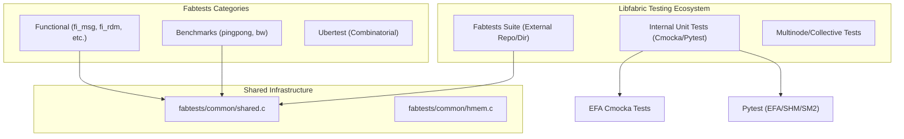
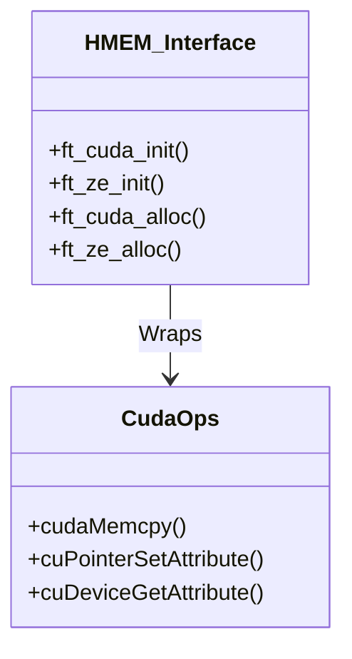

<!-- source: DeepWiki mcp.deepwiki.com · repo ofiwg/libfabric · page 5 Testing · fetched 2026-11-11 -->

# Testing

Relevant source files

The following files were used as context for generating this wiki page:

- [fabtests/Makefile.am](fabtests/Makefile.am)
- [fabtests/Makefile.win](fabtests/Makefile.win)
- [fabtests/benchmarks/benchmark_shared.c](fabtests/benchmarks/benchmark_shared.c)
- [fabtests/benchmarks/benchmark_shared.h](fabtests/benchmarks/benchmark_shared.h)
- [fabtests/benchmarks/rma_tx_completion.c](fabtests/benchmarks/rma_tx_completion.c)
- [fabtests/common/hmem.c](fabtests/common/hmem.c)
- [fabtests/common/hmem_cuda.c](fabtests/common/hmem_cuda.c)
- [fabtests/common/hmem_neuron.c](fabtests/common/hmem_neuron.c)
- [fabtests/common/hmem_rocr.c](fabtests/common/hmem_rocr.c)
- [fabtests/common/hmem_ze.c](fabtests/common/hmem_ze.c)
- [fabtests/common/shared.c](fabtests/common/shared.c)
- [fabtests/component/dmabuf-rdma/memcopy-xe.c](fabtests/component/dmabuf-rdma/memcopy-xe.c)
- [fabtests/fabtests.sln](fabtests/fabtests.sln)
- [fabtests/fabtests.vcxproj](fabtests/fabtests.vcxproj)
- [fabtests/fabtests.vcxproj.filters](fabtests/fabtests.vcxproj.filters)
- [fabtests/functional/av_xfer.c](fabtests/functional/av_xfer.c)
- [fabtests/functional/cm_data.c](fabtests/functional/cm_data.c)
- [fabtests/functional/cq_data.c](fabtests/functional/cq_data.c)
- [fabtests/functional/dgram.c](fabtests/functional/dgram.c)
- [fabtests/functional/mcast.c](fabtests/functional/mcast.c)
- [fabtests/functional/multi_ep.c](fabtests/functional/multi_ep.c)
- [fabtests/functional/multi_mr.c](fabtests/functional/multi_mr.c)
- [fabtests/functional/multi_recv.c](fabtests/functional/multi_recv.c)
- [fabtests/functional/rdm.c](fabtests/functional/rdm.c)
- [fabtests/functional/rdm_deferred_wq.c](fabtests/functional/rdm_deferred_wq.c)
- [fabtests/functional/rdm_multi_domain.c](fabtests/functional/rdm_multi_domain.c)
- [fabtests/functional/rdm_tagged_peek.c](fabtests/functional/rdm_tagged_peek.c)
- [fabtests/functional/recv_cancel.c](fabtests/functional/recv_cancel.c)
- [fabtests/functional/resmgmt_test.c](fabtests/functional/resmgmt_test.c)
- [fabtests/functional/scalable_ep.c](fabtests/functional/scalable_ep.c)
- [fabtests/functional/shared_ctx.c](fabtests/functional/shared_ctx.c)
- [fabtests/functional/unexpected_msg.c](fabtests/functional/unexpected_msg.c)
- [fabtests/include/hmem.h](fabtests/include/hmem.h)
- [fabtests/include/shared.h](fabtests/include/shared.h)
- [fabtests/man/fabtests.7.md](fabtests/man/fabtests.7.md)
- [fabtests/man/man7/fabtests.7](fabtests/man/man7/fabtests.7)
- [fabtests/prov/efa/src/efa_shared.h](fabtests/prov/efa/src/efa_shared.h)
- [fabtests/prov/efa/src/rdm_rnr_queue_resend.c](fabtests/prov/efa/src/rdm_rnr_queue_resend.c)
- [fabtests/prov/efa/src/rdm_rnr_read_cq_error.c](fabtests/prov/efa/src/rdm_rnr_read_cq_error.c)
- [fabtests/pytest/efa/test_rnr.py](fabtests/pytest/efa/test_rnr.py)
- [fabtests/scripts/runfabtests.cmd](fabtests/scripts/runfabtests.cmd)
- [fabtests/scripts/runfabtests.sh](fabtests/scripts/runfabtests.sh)

This page provides an overview of libfabric's testing infrastructure, focusing on the `fabtests` suite, shared testing utilities, and provider-specific validation. For more detailed information about continuous integration and build verification, see [CI/CD Pipeline](#3.2).

## Testing Architecture Overview

Libfabric utilizes a multi-layered testing strategy to verify functionality, correctness, and performance across different hardware and software providers.

Sources: [fabtests/Makefile.am:15-73](), [fabtests/common/shared.c:57-77](), [fabtests/include/shared.h:189-228]()

## Fabtests Suite

The `fabtests` suite is the primary tool for validating libfabric providers. It consists of standalone executables that exercise the Open Fabrics Interfaces (OFI).

### Shared Testing Framework
Most tests in the suite rely on a common infrastructure defined in `fabtests/common/shared.c` and `fabtests/include/shared.h`. This framework abstracts the boilerplate required to initialize fabric resources.

*   **Options Management**: The `ft_opts` struct [fabtests/include/shared.h:189-228]() stores command-line parameters such as iterations, transfer size, and completion methods.
*   **Resource Globals**: Common fabric objects like `fi_info`, `fid_fabric`, `fid_domain`, and `fid_ep` are managed globally [fabtests/common/shared.c:57-73]().
*   **Memory Management**: Utilities for allocating and registering memory regions, including support for heterogeneous memory (HMEM) via `ft_hmem_alloc` [fabtests/functional/unexpected_msg.c:66-68]().

For details, see [Testing Framework](#5.1).

### Test Categories
| Category | Purpose | Examples |
| :--- | :--- | :--- |
| **Functional** | Verify specific API features and endpoint types. | `fi_msg`, `fi_rdm`, `fi_unexpected_msg` [fabtests/Makefile.am:17-45]() |
| **Benchmarks** | Measure latency and bandwidth using ping-pong or streaming patterns. | `fi_msg_pingpong`, `fi_rdm_bw` [fabtests/Makefile.am:46-57]() |
| **Unit** | Basic one-sided validation of API objects (AV, CQ, EQ). | `fi_av_test`, `fi_cq_test`, `fi_mr_test` [fabtests/Makefile.am:58-67]() |
| **Ubertest** | A comprehensive test that iterates through various configuration combinations. | `fi_ubertest` [fabtests/Makefile.am:68]() |

Sources: [fabtests/man/fabtests.7.md:35-198](), [fabtests/Makefile.am:15-73]()

## Provider-Specific Tests

While `fabtests` provides general coverage, many providers implement specialized test suites to validate internal logic or hardware-specific behaviors.

### EFA and SHM Testing
The EFA provider utilizes a sophisticated testing stack including:
*   **Cmocka-based Unit Tests**: Located in `prov/efa/test/`, these use linker wrapping to mock RDMA verbs and EFA device interfaces.
*   **Pytest Infrastructure**: A Python-based framework used for EFA, SHM, and SM2 providers [fabtests/Makefile.am:150-229](). It allows for complex multi-node orchestration and environment variable manipulation.

### Exclusion Configurations
Because not all providers support every libfabric feature, `fabtests` uses exclusion files (e.g., `test_configs/verbs/verbs.exclude`) to skip tests that are known to be incompatible with specific provider capabilities [fabtests/Makefile.am:97-149]().

For details, see [Provider-specific Tests](#5.2).

## Heterogeneous Memory (HMEM) Testing
Libfabric includes dedicated utilities for testing memory registration and data transfers involving GPU/accelerator memory.

The framework supports:
*   **CUDA**: Detection of `DMA_BUF` vs `GPUDirect RDMA` support [fabtests/common/hmem_cuda.c:154-185]().
*   **Level Zero (ZE)**: Support for Intel GPUs [fabtests/include/hmem.h:48-130]().
*   **Other**: Neuron, SynapseAI, and ROCm [fabtests/Makefile.win:48-49]().

Sources: [fabtests/common/hmem_cuda.c:43-72](), [fabtests/include/hmem.h:38-44](), [fabtests/common/shared.c:93-95]()

## Execution Scripts
Automated execution is handled by scripts that parse configuration files and manage client-server synchronization:
*   **`runfabtests.sh`**: The primary shell script for running the suite against a provider [fabtests/scripts/runfabtests.sh:1-158]().
*   **`runmultinode.py`**: Orchestrates tests across multiple physical nodes [fabtests/Makefile.am:91]().

Sources: [fabtests/scripts/runfabtests.sh:47-65](), [fabtests/Makefile.am:87-92]()

---

