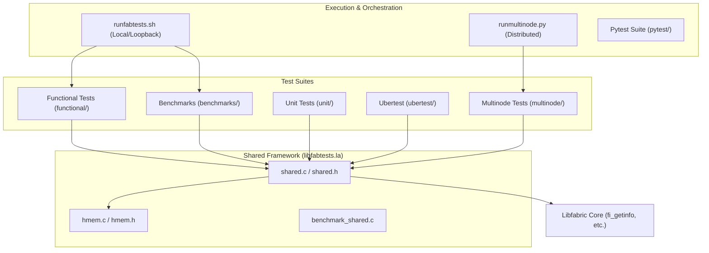
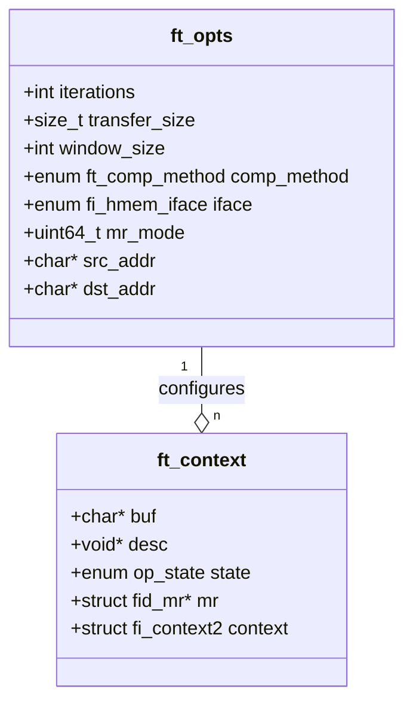
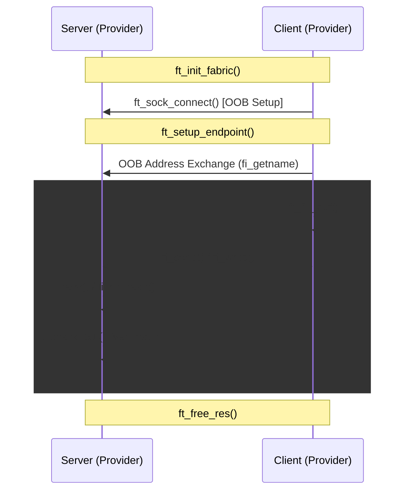

<!-- source: DeepWiki mcp.deepwiki.com · repo ofiwg/libfabric · page 5.1 Testing Framework · fetched 2026-11-11 -->

# Testing Framework

Relevant source files

The following files were used as context for generating this wiki page:

- [fabtests/Makefile.am](fabtests/Makefile.am)
- [fabtests/Makefile.win](fabtests/Makefile.win)
- [fabtests/benchmarks/benchmark_shared.c](fabtests/benchmarks/benchmark_shared.c)
- [fabtests/benchmarks/benchmark_shared.h](fabtests/benchmarks/benchmark_shared.h)
- [fabtests/benchmarks/dgram_pingpong.c](fabtests/benchmarks/dgram_pingpong.c)
- [fabtests/benchmarks/msg_bw.c](fabtests/benchmarks/msg_bw.c)
- [fabtests/benchmarks/msg_pingpong.c](fabtests/benchmarks/msg_pingpong.c)
- [fabtests/benchmarks/rdm_cntr_pingpong.c](fabtests/benchmarks/rdm_cntr_pingpong.c)
- [fabtests/benchmarks/rdm_pingpong.c](fabtests/benchmarks/rdm_pingpong.c)
- [fabtests/benchmarks/rdm_tagged_bw.c](fabtests/benchmarks/rdm_tagged_bw.c)
- [fabtests/benchmarks/rdm_tagged_pingpong.c](fabtests/benchmarks/rdm_tagged_pingpong.c)
- [fabtests/benchmarks/rma_bw.c](fabtests/benchmarks/rma_bw.c)
- [fabtests/benchmarks/rma_tx_completion.c](fabtests/benchmarks/rma_tx_completion.c)
- [fabtests/common/hmem.c](fabtests/common/hmem.c)
- [fabtests/common/hmem_cuda.c](fabtests/common/hmem_cuda.c)
- [fabtests/common/hmem_neuron.c](fabtests/common/hmem_neuron.c)
- [fabtests/common/hmem_rocr.c](fabtests/common/hmem_rocr.c)
- [fabtests/common/hmem_ze.c](fabtests/common/hmem_ze.c)
- [fabtests/common/shared.c](fabtests/common/shared.c)
- [fabtests/component/dmabuf-rdma/fi-mr-reg-xe.c](fabtests/component/dmabuf-rdma/fi-mr-reg-xe.c)
- [fabtests/component/dmabuf-rdma/fi-rdmabw-xe.c](fabtests/component/dmabuf-rdma/fi-rdmabw-xe.c)
- [fabtests/component/dmabuf-rdma/memcopy-xe.c](fabtests/component/dmabuf-rdma/memcopy-xe.c)
- [fabtests/component/dmabuf-rdma/mr-reg-xe.c](fabtests/component/dmabuf-rdma/mr-reg-xe.c)
- [fabtests/component/dmabuf-rdma/rdmabw-xe.c](fabtests/component/dmabuf-rdma/rdmabw-xe.c)
- [fabtests/component/dmabuf-rdma/shared.c](fabtests/component/dmabuf-rdma/shared.c)
- [fabtests/component/dmabuf-rdma/shared.h](fabtests/component/dmabuf-rdma/shared.h)
- [fabtests/component/dmabuf-rdma/util.c](fabtests/component/dmabuf-rdma/util.c)
- [fabtests/component/dmabuf-rdma/util.h](fabtests/component/dmabuf-rdma/util.h)
- [fabtests/component/dmabuf-rdma/xe.c](fabtests/component/dmabuf-rdma/xe.c)
- [fabtests/component/dmabuf-rdma/xe.h](fabtests/component/dmabuf-rdma/xe.h)
- [fabtests/component/sock_test.c](fabtests/component/sock_test.c)
- [fabtests/fabtests.sln](fabtests/fabtests.sln)
- [fabtests/fabtests.vcxproj](fabtests/fabtests.vcxproj)
- [fabtests/fabtests.vcxproj.filters](fabtests/fabtests.vcxproj.filters)
- [fabtests/functional/av_xfer.c](fabtests/functional/av_xfer.c)
- [fabtests/functional/cm_data.c](fabtests/functional/cm_data.c)
- [fabtests/functional/cq_data.c](fabtests/functional/cq_data.c)
- [fabtests/functional/dgram.c](fabtests/functional/dgram.c)
- [fabtests/functional/mcast.c](fabtests/functional/mcast.c)
- [fabtests/functional/multi_ep.c](fabtests/functional/multi_ep.c)
- [fabtests/functional/multi_mr.c](fabtests/functional/multi_mr.c)
- [fabtests/functional/multi_recv.c](fabtests/functional/multi_recv.c)
- [fabtests/functional/rdm.c](fabtests/functional/rdm.c)
- [fabtests/functional/rdm_atomic.c](fabtests/functional/rdm_atomic.c)
- [fabtests/functional/rdm_deferred_wq.c](fabtests/functional/rdm_deferred_wq.c)
- [fabtests/functional/rdm_multi_domain.c](fabtests/functional/rdm_multi_domain.c)
- [fabtests/functional/rdm_stress.c](fabtests/functional/rdm_stress.c)
- [fabtests/functional/rdm_tagged_peek.c](fabtests/functional/rdm_tagged_peek.c)
- [fabtests/functional/recv_cancel.c](fabtests/functional/recv_cancel.c)
- [fabtests/functional/resmgmt_test.c](fabtests/functional/resmgmt_test.c)
- [fabtests/functional/scalable_ep.c](fabtests/functional/scalable_ep.c)
- [fabtests/functional/shared_ctx.c](fabtests/functional/shared_ctx.c)
- [fabtests/functional/unexpected_msg.c](fabtests/functional/unexpected_msg.c)
- [fabtests/include/ft_osd.h](fabtests/include/ft_osd.h)
- [fabtests/include/hmem.h](fabtests/include/hmem.h)
- [fabtests/include/shared.h](fabtests/include/shared.h)
- [fabtests/man/fabtests.7.md](fabtests/man/fabtests.7.md)
- [fabtests/man/man7/fabtests.7](fabtests/man/man7/fabtests.7)
- [fabtests/multinode/include/core.h](fabtests/multinode/include/core.h)
- [fabtests/multinode/include/timing.h](fabtests/multinode/include/timing.h)
- [fabtests/multinode/src/core.c](fabtests/multinode/src/core.c)
- [fabtests/multinode/src/harness.c](fabtests/multinode/src/harness.c)
- [fabtests/multinode/src/pattern.c](fabtests/multinode/src/pattern.c)
- [fabtests/multinode/src/timing.c](fabtests/multinode/src/timing.c)
- [fabtests/prov/efa/src/efa_shared.h](fabtests/prov/efa/src/efa_shared.h)
- [fabtests/prov/efa/src/rdm_rnr_queue_resend.c](fabtests/prov/efa/src/rdm_rnr_queue_resend.c)
- [fabtests/prov/efa/src/rdm_rnr_read_cq_error.c](fabtests/prov/efa/src/rdm_rnr_read_cq_error.c)
- [fabtests/pytest/default/test_multinode.py](fabtests/pytest/default/test_multinode.py)
- [fabtests/pytest/efa/test_efa_shm_addr.py](fabtests/pytest/efa/test_efa_shm_addr.py)
- [fabtests/pytest/efa/test_rnr.py](fabtests/pytest/efa/test_rnr.py)
- [fabtests/regression/sighandler_test.c](fabtests/regression/sighandler_test.c)
- [fabtests/scripts/runfabtests.cmd](fabtests/scripts/runfabtests.cmd)
- [fabtests/scripts/runfabtests.sh](fabtests/scripts/runfabtests.sh)
- [fabtests/scripts/runmultinode.sh](fabtests/scripts/runmultinode.sh)
- [fabtests/test_configs/shm/all.test](fabtests/test_configs/shm/all.test)
- [fabtests/test_configs/shm/quick.test](fabtests/test_configs/shm/quick.test)
- [fabtests/test_configs/shm/verify.test](fabtests/test_configs/shm/verify.test)
- [fabtests/test_configs/sockets/sockets.exclude](fabtests/test_configs/sockets/sockets.exclude)
- [fabtests/ubertest/config.c](fabtests/ubertest/config.c)
- [fabtests/ubertest/cq.c](fabtests/ubertest/cq.c)
- [fabtests/ubertest/domain.c](fabtests/ubertest/domain.c)
- [fabtests/ubertest/ep.c](fabtests/ubertest/ep.c)
- [fabtests/ubertest/fabtest.h](fabtests/ubertest/fabtest.h)
- [fabtests/ubertest/test_ctrl.c](fabtests/ubertest/test_ctrl.c)
- [fabtests/ubertest/uber.c](fabtests/ubertest/uber.c)
- [fabtests/ubertest/verify.c](fabtests/ubertest/verify.c)
- [fabtests/ubertest/xfer.c](fabtests/ubertest/xfer.c)

The libfabric testing framework, primarily located in the `fabtests/` directory, provides a standardized environment for validating functionality, performance, and provider compliance. It abstracts fabric initialization, resource management, and command-line parsing into a shared library (`libfabtests.la`), allowing test developers to focus on specific communication patterns.

## Overview

The framework is structured to support a variety of testing categories, from low-level unit tests to complex multi-node stress tests.

Sources: [fabtests/Makefile.am:231-236](), [fabtests/man/fabtests.7.md:17-34]()

## Core Framework Components

### Common Data Structures and Options
The framework uses a centralized options structure, `ft_opts`, to store configuration parsed from the command line.

Sources: [fabtests/include/shared.h:181-187](), [fabtests/include/shared.h:189-228]()

### Shared Utilities (`shared.c`)
The `shared.c` file implements the heavy lifting for resource allocation and endpoint setup. Key functions include:
- `ft_init()`: Initializes the framework state [fabtests/common/shared.c:889-909]().
- `ft_getinfo()`: Wrapper around `fi_getinfo` to filter providers based on `ft_opts` [fabtests/common/shared.c:119-122]().
- `ft_open_fabric_res()`: Opens fabric, domain, and waitsets [fabtests/common/shared.c:581-711]().
- `ft_alloc_active_res()`: Allocates EPs, CQs, AVs, and Counters [fabtests/common/shared.c:749-766]().
- `ft_enable_ep()`: Binds resources and enables the endpoint [fabtests/common/shared.c:874-888]().

### HMEM Test Utilities
The HMEM (Heterogeneous Memory) sub-framework handles memory allocation and registration for GPU devices (CUDA, ROCm, Level Zero).
- `ft_hmem_alloc()`: Allocates device or host memory based on the selected interface [fabtests/common/hmem.c:165-180]().
- `ft_reg_mr()`: Registers memory regions with appropriate HMEM metadata [fabtests/common/shared.c:289-322]().

Sources: [fabtests/common/hmem.c:1-20](), [fabtests/include/hmem.h:1-15]()

## Test Categories

### 1. Functional Tests
These validate specific API features and edge cases.
- `fi_rdm_stress`: A multi-threaded stress test using an RPC-like protocol to verify reliability under load [fabtests/functional/rdm_stress.c:69-135]().
- `fi_unexpected_msg`: Validates the handling of messages that arrive before a matching receive buffer is posted [fabtests/functional/unexpected_msg.c:132-209]().
- `fi_multi_ep`: Tests parallel data transfers across multiple endpoints, optionally sharing CQs or AVs [fabtests/functional/multi_ep.c:134-173]().

### 2. Benchmarks
Performance-oriented tests modeled after OSU MPI benchmarks.
- `pingpong()`: Standard latency test. It supports both pre-posted receives (`pingpong_pre_posted_rx`) and on-the-fly posting (`pingpong_no_pre_posted_rx`) [fabtests/benchmarks/benchmark_shared.c:97-250]().
- `bw()`: Bandwidth test utilizing window-based transmission to saturate the fabric.

### 3. Ubertest (`fi_ubertest`)
A comprehensive testing tool that iterates through a "series" of configurations (combinations of endpoint types, completion modes, and memory registration modes) defined in a configuration file [fabtests/ubertest/uber.c:48-56](). It uses `ft_show_test_info()` to log the exact configuration being validated [fabtests/ubertest/uber.c:194-217]().

### 4. Multinode Framework
Designed for distributed testing across many ranks, utilizing a "Harness" for rank coordination.
- `pm_allgather()`: Exchanges endpoint addresses across all nodes [fabtests/multinode/src/core.c:158-163]().
- `multi_msg_send()` / `multi_msg_recv()`: Implements many-to-many communication patterns [fabtests/multinode/src/core.c:209-270]().

Sources: [fabtests/multinode/src/core.c:82-207](), [fabtests/multinode/src/harness.c:1-20]()

## Automation Scripts

### `runfabtests.sh`
The primary shell script for local and loopback testing. It defines sets of tests (functional, short, standard) and executes them against a provider [fabtests/scripts/runfabtests.sh:100-225]().
- It supports an exclusion mechanism via `./test_configs/*.exclude` files to skip tests known to be unsupported by specific providers [fabtests/scripts/runfabtests.sh:68-71]().
- It handles cleanup of background server processes using `trap cleanup_and_exit SIGINT` [fabtests/scripts/runfabtests.sh:42]().

### `runmultinode.py`
A Python-based orchestrator for running tests across a cluster, often used in conjunction with `pytest` for automated CI validation [fabtests/scripts/runmultinode.py:1-10]().

Sources: [fabtests/scripts/runfabtests.sh:1-50](), [fabtests/Makefile.am:87-92]()

## Data Flow: Typical Client-Server Test

Sources: [fabtests/common/shared.c:1328-1383](), [fabtests/functional/rdm.c:38-63]()

## Configuration and Build
The framework is built as part of the standard libfabric build process if `fabtests` is enabled.
- `Makefile.am`: Defines the compilation of all functional, benchmark, and unit binaries [fabtests/Makefile.am:15-73]().
- `test_configs/`: Contains `.test` and `.exclude` files for various providers (e.g., `tcp/all.test`, `verbs/verbs.exclude`) [fabtests/Makefile.am:97-149]().

Sources: [fabtests/Makefile.am:1-150]()

---

