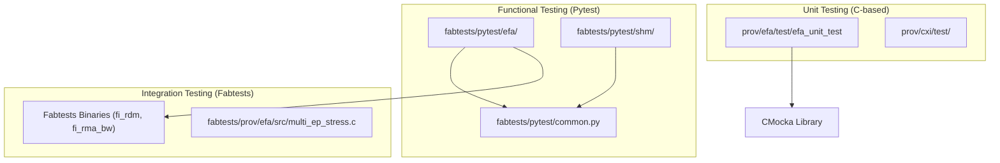
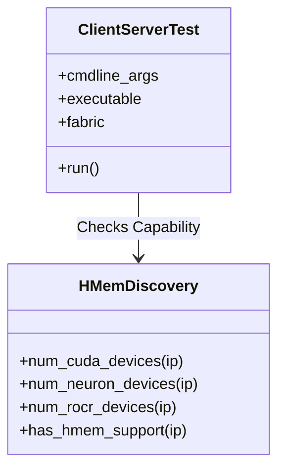

<!-- source: DeepWiki mcp.deepwiki.com · repo ofiwg/libfabric · page 5.2 Provider-specific Tests · fetched 2026-11-11 -->

# Provider-specific Tests

Relevant source files

The following files were used as context for generating this wiki page:

- [fabtests/include/ft_random.h](fabtests/include/ft_random.h)
- [fabtests/prov/efa/Makefile.include](fabtests/prov/efa/Makefile.include)
- [fabtests/prov/efa/src/efa_info_test.c](fabtests/prov/efa/src/efa_info_test.c)
- [fabtests/prov/efa/src/efa_mmap_test.c](fabtests/prov/efa/src/efa_mmap_test.c)
- [fabtests/prov/efa/src/efa_mr_test.c](fabtests/prov/efa/src/efa_mr_test.c)
- [fabtests/prov/efa/src/multi_ep_stress.c](fabtests/prov/efa/src/multi_ep_stress.c)
- [fabtests/prov/efa/src/multi_ep_stress.md](fabtests/prov/efa/src/multi_ep_stress.md)
- [fabtests/pytest/common.py](fabtests/pytest/common.py)
- [fabtests/pytest/conftest.py](fabtests/pytest/conftest.py)
- [fabtests/pytest/default/test_inject_test.py](fabtests/pytest/default/test_inject_test.py)
- [fabtests/pytest/default/test_rdm.py](fabtests/pytest/default/test_rdm.py)
- [fabtests/pytest/default/test_rma_bw.py](fabtests/pytest/default/test_rma_bw.py)
- [fabtests/pytest/default/test_sighandler.py](fabtests/pytest/default/test_sighandler.py)
- [fabtests/pytest/default/test_ubertest.py](fabtests/pytest/default/test_ubertest.py)
- [fabtests/pytest/efa/conftest.py](fabtests/pytest/efa/conftest.py)
- [fabtests/pytest/efa/efa_common.py](fabtests/pytest/efa/efa_common.py)
- [fabtests/pytest/efa/test_av.py](fabtests/pytest/efa/test_av.py)
- [fabtests/pytest/efa/test_cq.py](fabtests/pytest/efa/test_cq.py)
- [fabtests/pytest/efa/test_dgram.py](fabtests/pytest/efa/test_dgram.py)
- [fabtests/pytest/efa/test_efa_device_selection.py](fabtests/pytest/efa/test_efa_device_selection.py)
- [fabtests/pytest/efa/test_efa_info.py](fabtests/pytest/efa/test_efa_info.py)
- [fabtests/pytest/efa/test_efa_mmap.py](fabtests/pytest/efa/test_efa_mmap.py)
- [fabtests/pytest/efa/test_efa_protocol_selection.py](fabtests/pytest/efa/test_efa_protocol_selection.py)
- [fabtests/pytest/efa/test_fork_support.py](fabtests/pytest/efa/test_fork_support.py)
- [fabtests/pytest/efa/test_from_default.py](fabtests/pytest/efa/test_from_default.py)
- [fabtests/pytest/efa/test_mr.py](fabtests/pytest/efa/test_mr.py)
- [fabtests/pytest/efa/test_multi_ep_stress.py](fabtests/pytest/efa/test_multi_ep_stress.py)
- [fabtests/pytest/efa/test_multi_recv.py](fabtests/pytest/efa/test_multi_recv.py)
- [fabtests/pytest/efa/test_rdm.py](fabtests/pytest/efa/test_rdm.py)
- [fabtests/pytest/efa/test_rma_bw.py](fabtests/pytest/efa/test_rma_bw.py)
- [fabtests/pytest/efa/test_rma_pingpong.py](fabtests/pytest/efa/test_rma_pingpong.py)
- [fabtests/pytest/efa/test_runt.py](fabtests/pytest/efa/test_runt.py)
- [fabtests/pytest/efa/test_unexpected_msg.py](fabtests/pytest/efa/test_unexpected_msg.py)
- [fabtests/pytest/options.yaml](fabtests/pytest/options.yaml)
- [fabtests/pytest/pytest.ini](fabtests/pytest/pytest.ini)
- [fabtests/pytest/requirements.txt](fabtests/pytest/requirements.txt)
- [fabtests/pytest/shm/conftest.py](fabtests/pytest/shm/conftest.py)
- [fabtests/pytest/shm/shm_common.py](fabtests/pytest/shm/shm_common.py)
- [fabtests/pytest/shm/test_rdm.py](fabtests/pytest/shm/test_rdm.py)
- [fabtests/pytest/shm/test_rma_bw.py](fabtests/pytest/shm/test_rma_bw.py)
- [fabtests/pytest/shm/test_rma_pingpong.py](fabtests/pytest/shm/test_rma_pingpong.py)
- [fabtests/pytest/shm/test_unexpected_msg.py](fabtests/pytest/shm/test_unexpected_msg.py)
- [fabtests/scripts/runfabtests.py](fabtests/scripts/runfabtests.py)
- [fabtests/test_configs/efa/efa.exclude](fabtests/test_configs/efa/efa.exclude)
- [fabtests/test_configs/ofi_rxd/ofi_rxd.exclude](fabtests/test_configs/ofi_rxd/ofi_rxd.exclude)
- [fabtests/test_configs/shm/shm.exclude](fabtests/test_configs/shm/shm.exclude)
- [fabtests/test_configs/udp/udp.exclude](fabtests/test_configs/udp/udp.exclude)
- [fabtests/unit/av_test.c](fabtests/unit/av_test.c)
- [fabtests/unit/cntr_test.c](fabtests/unit/cntr_test.c)
- [fabtests/unit/cq_test.c](fabtests/unit/cq_test.c)
- [fabtests/unit/dom_test.c](fabtests/unit/dom_test.c)
- [fabtests/unit/eq_test.c](fabtests/unit/eq_test.c)
- [fabtests/unit/getinfo_test.c](fabtests/unit/getinfo_test.c)
- [fabtests/unit/mr_cache_evict.c](fabtests/unit/mr_cache_evict.c)
- [fabtests/unit/mr_test.c](fabtests/unit/mr_test.c)
- [fabtests/unit/setopt_test.c](fabtests/unit/setopt_test.c)
- [prov/cxi/src/cxip_av.c](prov/cxi/src/cxip_av.c)
- [prov/cxi/src/cxip_cntr.c](prov/cxi/src/cxip_cntr.c)
- [prov/cxi/src/cxip_cq.c](prov/cxi/src/cxip_cq.c)
- [prov/cxi/src/cxip_eq.c](prov/cxi/src/cxip_eq.c)
- [prov/cxi/src/cxip_fabric.c](prov/cxi/src/cxip_fabric.c)
- [prov/cxi/test/cxip_test_common.c](prov/cxi/test/cxip_test_common.c)
- [prov/cxi/test/cxip_test_common.h](prov/cxi/test/cxip_test_common.h)
- [prov/cxi/test/eq.c](prov/cxi/test/eq.c)
- [prov/cxi/test/msg.c](prov/cxi/test/msg.c)
- [prov/cxi/test/rma.c](prov/cxi/test/rma.c)
- [prov/cxi/test/tagged.c](prov/cxi/test/tagged.c)
- [prov/efa/Makefile.include](prov/efa/Makefile.include)
- [prov/efa/configure.m4](prov/efa/configure.m4)
- [prov/efa/test/efa_unit_test_common.c](prov/efa/test/efa_unit_test_common.c)
- [prov/efa/test/efa_unit_test_cq.c](prov/efa/test/efa_unit_test_cq.c)
- [prov/efa/test/efa_unit_test_ep.c](prov/efa/test/efa_unit_test_ep.c)
- [prov/efa/test/efa_unit_test_mocks.c](prov/efa/test/efa_unit_test_mocks.c)
- [prov/efa/test/efa_unit_test_mocks.h](prov/efa/test/efa_unit_test_mocks.h)
- [prov/efa/test/efa_unit_tests.c](prov/efa/test/efa_unit_tests.c)
- [prov/efa/test/efa_unit_tests.h](prov/efa/test/efa_unit_tests.h)

This page provides an overview of the testing frameworks and methodologies used to validate provider functionality in libfabric. It covers provider-specific unit tests (Cmocka-based), the pytest infrastructure for EFA and SHM, and specialized tests for providers like GNI and CXI.

## Test Architecture Overview

Libfabric employs a multi-layered testing approach to validate provider implementations, ranging from low-level C unit tests to high-level Python-based functional suites.

Sources: 
- [prov/efa/Makefile.include:150-177]()
- [fabtests/pytest/common.py:1-15]()
- [fabtests/prov/efa/src/multi_ep_stress.c:27-41]()

## EFA Provider Testing

The EFA provider maintains the most extensive suite of provider-specific tests in the repository, utilizing both C-based unit tests and Python-based functional tests.

### EFA Unit Testing (Cmocka)
The EFA unit tests use the CMocka framework to validate internal logic by mocking the `ibverbs` and `efadv` (EFA Direct Verbs) libraries.

**Key Components:**
*   **Mocking Infrastructure**: Uses linker wrapping (`-Wl,--wrap`) to intercept calls to hardware-level functions like `ibv_create_ah` or `efa_rdm_pke_read` [prov/efa/Makefile.include:185-197]().
*   **Resource Management**: The `struct efa_resource` encapsulates the libfabric objects (`fid_ep`, `fid_cq`, `fid_av`) required for a test case [prov/efa/test/efa_unit_tests.h:30-39]().
*   **Global State**: `g_efa_unit_test_mocks` holds function pointers to either real or mocked implementations, allowing dynamic behavior changes per test [prov/efa/test/efa_unit_tests.c:68-126]().

**Example: Handshake Validation**
The test `test_efa_rdm_ep_handshake_exchange_host_id` validates that the EFA RDM endpoint correctly exchanges host IDs during the connection phase [prov/efa/test/efa_unit_test_ep.c:99-176](). It mocks the `efa_qp_post_send` function to verify the packet contents before they hit the wire [prov/efa/test/efa_unit_test_ep.c:161-163]().

### EFA Pytest Suite
The pytest framework located in `fabtests/pytest/efa/` automates complex multi-node scenarios, including HMEM (GPU/Neuron) and error injection.

| Test File | Description |
|-----------|-------------|
| `test_rdm.py` | Validates RDM endpoint functionality, including 1M message support and `FI_ORDER_SAS` [fabtests/pytest/efa/test_rdm.py:8-28](). |
| `test_rma_bw.py` | Benchmarks RMA read/write/writedata operations with varying window sizes and completion methods like `sread` [fabtests/pytest/efa/test_rma_bw.py:10-113](). |
| `efa_common.py` | Provides utilities for parsing PCIe topology (`lspci`) to identify EFA device locations [fabtests/pytest/efa/efa_common.py:13-104](). |

Sources:
- [prov/efa/test/efa_unit_tests.h:30-39]()
- [prov/efa/test/efa_unit_tests.c:68-126]()
- [fabtests/pytest/efa/test_rdm.py:8-28]()
- [fabtests/pytest/efa/test_rma_bw.py:10-113]()

## CXI and GNI Testing

High-performance computing (HPC) providers like CXI and GNI include specific tests for their unique hardware features.

### CXI Tests
The CXI provider tests validate Slingshot-specific features such as command queues and hardware collectives.
*   **Implementation**: CXI tests (e.g., `prov/cxi/test/msg.c`) use a common header `cxip_test_common.h` to initialize the `cxip_endpoint` and `cxip_domain`.
*   **Coverage**: Includes tests for tagged messaging, RMA, and counter (CNTR) events [prov/cxi/src/cxip_cntr.c:1-20]().

### GNI Tests
GNI tests focus on the Cray Aries interconnect, validating the `gnix` domain and endpoint behaviors, particularly around the FMA (Fast Memory Access) and BTE (Block Transfer Engine) data paths.

## Shared Pytest Infrastructure

The `fabtests/pytest/common.py` file serves as the backbone for provider-specific Python tests, offering abstractions for remote execution and hardware discovery.

**Key Functions:**
*   **`num_hmem_devices`**: Queries remote nodes via SSH to count available GPU or Accelerator (Neuron/ROCm) devices [fabtests/pytest/common.py:145-155]().
*   **`efa_run_client_server_test`**: A wrapper that manages starting a server, waiting for it to be ready, and then launching the client with appropriate environment variables [fabtests/pytest/efa/efa_common.py:1-10]().
*   **SSH Error Handling**: Includes retry logic and pattern matching for common SSH failures (e.g., "Connection refused") to ensure CI stability [fabtests/pytest/common.py:32-42]().

Sources:
- [fabtests/pytest/common.py:32-42]()
- [fabtests/pytest/common.py:145-155]()
- [fabtests/pytest/efa/test_rdm.py:1-12]()

## Test Exclusion and Configurations

Providers use exclusion files to skip tests that are incompatible with their specific capabilities or known hardware limitations.

*   **EFA Exclusions**: Located in `fabtests/test_configs/efa/efa.exclude`.
*   **SHM Exclusions**: Located in `fabtests/test_configs/shm/shm.exclude`.
*   **UDP Exclusions**: Located in `fabtests/test_configs/udp/udp.exclude`.

These files are typically consumed by `runfabtests.py` or the pytest suite to filter the test matrix.

## Stress and Concurrency Testing

The `multi_ep_stress.c` utility is a specialized EFA test designed to validate endpoint recycling and concurrent resource management [fabtests/prov/efa/src/multi_ep_stress.c:1-25]().

**Test Parameters [fabtests/prov/efa/src/multi_ep_stress.c:27-41]():**
*   `--sender-workers`: Number of threads creating endpoints.
*   `--sender-ep-cycles`: Number of times an endpoint is opened and closed to check for leaks.
*   `--shared-av`: Validates multiple endpoints sharing a single Address Vector.
*   `--remove-av`: Tests the removal of AV entries while traffic is in flight.

Sources:
- [fabtests/prov/efa/src/multi_ep_stress.c:27-41]()
- [fabtests/prov/efa/src/multi_ep_stress.c:118-133]()

---

