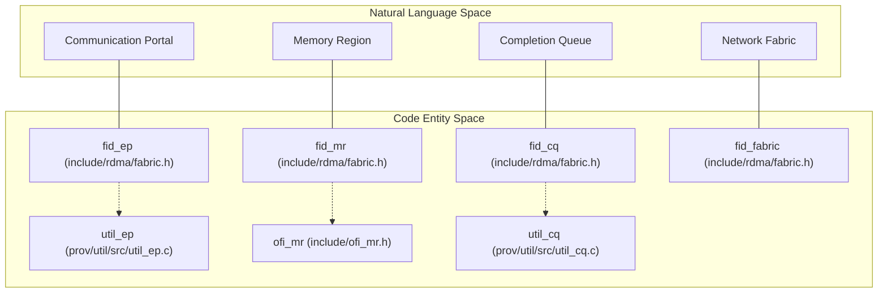
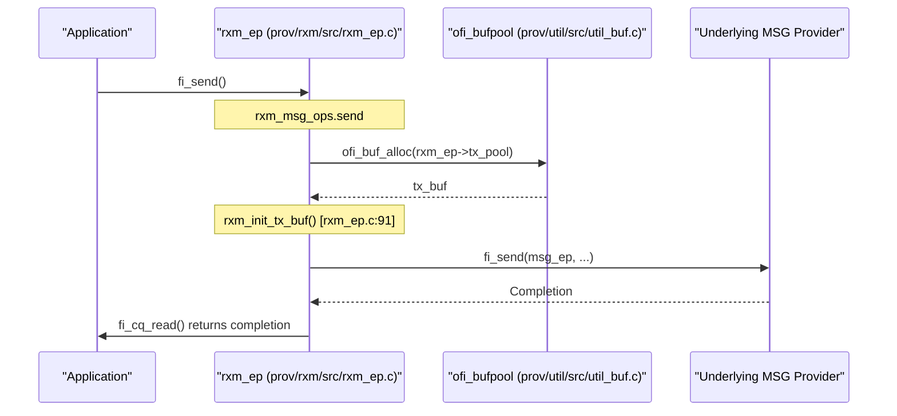

<!-- source: DeepWiki mcp.deepwiki.com · repo ofiwg/libfabric · page 6 Glossary · fetched 2026-11-11 -->

# Glossary

Relevant source files

The following files were used as context for generating this wiki page:

- [Makefile.am](Makefile.am)
- [include/ofi.h](include/ofi.h)
- [include/ofi_atomic_queue.h](include/ofi_atomic_queue.h)
- [include/ofi_hmem.h](include/ofi_hmem.h)
- [include/ofi_iov.h](include/ofi_iov.h)
- [include/ofi_mem.h](include/ofi_mem.h)
- [include/ofi_mr.h](include/ofi_mr.h)
- [include/ofi_osd.h](include/ofi_osd.h)
- [include/ofi_tree.h](include/ofi_tree.h)
- [include/ofi_util.h](include/ofi_util.h)
- [include/rdma/fabric.h](include/rdma/fabric.h)
- [include/rdma/fi_cm.h](include/rdma/fi_cm.h)
- [include/rdma/fi_domain.h](include/rdma/fi_domain.h)
- [include/rdma/fi_eq.h](include/rdma/fi_eq.h)
- [include/rdma/fi_errno.h](include/rdma/fi_errno.h)
- [include/rdma/providers/fi_prov.h](include/rdma/providers/fi_prov.h)
- [libfabric.vcxproj](libfabric.vcxproj)
- [libfabric.vcxproj.filters](libfabric.vcxproj.filters)
- [man/fi_atomic.3.md](man/fi_atomic.3.md)
- [man/fi_av.3.md](man/fi_av.3.md)
- [man/fi_cm.3.md](man/fi_cm.3.md)
- [man/fi_cntr.3.md](man/fi_cntr.3.md)
- [man/fi_cq.3.md](man/fi_cq.3.md)
- [man/fi_domain.3.md](man/fi_domain.3.md)
- [man/fi_endpoint.3.md](man/fi_endpoint.3.md)
- [man/fi_eq.3.md](man/fi_eq.3.md)
- [man/fi_fabric.3.md](man/fi_fabric.3.md)
- [man/fi_getinfo.3.md](man/fi_getinfo.3.md)
- [man/fi_info.1.md](man/fi_info.1.md)
- [man/fi_mr.3.md](man/fi_mr.3.md)
- [man/fi_msg.3.md](man/fi_msg.3.md)
- [man/fi_poll.3.md](man/fi_poll.3.md)
- [man/fi_rma.3.md](man/fi_rma.3.md)
- [man/fi_shm.7.md](man/fi_shm.7.md)
- [man/fi_tagged.3.md](man/fi_tagged.3.md)
- [man/fi_version.3.md](man/fi_version.3.md)
- [prov/rxd/src/rxd_cntr.c](prov/rxd/src/rxd_cntr.c)
- [prov/rxm/Makefile.include](prov/rxm/Makefile.include)
- [prov/rxm/src/rxm.h](prov/rxm/src/rxm.h)
- [prov/rxm/src/rxm_atomic.c](prov/rxm/src/rxm_atomic.c)
- [prov/rxm/src/rxm_attr.c](prov/rxm/src/rxm_attr.c)
- [prov/rxm/src/rxm_conn.c](prov/rxm/src/rxm_conn.c)
- [prov/rxm/src/rxm_cq.c](prov/rxm/src/rxm_cq.c)
- [prov/rxm/src/rxm_domain.c](prov/rxm/src/rxm_domain.c)
- [prov/rxm/src/rxm_ep.c](prov/rxm/src/rxm_ep.c)
- [prov/rxm/src/rxm_fabric.c](prov/rxm/src/rxm_fabric.c)
- [prov/rxm/src/rxm_init.c](prov/rxm/src/rxm_init.c)
- [prov/rxm/src/rxm_msg.c](prov/rxm/src/rxm_msg.c)
- [prov/rxm/src/rxm_rma.c](prov/rxm/src/rxm_rma.c)
- [prov/rxm/src/rxm_tagged.c](prov/rxm/src/rxm_tagged.c)
- [prov/shm/src/smr.h](prov/shm/src/smr.h)
- [prov/shm/src/smr_atomic.c](prov/shm/src/smr_atomic.c)
- [prov/shm/src/smr_attr.c](prov/shm/src/smr_attr.c)
- [prov/shm/src/smr_av.c](prov/shm/src/smr_av.c)
- [prov/shm/src/smr_cntr.c](prov/shm/src/smr_cntr.c)
- [prov/shm/src/smr_comp.c](prov/shm/src/smr_comp.c)
- [prov/shm/src/smr_cq.c](prov/shm/src/smr_cq.c)
- [prov/shm/src/smr_domain.c](prov/shm/src/smr_domain.c)
- [prov/shm/src/smr_dsa.c](prov/shm/src/smr_dsa.c)
- [prov/shm/src/smr_dsa.h](prov/shm/src/smr_dsa.h)
- [prov/shm/src/smr_ep.c](prov/shm/src/smr_ep.c)
- [prov/shm/src/smr_fabric.c](prov/shm/src/smr_fabric.c)
- [prov/shm/src/smr_init.c](prov/shm/src/smr_init.c)
- [prov/shm/src/smr_msg.c](prov/shm/src/smr_msg.c)
- [prov/shm/src/smr_progress.c](prov/shm/src/smr_progress.c)
- [prov/shm/src/smr_rma.c](prov/shm/src/smr_rma.c)
- [prov/shm/src/smr_signal.h](prov/shm/src/smr_signal.h)
- [prov/shm/src/smr_util.c](prov/shm/src/smr_util.c)
- [prov/shm/src/smr_util.h](prov/shm/src/smr_util.h)
- [prov/sockets/src/sock_mr.c](prov/sockets/src/sock_mr.c)
- [prov/tcp/Makefile.include](prov/tcp/Makefile.include)
- [prov/util/src/cuda_ipc_monitor.c](prov/util/src/cuda_ipc_monitor.c)
- [prov/util/src/cuda_mem_monitor.c](prov/util/src/cuda_mem_monitor.c)
- [prov/util/src/import_mem_monitor.c](prov/util/src/import_mem_monitor.c)
- [prov/util/src/rocr_ipc_monitor.c](prov/util/src/rocr_ipc_monitor.c)
- [prov/util/src/rocr_mem_monitor.c](prov/util/src/rocr_mem_monitor.c)
- [prov/util/src/rxm_av.c](prov/util/src/rxm_av.c)
- [prov/util/src/uffd_mem_monitor.c](prov/util/src/uffd_mem_monitor.c)
- [prov/util/src/util_attr.c](prov/util/src/util_attr.c)
- [prov/util/src/util_av.c](prov/util/src/util_av.c)
- [prov/util/src/util_buf.c](prov/util/src/util_buf.c)
- [prov/util/src/util_cntr.c](prov/util/src/util_cntr.c)
- [prov/util/src/util_cq.c](prov/util/src/util_cq.c)
- [prov/util/src/util_ep.c](prov/util/src/util_ep.c)
- [prov/util/src/util_eq.c](prov/util/src/util_eq.c)
- [prov/util/src/util_main.c](prov/util/src/util_main.c)
- [prov/util/src/util_mem_hooks.c](prov/util/src/util_mem_hooks.c)
- [prov/util/src/util_mem_monitor.c](prov/util/src/util_mem_monitor.c)
- [prov/util/src/util_mr_cache.c](prov/util/src/util_mr_cache.c)
- [prov/util/src/util_mr_map.c](prov/util/src/util_mr_map.c)
- [prov/util/src/util_wait.c](prov/util/src/util_wait.c)
- [prov/util/src/xpmem_monitor.c](prov/util/src/xpmem_monitor.c)
- [prov/util/src/ze_mem_monitor.c](prov/util/src/ze_mem_monitor.c)
- [prov/verbs/Makefile.include](prov/verbs/Makefile.include)
- [prov/verbs/src/verbs_cm.c](prov/verbs/src/verbs_cm.c)
- [prov/verbs/src/verbs_cm_xrc.c](prov/verbs/src/verbs_cm_xrc.c)
- [prov/verbs/src/verbs_cq.c](prov/verbs/src/verbs_cq.c)
- [prov/verbs/src/verbs_dgram_av.c](prov/verbs/src/verbs_dgram_av.c)
- [prov/verbs/src/verbs_dgram_ep_msg.c](prov/verbs/src/verbs_dgram_ep_msg.c)
- [prov/verbs/src/verbs_domain.c](prov/verbs/src/verbs_domain.c)
- [prov/verbs/src/verbs_domain_xrc.c](prov/verbs/src/verbs_domain_xrc.c)
- [prov/verbs/src/verbs_ep.c](prov/verbs/src/verbs_ep.c)
- [prov/verbs/src/verbs_eq.c](prov/verbs/src/verbs_eq.c)
- [prov/verbs/src/verbs_info.c](prov/verbs/src/verbs_info.c)
- [prov/verbs/src/verbs_init.c](prov/verbs/src/verbs_init.c)
- [prov/verbs/src/verbs_mr.c](prov/verbs/src/verbs_mr.c)
- [prov/verbs/src/verbs_msg.c](prov/verbs/src/verbs_msg.c)
- [prov/verbs/src/verbs_ofi.h](prov/verbs/src/verbs_ofi.h)
- [prov/verbs/src/verbs_rma.c](prov/verbs/src/verbs_rma.c)
- [src/fabric.c](src/fabric.c)
- [src/fi_tostr.c](src/fi_tostr.c)
- [src/hmem.c](src/hmem.c)
- [src/hmem_cuda.c](src/hmem_cuda.c)
- [src/hmem_cuda_gdrcopy.c](src/hmem_cuda_gdrcopy.c)
- [src/hmem_neuron.c](src/hmem_neuron.c)
- [src/hmem_rocr.c](src/hmem_rocr.c)
- [src/hmem_synapseai.c](src/hmem_synapseai.c)
- [src/hmem_ze.c](src/hmem_ze.c)
- [src/iov.c](src/iov.c)
- [src/log.c](src/log.c)
- [src/tree.c](src/tree.c)
- [src/var.c](src/var.c)
- [util/info.c](util/info.c)

This glossary defines codebase-specific terms, jargon, and domain concepts used throughout the libfabric library. It serves as a technical reference for engineers to understand the mapping between abstract fabric concepts and their concrete implementations in the code.

## Core Abstractions

### Fabric (`fid_fabric`)
The top-level container for all other network objects. It represents a logical connection to a network cloud or a specific hardware implementation.
*   **Implementation**: Defined in `[include/rdma/fabric.h:101-101]()`.
*   **Utility**: Providers often use `struct util_fabric` to manage internal state.
*   **Key Functions**: `fi_fabric` (allocation), `ofi_fabric_init` `[include/ofi_util.h:188-191]()`.

### Domain (`fid_domain`)
A resource domain that defines the boundary for resource sharing. Memory registrations, completion queues, and endpoints are typically associated with a domain.
*   **Implementation**: Defined in `[include/rdma/fi_domain.h]()`.
*   **Utility**: `struct util_domain` `[include/ofi_util.h:198-219]()` handles common logic like locking and reference counting.
*   **Data Flow**: Applications open a domain via `fi_domain()`, which routes to the provider's `domain` function.

### Endpoint (`fid_ep`)
A communication portal for transmitting or receiving data. There are active endpoints (data transfer) and passive endpoints (listening for connections).
*   **Implementation**: `struct fid_ep` `[include/rdma/fabric.h:109-109]()`.
*   **Types**: `FI_EP_MSG` (reliable/connection-oriented), `FI_EP_RDM` (reliable datagram), `FI_EP_DGRAM` (unreliable datagram) `[prov/verbs/src/verbs_info.c:139-155]()`.
*   **State**: Active endpoints transition from disabled to enabled via `fi_enable()` `[man/fi_endpoint.3.md:26-28]()`.

## Data Transfer Concepts

### Tagged Messaging
A data transfer mode where messages are matched based on a user-provided 64-bit tag.
*   **Implementation**: `struct fi_ops_tagged` defines the interface for `fi_tsend`, `fi_trecv`, etc.
*   **Provider Logic**: For example, RXM implements this in `rxm_tagged_ops` `[prov/rxm/src/rxm.h:188-188]()`.

### RMA (Remote Memory Access)
Operations that allow one endpoint to directly access the memory of a remote endpoint (Read/Write) without involving the remote application's CPU for every transfer.
*   **Implementation**: `struct fi_ops_rma` `[prov/rxm/src/rxm.h:190-191]()`.
*   **Key Ops**: `fi_read`, `fi_write`.

### Multi-Recv
An optimization where a single receive buffer can satisfy multiple incoming messages until it is exhausted.
*   **Flag**: `FI_MULTI_RECV` `[include/rdma/fabric.h:141-141]()`.
*   **Implementation**: Handled by the utility layer in `util_srx.c` or provider-specific logic in `smr_ep.c` `[prov/shm/src/smr_ep.c:132-135]()`.

## Internal Frameworks

### Provider (Core vs. Utility vs. Hook)
Libfabric uses a layered provider model.
*   **Core Provider**: Implements the API directly over hardware (e.g., `verbs`, `efa`).
*   **Utility Provider**: Layers over other providers to provide enhanced features (e.g., `rxm` provides RDM over MSG).
*   **Hook Provider**: Intercepts calls for monitoring or debugging (e.g., `hook_av.c`) `[Makefile.am:138-148]()`.

### Progress Engine
The mechanism that drives the completion of asynchronous operations.
*   **Manual Progress**: The application must call a function (like `fi_cq_read`) to process completions.
*   **Auto Progress**: The provider uses internal threads or hardware interrupts to drive completions.
*   **Code Reference**: `FI_PROGRESS_AUTO` and `FI_PROGRESS_MANUAL` are defined in `[include/rdma/fi_domain.h]()`.

### HMEM (Heterogeneous Memory)
The framework for supporting memory buffers located on accelerators (GPUs).
*   **Interfaces**: CUDA, ROCm, Level Zero (ZE).
*   **Implementation**: `src/hmem.c` `[Makefile.am:47-53]()`.
*   **Functionality**: Detects memory type and handles copies/registrations for device memory.

## Code Mapping Diagrams

### API to Code Entity Mapping
This diagram shows how natural language API concepts map to specific structures and file locations within the codebase.

**Sources**: `[include/rdma/fabric.h:100-114]()`, `[include/ofi_util.h:198-219]()`, `[Makefile.am:68-80]()`.

### RXM Provider Data Flow
A specific example of the internal data flow within the RXM (RDM over MSG) utility provider, showing the transition from libfabric API to the underlying "MSG" provider.

**Sources**: `[prov/rxm/src/rxm_ep.c:91-101]()`, `[prov/rxm/src/rxm_ep.c:138-145]()`, `[prov/rxm/src/rxm.h:186-193]()`.

## Technical Jargon & Abbreviations

| Term | Definition | Code Pointer |
| :--- | :--- | :--- |
| **AV** | Address Vector. Maps application-level addresses to fabric-specific addresses. | `struct fid_av` `[include/rdma/fabric.h:103]()` |
| **CQ** | Completion Queue. Collects results of completed asynchronous operations. | `struct fid_cq` `[include/rdma/fabric.h:107]()` |
| **EQ** | Event Queue. Collects connection and asynchronous error events. | `struct fid_eq` `[include/rdma/fabric.h:106]()` |
| **MR** | Memory Registration. Pins memory and prepares it for hardware access. | `struct fid_mr` `[include/rdma/fabric.h:112]()` |
| **SAR** | Segmentation and Reassembly. Breaking large messages into smaller MTU-sized packets. | `RXM_SAR_SEG_FIRST` `[prov/rxm/src/rxm_cq.c:140]()` |
| **SRX** | Shared Receive Context. Multiple endpoints sharing a single pool of receive buffers. | `util_srx.c` `[Makefile.am:83]()`, `[include/ofi_util.h:203]()` |
| **RDM** | Reliable Datagram. A connectionless transport that provides reliability. | `FI_EP_RDM` `[man/fi_endpoint.3.md:179-181]()` |
| **MSG** | Message endpoint. Connection-oriented reliable transport. | `FI_EP_MSG` `[prov/verbs/src/verbs_info.c:141]()` |
| **IOV** | I/O Vector. A scatter-gather list of buffers. | `struct iovec` `[include/rdma/fabric.h:41]()`, `ofi_iov.c` |

**Sources**: `[include/rdma/fabric.h:100-114]()`, `[include/rdma/fi_domain.h]()`, `[man/fi_endpoint.3.md:172-188]()`, `[Makefile.am:46-108]()`.