# Page: Overview

# Overview

<details>
<summary>Relevant source files</summary>

The following files were used as context for generating this wiki page:

- [AUTHORS](AUTHORS)
- [COPYING](COPYING)
- [Makefile.am](Makefile.am)
- [NEWS.md](NEWS.md)
- [README](README)
- [README.md](README.md)
- [configure.ac](configure.ac)
- [docs/windows.txt](docs/windows.txt)
- [fabtests/AUTHORS](fabtests/AUTHORS)
- [fabtests/COPYING](fabtests/COPYING)
- [fabtests/README](fabtests/README)
- [fabtests/configure.ac](fabtests/configure.ac)
- [include/ofi.h](include/ofi.h)
- [include/ofi_mem.h](include/ofi_mem.h)
- [include/ofi_osd.h](include/ofi_osd.h)
- [include/rdma/fabric.h](include/rdma/fabric.h)
- [include/rdma/fi_domain.h](include/rdma/fi_domain.h)
- [include/rdma/providers/fi_prov.h](include/rdma/providers/fi_prov.h)
- [include/windows/config.h](include/windows/config.h)
- [libfabric.vcxproj](libfabric.vcxproj)
- [libfabric.vcxproj.filters](libfabric.vcxproj.filters)
- [man/fi_atomic.3.md](man/fi_atomic.3.md)
- [man/fi_domain.3.md](man/fi_domain.3.md)
- [man/fi_endpoint.3.md](man/fi_endpoint.3.md)
- [man/fi_getinfo.3.md](man/fi_getinfo.3.md)
- [man/fi_info.1.md](man/fi_info.1.md)
- [man/fi_mr.3.md](man/fi_mr.3.md)
- [man/fi_msg.3.md](man/fi_msg.3.md)
- [man/fi_psm3.7.md](man/fi_psm3.7.md)
- [man/fi_rma.3.md](man/fi_rma.3.md)
- [man/fi_tagged.3.md](man/fi_tagged.3.md)
- [man/man1/fi_pingpong.1](man/man1/fi_pingpong.1)
- [man/man7/fi_psm3.7](man/man7/fi_psm3.7)
- [prov/util/src/util_buf.c](prov/util/src/util_buf.c)
- [src/fabric.c](src/fabric.c)
- [src/fi_tostr.c](src/fi_tostr.c)
- [src/log.c](src/log.c)
- [src/var.c](src/var.c)
- [util/info.c](util/info.c)

</details>


Libfabric is a low-level network programming interface designed to facilitate communication across high-performance fabrics. It provides a framework for fabric communication interfaces, enabling applications to leverage various network fabrics (such as InfiniBand, RoCE, Intel Omni-Path, AWS EFA, TCP sockets, and shared memory) through a consistent, unified API.

The purpose of this overview is to introduce libfabric's architecture, core concepts, and components. It explains how libfabric organizes its codebase, the relationships between providers and hardware, and how data flows through the system. For details about specific API usage, see [API Introduction](#1.2).

## Libfabric Architecture

The libfabric architecture consists of several layers that provide abstractions for fabric communication. It follows a modular design to decouple application code from specific fabric implementation details.

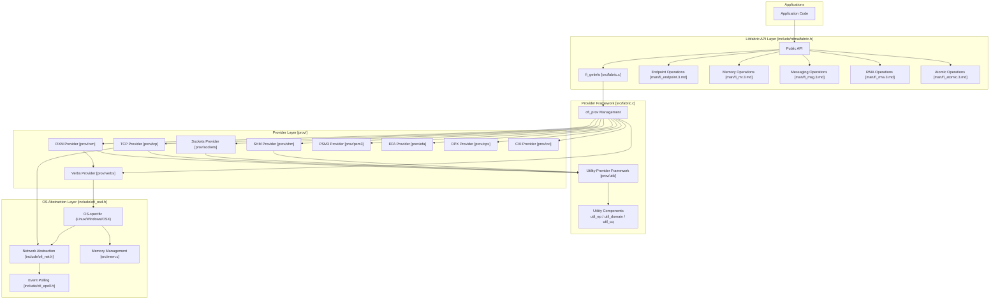

Sources: [include/rdma/fabric.h:1-115](), [src/fabric.c:62-85](), [Makefile.am:46-108](), [configure.ac:23-46]()

## Core Concepts

Libfabric is built around several key abstractions (represented by `fid` structures) that model fabric communication:

### Fabric and Domains
- **Fabric (`fid_fabric`)**: Represents a fabric interface or network, the highest level of abstraction [include/rdma/fabric.h:101]().
- **Domain (`fid_domain`)**: Represents an addressable communication region within a fabric, typically mapping to a NIC or hardware port [include/rdma/fabric.h:102]().

### Endpoints and Communication
- **Endpoint (`fid_ep`)**: Communication portal used for data transfers [include/rdma/fabric.h:109]().
  - **Active Endpoint**: Performs data transfers (connected or connectionless) [man/fi_endpoint.3.md:172-178]().
  - **Passive Endpoint (`fid_pep`)**: Listens for incoming connection requests [man/fi_endpoint.3.md:68-69]().
  - **Scalable Endpoint**: Supports multiple transmit/receive contexts [man/fi_endpoint.3.md:65-66]().

### Data Structures
- **Address Vector (`fid_av`)**: Maps and stores transport/network addresses [include/rdma/fi_domain.h:48-50]().
- **Completion Queue (`fid_cq`)**: Reports completed operations [include/rdma/fabric.h:107]().
- **Event Queue (`fid_eq`)**: Reports connection management and asynchronous events [include/rdma/fabric.h:106]().
- **Memory Region (`fid_mr`)**: Registered memory buffers for fabric access [include/rdma/fi_domain.h:131-135]().

### Communication Models
Libfabric supports multiple communication models via capability flags:

| Capability Flag | Description | Key Header |
|-----------------|-------------|------------|
| `FI_MSG` | Standard message-based communication | [rdma/fi_endpoint.h]() |
| `FI_TAGGED` | Message passing with message tag identifiers | [rdma/fi_tagged.h]() |
| `FI_RMA` | Remote Memory Access operations | [rdma/fi_rma.h]() |
| `FI_ATOMIC` | Atomic operations on remote memory | [rdma/fi_atomic.h]() |
| `FI_COLLECTIVE` | Group communication operations | [rdma/fi_collective.h]() |

Sources: [include/rdma/fabric.h:125-132](), [include/rdma/fi_domain.h:65-73](), [man/fi_endpoint.3.md:179-188]()

## Provider Architecture

Providers are driver-like plugins that implement the libfabric API. They are classified by their relationship to the hardware and other providers.

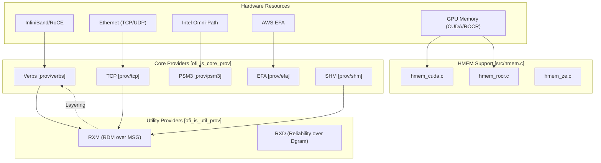

### Provider Types
1. **Core Providers**: Interface directly with hardware or system network stacks (e.g., `verbs`, `tcp`, `efa`) [src/fabric.c:255-258]().
2. **Utility Providers**: Implement higher-level protocols over other providers (e.g., `rxm` provides RDM endpoints over MSG-only providers) [src/fabric.c:250-253]().
3. **Hook Providers**: Intercept API calls for instrumentation, such as `hook_perf` for profiling [src/fabric.c:260-263]().

Sources: [src/fabric.c:250-268](), [src/fabric.c:464-498](), [Makefile.am:47-54]()

## Data Flow and Initialization

The following sequence describes how applications interact with the libfabric framework to establish communication.

### Initialization Sequence
1. **Discovery**: Application calls `fi_getinfo()` with hints to find suitable providers [man/fi_getinfo.3.md:54-61]().
2. **Fabric/Domain**: Application opens a fabric object (`fi_fabric()`) and a domain (`fi_domain()`) [man/fi_getinfo.3.md:69-78]().
3. **Resources**: Application creates communication resources:
    - Open CQs (`fi_cq_open`) and AVs (`fi_av_open`).
    - Register memory (`fi_mr_reg`) for RMA/Atomics [man/fi_mr.3.md:58-65]().
4. **Endpoints**: Application allocates an endpoint (`fi_endpoint()`) and binds it to CQs/AVs [man/fi_endpoint.3.md:59-60]().
5. **Activation**: Application enables the endpoint (`fi_enable()`) to begin data transfers [man/fi_endpoint.3.md:95]().

### Data Transfer Sequence
1. **Post Buffers**: For incoming data, application calls `fi_recv()` [man/fi_msg.3.md]().
2. **Initiate Transfer**: Application calls `fi_send()`, `fi_write()`, or `fi_atomic()` [man/fi_rma.3.md]().
3. **Progress**: The provider's internal progress engine (e.g., `xnet` PE or `verbs` poll) moves data [man/fi_endpoint.3.md:201-207]().
4. **Completion**: Application polls the CQ (`fi_cq_read()`) to identify finished operations.

Sources: [src/fabric.c:590-628](), [man/fi_getinfo.3.md:54-69](), [man/fi_endpoint.3.md:171-225]()

## Build System and Configuration

Libfabric uses Autotools for configuration and building.

- **Configure Options**: Users can enable/disable specific providers using `--enable-<provider>` or force direct provider calls via `--enable-direct` [configure.ac:85-97]().
- **HMEM Support**: Accelerator memory support is toggled via `--with-cuda`, `--with-rocr`, etc [configure.ac:73-83]().
- **Platform Support**: Libfabric targets Linux, macOS, and FreeBSD [configure.ac:29-42](). Windows support is managed via separate project files [libfabric.vcxproj]().

Sources: [configure.ac:1-125](), [Makefile.am:1-40](), [NEWS.md:12-44]()

## Key Components and Their Roles

| Component | Code Pointer | Role |
|-----------|--------------|------|
| **Provider Registry** | `struct ofi_prov` [src/fabric.c:62-69]() | Tracks registered and loaded providers. |
| **Matching Engine** | `fi_getinfo` [src/fabric.c:590]() | Filters providers based on application requirements. |
| **HMEM Framework** | `src/hmem.c` [src/hmem.c:1]() | Provides unified access to GPU/accelerator memory. |
| **Utility Library** | `include/ofi.h` [include/ofi.h:1]() | Internal macros and functions shared across providers. |
| **String Conversion** | `src/fi_tostr.c` [src/fi_tostr.c:1]() | Debugging utility to convert libfabric types to strings. |

For details on the internal organization, see [Architecture](#1.1). For an overview of the programming model, see [API Introduction](#1.2).

---

# Page: Architecture

# Architecture

<details>
<summary>Relevant source files</summary>

The following files were used as context for generating this wiki page:

- [Makefile.am](Makefile.am)
- [include/ofi.h](include/ofi.h)
- [include/ofi_hook.h](include/ofi_hook.h)
- [include/ofi_mem.h](include/ofi_mem.h)
- [include/ofi_osd.h](include/ofi_osd.h)
- [include/ofi_prov.h](include/ofi_prov.h)
- [include/rdma/fabric.h](include/rdma/fabric.h)
- [include/rdma/fi_domain.h](include/rdma/fi_domain.h)
- [include/rdma/providers/fi_prov.h](include/rdma/providers/fi_prov.h)
- [libfabric.vcxproj](libfabric.vcxproj)
- [libfabric.vcxproj.filters](libfabric.vcxproj.filters)
- [man/fi_atomic.3.md](man/fi_atomic.3.md)
- [man/fi_domain.3.md](man/fi_domain.3.md)
- [man/fi_endpoint.3.md](man/fi_endpoint.3.md)
- [man/fi_getinfo.3.md](man/fi_getinfo.3.md)
- [man/fi_info.1.md](man/fi_info.1.md)
- [man/fi_mr.3.md](man/fi_mr.3.md)
- [man/fi_msg.3.md](man/fi_msg.3.md)
- [man/fi_rma.3.md](man/fi_rma.3.md)
- [man/fi_tagged.3.md](man/fi_tagged.3.md)
- [prov/hook/hook_debug/include/hook_debug.h](prov/hook/hook_debug/include/hook_debug.h)
- [prov/hook/hook_debug/src/hook_debug.c](prov/hook/hook_debug/src/hook_debug.c)
- [prov/hook/src/hook.c](prov/hook/src/hook.c)
- [prov/hook/src/hook_av.c](prov/hook/src/hook_av.c)
- [prov/hook/src/hook_cm.c](prov/hook/src/hook_cm.c)
- [prov/hook/src/hook_cntr.c](prov/hook/src/hook_cntr.c)
- [prov/hook/src/hook_cq.c](prov/hook/src/hook_cq.c)
- [prov/hook/src/hook_domain.c](prov/hook/src/hook_domain.c)
- [prov/hook/src/hook_ep.c](prov/hook/src/hook_ep.c)
- [prov/hook/src/hook_eq.c](prov/hook/src/hook_eq.c)
- [prov/hook/src/hook_wait.c](prov/hook/src/hook_wait.c)
- [prov/hook/src/hook_xfer.c](prov/hook/src/hook_xfer.c)
- [prov/opx/include/rdma/fi_direct_endpoint.h](prov/opx/include/rdma/fi_direct_endpoint.h)
- [prov/opx/src/fi_opx_info.c](prov/opx/src/fi_opx_info.c)
- [prov/util/src/util_buf.c](prov/util/src/util_buf.c)
- [src/fabric.c](src/fabric.c)
- [src/fi_tostr.c](src/fi_tostr.c)
- [src/log.c](src/log.c)
- [src/var.c](src/var.c)
- [util/info.c](util/info.c)

</details>


This document describes the high-level architecture of libfabric, explaining the framework's structure, component relationships, and data flow. Libfabric provides a unified API for fabric communication, abstracting away the details of different fabric providers to offer consistent access to high-performance networking hardware.

## Overview of Libfabric Architecture

Libfabric is designed as a framework that provides a unified interface to various network fabrics through a layered architecture. This framework allows applications to communicate over high-performance fabrics without needing to understand the specific details of the underlying hardware.

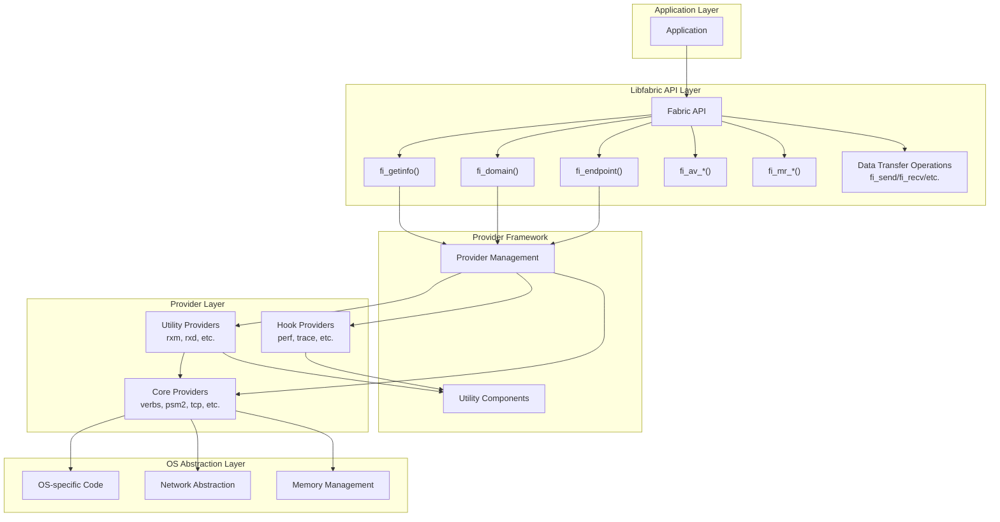

Sources: [src/fabric.c:36-1046](), [include/rdma/fabric.h:35-828](), [Makefile.am:10-230]()

The architecture consists of several key layers:

1. **Libfabric API Layer**: Provides the public API (defined in headers like `fabric.h` and `fi_endpoint.h`) that applications use to interact with fabric hardware. [include/rdma/fabric.h:35-220](), [include/rdma/fi_endpoint.h:54-116]()
2. **Provider Framework**: Manages provider registration, discovery via `fi_getinfo`, and selection. [src/fabric.c:62-183]()
3. **Provider Layer**: Contains implementations for specific fabrics (core providers), add-on functionality (utility providers like `rxm`), and hooks. [src/fabric.c:250-268]()
4. **OS Abstraction Layer**: Provides platform independence for network and system operations (e.g., `osd.h` for Linux/Windows). [Makefile.am:110-132](), [include/ofi_osd.h:1-61]()

## Provider Framework Architecture

The provider framework is at the heart of libfabric's design. It allows multiple fabric providers to coexist while presenting a unified API to applications.

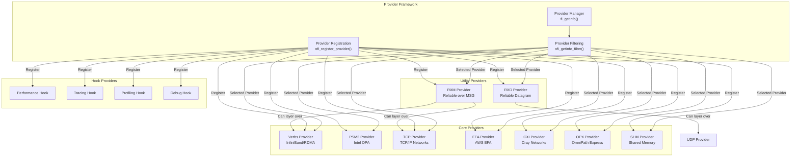

Sources: [src/fabric.c:62-69](), [src/fabric.c:250-268](), [src/fabric.c:270-280](), [include/rdma/providers/fi_prov.h:1-100]()

The provider framework handles:

1. **Provider Registration**: During initialization, providers register via `ofi_insert_prov`. [src/fabric.c:153-183]()
2. **Provider Discovery**: Finding available providers that match application requirements using the matching engine in `fi_getinfo`. [man/fi_getinfo.3.md:54-91]()
3. **Provider Selection**: Choosing the most appropriate provider based on versioning and preferred flags. [src/fabric.c:140-151]()
4. **Provider Layering**: Supporting layered providers where utility providers (type `OFI_PROV_UTIL`) build on core providers (type `OFI_PROV_CORE`). [src/fabric.c:250-258]()

## Initialization and Provider Selection Flow

When an application uses libfabric, it follows a specific initialization flow to select and configure appropriate providers.

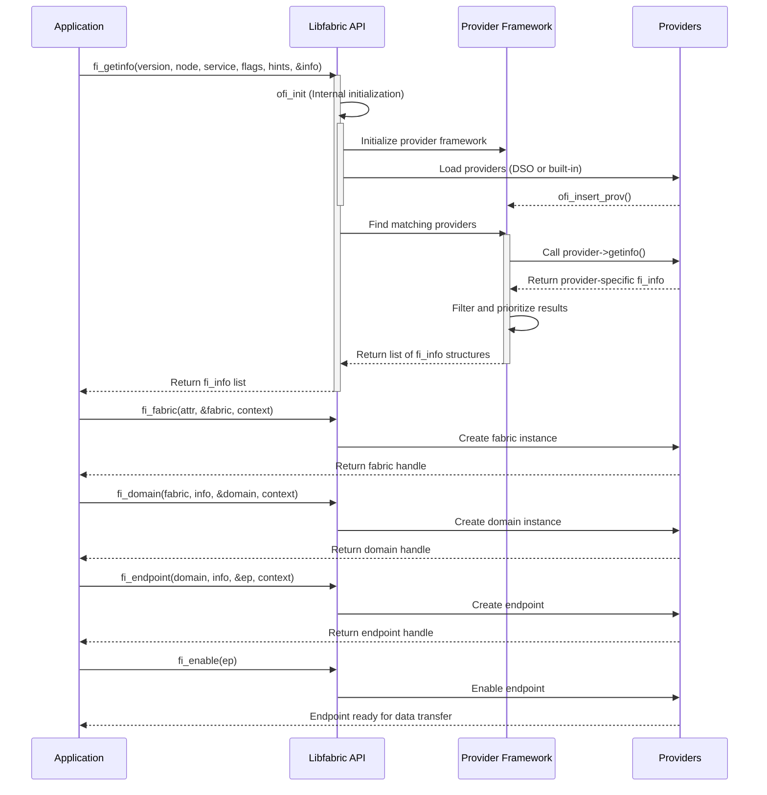

Sources: [src/fabric.c:84-183](), [man/fi_getinfo.3.md:54-91](), [man/fi_endpoint.3.md:54-116](), [man/fi_domain.3.md:19-35]()

The initialization flow includes:

1. **Provider Loading**: Providers are loaded from dynamic shared objects (DSOs) via `dlopen` or linked as built-in libraries. [src/fabric.c:57-69](), [Makefile.am:27]()
2. **Provider Selection**: The application calls `fi_getinfo()` to find providers matching its requirements (caps, mode, addr_format). [man/fi_getinfo.3.md:129-147]()
3. **Resource Creation**: The application creates fabric, domain, and endpoint resources using the selected provider's ops. [include/rdma/fabric.h:100-114]()
4. **Endpoint Enabling**: Endpoints are created in a disabled state and must transition to enabled via `fi_enable`. [man/fi_endpoint.3.md:189-194]()

## Data Structure Relationships

At the core of libfabric are several key data structures (fids) that represent fabric resources.

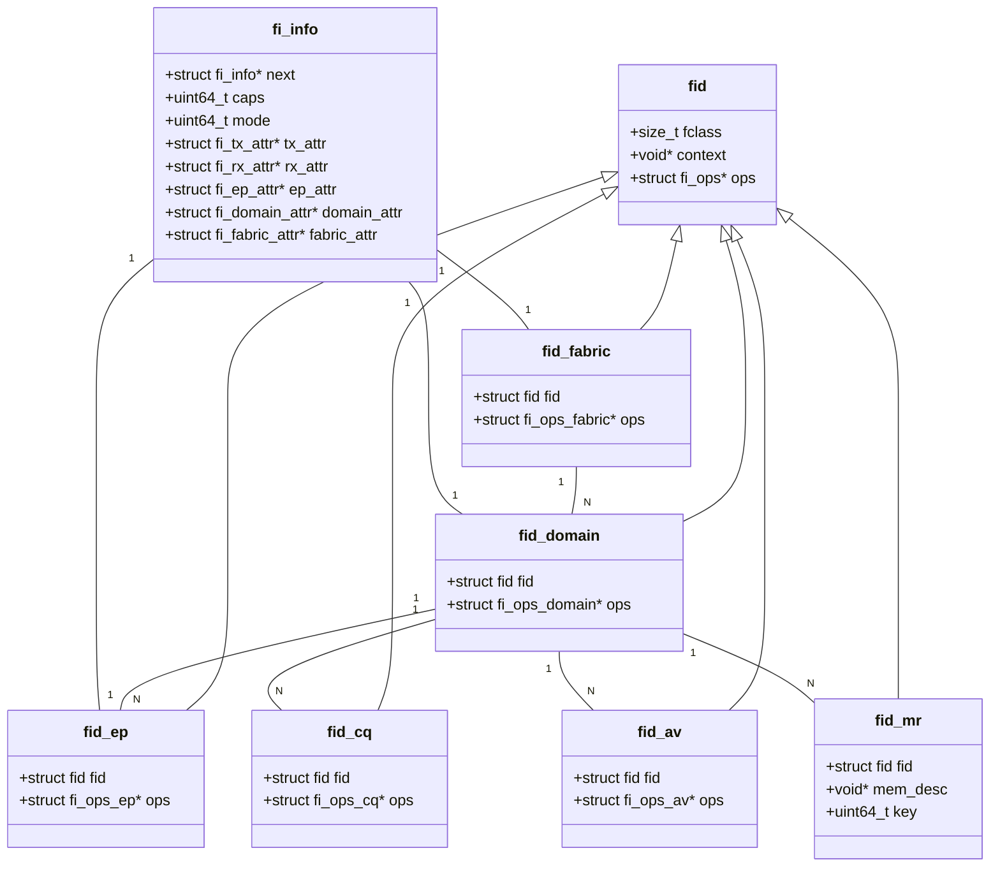

Sources: [include/rdma/fabric.h:100-114](), [include/rdma/fi_domain.h:114-117](), [include/rdma/fi_domain.h:131-135](), [man/fi_getinfo.3.md:130-147]()

The key data structures include:

1. **fid**: Base structure for all fabric identifiers. [include/rdma/fabric.h:115]()
2. **fid_fabric**: Represents a fabric instance. [include/rdma/fabric.h:101]()
3. **fid_domain**: Represents a resource domain (NIC/port boundary). [man/fi_domain.3.md:66-71]()
4. **fid_ep**: Communication portal for data transfer. [man/fi_endpoint.3.md:172-178]()
5. **fid_cq**: Completion queue for asynchronous operations. [include/rdma/fabric.h:107]()
6. **fid_av**: Address vector for mapping network addresses. [include/rdma/fi_domain.h:114-117]()
7. **fid_mr**: Memory region for direct fabric access. [include/rdma/fi_domain.h:131-135]()
8. **fi_info**: Contains information about a provider's capabilities and attributes. [man/fi_getinfo.3.md:130-146]()

## Data Transfer Flow

Libfabric supports various data transfer methods including message, RMA (Remote Memory Access), tagged, and atomic operations.

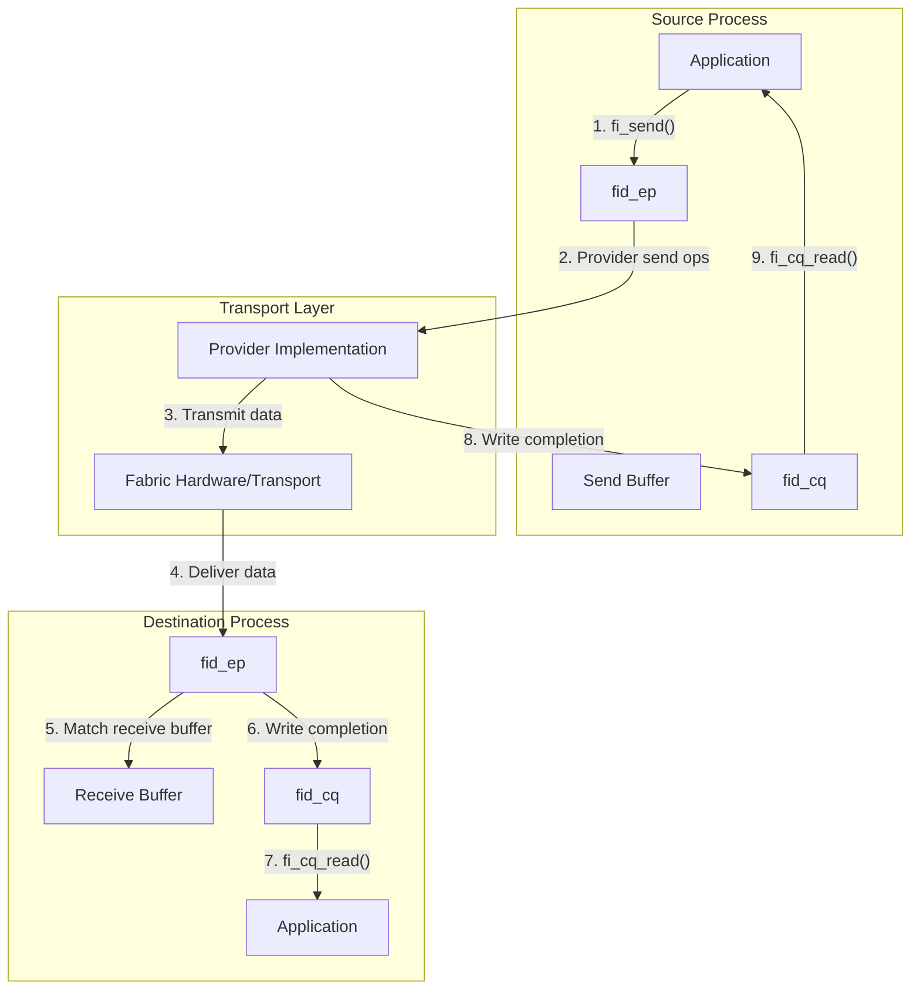

Sources: [man/fi_endpoint.3.md:180-188](), [man/fi_msg.3.md:10-17](), [include/rdma/fabric.h:125-132]()

The data transfer flow involves:

1. **Endpoint Binding**: Active endpoints are bound to CQs, EQs, and AVs before use. [man/fi_endpoint.3.md:196-207]()
2. **Buffer Posting**: Buffers are posted for receives (via `fi_recv`) or registered for RMA (via `fi_mr_reg`). [man/fi_mr.3.md:133-142]()
3. **Operation Initiation**: Applications call data transfer functions like `fi_send`, `fi_write`, or `fi_tsend`. [man/fi_msg.3.md:10-17](), [man/fi_tagged.3.md:10-17]()
4. **Completion**: Asynchronous events are reported through Completion Queues (`fid_cq`). [man/fi_endpoint.3.md:198-200]()

## Provider Implementation and Utility Framework

Providers implement the libfabric API using the `fi_provider` structure and internal utility frameworks.

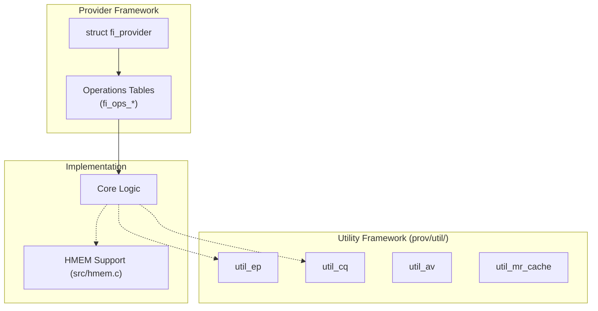

Sources: [src/fabric.c:62-69](), [Makefile.am:66-108](), [include/rdma/providers/fi_prov.h:50-80]()

Providers often use the utility framework (located in `prov/util/`) to handle common tasks:

1. **Memory Registration Cache**: `util_mr_cache.c` manages registered memory to reduce registration overhead. [Makefile.am:86]()
2. **Buffer Management**: `util_buf.c` (ofi_bufpool) provides optimized buffer pooling. [Makefile.am:80]()
3. **Endpoint/CQ Helpers**: `util_ep.c` and `util_cq.c` provide boilerplate for resource management. [Makefile.am:70-73]()
4. **Heterogeneous Memory (HMEM)**: Libfabric provides a common framework for GPU memory (CUDA, ROCR, ZE) in `src/hmem.c`. [Makefile.am:47-54]()

---

# Page: API Introduction

# API Introduction

<details>
<summary>Relevant source files</summary>

The following files were used as context for generating this wiki page:

- [include/rdma/fabric.h](include/rdma/fabric.h)
- [include/rdma/fi_atomic.h](include/rdma/fi_atomic.h)
- [include/rdma/fi_cm.h](include/rdma/fi_cm.h)
- [include/rdma/fi_domain.h](include/rdma/fi_domain.h)
- [include/rdma/fi_endpoint.h](include/rdma/fi_endpoint.h)
- [include/rdma/fi_eq.h](include/rdma/fi_eq.h)
- [include/rdma/fi_errno.h](include/rdma/fi_errno.h)
- [include/rdma/fi_rma.h](include/rdma/fi_rma.h)
- [include/rdma/fi_tagged.h](include/rdma/fi_tagged.h)
- [man/fi_atomic.3.md](man/fi_atomic.3.md)
- [man/fi_av.3.md](man/fi_av.3.md)
- [man/fi_cm.3.md](man/fi_cm.3.md)
- [man/fi_cntr.3.md](man/fi_cntr.3.md)
- [man/fi_cq.3.md](man/fi_cq.3.md)
- [man/fi_domain.3.md](man/fi_domain.3.md)
- [man/fi_endpoint.3.md](man/fi_endpoint.3.md)
- [man/fi_eq.3.md](man/fi_eq.3.md)
- [man/fi_fabric.3.md](man/fi_fabric.3.md)
- [man/fi_getinfo.3.md](man/fi_getinfo.3.md)
- [man/fi_mr.3.md](man/fi_mr.3.md)
- [man/fi_msg.3.md](man/fi_msg.3.md)
- [man/fi_poll.3.md](man/fi_poll.3.md)
- [man/fi_rma.3.md](man/fi_rma.3.md)
- [man/fi_tagged.3.md](man/fi_tagged.3.md)
- [man/fi_version.3.md](man/fi_version.3.md)
- [man/man3/fi_atomic.3](man/man3/fi_atomic.3)
- [man/man3/fi_av.3](man/man3/fi_av.3)
- [man/man3/fi_cntr.3](man/man3/fi_cntr.3)
- [man/man3/fi_cq.3](man/man3/fi_cq.3)
- [man/man3/fi_domain.3](man/man3/fi_domain.3)
- [man/man3/fi_endpoint.3](man/man3/fi_endpoint.3)
- [man/man3/fi_eq.3](man/man3/fi_eq.3)
- [man/man3/fi_getinfo.3](man/man3/fi_getinfo.3)
- [man/man3/fi_mr.3](man/man3/fi_mr.3)
- [man/man3/fi_msg.3](man/man3/fi_msg.3)
- [man/man3/fi_poll.3](man/man3/fi_poll.3)
- [man/man3/fi_rma.3](man/man3/fi_rma.3)
- [man/man3/fi_tagged.3](man/man3/fi_tagged.3)
- [src/fi_tostr.c](src/fi_tostr.c)

</details>


This document provides an introduction to the libfabric API, which offers a framework for accessing high-performance fabric interfaces. Libfabric abstracts the underlying network hardware details, presenting applications with a consistent interface for data transfers across different fabric technologies.

## Purpose and Scope

The Libfabric API serves as a user-level interface for accessing various fabric providers such as InfiniBand, TCP, shared memory, and proprietary networks. It is designed to support high-performance computing, data centers, and enterprise applications with efficient, scalable communication capabilities.

This page covers the fundamental API concepts, key data structures, initialization process, and data transfer models. Reference is made to the public header files such as `rdma/fabric.h`, `rdma/fi_domain.h`, and `rdma/fi_endpoint.h`.

## API Structure Overview

The following diagram illustrates the typical application interaction flow with the libfabric API, from discovery to cleanup.

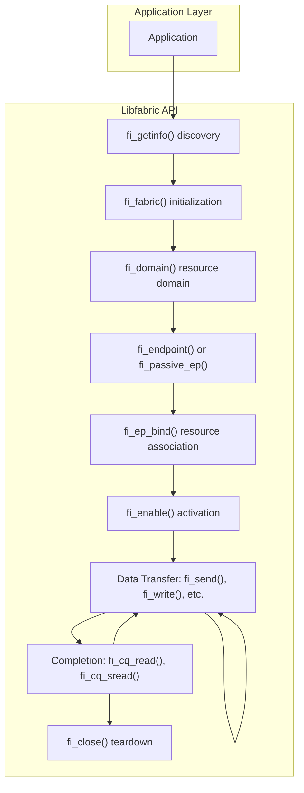

Sources: [man/fi_getinfo.3.md:19-20](), [man/fi_fabric.3.md:19-20](), [man/fi_domain.3.md:19-20](), [man/fi_endpoint.3.md:59-69](), [man/fi_endpoint.3.md:89-95](), [man/fi_cq.3.md:43-55]()

## Key Abstractions

Libfabric uses Fabric Identifiers (`fid`) to represent various resources. All resource structures begin with a common `struct fid`.

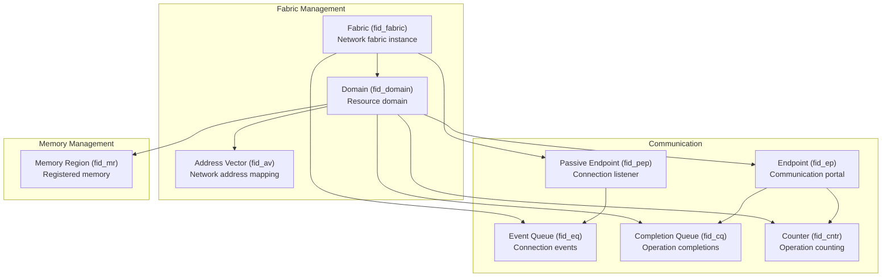

Sources: [include/rdma/fabric.h:100-114](), [man/fi_domain.3.md:65-71](), [man/fi_endpoint.3.md:172-181](), [man/fi_mr.3.md:133-142]()

### Key Abstractions Explained

| Abstraction | Code Entity | Description |
|-------------|-------------|--------------|
| **Fabric** | `struct fid_fabric` | Represents a fabric domain or a collection of hardware resources. |
| **Domain** | `struct fid_domain` | Represents hardware resources, typically associated with a network adapter. |
| **Endpoint** | `struct fid_ep` | Communication portal for sending and receiving data (Active). |
| **Passive Endpoint** | `struct fid_pep` | Listens for incoming connection requests. |
| **Address Vector** | `struct fid_av` | Maps transport/network addresses to fabric addresses (`fi_addr_t`). |
| **Memory Region** | `struct fid_mr` | Local memory registered for direct fabric access (RMA/Atomics). |
| **Completion Queue** | `struct fid_cq` | Reports completion of asynchronous data transfer operations. |
| **Event Queue** | `struct fid_eq` | Reports connection management and asynchronous control events. |
| **Counter** | `struct fid_cntr` | Tracks the number of completed operations for low-overhead progress. |

Sources: [include/rdma/fabric.h:100-114](), [include/rdma/fi_domain.h:114-117](), [include/rdma/fi_domain.h:131-135](), [include/rdma/fi_endpoint.h:149-164]()

## Core Data Structures

The `fi_info` structure is the central descriptor for fabric capabilities and endpoint attributes.

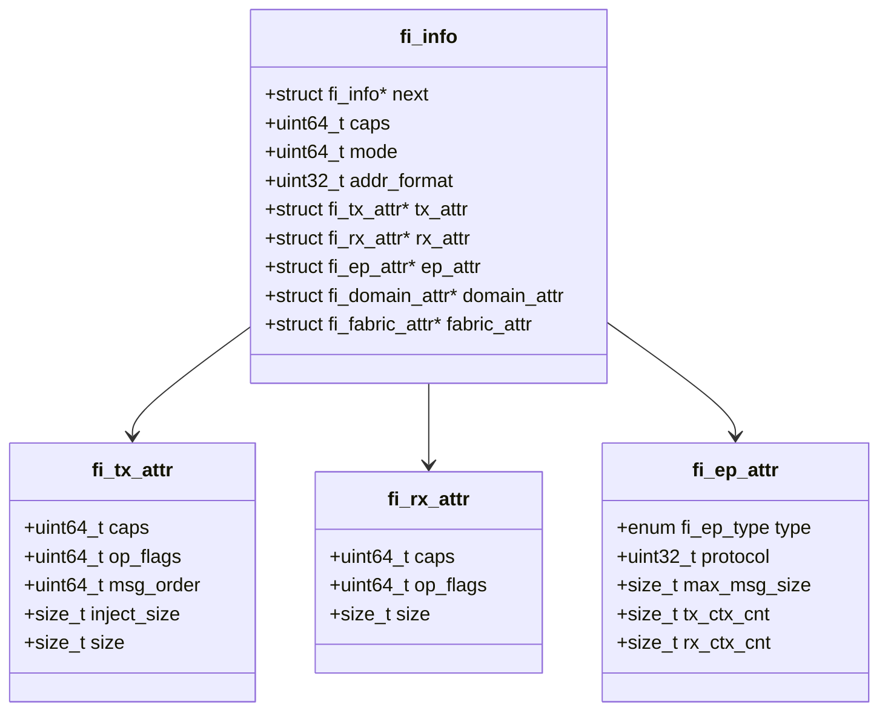

Sources: [man/fi_getinfo.3.md:130-146](), [man/fi_getinfo.3.md:313-324](), [man/fi_getinfo.3.md:378-386](), [man/fi_getinfo.3.md:428-442]()

## API Initialization Flow

Applications follow a specific sequence to establish a communication path.

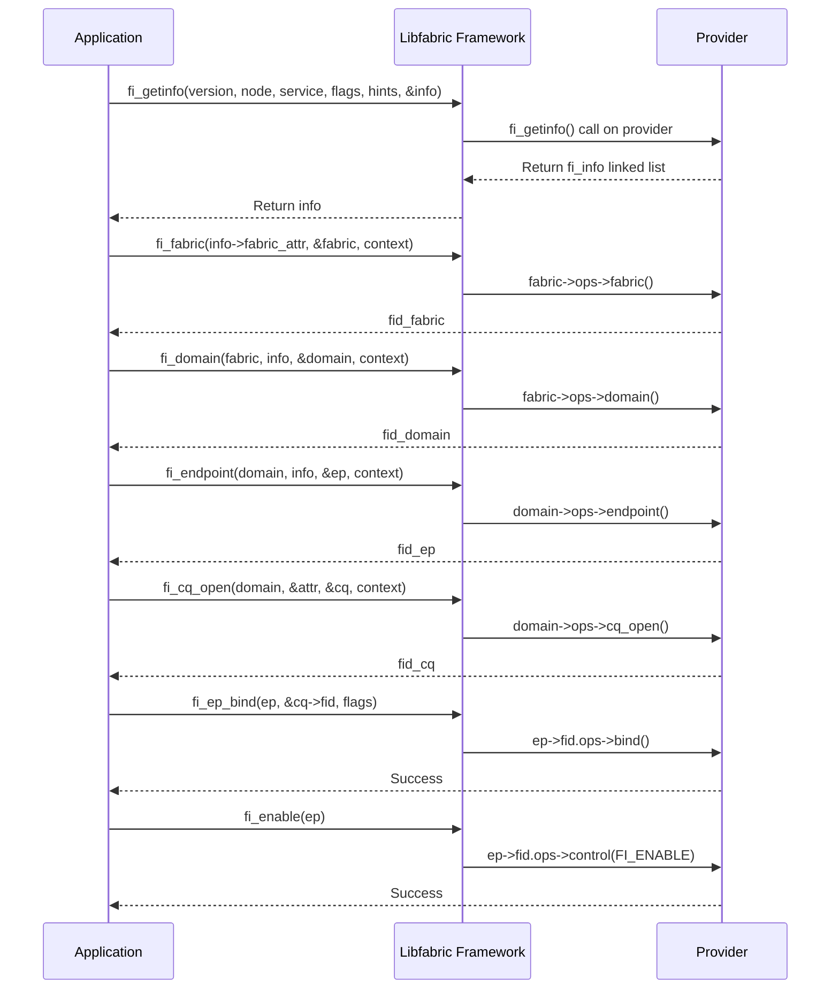

Sources: [man/fi_getinfo.3.md:54-68](), [man/fi_domain.3.md:19-20](), [man/fi_endpoint.3.md:59-60](), [man/fi_cq.3.md:36-37](), [man/fi_endpoint.3.md:89](), [man/fi_endpoint.3.md:95]()

## Data Transfer Models

Libfabric defines four primary data transfer interfaces, accessed via function pointers in the `fid_ep` structure.

### 1. Message Operations (`fi_msg`)
Standard send/receive semantics. Source/destination addresses are managed via Address Vectors for connectionless endpoints.
*   **Functions**: `fi_send()`, `fi_recv()`, `fi_sendmsg()`, `fi_recvmsg()`.
*   **Header**: `rdma/fi_endpoint.h`

### 2. Tagged Message Operations (`fi_tagged`)
Extends message operations with a `uint64_t` tag for matching.
*   **Functions**: `fi_tsend()`, `fi_trecv()`, `fi_tmatch()`.
*   **Header**: `rdma/fi_tagged.h`

### 3. Remote Memory Access (`fi_rma`)
One-sided operations where the initiator specifies the remote memory address and access key.
*   **Functions**: `fi_read()`, `fi_write()`, `fi_readmsg()`, `fi_writemsg()`.
*   **Header**: `rdma/fi_rma.h`

### 4. Atomic Operations (`fi_atomic`)
Operations that perform an atomic read-modify-write on remote memory.
*   **Functions**: `fi_atomic()`, `fi_fetch_atomic()`, `fi_compare_atomic()`.
*   **Header**: `rdma/fi_atomic.h`

Sources: [include/rdma/fi_endpoint.h:112-132](), [man/fi_msg.3.md:20-54](), [man/fi_tagged.3.md:20-52](), [man/fi_rma.3.md:20-54](), [man/fi_atomic.3.md:29-50]()

## Memory Registration (MR)

Memory must be registered with a domain before it can be used as a target for RMA or atomic operations.

```c
int fi_mr_reg(struct fid_domain *domain, const void *buf, size_t len,
    uint64_t access, uint64_t offset, uint64_t requested_key,
    uint64_t flags, struct fid_mr **mr, void *context);
```

The `access` flags (e.g., `FI_REMOTE_READ`, `FI_REMOTE_WRITE`) define what operations peers can perform on the registered region.

Sources: [man/fi_mr.3.md:51-53](), [include/rdma/fabric.h:133-140]()

## Completion and Event Handling

*   **Completion Queues (CQ)**: Used for high-frequency data transfer completions. Applications read `fi_cq_entry` (or variant) structures from the CQ.
*   **Event Queues (EQ)**: Used for low-frequency control events, such as `FI_CONNECTED` or `FI_SHUTDOWN`.
*   **Wait Objects**: CQs and EQs can be associated with wait objects (e.g., file descriptors) to allow blocking until an event occurs.

Sources: [man/fi_cq.3.md:116-121](), [man/fi_cq.3.md:153-161](), [man/fi_eq.3.md:103-112]()

## Progress and Threading Models

| Concept | Options | Description |
|---------|---------|-------------|
| **Progress** | `FI_PROGRESS_AUTO`, `FI_PROGRESS_MANUAL` | Defines if the provider handles background tasks automatically or if the app must call a progress function (like `fi_cq_read`). |
| **Threading** | `FI_THREAD_SAFE`, `FI_THREAD_DOMAIN`, `FI_THREAD_COMPLETION` | Defines the level of locking provided by the provider for concurrent access. |

Sources: [include/rdma/fabric.h:247-252](), [include/rdma/fabric.h:254-261](), [src/fi_tostr.c:135-146](), [src/fi_tostr.c:149-160]()

---

# Page: Examples and Bindings

# Examples and Bindings

<details>
<summary>Relevant source files</summary>

The following files were used as context for generating this wiki page:

- [.gitignore](.gitignore)
- [examples/Makefile](examples/Makefile)
- [examples/README.md](examples/README.md)
- [examples/msg.c](examples/msg.c)
- [examples/rdm.c](examples/rdm.c)
- [examples/rdm_rma.c](examples/rdm_rma.c)
- [examples/rdm_tagged.c](examples/rdm_tagged.c)
- [examples/tcp_socket.c](examples/tcp_socket.c)
- [fabtests/component/dmabuf-rdma/check_cuda_dmabuf.c](fabtests/component/dmabuf-rdma/check_cuda_dmabuf.c)
- [fabtests/unit/check_hmem.c](fabtests/unit/check_hmem.c)
- [include/rdma/fabric.h](include/rdma/fabric.h)
- [include/rdma/fi_domain.h](include/rdma/fi_domain.h)
- [man/fi_atomic.3.md](man/fi_atomic.3.md)
- [man/fi_domain.3.md](man/fi_domain.3.md)
- [man/fi_endpoint.3.md](man/fi_endpoint.3.md)
- [man/fi_getinfo.3.md](man/fi_getinfo.3.md)
- [man/fi_mr.3.md](man/fi_mr.3.md)
- [man/fi_msg.3.md](man/fi_msg.3.md)
- [man/fi_rma.3.md](man/fi_rma.3.md)
- [man/fi_tagged.3.md](man/fi_tagged.3.md)
- [src/fi_tostr.c](src/fi_tostr.c)

</details>


This section describes the standalone code examples provided in the libfabric repository and the official Rust language bindings. These resources serve as the primary entry point for developers to understand common libfabric usage patterns and to integrate the library into high-performance applications written in Rust.

## Code Examples

The `examples/` directory contains standalone C programs that demonstrate the core communication paradigms supported by libfabric. These examples are designed to be pedagogical, showing the minimum boilerplate required to initialize the library, discover providers, and perform data transfers.

### Common Usage Patterns

Libfabric examples typically follow a standard lifecycle:
1.  **Discovery**: Calling `fi_getinfo` to find a provider matching the application's requirements [man/fi_getinfo.3.md:19-20]().
2.  **Resource Allocation**: Opening a fabric, domain, and endpoint [man/fi_domain.3.md:19-20](), [man/fi_endpoint.3.md:59-60]().
3.  **Binding**: Associating the endpoint with Event Queues (EQ), Completion Queues (CQ), and Address Vectors (AV) [man/fi_endpoint.3.md:89-93]().
4.  **Activation**: Enabling the endpoint via `fi_enable` [man/fi_endpoint.3.md:95]().
5.  **Data Transfer**: Executing MSG, RDM, RMA, or Tagged operations.

### Example Implementation Mapping

| Example File | Pattern | Description | Key Functions Used |
| :--- | :--- | :--- | :--- |
| `examples/rdm.c` | **RDM** | Reliable Datagram Messaging. | `fi_send`, `fi_recv` |
| `examples/msg.c` | **MSG** | Connection-oriented byte streams. | `fi_connect`, `fi_accept` |
| `examples/rdm_tagged.c` | **Tagged** | Matching sends to receives via 64-bit tags. | `fi_tsend`, `fi_trecv` |
| `examples/rdm_rma.c` | **RMA** | One-sided Remote Memory Access. | `fi_read`, `fi_write` |

### Data Flow: Tagged Messaging (RDM)
The following diagram illustrates the data flow and entity relationships in a tagged messaging example, such as `rdm_tagged.c`.

**Tagged Communication Entity Map**
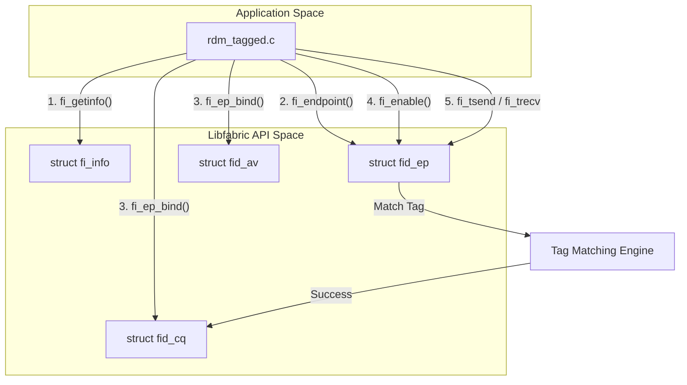
Sources: [man/fi_tagged.3.md:23-52](), [man/fi_endpoint.3.md:89-95](), [examples/rdm_tagged.c]()

---

## Rust Bindings

The `bindings/rust/` directory provides the official Foreign Function Interface (FFI) to libfabric for Rust-based HPC applications. These bindings allow Rust developers to leverage libfabric's high-performance capabilities while maintaining the safety and expressive power of the Rust language.

### Structure and Implementation
The bindings are typically generated or maintained to wrap the core headers found in `include/rdma/`.

*   **Core FFI**: Maps C structures like `fi_info` [include/rdma/fabric.h:130-146]() and `fid_domain` [include/rdma/fi_domain.h:131-135]() to Rust `struct` representations.
*   **Constants**: Exports bitflags for capabilities such as `FI_MSG` [include/rdma/fabric.h:125](), `FI_RMA` [include/rdma/fabric.h:126](), and `FI_TAGGED` [include/rdma/fabric.h:127]().
*   **Function Mapping**: Provides safe or unsafe wrappers around the primary API entry points like `fi_getinfo` and `fi_fabric`.

### Rust Integration Flow
This diagram shows how a Rust application interacts with the underlying libfabric C library through the provided bindings.

**Rust-to-C FFI Bridge**
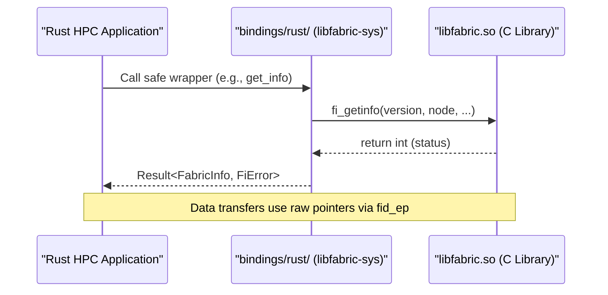
Sources: [bindings/rust/]() (referenced by path), [include/rdma/fabric.h:98-113]()

---

## Technical Detail: Data Transfer Interfaces

The examples demonstrate four primary data transfer interfaces defined in the libfabric specification.

### 1. Message (MSG)
Standard two-sided communication. The receiver must post a buffer before the sender initiates the transfer.
*   **Functions**: `fi_send`, `fi_recv` [man/fi_msg.3.md:24-34]().
*   **Usage**: Demonstrated in `examples/msg.c`.

### 2. Tagged Messaging (TAGGED)
An extension of the message interface where buffers are matched using a 64-bit tag and an ignore mask [man/fi_tagged.3.md:112-116]().
*   **Matching Logic**: `(send_tag & ~ignore) == (recv_tag & ~ignore)` [man/fi_tagged.3.md:119]().
*   **Usage**: Demonstrated in `examples/rdm_tagged.c`.

### 3. Remote Memory Access (RMA)
One-sided operations where a process can directly read from or write to a remote process's memory without its active involvement in the transfer [man/fi_rma.3.md:111-114]().
*   **Key Requirements**: Requires memory registration (`fi_mr_reg`) and a protection key (`key`) [man/fi_mr.3.md:51-53]().
*   **Functions**: `fi_read`, `fi_write` [man/fi_rma.3.md:24-36]().

### 4. Atomics
Operations that perform a read-modify-write sequence on a remote memory location atomically [man/fi_atomic.3.md:152-155]().
*   **Supported Types**: Includes `FI_INT64`, `FI_FLOAT`, `FI_DOUBLE`, etc [man/fi_atomic.3.md:169-203]().
*   **Operations**: `FI_SUM`, `FI_MIN`, `FI_MAX`, `FI_CSWAP` [include/rdma/fi_domain.h:247-271]().

Sources: [man/fi_msg.3.md](), [man/fi_tagged.3.md](), [man/fi_rma.3.md](), [man/fi_atomic.3.md](), [include/rdma/fi_domain.h]()

---

# Page: Core Framework

# Core Framework

<details>
<summary>Relevant source files</summary>

The following files were used as context for generating this wiki page:

- [Makefile.am](Makefile.am)
- [include/freebsd/osd.h](include/freebsd/osd.h)
- [include/linux/osd.h](include/linux/osd.h)
- [include/ofi.h](include/ofi.h)
- [include/ofi_atom.h](include/ofi_atom.h)
- [include/ofi_epoll.h](include/ofi_epoll.h)
- [include/ofi_list.h](include/ofi_list.h)
- [include/ofi_lock.h](include/ofi_lock.h)
- [include/ofi_mem.h](include/ofi_mem.h)
- [include/ofi_net.h](include/ofi_net.h)
- [include/ofi_osd.h](include/ofi_osd.h)
- [include/ofi_signal.h](include/ofi_signal.h)
- [include/osx/osd.h](include/osx/osd.h)
- [include/rdma/providers/fi_prov.h](include/rdma/providers/fi_prov.h)
- [include/unix/osd.h](include/unix/osd.h)
- [include/windows/ifaddrs.h](include/windows/ifaddrs.h)
- [include/windows/osd.h](include/windows/osd.h)
- [libfabric.vcxproj](libfabric.vcxproj)
- [libfabric.vcxproj.filters](libfabric.vcxproj.filters)
- [man/fi_info.1.md](man/fi_info.1.md)
- [prov/util/src/util_buf.c](prov/util/src/util_buf.c)
- [src/common.c](src/common.c)
- [src/fabric.c](src/fabric.c)
- [src/iouring.c](src/iouring.c)
- [src/linux/osd.c](src/linux/osd.c)
- [src/log.c](src/log.c)
- [src/mem.c](src/mem.c)
- [src/osx/osd.c](src/osx/osd.c)
- [src/unix/osd.c](src/unix/osd.c)
- [src/var.c](src/var.c)
- [src/windows/osd.c](src/windows/osd.c)
- [util/info.c](util/info.c)

</details>


The Core Framework of libfabric provides the foundation for the fabric interface abstraction. It manages provider registration, discovery, and selection while implementing the data structures and mechanisms needed to support the libfabric API. This page describes the architecture and key components of the framework that enables communication between applications and diverse fabric providers.

## Core Framework Architecture

The Core Framework connects applications to fabric providers through a consistent API while managing resource lifecycle, data transfer operations, and event completions.

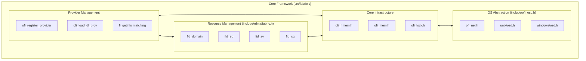

Sources: [src/fabric.c:1-69](), [include/rdma/fabric.h:571-588](), [Makefile.am:45-108]()

## Provider Management
The provider management subsystem is responsible for registering, discovering, and selecting appropriate fabric providers. Providers are maintained in a linked list defined by `struct ofi_prov`.

*   **Discovery**: The framework discovers providers through static registration or dynamic loading via `dlopen` in `ofi_load_dl_prov`.
*   **Filtering**: Applications can filter providers using environment variables like `FI_PROVIDER` or through `fi_getinfo` hints.
*   **Ordering**: Providers are ordered based on version and preference flags in `ofi_insert_prov`.

For details, see [Provider Management](#2.1).

Sources: [src/fabric.c:62-83](), [src/fabric.c:153-183](), [src/fabric.c:922-1010]()

## Utility Provider Framework
To simplify provider development, libfabric includes a utility framework (`prov/util/`). This framework provides common implementations for complex objects like completion queues (`util_cq`), address vectors (`util_av`), and endpoints (`util_ep`). It also includes the `ofi_bufpool` for high-performance memory management.

For details, see [Utility Provider Framework](#2.2).

Sources: [Makefile.am:66-86](), [prov/util/src/util_buf.c:63-133]()

## OS Abstraction Layer (OSD)
Libfabric uses an OS Abstraction Layer to maintain portability across Linux, Windows, macOS, and FreeBSD. 
*   **Network**: `include/ofi_net.h` defines cross-platform socket operations like `ofi_send_socket`.
*   **Platform Specifics**: Platform-specific headers (e.g., `include/unix/osd.h`, `include/windows/osd.h`) abstract threading (`OFI_THREAD_LOCAL`), memory mapping (`ofi_mmap_anon_pages`), and error handling (`ofi_sockerr`).

For details, see [OS Abstraction Layer](#2.3).

Sources: [include/ofi_net.h:162-183](), [include/unix/osd.h:34-111](), [include/windows/osd.h:17-44]()

## Memory Registration and HMEM
The framework manages memory registration (MR) through a caching subsystem and monitors memory events (e.g., via `uffd` or `kdreg2`). The Heterogeneous Memory (HMEM) framework enables libfabric to support specialized memory types, such as CUDA, ROCm, and Ze, allowing providers to transparently handle GPU buffers.

For details, see [Memory Registration and HMEM](#2.4).

Sources: [src/hmem.c:47-56](), [include/ofi_mr.h:53-79](), [Makefile.am:84-96]()

## Collective Operations
Libfabric provides an interface for hardware-accelerated and software-emulated collective operations (e.g., `barrier`, `allreduce`). The framework handles AV sets and collective attributes to coordinate operations across multiple endpoints.

For details, see [Collective Operations](#2.5).

Sources: [prov/coll/src/coll_init.c:107-108](), [include/rdma/fi_collective.h:246-246](), [Makefile.am:98-108]()

## Code Entity Map

The following diagram maps high-level framework concepts to specific code entities within the libfabric source tree.

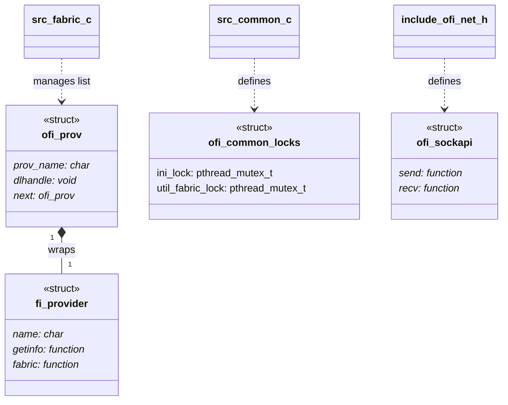

Sources: [src/fabric.c:62-69](), [src/common.c:77-86](), [include/ofi_net.h:162-183]()

---

# Page: Provider Management

# Provider Management

<details>
<summary>Relevant source files</summary>

The following files were used as context for generating this wiki page:

- [AUTHORS](AUTHORS)
- [COPYING](COPYING)
- [Makefile.am](Makefile.am)
- [NEWS.md](NEWS.md)
- [README](README)
- [configure.ac](configure.ac)
- [docs/windows.txt](docs/windows.txt)
- [fabtests/AUTHORS](fabtests/AUTHORS)
- [fabtests/COPYING](fabtests/COPYING)
- [fabtests/README](fabtests/README)
- [fabtests/configure.ac](fabtests/configure.ac)
- [include/ofi.h](include/ofi.h)
- [include/ofi_abi.h](include/ofi_abi.h)
- [include/ofi_mem.h](include/ofi_mem.h)
- [include/ofi_osd.h](include/ofi_osd.h)
- [include/rdma/fi_ext.h](include/rdma/fi_ext.h)
- [include/rdma/providers/fi_peer.h](include/rdma/providers/fi_peer.h)
- [include/rdma/providers/fi_prov.h](include/rdma/providers/fi_prov.h)
- [include/windows/config.h](include/windows/config.h)
- [libfabric.map.in](libfabric.map.in)
- [libfabric.vcxproj](libfabric.vcxproj)
- [libfabric.vcxproj.filters](libfabric.vcxproj.filters)
- [man/fi_info.1.md](man/fi_info.1.md)
- [man/fi_peer.3.md](man/fi_peer.3.md)
- [man/fi_provider.3.md](man/fi_provider.3.md)
- [prov/util/src/util_buf.c](prov/util/src/util_buf.c)
- [prov/util/src/util_srx.c](prov/util/src/util_srx.c)
- [src/abi_1_0.c](src/abi_1_0.c)
- [src/fabric.c](src/fabric.c)
- [src/log.c](src/log.c)
- [src/var.c](src/var.c)
- [util/info.c](util/info.c)

</details>


This page describes the provider management system in libfabric, which handles the registration, discovery, and selection of providers. A provider in libfabric is an implementation that gives access to an underlying fabric (network transport) service. Provider management is central to libfabric's ability to abstract different network technologies behind a common API.

## Provider Overview

Providers in libfabric are implementations of the libfabric API, each targeting a specific network technology or transport. The provider management system enables applications to select and use the most appropriate provider for their needs based on capability, performance, and availability.

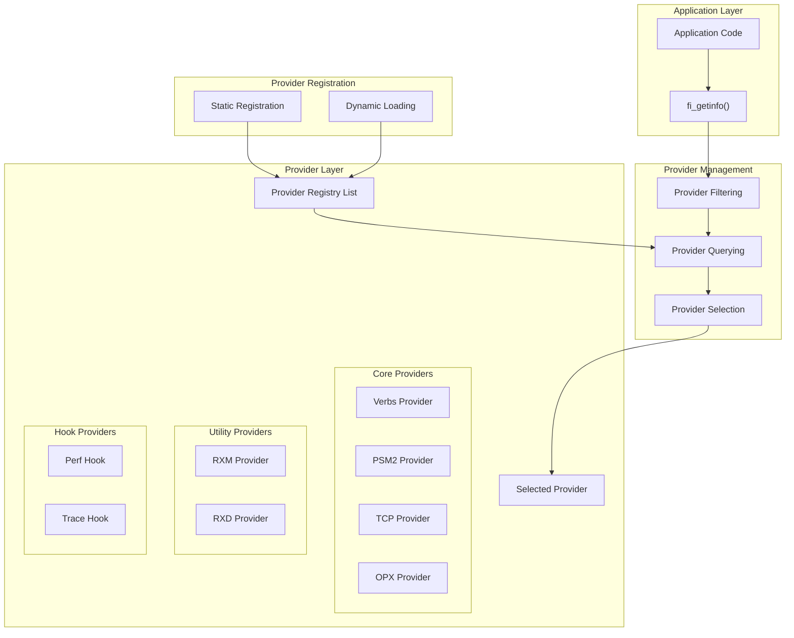

Sources: [src/fabric.c:62-81](), [include/rdma/providers/fi_prov.h:50-70]()

## Provider Types

Libfabric providers are categorized into different types based on their role in the provider hierarchy. These types are defined in the internal provider context:

| Provider Type | Description | Internal Constant |
|---------------|-------------|-------------------|
| Core | Direct implementations for hardware or transport | `OFI_PROV_CORE` |
| Utility | Add functionality (layering) on top of core providers | `OFI_PROV_UTIL` |
| Hook | Intercept calls for instrumentation/debugging | `OFI_PROV_HOOK` |
| LNX | Linux-specific multi-rail or specialized providers | `OFI_PROV_LNX` |

The provider management system uses these types to determine how providers interact and how they should be ordered in the provider chain.

Sources: [src/fabric.c:250-268](), [include/rdma/providers/fi_prov.h:54-61]()

## Provider Registration

Providers are registered with the libfabric framework through two primary mechanisms during the execution of `fi_ini`.

### Static Registration

Built-in providers are statically registered in `fi_ini()` [src/fabric.c:922-1002]() with explicit calls to initialization functions (e.g., `psm3_ini`, `verbs_ini`). These calls eventually invoke `ofi_register_provider` to add the provider to the global linked list.

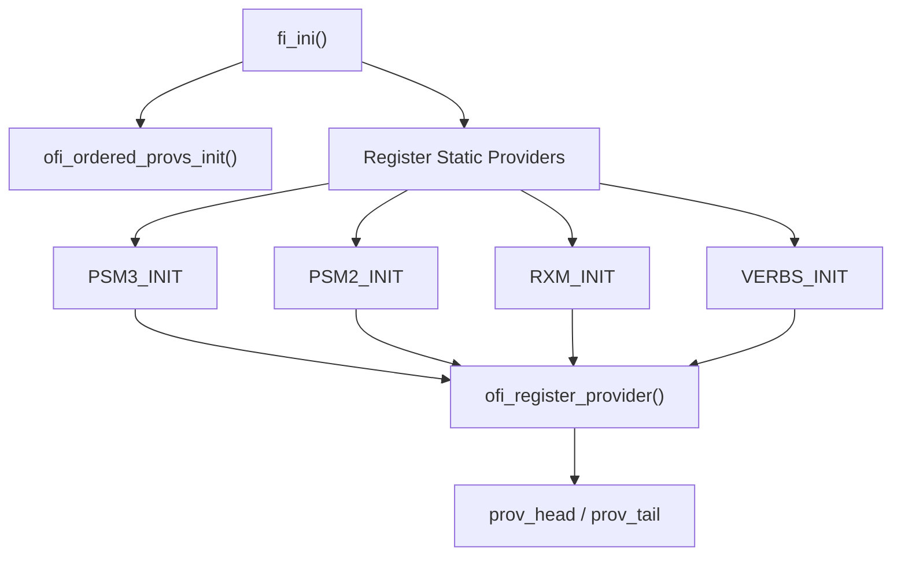

### Dynamic Loading

Dynamically loaded providers (DSOs) are discovered via `dlopen` in `ofi_load_dl_prov` [src/fabric.c:512-591](). Libfabric searches `FI_PROVIDER_PATH` or the default `PROVDLDIR` [Makefile.am:15-15]().

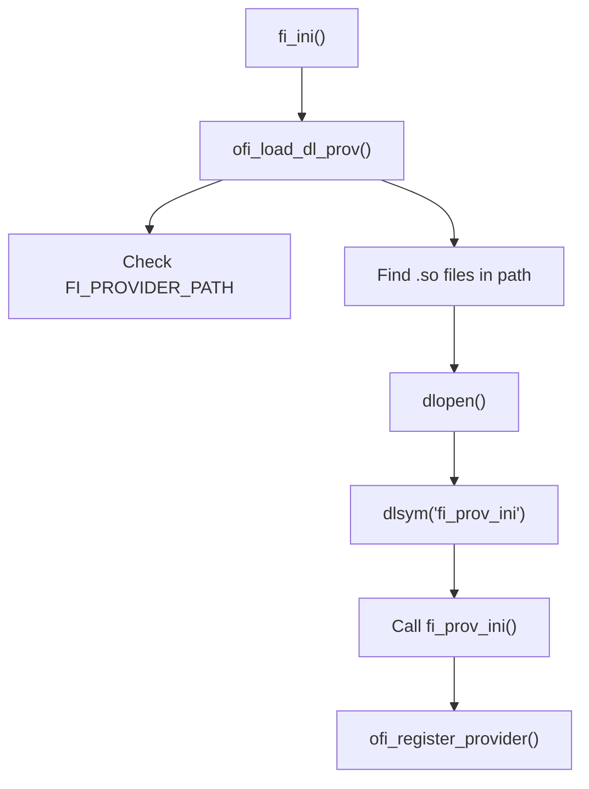

Sources: [src/fabric.c:512-591](), [src/fabric.c:977-1002](), [Makefile.am:15-15]()

## Provider Ordering

Providers are ordered based on either their version or registration order. This affects which provider is returned first by `fi_getinfo`.

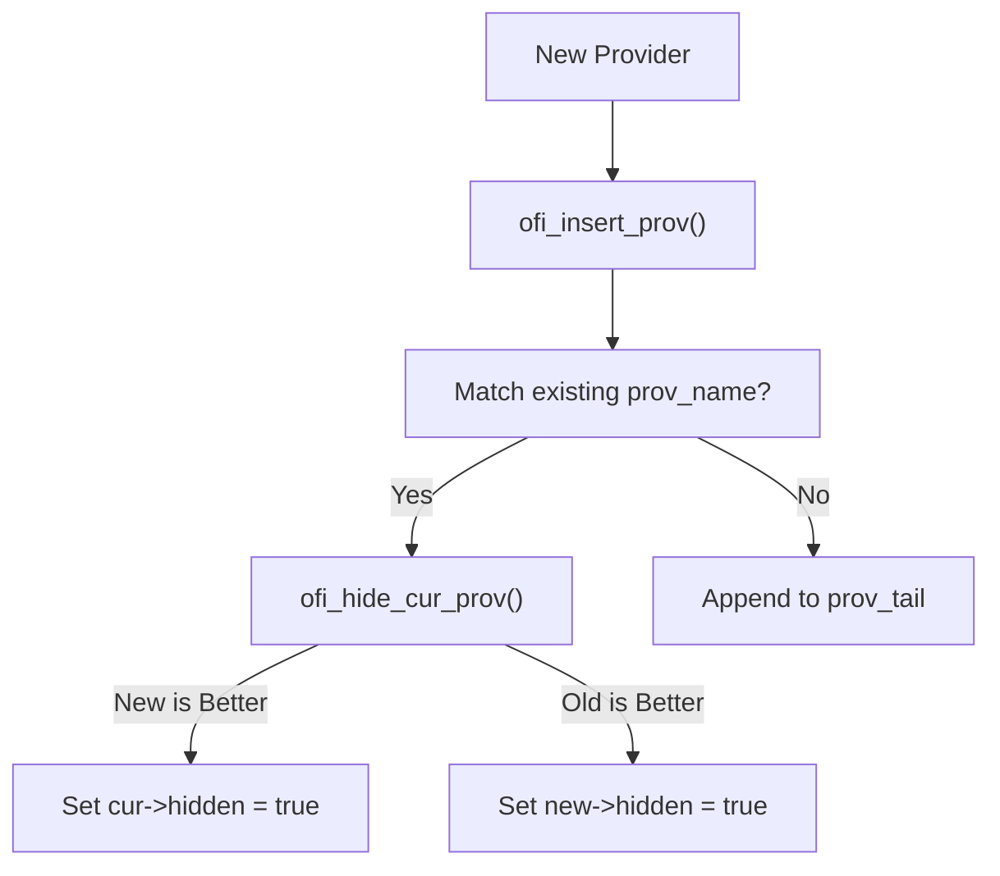

The ordering logic in `ofi_hide_cur_prov` [src/fabric.c:140-151]() considers:
- **Preferred status**: Providers loaded with a `+` prefix in `FI_PROVIDER_PATH` [src/fabric.c:481-483]().
- **Version**: If `prov_order` is `OFI_PROV_ORDER_VERSION`, higher versions are preferred [src/fabric.c:149-150]().

Sources: [src/fabric.c:140-183](), [src/fabric.c:464-497]()

## Discovery Engine: fi_getinfo

The matching engine in `fi_getinfo` [src/fabric.c:356-412]() iterates through the registered providers and invokes their specific `getinfo` implementations.

### Matching Logic
1. **Initial Filter**: Checks `FI_PROVIDER` environment variable to see if the provider is explicitly included or excluded [src/fabric.c:270-291]().
2. **Provider Query**: Calls `prov->provider->getinfo(...)`.
3. **Post Filter**: If the application provided a specific `prov_name`, `fabric_attr->name`, or `domain_attr->name` in hints, libfabric filters the returned results to ensure they match [src/fabric.c:293-333]().

```mermaid
flowchart TD
    start["fi_getinfo()"] --> filter_prov["ofi_apply_prov_init_filter()"]
    filter_prov -->|"Allowed"| call_prov_getinfo["prov->provider->getinfo()"]
    call_prov_getinfo --> post_filter["ofi_apply_prov_post_filter()"]
    post_filter -->|"Match"| add_list["Append to result list"]
    post_filter -->|"No Match"| next_prov["Try next provider"]
```

Sources: [src/fabric.c:356-412](), [src/fabric.c:270-333]()

## Provider Hooks

Hooks allow intercepting API calls. They are enabled via the `FI_HOOK` environment variable. When `fi_fabric` is called, libfabric checks for hooks and layers them over the core provider using `ofi_hook_install` [src/fabric.c:865-920]().

```mermaid
graph LR
    App --> HookProv["Hook Provider (e.g. perf)"]
    HookProv --> CoreProv["Core Provider (e.g. verbs)"]
    CoreProv --> Hardware["Network Hardware"]
```

Sources: [src/fabric.c:865-920](), [src/fabric.c:427-457]()

## Key Data Structures

### Provider Entry (`struct ofi_prov`)
This internal structure tracks each registered provider within the core framework.

```mermaid
classDiagram
    class ofi_prov {
        +struct ofi_prov *next
        +char *prov_name
        +struct fi_provider *provider
        +void *dlhandle
        +bool hidden
        +bool preferred
    }
    note for ofi_prov "Defined in src/fabric.c:62"
```

### Public Provider Interface (`struct fi_provider`)
The structure that every provider must implement and register.

```mermaid
classDiagram
    class fi_provider {
        +uint32_t version
        +const char *name
        +int (*getinfo)(...)
        +int (*fabric)(...)
        +void (*cleanup)(...)
    }
    note for fi_provider "Defined in include/rdma/providers/fi_prov.h"
```

Sources: [src/fabric.c:62-69](), [include/rdma/providers/fi_prov.h:72-83]()

## Configuration and Filtering

The management system respects several environment variables to control provider behavior:

| Variable | Description | Implementation |
|----------|-------------|----------------|
| `FI_PROVIDER` | Comma-separated list of providers to include or exclude (using `^`) | `prov_filter` [src/fabric.c:87-87]() |
| `FI_PROVIDER_PATH` | Search path for dynamic providers. `@` prefix sets registration order. | `ofi_load_dl_prov` [src/fabric.c:512-591]() |
| `FI_HOOK` | Semicolon-separated list of hook providers to install. | `ofi_hook_init` [src/fabric.c:427-457]() |

Sources: [src/fabric.c:270-356](), [src/fabric.c:512-591](), [src/fabric.c:427-457]()

---

# Page: Utility Provider Framework

# Utility Provider Framework

<details>
<summary>Relevant source files</summary>

The following files were used as context for generating this wiki page:

- [fabtests/functional/rdm_multi_client.c](fabtests/functional/rdm_multi_client.c)
- [fabtests/multinode/src/core_coll.c](fabtests/multinode/src/core_coll.c)
- [fabtests/prov/efa/src/efa_implicit_av_test.c](fabtests/prov/efa/src/efa_implicit_av_test.c)
- [include/ofi_bitmask.h](include/ofi_bitmask.h)
- [include/ofi_coll.h](include/ofi_coll.h)
- [include/ofi_enosys.h](include/ofi_enosys.h)
- [include/ofi_util.h](include/ofi_util.h)
- [include/rdma/fi_collective.h](include/rdma/fi_collective.h)
- [include/windows/poll.h](include/windows/poll.h)
- [man/fi_av_set.3.md](man/fi_av_set.3.md)
- [man/fi_collective.3.md](man/fi_collective.3.md)
- [man/man3/fi_allgather.3](man/man3/fi_allgather.3)
- [prov/rxd/src/rxd_cntr.c](prov/rxd/src/rxd_cntr.c)
- [prov/rxm/Makefile.include](prov/rxm/Makefile.include)
- [prov/rxm/src/rxm.h](prov/rxm/src/rxm.h)
- [prov/rxm/src/rxm_atomic.c](prov/rxm/src/rxm_atomic.c)
- [prov/rxm/src/rxm_attr.c](prov/rxm/src/rxm_attr.c)
- [prov/rxm/src/rxm_conn.c](prov/rxm/src/rxm_conn.c)
- [prov/rxm/src/rxm_cq.c](prov/rxm/src/rxm_cq.c)
- [prov/rxm/src/rxm_domain.c](prov/rxm/src/rxm_domain.c)
- [prov/rxm/src/rxm_ep.c](prov/rxm/src/rxm_ep.c)
- [prov/rxm/src/rxm_fabric.c](prov/rxm/src/rxm_fabric.c)
- [prov/rxm/src/rxm_init.c](prov/rxm/src/rxm_init.c)
- [prov/rxm/src/rxm_msg.c](prov/rxm/src/rxm_msg.c)
- [prov/rxm/src/rxm_rma.c](prov/rxm/src/rxm_rma.c)
- [prov/rxm/src/rxm_tagged.c](prov/rxm/src/rxm_tagged.c)
- [prov/udp/Makefile.include](prov/udp/Makefile.include)
- [prov/udp/src/udpx.h](prov/udp/src/udpx.h)
- [prov/udp/src/udpx_attr.c](prov/udp/src/udpx_attr.c)
- [prov/udp/src/udpx_cq.c](prov/udp/src/udpx_cq.c)
- [prov/udp/src/udpx_domain.c](prov/udp/src/udpx_domain.c)
- [prov/udp/src/udpx_ep.c](prov/udp/src/udpx_ep.c)
- [prov/udp/src/udpx_fabric.c](prov/udp/src/udpx_fabric.c)
- [prov/udp/src/udpx_init.c](prov/udp/src/udpx_init.c)
- [prov/util/src/rxm_av.c](prov/util/src/rxm_av.c)
- [prov/util/src/util_attr.c](prov/util/src/util_attr.c)
- [prov/util/src/util_av.c](prov/util/src/util_av.c)
- [prov/util/src/util_cntr.c](prov/util/src/util_cntr.c)
- [prov/util/src/util_cq.c](prov/util/src/util_cq.c)
- [prov/util/src/util_domain.c](prov/util/src/util_domain.c)
- [prov/util/src/util_ep.c](prov/util/src/util_ep.c)
- [prov/util/src/util_eq.c](prov/util/src/util_eq.c)
- [prov/util/src/util_fabric.c](prov/util/src/util_fabric.c)
- [prov/util/src/util_main.c](prov/util/src/util_main.c)
- [prov/util/src/util_poll.c](prov/util/src/util_poll.c)
- [prov/util/src/util_wait.c](prov/util/src/util_wait.c)
- [src/enosys.c](src/enosys.c)

</details>


The Utility Provider Framework (found in `prov/util/`) provides a set of common infrastructure components that simplify the development of libfabric providers. It offers reusable implementations of core libfabric abstractions like fabrics, domains, endpoints, address vectors, completion queues, and shared receive contexts. By leveraging this framework, providers can focus on their unique transport logic while maintaining consistent behavior and reducing code duplication.

## Architecture Overview

The Utility Provider Framework sits between the libfabric core API and the specific provider implementations (like RXM, RXD, or TCP).

```mermaid
graph TD
    subgraph "Application Layer"
        app["Application Code"]
    end
    
    subgraph "libfabric API Layer"
        api["Libfabric API (fi_getinfo, fi_endpoint, etc.)"]
    end
    
    subgraph "Utility Provider Framework (prov/util/)"
        util_fabric["util_fabric"]
        util_domain["util_domain"]
        util_ep["util_ep"]
        util_av["util_av"]
        util_cq["util_cq"]
        util_srx["util_srx (Shared Receive Context)"]
        ofi_bufpool["ofi_bufpool (util_buf)"]
    end
    
    subgraph "Provider Implementations"
        rxm["RXM Provider (RDM over MSG)"]
        tcp["TCP Provider"]
        rxd["RXD Provider"]
    end
    
    app --> api
    api --> util_fabric
    util_fabric --> util_domain
    util_domain --> util_ep
    util_ep --> util_av
    util_ep --> util_cq
    util_ep --> util_srx
    
    rxm --> util_ep
    tcp --> util_srx
    rxd --> util_ep
```
Sources: [include/ofi_util.h:160-166](), [include/ofi_util.h:177-186](), [include/ofi_util.h:198-219](), [include/ofi_util.h:279-309]()

## Core Framework Components

### Utility Fabric and Domain
The `util_fabric` and `util_domain` structures provide base management for fabric and domain resources, including reference counting and locking.

*   **util_fabric**: Manages a list of domains and provider-specific attributes. [include/ofi_util.h:177-186]()
*   **util_domain**: Handles memory registration (MR) mapping via `ofi_mr_map` and coordinates with the Shared Receive Context (SRX). [include/ofi_util.h:198-219]()

### Utility Endpoint (util_ep)
The `util_ep` is the central structure for endpoint management. It tracks bound CQs, AVs, and counters, and provides a hook for a progress engine.

| Field | Description |
| :--- | :--- |
| `ep_fid` | The base libfabric endpoint FID. |
| `rx_cq` / `tx_cq` | Pointers to utility CQs for completion tracking. |
| `cntrs` | Array of utility counters (`util_cntr`) for various operations (TX, RX, READ, WRITE). |
| `progress` | A function pointer (`ofi_ep_progress_func`) called to drive provider progress. |

Sources: [include/ofi_util.h:279-309](), [prov/util/src/util_ep.c:40-73]()

### Utility Completion Queue (util_cq)
`util_cq` implements a completion queue that supports software-based overflow handling via an `aux_queue`.

*   **Implementation**: It uses a circular queue (`ofi_comp_cirq`) for standard completions. [include/ofi_util.h:525]()
*   **Overflow**: If the hardware or primary queue is full, entries are moved to `aux_queue`. [prov/util/src/util_cq.c:45-55]()
*   **Error Handling**: Provides `ofi_cq_write_error` for reporting failed operations to the application. [prov/util/src/util_cq.c:113-125]()

### Utility Address Vector (util_av)
The `util_av` handles the mapping between `fi_addr_t` and provider-specific address data.

*   **util_av_entry**: Internal structure stored in a hash table or bufpool to resolve addresses. [include/ofi_util.h:879-902]()
*   **Key Functions**: `ofi_av_insert_addr` [prov/util/src/util_av.c:301-331]() and `ofi_av_lookup_fi_addr` [prov/util/src/util_av.c:248-257]().

### Shared Receive Context (util_srx)
The `util_srx` allows multiple endpoints to share a single pool of receive buffers. This is critical for scalability in providers like RXM and TCP.

*   **Mechanism**: It manages a `fi_peer_rx_entry` list. When a message arrives, the SRX determines which endpoint's context should receive the data. [prov/rxm/src/rxm_ep.c:178-181](), [prov/rxm/src/rxm_cq.c:189-208]()

## Memory Management: ofi_bufpool
The utility framework provides `ofi_bufpool` (often referred to as `util_buf`) for high-performance buffer management. It supports regions, alignment, and custom initialization/registration functions.

```mermaid
sequenceDiagram
    participant Prov as Provider (e.g., RXM)
    participant Pool as ofi_bufpool
    participant HMEM as HMEM/MR Layer

    Prov->>Pool: ofi_bufpool_create_attr(attr)
    Pool->>Prov: call attr.alloc_fn (rxm_buf_reg)
    Prov->>HMEM: fi_mr_reg (Register Memory)
    Pool->>Prov: call attr.init_fn (rxm_init_rx_buf)
    Prov->>Pool: ofi_buf_alloc()
    Pool-->>Prov: Return Buffer Pointer
```
Sources: [prov/rxm/src/rxm_ep.c:45-77](), [prov/rxm/src/rxm_ep.c:117-174]()

## Mapping Code Entities to System Concepts

This diagram illustrates how specific C structures in `prov/util/` and `prov/rxm/` relate to libfabric concepts.

```mermaid
classDiagram
    class libfabric_Concept {
        <<Interface>>
        fi_endpoint
        fi_cq
        fi_av
    }

    class util_ep {
        struct fid_ep ep_fid
        struct util_cq* rx_cq
        ofi_ep_progress_func progress
    }

    class rxm_ep {
        struct util_ep util_ep
        struct ofi_bufpool* rx_pool
        struct rxm_conn* conns
    }

    class util_cq {
        struct fid_cq cq_fid
        struct util_comp_cirq* cirq
        struct slist aux_queue
    }

    class util_av {
        struct fid_av av_fid
        struct util_av_entry* hash
        struct ofi_bufpool* av_entry_pool
    }

    libfabric_Concept <|.. util_ep : implements
    libfabric_Concept <|.. util_cq : implements
    libfabric_Concept <|.. util_av : implements
    util_ep <|-- rxm_ep : extends
```
Sources: [include/ofi_util.h:279-309](), [prov/rxm/src/rxm.h:258-300](), [include/ofi_util.h:502-528](), [include/ofi_util.h:879-902]()

## Data Flow: Completion Handling
When a provider receives a completion from the underlying transport (e.g., a TCP socket or Verbs CQ), it uses the utility framework to notify the application.

1.  **Provider Progress**: The provider's progress engine (e.g., `rxm_conn_progress`) is triggered. [prov/rxm/src/rxm_conn.c:88-107]()
2.  **Completion Processing**: The provider identifies the `util_cq` associated with the operation.
3.  **CQ Write**: The provider calls `ofi_peer_cq_write` or `ofi_cq_write`. [prov/rxm/src/rxm_cq.c:120-128]()
4.  **Auxiliary Handling**: If the application's CQ is full, `util_cq` automatically places the entry into the `aux_queue`. [prov/util/src/util_cq.c:45-55]()
5.  **Application Poll**: When the application calls `fi_cq_read`, the utility framework first checks the `aux_queue` before the primary circular queue. [prov/util/src/util_cq.c:239-260]()

Sources: [prov/rxm/src/rxm_cq.c:104-132](), [prov/util/src/util_cq.c:42-82](), [include/ofi_util.h:502-528]()

---

# Page: OS Abstraction Layer

# OS Abstraction Layer

<details>
<summary>Relevant source files</summary>

The following files were used as context for generating this wiki page:

- [include/freebsd/osd.h](include/freebsd/osd.h)
- [include/linux/osd.h](include/linux/osd.h)
- [include/ofi_atom.h](include/ofi_atom.h)
- [include/ofi_epoll.h](include/ofi_epoll.h)
- [include/ofi_indexer.h](include/ofi_indexer.h)
- [include/ofi_list.h](include/ofi_list.h)
- [include/ofi_lock.h](include/ofi_lock.h)
- [include/ofi_net.h](include/ofi_net.h)
- [include/ofi_signal.h](include/ofi_signal.h)
- [include/osx/osd.h](include/osx/osd.h)
- [include/unix/osd.h](include/unix/osd.h)
- [include/windows/ifaddrs.h](include/windows/ifaddrs.h)
- [include/windows/osd.h](include/windows/osd.h)
- [src/common.c](src/common.c)
- [src/indexer.c](src/indexer.c)
- [src/iouring.c](src/iouring.c)
- [src/linux/osd.c](src/linux/osd.c)
- [src/mem.c](src/mem.c)
- [src/osx/osd.c](src/osx/osd.c)
- [src/unix/osd.c](src/unix/osd.c)
- [src/windows/osd.c](src/windows/osd.c)

</details>


The OS Abstraction Layer (OSD) in libfabric provides a unified cross-platform interface that allows the library to function consistently across different operating systems. It abstracts platform-specific functionality including file operations, socket communications, memory management, threading, network address handling, and synchronization primitives. This abstraction enables libfabric providers to use a common API regardless of the underlying operating system.

## Architecture

The OS Abstraction Layer sits at the foundation of the libfabric architecture, providing core capabilities that higher layers of the library depend on. It ensures that code can be written once and run consistently across Linux, Windows, macOS, and FreeBSD.

```mermaid
flowchart TD
    subgraph "Applications"
        app["Application Code"]
    end

    subgraph "Libfabric API"
        api["fabric.h API"]
    end

    subgraph "Provider Layer"
        providers["Fabric Providers"]
    end

    subgraph "OS Abstraction Layer"
        subgraph "Platform-Specific Implementations (osd.h)"
            linux["Linux Implementation"]
            windows["Windows Implementation"]
            osx["macOS Implementation"]
            freebsd["FreeBSD Implementation"]
        end

        subgraph "Common Abstractions"
            socket["ofi_net.h: Socket Operations"]
            memory["ofi.h: Memory Management"]
            threading["ofi_lock.h: Threading & Sync"]
            indexing["ofi_indexer.h: Indexer/Map"]
            list["ofi_list.h: Linked Lists"]
            events["ofi_epoll.h: Event Handling"]
        end
    end

    app --> api
    api --> providers
    providers --> socket & memory & threading & indexing & list & events
    socket & memory & threading & indexing & list & events --> linux & windows & osx & freebsd
```

Sources: [include/unix/osd.h:1-250](), [include/windows/osd.h:1-280](), [include/osx/osd.h:1-100](), [include/ofi_net.h:1-100](), [include/ofi_lock.h:1-50]()

### Platform Abstraction Headers

The OSD layer is implemented through a set of platform-specific header files that define common interfaces with platform-specific implementations. The system uses `ofi_osd.h` as a top-level wrapper that includes the correct variant based on build-time definitions.

| Platform | Primary Header | Implementation Files |
|----------|---------------|---------------------|
| Unix (Base) | `include/unix/osd.h` | `src/unix/osd.c` |
| Linux | `include/linux/osd.h` | `src/linux/osd.c` |
| Windows | `include/windows/osd.h` | `src/windows/osd.c` |
| macOS | `include/osx/osd.h` | `src/osx/osd.c` |
| FreeBSD | `include/freebsd/osd.h` | (extends Unix) |

Sources: [include/unix/osd.h:34-111](), [include/windows/osd.h:17-43](), [include/osx/osd.h:36-57](), [src/unix/osd.c:54-61](), [src/windows/osd.c:44-50]()

## Key Components

### Socket Operations (`ofi_net.h`)

The socket abstraction provides a unified interface for network communication, handling differences between Windows (Winsock) and POSIX systems. It includes `ofi_sockapi` which abstracts the backend implementation (e.g., standard sockets vs `io_uring`).

```mermaid
classDiagram
    class ofi_sockapi {
        +connect()
        +accept()
        +send()
        +sendv()
        +recv()
        +recvv()
        +tx_uring: ofi_sockapi_uring
        +rx_uring: ofi_sockapi_uring
    }

    class ofi_sockctx {
        +context: void*
        +uring_sqe_inuse: bool
    }

    ofi_sockapi ..> ofi_sockctx : uses
```

The socket operations include:
- **Standard Sockets**: Wrappers like `ofi_sockapi_send_socket` [include/ofi_net.h:224-243]() and `ofi_sockapi_recv_socket` [include/ofi_net.h:267-286]().
- **Utility Functions**: `ofi_recvall_socket` [include/ofi_net.h:113-119]() and `ofi_sendall_socket` [include/ofi_net.h:121-133]() ensure complete data transfer.
- **Error Handling**: `ofi_sockerr()` [include/unix/osd.h:185-188]() maps platform-specific errors to standard codes.

Sources: [include/ofi_net.h:113-286](), [include/unix/osd.h:142-188]()

### Memory Management and Utilities

The memory component provides primitives for allocation, shared memory, and huge pages.

- **Allocation**: `ofi_memalign` [include/unix/osd.h:116-119]() and `ofi_freealign` [include/unix/osd.h:131-134]().
- **Anonymous Pages**: `ofi_mmap_anon_pages` [src/unix/osd.c:126-134]() provides a platform-independent way to allocate large memory regions.
- **Shared Memory**: The `util_shm` struct and `ofi_shm_map` [src/unix/osd.c:144-210]() / [src/windows/osd.c:235-273]() functions handle inter-process communication segments.

Sources: [include/unix/osd.h:105-134](), [src/unix/osd.c:126-221](), [src/windows/osd.c:235-273]()

### Event Polling (`ofi_epoll.h`)

The event polling component provides a unified interface for I/O event notification, using the most efficient mechanism available.

- **Linux**: Uses `epoll` via `ofi_epoll_create` [include/ofi_epoll.h:218-222]().
- **macOS/FreeBSD**: Uses `kqueue` via `ofi_epoll_create` [include/ofi_epoll.h:69-73]().
- **Fallback**: Uses standard `poll()` [include/ofi_epoll.h:272-284]().

```mermaid
flowchart TD
    subgraph "OFI Epoll API"
        create["ofi_epoll_create()"]
        add["ofi_epoll_add()"]
        wait["ofi_epoll_wait()"]
    end

    subgraph "Backend"
        kqueue["kqueue (BSD/OSX)"]
        epoll["epoll (Linux)"]
        poll["poll (Fallback)"]
    end

    create --> kqueue & epoll & poll
    add --> kqueue & epoll & poll
    wait --> kqueue & epoll & poll
```

Sources: [include/ofi_epoll.h:49-196](), [include/ofi_epoll.h:206-298]()

### I/O Enhancements (`io_uring`)

Libfabric supports Linux `io_uring` for high-performance asynchronous socket I/O. This is integrated into the `ofi_sockapi` structure.

- **Initialization**: `ofi_uring_init` [src/iouring.c:184-215]().
- **Operations**: `ofi_sockapi_send_uring` and `ofi_sockapi_recv_uring` allow providers to queue I/O without immediate blocking.

Sources: [src/iouring.c:40-254](), [include/ofi_net.h:140-161]()

### Synchronization and Primitive Types

- **Locks**: `ofi_lock.h` defines `ofi_spin_t` and `ofi_mutex_t` [include/ofi_lock.h:77-208](). The `ofi_genlock` structure [src/common.c:103-142]() provides a generic wrapper that can switch between spinlocks, mutexes, or no-ops at runtime.
- **Lists**: `ofi_list.h` provides a circular doubly-linked list (`dlist_entry`) [include/ofi_list.h:57-60]() with extensive macros for traversal (`dlist_foreach`) [include/ofi_list.h:117-118]().
- **Indexer**: `ofi_indexer.h` manages associations between pointers and integer IDs [include/ofi_indexer.h:49-84](). It uses a chunked array approach to grow dynamically [src/indexer.c:55-84]().

Sources: [include/ofi_lock.h:77-208](), [src/common.c:103-142](), [include/ofi_list.h:55-138](), [include/ofi_indexer.h:49-115](), [src/indexer.c:55-157]()

## Platform-Specific Implementation Details

### Windows (`src/windows/osd.c`)
- Implements `socketpair` [src/windows/osd.c:58-117]() using a local loopback connection, as Windows lacks native support.
- Handles library initialization via `DllMain` [src/windows/osd.c:211-233]().
- Maps POSIX-style file reads to `CreateFileA` and `ReadFile` [src/windows/osd.c:153-196]().

### Unix/Linux (`src/unix/osd.c`)
- Implements `fi_fd_nonblock` [src/unix/osd.c:82-95]() using `fcntl`.
- Provides `ofi_set_thread_affinity` [src/unix/osd.c:266-310]() for pinning threads to specific CPUs.
- Uses `shm_open` and `mmap` for shared memory [src/unix/osd.c:144-221]().

### macOS (`include/osx/osd.h`)
- Implements spinlocks using `os_unfair_lock` [include/osx/osd.h:201-233]().
- Maps `pthread_yield` to `pthread_yield_np` [include/osx/osd.h:59]().

Sources: [src/windows/osd.c:58-233](), [src/unix/osd.c:82-310](), [include/osx/osd.h:59-233]()

---

# Page: Memory Registration and HMEM

# Memory Registration and HMEM

<details>
<summary>Relevant source files</summary>

The following files were used as context for generating this wiki page:

- [AUTHORS](AUTHORS)
- [COPYING](COPYING)
- [NEWS.md](NEWS.md)
- [README](README)
- [configure.ac](configure.ac)
- [docs/windows.txt](docs/windows.txt)
- [fabtests/AUTHORS](fabtests/AUTHORS)
- [fabtests/COPYING](fabtests/COPYING)
- [fabtests/README](fabtests/README)
- [fabtests/configure.ac](fabtests/configure.ac)
- [include/ofi_hmem.h](include/ofi_hmem.h)
- [include/ofi_mr.h](include/ofi_mr.h)
- [include/ofi_tree.h](include/ofi_tree.h)
- [include/windows/config.h](include/windows/config.h)
- [prov/sockets/src/sock_mr.c](prov/sockets/src/sock_mr.c)
- [prov/util/src/cuda_ipc_monitor.c](prov/util/src/cuda_ipc_monitor.c)
- [prov/util/src/cuda_mem_monitor.c](prov/util/src/cuda_mem_monitor.c)
- [prov/util/src/import_mem_monitor.c](prov/util/src/import_mem_monitor.c)
- [prov/util/src/rocr_ipc_monitor.c](prov/util/src/rocr_ipc_monitor.c)
- [prov/util/src/rocr_mem_monitor.c](prov/util/src/rocr_mem_monitor.c)
- [prov/util/src/uffd_mem_monitor.c](prov/util/src/uffd_mem_monitor.c)
- [prov/util/src/util_mem_hooks.c](prov/util/src/util_mem_hooks.c)
- [prov/util/src/util_mem_monitor.c](prov/util/src/util_mem_monitor.c)
- [prov/util/src/util_mr_cache.c](prov/util/src/util_mr_cache.c)
- [prov/util/src/util_mr_map.c](prov/util/src/util_mr_map.c)
- [prov/util/src/xpmem_monitor.c](prov/util/src/xpmem_monitor.c)
- [prov/util/src/ze_mem_monitor.c](prov/util/src/ze_mem_monitor.c)
- [prov/verbs/src/verbs_mr.c](prov/verbs/src/verbs_mr.c)
- [src/hmem.c](src/hmem.c)
- [src/hmem_cuda.c](src/hmem_cuda.c)
- [src/hmem_cuda_gdrcopy.c](src/hmem_cuda_gdrcopy.c)
- [src/hmem_neuron.c](src/hmem_neuron.c)
- [src/hmem_rocr.c](src/hmem_rocr.c)
- [src/hmem_synapseai.c](src/hmem_synapseai.c)
- [src/hmem_ze.c](src/hmem_ze.c)
- [src/tree.c](src/tree.c)

</details>


The Memory Registration (MR) and Heterogeneous Memory (HMEM) subsystems provide a unified framework for managing memory access across diverse hardware types, including standard system RAM and accelerator memory (GPUs/TPUs). This architecture allows providers to efficiently track memory validity, cache registrations, and perform cross-device data transfers.

## Memory Registration (MR) Cache

The MR cache is a utility component designed to reduce the overhead of pinning and registering memory with hardware. It stores active and inactive memory regions in a Red-Black tree for fast lookups.

### Architecture and Data Flow
When an application requests memory registration, the provider checks the `ofi_mr_cache` [include/ofi_mr.h:140](). If a matching entry exists and is still valid, the cached registration is returned. If not, a new registration is performed and added to the cache.

The cache interacts with **Memory Monitors** to ensure that if the underlying virtual-to-physical mapping changes (e.g., via `free()` or `munmap()`), the cached entry is invalidated.

### Key Components
- `ofi_mr_cache`: The primary structure managing cached registrations [prov/util/src/util_mr_cache.c:47]().
- `ofi_mr_entry`: Represents a single cached registration, including its `iovec` and HMEM metadata [include/ofi_mr.h:153-160]().
- `ofi_rbmap`: A Red-Black tree used for $O(\log n)$ lookup of memory ranges [prov/util/src/util_mr_cache.c:158-168]().

**MR Cache Lookup Logic**
```mermaid
graph TD
    A["fi_mr_reg"] --> B{"Cache Enabled?"}
    B -- "No" --> C["Direct Provider Registration"]
    B -- "Yes" --> D["ofi_mr_rbt_find()"]
    D --> E{"Entry Found?"}
    E -- "Yes" --> F["Check ofi_mem_monitor->valid()"]
    F -- "Valid" --> G["Return Cached MR"]
    F -- "Invalid" --> H["util_mr_uncache_entry()"]
    E -- "No" --> I["Create New Registration"]
    I --> J["ofi_monitor_subscribe()"]
    J --> K["Insert into ofi_rbmap"]
    K --> G
    H --> I
```
*Sources: [prov/util/src/util_mr_cache.c:158-184](), [include/ofi_mr.h:170-195]()*

---

## Memory Monitors

Memory monitors track the state of virtual memory regions. They notify the MR cache when memory is invalidated so that stale entries can be purged.

### Monitor Implementations
Libfabric supports multiple monitor backends depending on OS capabilities:
1.  **Userfaultfd (uffd)**: Uses the Linux `userfaultfd` mechanism to intercept page events [prov/util/src/util_mem_monitor.c:200]().
2.  **Memhooks**: Intercepts standard library calls like `free`, `malloc`, and `munmap` [prov/util/src/util_mem_monitor.c:207]().
3.  **kdreg2**: A Linux kernel module-based monitor for high-performance notification [include/ofi_mr.h:55-61]().
4.  **Device-Specific Monitors**: Specialized monitors for CUDA, ROCm, and Level Zero memory [prov/util/src/util_mem_monitor.c:166-178]().

### Monitor Lifecycle
Monitors transition through states defined in `fi_mm_state` [include/ofi_mr.h:162-168](). The `ofi_monitors_update` function coordinates starting and stopping monitors to avoid deadlocks during memory-intensive operations [prov/util/src/util_mem_monitor.c:99-144]().

**Monitor to Cache Association**
```mermaid
classDiagram
    class ofi_mem_monitor {
        +name: char*
        +iface: fi_hmem_iface
        +state: fi_mm_state
        +start()
        +stop()
        +subscribe()
        +unsubscribe()
    }
    class ofi_mr_cache {
        +tree: ofi_rbmap
        +monitors: ofi_mem_monitor**
        +notify_cnt: uint64_t
    }
    ofi_mr_cache "1" o-- "N" ofi_mem_monitor : uses
    ofi_mem_monitor <|-- uffd_monitor
    ofi_mem_monitor <|-- memhooks_monitor
    ofi_mem_monitor <|-- cuda_monitor
```
*Sources: [include/ofi_mr.h:170-195](), [prov/util/src/util_mem_monitor.c:159-187]()*

---

## Heterogeneous Memory (HMEM) Framework

The HMEM framework abstracts the complexities of different accelerator memory types. It provides a consistent interface (`ofi_hmem_ops`) for providers to perform copies and query address properties regardless of the underlying hardware.

### Supported Interfaces
Defined in `fi_hmem_iface` [include/ofi_hmem.h:97-135]():
- `FI_HMEM_SYSTEM`: Standard RAM.
- `FI_HMEM_CUDA`: NVIDIA GPUs.
- `FI_HMEM_ROCR`: AMD GPUs (ROCm).
- `FI_HMEM_ZE`: Intel GPUs (OneAPI Level Zero).
- `FI_HMEM_NEURON`: AWS Trainium/Inferentia.
- `FI_HMEM_SYNAPSEAI`: Habana Gaudi.

### Core Operations
The `hmem_ops` array contains function pointers for each interface [src/hmem.c:119-215](). Key operations include:
- `copy_to_hmem` / `copy_from_hmem`: Synchronous data transfer [include/ofi_hmem.h:111-114]().
- `is_addr_valid`: Determines if an address belongs to a specific device [include/ofi_hmem.h:115]().
- `get_dmabuf_fd`: Exports memory as a Linux DMA-BUF file descriptor for peer-to-peer transfers [include/ofi_hmem.h:132]().

### HMEM Implementation Example: CUDA
The CUDA implementation (`src/hmem_cuda.c`) uses `dlopen` (if enabled) to load `libcuda.so` and `libcudart.so` [src/hmem_cuda.c:48-51](). It maps libfabric calls to CUDA-specific functions:
- `ofi_cudaMemcpy` wraps `cudaMemcpy` and ensures synchronization if the context is not registered [src/hmem_cuda.c:178-204]().
- `cuda_get_dmabuf_fd` utilizes `cuMemGetHandleForAddressRange` to support GPUDirect RDMA via DMA-BUF [src/hmem_cuda.c:57-62]().

**HMEM Data Flow (Copy Operation)**
```mermaid
sequenceDiagram
    participant App
    participant Provider
    participant HMEM_Core as "src/hmem.c"
    participant CUDA_Ops as "src/hmem_cuda.c"
    
    App->>Provider: fi_send(buf)
    Provider->>HMEM_Core: ofi_hmem_get_iface(buf)
    HMEM_Core-->>Provider: return FI_HMEM_CUDA
    Provider->>HMEM_Core: hmem_ops[FI_HMEM_CUDA].copy_from_hmem(...)
    HMEM_Core->>CUDA_Ops: cuda_copy_from_dev(...)
    CUDA_Ops->>CUDA_Ops: ofi_cudaMemcpy(..., cudaMemcpyDeviceToHost)
    CUDA_Ops-->>App: Copy Complete
```
*Sources: [src/hmem.c:146-172](), [src/hmem_cuda.c:178-204](), [include/ofi_hmem.h:97-135]()*

---

## Peer-to-Peer (P2P) and DMA-BUF
Libfabric leverages Linux DMA-BUF to enable direct hardware-to-hardware transfers, bypassing host memory.
- Providers like **Verbs** check for DMA-BUF support during registration [prov/verbs/src/verbs_mr.c:60-118]().
- If `FI_MR_DMABUF` is requested, the provider uses `ofi_hmem_get_dmabuf_fd` to retrieve a file descriptor which is then passed to the NIC driver via `ibv_reg_dmabuf_mr` [prov/verbs/src/verbs_mr.c:141-145]().

*Sources: [prov/verbs/src/verbs_mr.c:141-152](), [include/ofi_hmem.h:132-134](), [NEWS.md:35]()*

---

# Page: Collective Operations

# Collective Operations

<details>
<summary>Relevant source files</summary>

The following files were used as context for generating this wiki page:

- [fabtests/functional/rdm_multi_client.c](fabtests/functional/rdm_multi_client.c)
- [fabtests/multinode/src/core_coll.c](fabtests/multinode/src/core_coll.c)
- [fabtests/prov/efa/src/efa_implicit_av_test.c](fabtests/prov/efa/src/efa_implicit_av_test.c)
- [include/ofi_bitmask.h](include/ofi_bitmask.h)
- [include/ofi_coll.h](include/ofi_coll.h)
- [include/ofi_enosys.h](include/ofi_enosys.h)
- [include/rdma/fi_collective.h](include/rdma/fi_collective.h)
- [man/fi_av_set.3.md](man/fi_av_set.3.md)
- [man/fi_collective.3.md](man/fi_collective.3.md)
- [man/man3/fi_allgather.3](man/man3/fi_allgather.3)
- [prov/cxi/configure.m4](prov/cxi/configure.m4)
- [prov/cxi/include/fi_cxi_ext.h](prov/cxi/include/fi_cxi_ext.h)
- [prov/cxi/src/cxip_cmdq.c](prov/cxi/src/cxip_cmdq.c)
- [prov/cxi/src/cxip_coll.c](prov/cxi/src/cxip_coll.c)
- [prov/cxi/src/cxip_coll_trace.c](prov/cxi/src/cxip_coll_trace.c)
- [prov/cxi/src/cxip_ctrl.c](prov/cxi/src/cxip_ctrl.c)
- [prov/cxi/src/cxip_curl.c](prov/cxi/src/cxip_curl.c)
- [prov/cxi/src/cxip_dom.c](prov/cxi/src/cxip_dom.c)
- [prov/cxi/src/cxip_evtq.c](prov/cxi/src/cxip_evtq.c)
- [prov/cxi/src/cxip_if.c](prov/cxi/src/cxip_if.c)
- [prov/cxi/src/cxip_nic.c](prov/cxi/src/cxip_nic.c)
- [prov/cxi/src/cxip_portals_table.c](prov/cxi/src/cxip_portals_table.c)
- [prov/cxi/src/cxip_req_buf.c](prov/cxi/src/cxip_req_buf.c)
- [prov/cxi/src/cxip_telemetry.c](prov/cxi/src/cxip_telemetry.c)
- [prov/cxi/src/cxip_zbcoll.c](prov/cxi/src/cxip_zbcoll.c)
- [prov/cxi/test/auth_key.c](prov/cxi/test/auth_key.c)
- [prov/cxi/test/coll.c](prov/cxi/test/coll.c)
- [prov/cxi/test/curl.c](prov/cxi/test/curl.c)
- [prov/cxi/test/domain.c](prov/cxi/test/domain.c)
- [prov/cxi/test/fabric.c](prov/cxi/test/fabric.c)
- [prov/cxi/test/multinode/test_coll.c](prov/cxi/test/multinode/test_coll.c)
- [src/enosys.c](src/enosys.c)

</details>


Collective operations provide a framework for group communication exchanges where multiple peer endpoints coordinate to exchange or reduce data. This framework supports both application-managed membership and provider-managed membership, targeting hardware offload capabilities for operations like reductions and barriers.

## Overview of the Collective API

The `fi_collective` API defines operations that are coordinated across a set of peer endpoints. Key operations include:

*   **`fi_join_collective`**: Associates an endpoint with a collective group defined by an AV set [man/fi_collective.3.md:55-57]().
*   **`fi_barrier`**: Synchronizes all peers in the collective group [man/fi_collective.3.md:59-60]().
*   **`fi_allreduce`**: Performs a reduction operation (e.g., SUM, MIN, MAX) and distributes the result to all peers [man/fi_collective.3.md:74-78]().
*   **`fi_broadcast`**: Transmits data from one root peer to all others [man/fi_collective.3.md:65-67]().
*   **`fi_query_collective`**: Allows applications to query provider support for specific collective operations, datatypes, and reduction operators [man/fi_collective.3.md:104-106]().

### Collective Data Flow and API Mapping

The following diagram illustrates the relationship between the high-level API calls and the underlying code structures used to manage collective state.

**Collective API to Code Entity Mapping**
```mermaid
graph TD
    subgraph "Application Space"
        API["fi_collective API"]
    end

    subgraph "Provider Utility (prov/util/)"
        U_COLL["util_coll_operation"]
        U_WORK["util_coll_work_item"]
        U_MC["util_coll_mc"]
    end

    subgraph "Hardware Provider (prov/cxi/)"
        C_COLL["cxip_coll_reduction"]
        C_ZB["cxip_zbcoll"]
        C_CMDQ["cxip_cmdq"]
    end

    API -->|initiates| U_COLL
    U_COLL -->|decomposes into| U_WORK
    U_COLL -->|references| U_MC
    U_MC -->|maps to| C_COLL
    C_ZB -->|uses| C_CMDQ
    C_COLL -->|offloads to| C_CMDQ
```
Sources: [include/ofi_coll.h:146-163](), [prov/cxi/src/cxip_coll.c:109-131](), [include/ofi_coll.h:86-93]()

## Collective Membership and AV Sets

Collective membership is established via **Address Vector Sets (AV Sets)**. An AV set represents an ordered subset of addresses within an Address Vector [man/fi_collective.3.md:190-194]().

1.  **Creation**: The application creates an AV set using `fi_av_set` [fabtests/multinode/src/core_coll.c:151-153]().
2.  **Joining**: Peers call `fi_join_collective` to associate their endpoint (`fid_ep`) with the AV set [fabtests/multinode/src/core_coll.c:161-165]().
3.  **Multicast Group**: Successful joining results in a multicast group handle (`fid_mc`), which provides the collective address (`fi_addr_t`) used in subsequent collective calls [fabtests/multinode/src/core_coll.c:220-221]().

Sources: [man/fi_collective.3.md:182-194](), [fabtests/multinode/src/core_coll.c:138-168]()

## Utility Provider Framework (`prov/util/`)

The utility framework provides a software-based implementation of collectives for providers that do not have native hardware support. It uses a state-machine approach to decompose collective operations into point-to-point messages.

### Key Structures
*   **`util_coll_operation`**: Encapsulates the state of a single collective call (e.g., barrier, allreduce) [include/ofi_coll.h:146-163]().
*   **`util_coll_work_item`**: Represents an individual task within a collective, such as a send, receive, or local reduction [include/ofi_coll.h:86-93]().
*   **`util_coll_op_type`**: Enumerates supported utility collectives: `UTIL_COLL_JOIN_OP`, `UTIL_COLL_BARRIER_OP`, `UTIL_COLL_ALLREDUCE_OP`, etc. [include/ofi_coll.h:46-53]().

### Work Item Types
Collectives are broken down into specific work types:
*   `UTIL_COLL_SEND` / `UTIL_COLL_RECV`: Point-to-point data movement [include/ofi_coll.h:65-66]().
*   `UTIL_COLL_REDUCE`: Local compute for reduction operations [include/ofi_coll.h:67]().
*   `UTIL_COLL_COPY`: Memory copies for buffering [include/ofi_coll.h:68]().

Sources: [include/ofi_coll.h:46-120]()

## Hardware-Accelerated Collectives (CXI Provider)

The CXI provider (`prov/cxi/`) implements hardware-accelerated collectives by offloading reductions and barriers to the fabric.

### Hardware Reduction Implementation
CXI uses specialized reduction packets and hardware-managed multicast trees.
*   **Packet Format**: Reduction packets contain a 12-byte header including sequence numbers (`rt_seqno`), operation codes (`rt_op`), and contribution counts (`rt_count`) [prov/cxi/src/cxip_coll.c:134-158]().
*   **Concurrency**: The provider manages concurrent reductions using a reduction table indexed by `red_id` [prov/cxi/src/cxip_coll.c:118-128]().
*   **Sequence Numbers**: 10-bit sequence numbers ensure ordered processing of collective packets in the fabric [prov/cxi/src/cxip_coll.c:190-193]().

### Zero-Byte Collectives (ZBCOLL)
For synchronization operations like barriers, CXI utilizes "Zero-Byte Collectives". These involve:
*   **Control Messages**: Coordinating state across nodes using IDC (Immediate Data Command) messages [prov/cxi/src/cxip_ctrl.c:114-124]().
*   **Multicast IDs**: Disambiguating multiple multicast trees via a 13-bit ID [prov/cxi/src/cxip_coll.c:167-169]().

**CXI Collective Command Flow**
```mermaid
sequenceDiagram
    participant App as Application
    participant CXIP as CXI Provider (cxip_coll.c)
    participant CMDQ as Command Queue (cxip_cmdq.c)
    participant HW as Cassini Hardware

    App->>CXIP: fi_allreduce(coll_addr, op, buf)
    CXIP->>CXIP: Allocate red_id from reduction table
    CXIP->>CMDQ: cxip_cmdq_emit_idc_put()
    CMDQ->>HW: Ring Doorbell (cxi_cq_ring)
    HW-->>CXIP: C_EVENT_PUT (Completion)
    CXIP->>App: Generate CQ Entry
```
Sources: [prov/cxi/src/cxip_coll.c:109-131](), [prov/cxi/src/cxip_dom.c:146-173](), [prov/cxi/src/cxip_ctrl.c:58-63]()

## External Dependencies and Initialization

Some collective implementations, particularly for fabric management or topology discovery, may rely on external libraries like `libcurl` or `libjson-c`.

*   **Dynamic Loading**: The CXI provider can `dlopen` these libraries at runtime to avoid hard dependencies [prov/cxi/src/cxip_curl.c:186-212]().
*   **Configuration**: Build-time options `--enable-cxi-curl-dlopen` and `--enable-cxi-json-dlopen` control this behavior [prov/cxi/configure.m4:55-73]().
*   **Metrics**: Providers track collective performance and health, such as bad reduction counts or partial completion stats [prov/cxi/src/cxip_coll.c:62-92]().

Sources: [prov/cxi/src/cxip_curl.c:186-212](), [prov/cxi/configure.m4:55-73](), [prov/cxi/src/cxip_coll.c:62-92]()

---

# Page: Building and Configuration

# Building and Configuration

<details>
<summary>Relevant source files</summary>

The following files were used as context for generating this wiki page:

- [AUTHORS](AUTHORS)
- [COPYING](COPYING)
- [Makefile.am](Makefile.am)
- [NEWS.md](NEWS.md)
- [README](README)
- [configure.ac](configure.ac)
- [docs/windows.txt](docs/windows.txt)
- [fabtests/AUTHORS](fabtests/AUTHORS)
- [fabtests/COPYING](fabtests/COPYING)
- [fabtests/README](fabtests/README)
- [fabtests/configure.ac](fabtests/configure.ac)
- [include/ofi.h](include/ofi.h)
- [include/ofi_mem.h](include/ofi_mem.h)
- [include/ofi_osd.h](include/ofi_osd.h)
- [include/rdma/providers/fi_prov.h](include/rdma/providers/fi_prov.h)
- [include/windows/config.h](include/windows/config.h)
- [libfabric.vcxproj](libfabric.vcxproj)
- [libfabric.vcxproj.filters](libfabric.vcxproj.filters)
- [man/fi_info.1.md](man/fi_info.1.md)
- [prov/util/src/util_buf.c](prov/util/src/util_buf.c)
- [src/fabric.c](src/fabric.c)
- [src/log.c](src/log.c)
- [src/var.c](src/var.c)
- [util/info.c](util/info.c)

</details>


This page provides a high-level overview of how to build and configure the libfabric library for different environments and requirements. Libfabric uses an Autotools-based system on Unix-like platforms and Visual Studio solutions for Windows.

## Build System Architecture

Libfabric is designed to be highly modular. The build system manages the core framework, utility components, and a diverse set of providers. It supports both static linking and dynamic loading of providers via `dlopen`.

Title: Build System Flow and Entity Association
```mermaid
flowchart TD
    subgraph "Input Space"
        AC["configure.ac"]
        AM["Makefile.am"]
        M4["config/fi_check_package.m4"]
    end

    subgraph "Code Entity Space (Build Logic)"
        CONF["configure script"]
        MK["Generated Makefiles"]
        CH["config.h"]
    end

    subgraph "Output Space (Artifacts)"
        LIB["src/libfabric.la"]
        PROV["DL_PROVIDERS (DSOs)"]
        UTIL["util/fi_info"]
    end

    AC --> |"autoconf"| CONF
    AM --> |"automake"| MK
    M4 --> |"m4_include"| AC
    
    CONF --> |"defines"| CH
    CONF --> |"generates"| MK
    
    MK --> |"compile/link"| LIB
    MK --> |"compile/link"| PROV
    MK --> |"compile/link"| UTIL

    style LIB stroke-width:2px
    style PROV stroke-width:2px
```
Sources: [configure.ac:10-22](), [Makefile.am:17-30](), [Makefile.am:153-156]()

## Build Options and Customization

The configuration process allows users to tailor the library to specific hardware and performance needs. Key categories of options include:

*   **Provider Selection**: Use `--enable-[provider]` to include specific backends like `tcp`, `verbs`, or `efa`. The `--enable-only` flag restricts the build to explicitly requested providers [configure.ac:92-97]().
*   **Performance Optimization**: The `--enable-direct` option allows applications to bypass the standard provider switchboard for a specific provider, reducing latency [configure.ac:85-90]().
*   **Heterogeneous Memory (HMEM)**: Support for GPU and accelerator memory is configured using flags such as `--with-cuda`, `--with-rocr`, and `--with-ze` [Makefile.am:47-53]().
*   **Debug and Sanitizers**: Developers can enable deep instrumentation using `--enable-debug` or various LLVM/GCC sanitizers like ASan and TSan [configure.ac:128-133](), [configure.ac:170-192]().

For a detailed breakdown of all available flags and their impacts on the library, see **[Build Options](#3.1)**.

## Platform Support

### Unix-like (Linux, macOS, FreeBSD)
Libfabric detects the host OS during the `configure` stage to include platform-specific abstraction layers [configure.ac:23-42](). On Linux, it can leverage advanced features like `io_uring` [Makefile.am:134-136]().

### Windows
Windows builds are managed via Visual Studio project files (`libfabric.vcxproj`). The configuration is largely defined in a manual `config.h` located in the `include/windows/` directory [libfabric.vcxproj:1-49](), [include/windows/config.h:1-20]().

Title: OS Abstraction Mapping
```mermaid
graph LR
    subgraph "Natural Language"
        LINUX["Linux Support"]
        WIN["Windows Support"]
        MAC["macOS Support"]
    end

    subgraph "Code Entities (OSD)"
        src_linux["src/linux/osd.c"]
        src_win["src/windows/osd.c"]
        src_unix["src/unix/osd.c"]
        inc_osd["include/ofi_osd.h"]
    end

    LINUX --> src_linux
    LINUX --> src_unix
    WIN --> src_win
    MAC --> src_unix
    src_linux --> inc_osd
    src_win --> inc_osd
    src_unix --> inc_osd
```
Sources: [Makefile.am:110-132](), [include/ofi_osd.h:1-20](), [libfabric.vcxproj.filters:46-48]()

## CI/CD Pipeline

Libfabric maintains a rigorous testing regime across multiple environments:
*   **GitHub Actions**: Handles PR-level checks, static analysis (CodeQL), and security scanning [NEWS.md:121-121]().
*   **Jenkins Pipelines**: Intel, Cray, and AWS maintain specialized pipelines to test against specific high-performance fabrics and hardware that are not available in standard cloud CI environments.

For more information on the automated testing and release process, see **[CI/CD Pipeline](#3.2)**.

## Runtime Verification

After building, the `fi_info` utility is the primary tool used to verify which providers were successfully compiled and are available on the current system [util/info.c:1-165]().

```bash
# List all available providers and their attributes
./util/fi_info -l
```
Sources: [Makefile.am:164-166](), [util/info.c:164-165]()

---

# Page: Build Options

# Build Options

<details>
<summary>Relevant source files</summary>

The following files were used as context for generating this wiki page:

- [AUTHORS](AUTHORS)
- [COPYING](COPYING)
- [NEWS.md](NEWS.md)
- [README](README)
- [config/cron-make-nightly-tarball.pl](config/cron-make-nightly-tarball.pl)
- [config/distscript.pl](config/distscript.pl)
- [config/fi_check_package.m4](config/fi_check_package.m4)
- [config/fi_provider.m4](config/fi_provider.m4)
- [config/md2nroff.pl](config/md2nroff.pl)
- [configure.ac](configure.ac)
- [docs/windows.txt](docs/windows.txt)
- [fabtests/AUTHORS](fabtests/AUTHORS)
- [fabtests/COPYING](fabtests/COPYING)
- [fabtests/README](fabtests/README)
- [fabtests/configure.ac](fabtests/configure.ac)
- [include/windows/config.h](include/windows/config.h)
- [libfabric.pc.in](libfabric.pc.in)
- [prov/psm2/Makefile.include](prov/psm2/Makefile.include)
- [prov/psm2/configure.m4](prov/psm2/configure.m4)
- [prov/psm2/src/version.h](prov/psm2/src/version.h)
- [prov/sockets/Makefile.include](prov/sockets/Makefile.include)
- [prov/sockets/configure.m4](prov/sockets/configure.m4)
- [prov/sockets/include/sock_util.h](prov/sockets/include/sock_util.h)
- [prov/usnic/configure.m4](prov/usnic/configure.m4)
- [prov/verbs/configure.m4](prov/verbs/configure.m4)

</details>


This page details the various configuration and build options available for libfabric. Understanding these options is essential for customizing the build to suit specific hardware, operating systems, and performance requirements. This document focuses on compile-time build options; for runtime configuration, see [Environment Variables](#6.2).

## Overview of the Build System

Libfabric uses the GNU Autotools build system (`autoconf`, `automake`, and `libtool`) for configuring and building the library on Linux, macOS, and FreeBSD [configure.ac:25-42](). For Windows, a separate solution and header configuration are provided [include/windows/config.h:1-10]().

The build system allows for extensive customization including enabling/disabling specific providers, hardware acceleration features, debugging options, and more.

### Build System Data Flow
The diagram below illustrates how configuration inputs from the user and the environment are processed by Autotools macros to generate the final build artifacts.

```mermaid
flowchart TD
    AC["configure.ac"] --> CONF["./configure"]
    M4_PROV["config/fi_provider.m4"] --> CONF
    M4_PKG["config/fi_check_package.m4"] --> CONF
    PROV_M4["prov/&lt;name&gt;/configure.m4"] --> CONF
    
    CONF -->|Generates| CONFIG_H["config.h"]
    CONF -->|Generates| MAKE["Makefile"]
    
    subgraph "Build Phase"
        MAKE --> CC["Compiler (gcc/icc)"]
        CC --> LIB["libfabric.so / .a"]
        CC --> TOOLS["fi_info / fi_pingpong"]
    end
    
    subgraph "Logic Entities"
        FI_PROVIDER_SETUP["FI_PROVIDER_SETUP macro"]
        FI_CHECK_PACKAGE["FI_CHECK_PACKAGE macro"]
    end
    
    CONF -.-> FI_PROVIDER_SETUP
    FI_PROVIDER_SETUP -.-> FI_CHECK_PACKAGE
```

**Sources:** [configure.ac:12-22](), [config/fi_provider.m4:51-106](), [config/fi_check_package.m4:1-50]()

## Provider Selection and Management

Libfabric's architecture is built around providers. The build system provides granular control over which providers are included and how they are linked.

### Core Selection Flags
*   `--enable-direct=[provider]`: Enables direct calls to a specific fabric provider, bypassing the standard function pointer table for reduced latency [configure.ac:85-90](). This requires the provider to have a `fi_direct.h` header [config/fi_provider.m4:149-159]().
*   `--enable-only`: When set, only explicitly specified providers are built; all others default to disabled [configure.ac:92-97]().
*   `--enable-[provider]=dl`: Builds the specified provider as a Dynamic Shared Object (DSO/plugin) instead of linking it statically into `libfabric.so` [config/fi_provider.m4:60-68]().

### Provider Setup Logic
The `FI_PROVIDER_SETUP` macro in `config/fi_provider.m4` manages the lifecycle of provider discovery during configuration.

| Variable/Macro | Role |
|:---|:---|
| `FI_PROVIDER_SETUP` | Main entry point for a provider's config logic [config/fi_provider.m4:51](). |
| `[provider]_happy` | Shell variable set to `1` if the provider's dependencies are met [config/fi_provider.m4:108](). |
| `PROVIDERS_TO_BUILD` | Aggregated list of all enabled providers [config/fi_provider.m4:109](). |
| `HAVE_[PROV]_DL` | C macro defined if the provider is built as a plugin [config/fi_provider.m4:132](). |

**Sources:** [configure.ac:85-97](), [config/fi_provider.m4:51-171]()

## Heterogeneous Memory (HMEM) Options

Libfabric supports various accelerator memory types. These are configured via `--with-[package]` flags.

| Option | Description | Implementation Detail |
|:---|:---|:---|
| `--with-cuda=DIR` | Enable NVIDIA CUDA support | Checks for `cuda_runtime.h` [fabtests/configure.ac:152-163](). |
| `--with-rocr=DIR` | Enable AMD ROCm support | Checks for `hsa/hsa.h` [fabtests/configure.ac:201-214](). |
| `--with-ze=DIR` | Enable Intel OneAPI Level Zero | Used for GPU memory peer-to-peer [NEWS.md:149-157](). |
| `--with-neuron` | Enable AWS Neuron support | Includes `nrt_get_dmabuf_fd_v2` support [NEWS.md:14-15](). |

### Memory Monitor Selection
Memory monitors track memory registrations to support caching.
*   `--disable-memhooks-monitor`: Disables the standard glibc-based memory hook monitor.
*   `--disable-uffd-monitor`: Disables the Linux `userfaultfd` based monitor.
*   `--disable-kdreg2`: Disables the kernel-assisted registration monitor.

**Sources:** [fabtests/configure.ac:149-214](), [NEWS.md:14-43](), [configure.ac:700-800]()

## Debugging and Profiling

Configuration flags for development and performance analysis:

*   `--enable-debug`: Sets `CFLAGS` to `-g -O0`, defines `ENABLE_DEBUG`, and enables internal assertions [configure.ac:128-158]().
*   `--enable-profile`: Defines `HAVE_FABRIC_PROFILE` to enable internal timing and counter instrumentation [configure.ac:159-168]().
*   `--with-valgrind`: Defines `INCLUDE_VALGRIND` to enable memory annotations for Valgrind tools [configure.ac:73-83]().
*   **Sanitizers**: Libfabric supports Address (`asan`), Leak (`lsan`), Thread (`tsan`), and Undefined Behavior (`ubsan`) sanitizers via the `FI_ARG_ENABLE_SANITIZER` macro [configure.ac:170-199]().

**Sources:** [configure.ac:128-199]()

## Windows Build Configuration

The Windows build does not use Autotools. Instead, it relies on a static `config.h` located in `include/windows/config.h`.

### Windows Feature Mapping

```mermaid
graph LR
    subgraph "include/windows/config.h"
        DEF_VERBS["#define HAVE_VERBS 1"]
        DEF_TCP["#define HAVE_TCP 1"]
        DEF_NETDIR["#define HAVE_NETDIR 1"]
        DEF_DEBUG["#define ENABLE_DEBUG"]
    end
    
    DEF_VERBS -->|Enables| PROV_VERBS["prov/verbs"]
    DEF_TCP -->|Enables| PROV_TCP["prov/tcp"]
    DEF_NETDIR -->|Enables| PROV_NETDIR["prov/netdir"]
```

Windows builds typically enable a subset of providers: `sockets`, `udp`, `tcp`, `rxm`, `rxd`, `verbs`, and the Windows-specific `netdir` (NetworkDirect) provider [include/windows/config.h:139-191]().

**Sources:** [include/windows/config.h:1-240]()

## Core M4 Macros and Config Files

The `config/` directory contains the logic that drives the `configure` script:

*   `fi_check_package.m4`: A generic macro to check for headers and libraries (e.g., `ibverbs`, `rdmacm`) and set appropriate `CPPFLAGS` and `LIBS` [config/fi_check_package.m4:1-50]().
*   `fi_provider.m4`: Contains the core logic for provider registration and the `--enable-[provider]` command-line interface [config/fi_provider.m4:7-171]().
*   `distscript.pl`: A script invoked during `make dist` to ensure the distribution tarball is clean and includes generated files [config/distscript.pl:1-50]().
*   `cron-make-nightly-tarball.pl`: Automates the creation of nightly builds by updating the version string in `configure.ac` with `git describe` output [config/cron-make-nightly-tarball.pl:138-165]().

**Sources:** [config/fi_provider.m4:7-171](), [config/cron-make-nightly-tarball.pl:138-165](), [configure.ac:12-22]()

---

# Page: CI/CD Pipeline

# CI/CD Pipeline

<details>
<summary>Relevant source files</summary>

The following files were used as context for generating this wiki page:

- [.appveyor.ps1](.appveyor.ps1)
- [.appveyor.yml](.appveyor.yml)
- [.github/workflows/auto-release.yml](.github/workflows/auto-release.yml)
- [.github/workflows/binding-checks.yaml](.github/workflows/binding-checks.yaml)
- [.github/workflows/build-dist-tarballs.yml](.github/workflows/build-dist-tarballs.yml)
- [.github/workflows/clang-format-check.yml](.github/workflows/clang-format-check.yml)
- [.github/workflows/codeql.yml](.github/workflows/codeql.yml)
- [.github/workflows/configure-checks.yml](.github/workflows/configure-checks.yml)
- [.github/workflows/coverity.yml](.github/workflows/coverity.yml)
- [.github/workflows/gh-man.sh](.github/workflows/gh-man.sh)
- [.github/workflows/gh-man.yaml](.github/workflows/gh-man.yaml)
- [.github/workflows/nroff-elves.sh](.github/workflows/nroff-elves.sh)
- [.github/workflows/nroff-elves.yaml](.github/workflows/nroff-elves.yaml)
- [.github/workflows/pr-character-safety.yml](.github/workflows/pr-character-safety.yml)
- [.github/workflows/pr-ci.yml](.github/workflows/pr-ci.yml)
- [.github/workflows/scorecard.yml](.github/workflows/scorecard.yml)
- [.github/workflows/scripts/check_nonprintable.sh](.github/workflows/scripts/check_nonprintable.sh)
- [.github/workflows/scripts/check_text_to_binary.sh](.github/workflows/scripts/check_text_to_binary.sh)
- [.github/workflows/scripts/test_pr_character_safety.sh](.github/workflows/scripts/test_pr_character_safety.sh)
- [.github/workflows/stale.yml](.github/workflows/stale.yml)
- [.travis.yml](.travis.yml)
- [Libfabric.Build.Default.props](Libfabric.Build.Default.props)
- [contrib/aws/Jenkinsfile](contrib/aws/Jenkinsfile)
- [contrib/cray/Jenkinsfile.verbs](contrib/cray/Jenkinsfile.verbs)
- [contrib/cray/bats/batsgenerator.sh](contrib/cray/bats/batsgenerator.sh)
- [contrib/cray/bats/benchmark.template](contrib/cray/bats/benchmark.template)
- [contrib/cray/bats/imb.bats](contrib/cray/bats/imb.bats)
- [contrib/cray/bats/omb.bats](contrib/cray/bats/omb.bats)
- [contrib/cray/bats/smoketests.bats](contrib/cray/bats/smoketests.bats)
- [contrib/cray/bats/test_helper.bash](contrib/cray/bats/test_helper.bash)
- [contrib/cray/bin/common.sh](contrib/cray/bin/common.sh)
- [contrib/cray/bin/fabtest_wrapper.sh](contrib/cray/bin/fabtest_wrapper.sh)
- [contrib/cray/bin/logwrap](contrib/cray/bin/logwrap)
- [contrib/cray/bin/parse_logfiles.sh](contrib/cray/bin/parse_logfiles.sh)
- [contrib/cray/bin/run_libfabric_pipeline](contrib/cray/bin/run_libfabric_pipeline)
- [contrib/cray/bin/setup.sh](contrib/cray/bin/setup.sh)
- [contrib/cray/bin/verify_requirements.sh](contrib/cray/bin/verify_requirements.sh)
- [contrib/cray/sft_test_results_baseline.txt](contrib/cray/sft_test_results_baseline.txt)
- [contrib/intel/jenkins/Jenkinsfile](contrib/intel/jenkins/Jenkinsfile)
- [contrib/intel/jenkins/Jenkinsfile_daos.nightly](contrib/intel/jenkins/Jenkinsfile_daos.nightly)
- [fabtests/test_configs/shm/cuda.exclude](fabtests/test_configs/shm/cuda.exclude)
- [include/windows/sys/socket.h](include/windows/sys/socket.h)
- [include/windows/sys/wait.h](include/windows/sys/wait.h)
- [info.vcxproj](info.vcxproj)
- [info.vcxproj.filters](info.vcxproj.filters)
- [libfabric.def](libfabric.def)
- [libfabric.sln](libfabric.sln)
- [man/man3/fi_fabric2.3](man/man3/fi_fabric2.3)
- [pingpong.vcxproj](pingpong.vcxproj)
- [pingpong.vcxproj.filters](pingpong.vcxproj.filters)
- [strerror.vcxproj](strerror.vcxproj)
- [strerror.vcxproj.filters](strerror.vcxproj.filters)
- [util/windows/getopt/getopt.cpp](util/windows/getopt/getopt.cpp)

</details>


This document describes the Continuous Integration/Continuous Deployment (CI/CD) pipeline for libfabric, covering GitHub Actions, multi-vendor Jenkins pipelines (Intel, Cray, AWS), and specialized security and static analysis workflows. For information about the testing framework itself, see [Testing Framework](#5.1).

## Overview

The libfabric CI/CD infrastructure is a distributed system involving multiple providers' infrastructure to ensure compatibility across a wide range of high-performance computing (HPC) hardware and software stacks.

```mermaid
flowchart TD
    subgraph "GitHub Actions (Public CI)"
        pr_ci["pr-ci.yml (Build/Distcheck)"]
        codeql["codeql.yml (Security)"]
        coverity["coverity.yml (Static Analysis)"]
        nroff["nroff-elves (Man Pages)"]
    end

    subgraph "Vendor Jenkins (Private CI)"
        intel["Intel Jenkins (Verbs, TCP, GPU, DAOS)"]
        cray["Cray Jenkins (Verbs, CUDA, ROCR)"]
        aws["AWS CI (EFA, Cluster Tests)"]
    end

    PR["Pull Request / Push"] --> pr_ci & codeql & intel & cray & aws
    pr_ci --> |"Success"| Merge["Merge to Main"]
    nroff --> |"Commit"| doc_update["Documentation Update"]
```

Sources: [.github/workflows/pr-ci.yml:1-2](), [contrib/intel/jenkins/Jenkinsfile:148-169](), [contrib/cray/Jenkinsfile.verbs:12-28](), [contrib/aws/Jenkinsfile:141-152]()

## GitHub Actions Workflows

GitHub Actions provides the primary public-facing validation for every pull request and push to the `main` branch.

### Build and Distribution Checks (`pr-ci.yml`)
The `pr-ci.yml` workflow performs exhaustive build checks across Linux (Ubuntu) and macOS. It verifies:
* **Standard Builds**: Compiles with `gcc` and `clang` using a wide array of provider flags `OFI_PROVIDER_FLAGS` [.github/workflows/pr-ci.yml:27-40]().
* **Distcheck**: Runs `make distcheck` to ensure the distribution tarball is complete and buildable [.github/workflows/pr-ci.yml:70-70]().
* **HMEM Support**: Specifically validates Heterogeneous Memory (HMEM) builds by installing `nvidia-cuda-toolkit` and Intel `level-zero` headers, then configuring with `--with-cuda` and `--with-ze` [.github/workflows/pr-ci.yml:110-152]().
* **Compiler Compatibility**: Includes a specific job for `gcc-15` to catch forward-compatibility issues [.github/workflows/pr-ci.yml:78-103]().

### Security and Static Analysis
* **CodeQL**: Scans `c-cpp`, `python`, and `ruby` code for vulnerabilities on a nightly schedule and per PR [.github/workflows/codeql.yml:16-45]().
* **Coverity**: A nightly scan that downloads Coverity tools, configures with `clang`, and submits a build bundle to the Coverity Scan service [.github/workflows/coverity.yml:58-97]().
* **Scorecard**: Evaluates the repository against OpenSSF security best practices, including branch protection and dependency pinning [.github/workflows/scorecard.yml:5-42]().

### Documentation Automation
* **Nroff Elves**: Automatically converts Markdown man pages in `man/*.md` to nroff format using `pandoc` whenever they are modified [.github/workflows/nroff-elves.yaml:5-34]().
* **GH Man Page Updater**: Syncs the rendered man pages to the `gh-pages` branch for web viewing [.github/workflows/gh-man.yaml:1-36]().

Sources: [.github/workflows/pr-ci.yml:1-185](), [.github/workflows/codeql.yml:1-87](), [.github/workflows/coverity.yml:1-103](), [.github/workflows/scorecard.yml:1-75](), [.github/workflows/nroff-elves.yaml:1-39]()

## Intel Jenkins Pipeline

The Intel Jenkins pipeline handles complex integration testing, including GPU (Level Zero) and DAOS environments.

### Logic and Opt-out
The pipeline includes a `skip()` function that identifies if a PR only contains changes to documentation or specific providers (like `efa` or `opx`) that are handled by other CI systems. If such changes are detected, the Intel CI may opt out of the full run to save resources [contrib/intel/jenkins/Jenkinsfile:122-146]().

### Pipeline Stages
1. **Init**: Initializes workspaces and clones the `ci` resource repository [contrib/intel/jenkins/Jenkinsfile:170-189]().
2. **Opt-out**: Executes `git_diffs()` and the `authorize.py` script to validate the PR author and change set [contrib/intel/jenkins/Jenkinsfile:190-204]().
3. **Run**: Executes the `red` (Resource Execution Driver) tool. This tool uses JSON configurations (e.g., `MAIN_CONFIG`, `LEVEL_ZERO_CONFIG`) to orchestrate tests across different clusters [contrib/intel/jenkins/Jenkinsfile:205-236]().
4. **Summary**: Uses `summarize.py` to aggregate logs and post results back to GitHub [contrib/intel/jenkins/Jenkinsfile:55-70]().

```mermaid
flowchart TD
    subgraph "Intel Jenkins Logic"
        init["initialize()"]
        diff["git_diffs()"]
        check_skip["skip() check"]
        run_red["run_red(config)"]
        summary["CI_summarize()"]
    end

    init --> diff
    diff --> check_skip
    check_skip --> |"Changes Found"| run_red
    run_red --> summary
```

Sources: [contrib/intel/jenkins/Jenkinsfile:9-146](), [contrib/intel/jenkins/Jenkinsfile:170-245]()

## Cray Jenkins Pipeline

The Cray pipeline focuses on the Verbs provider and its integration with specialized HPC hardware and memory monitors.

### Implementation Detail
* **Build Verification**: Unlike standard CI, the Cray pipeline uses `objdump` to verify that the resulting `libfabric.so` is correctly linked against `cuda` and `hsa` (ROCR) libraries [contrib/cray/Jenkinsfile.verbs:73-86]().
* **DLOpen Testing**: It explicitly tests two build modes: standard linking and `dlopen` mode (`--enable-cuda-dlopen`), ensuring that libfabric can load these dependencies at runtime without hard links [contrib/cray/Jenkinsfile.verbs:88-124]().
* **External Test Suites**: Integrates with `libfabric-test-utils` (LTU) and `libfabric-sft` (Software Functional Testing) [contrib/cray/Jenkinsfile.verbs:125-169]().

Sources: [contrib/cray/Jenkinsfile.verbs:1-169]()

## AWS CI (EFA Provider)

The AWS CI pipeline validates the EFA (Elastic Fabric Adapter) provider using a tool called **PortaFiducia**.

### PortaFiducia Orchestration
PortaFiducia is a test orchestrator that manages AWS resources to run libfabric tests in a real cloud environment.
* **Cluster Management**: The pipeline can create and delete "manual clusters" for testing, particularly for large instances like `trn1.32xlarge` [contrib/aws/Jenkinsfile:48-54]().
* **Test Orchestrator**: Runs `test_orchestrator.py` which executes a suite of tests including `test_efa_ut` (EFA unit tests), `test_fabtests_functional`, and `test_fork_support` [contrib/aws/Jenkinsfile:182-190]().
* **Windows Support**: Includes a specialized stage for Windows testing using `test_orchestrator_windows.py` [contrib/aws/Jenkinsfile:101-118]().

Sources: [contrib/aws/Jenkinsfile:15-190]()

## Windows CI (AppVeyor)

For Windows environments, libfabric uses AppVeyor to build the Visual Studio solution (`libfabric.sln`) and run functional tests.
* **Configurations**: Builds both `Debug-v142` and `Release-v142` [.appveyor.yml:7-9]().
* **Test Script**: Uses `runfabtests.cmd` to execute `unit`, `functional`, and `multinode` tests over the `tcp` provider [.appveyor.yml:29-34]().

Sources: [.appveyor.yml:1-43]()

## Data Flow: Code to Result

The following diagram maps the transition from code changes to CI results, highlighting the specific scripts and entities involved.

```mermaid
flowchart LR
    code["Code Change"] --> |"Triggers"| actions[".github/workflows/"]
    code --> |"Triggers"| jenkins["Jenkinsfile"]

    subgraph "Execution Layer"
        actions --> |"runs"| autogen["./autogen.sh"]
        actions --> |"runs"| config["./configure"]
        jenkins --> |"calls"| red["red (Resource Driver)"]
        jenkins --> |"calls"| pf["test_orchestrator.py"]
    end

    subgraph "Verification Layer"
        autogen --> |"builds"| libfab["libfabric.so / .dll"]
        libfab --> |"tested by"| fabtests["fabtests/"]
        libfab --> |"verified by"| objdump["objdump (Cray)"]
        libfab --> |"analyzed by"| cov["cov-build (Coverity)"]
    end

    fabtests & objdump & cov --> |"Report"| GH["GitHub Status Check"]
```

Sources: [.github/workflows/pr-ci.yml:61-71](), [contrib/intel/jenkins/Jenkinsfile:35-44](), [contrib/cray/Jenkinsfile.verbs:73-76](), [contrib/aws/Jenkinsfile:67-68]()

---

# Page: Providers

# Providers

<details>
<summary>Relevant source files</summary>

The following files were used as context for generating this wiki page:

- [Makefile.am](Makefile.am)
- [docs/providers](docs/providers)
- [include/ofi.h](include/ofi.h)
- [include/ofi_mem.h](include/ofi_mem.h)
- [include/ofi_osd.h](include/ofi_osd.h)
- [include/rdma/providers/fi_prov.h](include/rdma/providers/fi_prov.h)
- [libfabric.vcxproj](libfabric.vcxproj)
- [libfabric.vcxproj.filters](libfabric.vcxproj.filters)
- [man/fabric.7.md](man/fabric.7.md)
- [man/fi_info.1.md](man/fi_info.1.md)
- [man/fi_provider.7.md](man/fi_provider.7.md)
- [man/fi_psm2.7.md](man/fi_psm2.7.md)
- [man/fi_rxm.7.md](man/fi_rxm.7.md)
- [man/fi_sockets.7.md](man/fi_sockets.7.md)
- [man/fi_usnic.7.md](man/fi_usnic.7.md)
- [man/fi_verbs.7.md](man/fi_verbs.7.md)
- [man/man3/fi_av_set.3](man/man3/fi_av_set.3)
- [man/man3/fi_cm.3](man/man3/fi_cm.3)
- [man/man3/fi_collective.3](man/man3/fi_collective.3)
- [man/man3/fi_control.3](man/man3/fi_control.3)
- [man/man3/fi_fabric.3](man/man3/fi_fabric.3)
- [man/man3/fi_trigger.3](man/man3/fi_trigger.3)
- [man/man7/fabric.7](man/man7/fabric.7)
- [man/man7/fi_direct.7](man/man7/fi_direct.7)
- [man/man7/fi_provider.7](man/man7/fi_provider.7)
- [man/man7/fi_psm2.7](man/man7/fi_psm2.7)
- [man/man7/fi_rxm.7](man/man7/fi_rxm.7)
- [man/man7/fi_sockets.7](man/man7/fi_sockets.7)
- [man/man7/fi_usnic.7](man/man7/fi_usnic.7)
- [man/man7/fi_verbs.7](man/man7/fi_verbs.7)
- [prov/util/src/util_buf.c](prov/util/src/util_buf.c)
- [src/fabric.c](src/fabric.c)
- [src/log.c](src/log.c)
- [src/var.c](src/var.c)
- [util/info.c](util/info.c)

</details>


Providers in libfabric are implementations of the libfabric API that abstract away the specific details of different network fabrics and protocols. Each provider offers the `fabric.h` API over a specific networking hardware or protocol, presenting applications with a uniform interface while handling the unique characteristics of the underlying transport mechanism.

This page covers the provider architecture in libfabric, the classification of providers, their capabilities, and how they interact with applications and other libfabric components. For information on the overall libfabric architecture, see [Overview](#1) and [Architecture](#1.1).

## Provider Architecture

Providers form a critical layer in the libfabric architecture, sitting between the API layer that applications use and the various network transports:

**Provider Architecture in Libfabric**
```mermaid
graph TD
    subgraph "Applications"
        [app_code] --> [fi_getinfo]
    end
    
    subgraph "Libfabric Core [src/fabric.c]"
        [fi_getinfo] --> [ofi_prov_mgr]
        [ofi_prov_mgr] --> [ofi_filter]
    end
    
    subgraph "Provider Layer [prov/]"
        [ofi_prov_mgr] --> [prov_verbs]
        [ofi_prov_mgr] --> [prov_tcp]
        [ofi_prov_mgr] --> [prov_rxm]
        [ofi_prov_mgr] --> [prov_shm]
        
        [prov_rxm] -- "util_ep" --> [prov_verbs]
        [prov_rxm] -- "util_ep" --> [prov_tcp]
    end
    
    subgraph "Hardware/Kernel Interface"
        [prov_verbs] --> [librdmacm]
        [prov_tcp] --> [sockets_api]
        [prov_shm] --> [posix_shm]
    end
```

Sources:
- [src/fabric.c:62-81]()
- [src/fabric.c:153-183]()
- [include/rdma/providers/fi_prov.h:74-105]()

Applications interact with the libfabric API, which uses the Provider Framework to manage and select appropriate providers based on the application's requirements. The providers then handle communication with the underlying network hardware or transport protocols.

## Provider Classification and Relationships

Providers in libfabric are classified into several types, primarily defined by their `ofi_prov_ctx` type:

1.  **Core Providers** (`OFI_PROV_CORE`): Interface directly with network hardware or low-level communication libraries (e.g., Verbs, EFA, PSM2).
2.  **Utility Providers** (`OFI_PROV_UTIL`): Build on core providers to add functionality (e.g., RXM, RXD).
3.  **Hook Providers** (`OFI_PROV_HOOK`): Intercept API calls for monitoring or debugging (e.g., dmabuf_peer_mem).

**Provider Classification Bridge**
```mermaid
graph LR
    subgraph "Code Entities [include/ofi_prov.h]"
        core_type["OFI_PROV_CORE"]
        util_type["OFI_PROV_UTIL"]
        hook_type["OFI_PROV_HOOK"]
    end

    subgraph "System Implementation"
        verbs_prov["prov/verbs"] -- "is" --> core_type
        rxm_prov["prov/rxm"] -- "is" --> util_type
        hook_prov["prov/hook"] -- "is" --> hook_type
    end

    subgraph "Functionality"
        core_type --> HW["Hardware Access"]
        util_type --> Layering["Layering/Reliability"]
        hook_type --> Mon["Monitoring/Interception"]
    end
```

Sources:
- [src/fabric.c:250-268]()
- [include/rdma/providers/fi_prov.h:110-125]()

## Core Providers

### Verbs Provider
The Verbs provider enables applications to run over RDMA hardware (InfiniBand, iWARP, RoCE). It translates libfabric calls to `ibverbs` and `librdmacm` operations.
- **Endpoint Types**: `FI_EP_MSG`, `FI_EP_DGRAM`, and `FI_EP_RDM` (via layering).
- **Key Files**: `prov/verbs/src/verbs_info.c`, `prov/verbs/src/verbs_ep.c`.
- For details, see [Verbs Provider](#4.2).

Sources:
- [man/man7/fi_verbs.7:22-29]()
- [man/fi_verbs.7.md:14-18]()

### TCP Provider
Internally known as `xnet`, the TCP provider enables libfabric communication over standard TCP/IP networks. It is optimized for high-performance messaging over sockets.
- **Endpoint Types**: Primarily `FI_EP_MSG`.
- For details, see [TCP Provider](#4.4).

Sources:
- [Makefile.am:82-83]()

### Sockets Provider
A general-purpose provider that implements the libfabric API over standard UDP and TCP sockets. It is often used for development and environments without RDMA hardware.
- **Endpoint Types**: `FI_EP_MSG`, `FI_EP_DGRAM`, `FI_EP_RDM`.
- For details, see [Sockets Provider](#4.3).

Sources:
- [man/man7/fi_sockets.7:1-15]()

### SHM Provider
The Shared Memory provider is optimized for intra-node communication. It uses mechanisms like `XPMEM` or POSIX shared memory to allow processes on the same host to communicate with minimal overhead.
- **Endpoint Types**: `FI_EP_RDM`.
- For details, see [SHM Provider](#4.5).

Sources:
- [src/fabric.c:54]()
- [Makefile.am:55-56]()

### EFA Provider
The Elastic Fabric Adapter provider is designed specifically for AWS EFA hardware. it provides low-latency, high-bandwidth communication in the cloud.
- **Endpoint Types**: `FI_EP_RDM`.
- For details, see [EFA Provider](#4.7).

Sources:
- [Makefile.am:4]()

### PSM2 Provider
Supports Intel's Performance Scaled Messaging 2 interface, used with Intel Omni-Path (OPA) hardware.
- **Endpoint Types**: `FI_EP_RDM`.
- For details, see [PSM2 Provider](#4.9).

Sources:
- [man/man7/fi_psm2.7:1-15]()

## Utility Providers

### RXM Provider
The RXM (RDM over MSG) provider is a utility layer that provides Reliable Datagram (RDM) semantics over connection-oriented Message (MSG) endpoints. It handles connection management, segmentation, and reassembly (SAR).
- **Implementation**: Layers over `verbs`, `tcp`, or `sockets`.
- For details, see [RXM Provider](#4.1).

Sources:
- [man/man7/fi_rxm.7:1-15]()
- [Makefile.am:69]()

### RXD Provider
The RXD (Reliable Datagram over Datagram) provider implements a reliability protocol over unreliable datagram transports like UDP.
- **Implementation**: Layers over `udp` or `verbs` (DGRAM).
- For details, see [RXD Provider](#4.6).

Sources:
- [libfabric.vcxproj.filters:73-81]()

## Additional Providers
Libfabric includes several other specialized providers:
- **OPX**: Optimized for Omni-Path Express. See [OPX Provider](#4.8).
- **CXI**: For HPE Slingshot fabrics. See [CXI Provider](#4.10).
- **GNI, usNIC, UDP, LNX**: Brief descriptions of these and others are available in [Additional Providers](#4.11).

Sources:
- [Makefile.am:5-6]()
- [man/fi_usnic.7.md:1-10]()

## Provider Selection and Management

Providers are managed by the core libfabric library. The discovery engine in `src/fabric.c` handles `fi_getinfo` requests by iterating through registered providers and matching their capabilities against application hints.

| Function | Description | Source |
| :--- | :--- | :--- |
| `fi_getinfo` | Entry point for discovering available providers. | [src/fabric.c:96-140]() |
| `fi_param_define` | Allows providers to export runtime environment variables. | [src/var.c:188-252]() |
| `fi_log` | Centralized logging system for all providers. | [src/log.c:166-214]() |

### Provider Filtering
Applications can filter providers using the `FI_PROVIDER` environment variable. The core framework uses `ofi_apply_filter` to include or exclude specific implementations during the discovery phase.

Sources:
- [src/fabric.c:270-276]()
- [src/log.c:189-194]()

### Memory Management and HMEM
Many providers utilize the common memory registration and HMEM (Heterogeneous Memory) framework to support GPU and accelerator memory (CUDA, ROCm, Ze).

Sources:
- [src/hmem.c:47-53]()
- [prov/util/src/util_mr_cache.c:86]()

---

# Page: RXM Provider

# RXM Provider

<details>
<summary>Relevant source files</summary>

The following files were used as context for generating this wiki page:

- [include/ofi_util.h](include/ofi_util.h)
- [prov/rxd/src/rxd_cntr.c](prov/rxd/src/rxd_cntr.c)
- [prov/rxm/Makefile.include](prov/rxm/Makefile.include)
- [prov/rxm/src/rxm.h](prov/rxm/src/rxm.h)
- [prov/rxm/src/rxm_atomic.c](prov/rxm/src/rxm_atomic.c)
- [prov/rxm/src/rxm_attr.c](prov/rxm/src/rxm_attr.c)
- [prov/rxm/src/rxm_conn.c](prov/rxm/src/rxm_conn.c)
- [prov/rxm/src/rxm_cq.c](prov/rxm/src/rxm_cq.c)
- [prov/rxm/src/rxm_domain.c](prov/rxm/src/rxm_domain.c)
- [prov/rxm/src/rxm_ep.c](prov/rxm/src/rxm_ep.c)
- [prov/rxm/src/rxm_fabric.c](prov/rxm/src/rxm_fabric.c)
- [prov/rxm/src/rxm_init.c](prov/rxm/src/rxm_init.c)
- [prov/rxm/src/rxm_msg.c](prov/rxm/src/rxm_msg.c)
- [prov/rxm/src/rxm_rma.c](prov/rxm/src/rxm_rma.c)
- [prov/rxm/src/rxm_tagged.c](prov/rxm/src/rxm_tagged.c)
- [prov/util/src/rxm_av.c](prov/util/src/rxm_av.c)
- [prov/util/src/util_attr.c](prov/util/src/util_attr.c)
- [prov/util/src/util_av.c](prov/util/src/util_av.c)
- [prov/util/src/util_cntr.c](prov/util/src/util_cntr.c)
- [prov/util/src/util_cq.c](prov/util/src/util_cq.c)
- [prov/util/src/util_ep.c](prov/util/src/util_ep.c)
- [prov/util/src/util_eq.c](prov/util/src/util_eq.c)
- [prov/util/src/util_main.c](prov/util/src/util_main.c)
- [prov/util/src/util_wait.c](prov/util/src/util_wait.c)

</details>


The RXM (RDM over MSG) provider is a utility provider in the libfabric framework that emulates `FI_EP_RDM` (Reliable Datagram) endpoints over `FI_EP_MSG` (Message) endpoints. It serves as a translation layer that provides Reliable Datagram semantics while using underlying Message-based providers such as `tcp` or `verbs`. The RXM provider handles connection management, segmentation and reassembly (SAR), and rendezvous protocols, while optionally hiding memory registration requirements from applications.

Sources: [prov/rxm/src/rxm.h:183-193](), [prov/rxm/src/rxm_init.c:70-73]()

## Architecture Overview

The RXM provider is designed as a layering provider that sits between application code and core providers. It translates RDM endpoint operations into MSG endpoint operations.

### Layering Architecture
The RXM provider wraps a core provider's MSG endpoint. It manages a set of internal connection structures (`struct rxm_conn`) to map logical `fi_addr_t` addresses to specific underlying MSG connections.

```mermaid
flowchart TD
    subgraph "Application Space"
        app["Application (FI_EP_RDM)"]
    end
    
    subgraph "RXM Provider (prov/rxm/)"
        rxm_ep["struct rxm_ep"]
        rxm_conn["struct rxm_conn"]
        rxm_pools["Buffer Pools (rx_pool, tx_pool)"]
    end
    
    subgraph "Core Provider (prov/tcp, prov/verbs, etc)"
        msg_ep["struct fid_ep (FI_EP_MSG)"]
        msg_cq["struct fid_cq"]
    end
    
    app -->|fi_send/fi_recv| rxm_ep
    rxm_ep -->|manages| rxm_conn
    rxm_ep -->|allocates| rxm_pools
    rxm_conn -->|calls| msg_ep
    msg_ep -->|completions| msg_cq
    msg_cq -->|polled by| rxm_ep
```
Sources: [prov/rxm/src/rxm.h:638-694](), [prov/rxm/src/rxm_ep.c:1166-1177]()

### Provider Capabilities
RXM maps requested capabilities to the underlying provider. It supports `FI_MSG`, `FI_TAGGED`, `FI_RMA`, and `FI_ATOMIC`.

| Capability | Support Status | Code Entity |
|------------|----------------|-------------|
| `FI_MSG` | Supported | `rxm_msg_ops` [prov/rxm/src/rxm.h:186]() |
| `FI_TAGGED` | Supported | `rxm_tagged_ops` [prov/rxm/src/rxm.h:188]() |
| `FI_RMA` | Supported | `rxm_rma_ops` [prov/rxm/src/rxm.h:190]() |
| `FI_ATOMIC` | Supported | `rxm_ops_atomic` [prov/rxm/src/rxm.h:192]() |

## Connection Manager

Since RXM emulates a connectionless RDM endpoint over connection-oriented MSG endpoints, it maintains an internal Connection Manager (CM).

### Connection States
Connections transition through states defined in `enum rxm_cm_state`:
*   `RXM_CM_IDLE`: No active connection.
*   `RXM_CM_CONNECTING`: Connection request sent.
*   `RXM_CM_ACCEPTING`: Responding to a remote request.
*   `RXM_CM_CONNECTED`: Data transfer allowed.

Sources: [prov/rxm/src/rxm.h:215-220](), [prov/rxm/src/rxm_conn.c:87-91]()

### Data Flow for Connection Setup
When an application calls a transmit function to a new `fi_addr_t`, RXM triggers `rxm_get_conn` which initiates a connection if one does not exist.

```mermaid
sequenceDiagram
    participant EP as rxm_ep
    participant CONN as rxm_conn
    participant MSG as Core MSG EP
    
    EP->>CONN: rxm_get_conn()
    Note over CONN: State: IDLE -> CONNECTING
    CONN->>MSG: fi_connect()
    MSG-->>CONN: FI_CONNECTED (EQ Event)
    Note over CONN: State: CONNECTING -> CONNECTED
    CONN-->>EP: Return msg_ep
```
Sources: [prov/rxm/src/rxm_conn.c:170-226](), [prov/rxm/src/rxm_conn.c:425-460]()

## Segmentation and Reassembly (SAR)

The SAR protocol is used for medium-sized messages that exceed the eager limit but are smaller than the rendezvous threshold.

*   **Fragmentation**: The sender splits the message into segments, marking them as `RXM_SAR_SEG_FIRST`, `MIDDLE`, or `LAST` via `rxm_sar_get_seg_type`.
*   **Reassembly**: The receiver uses `deferred_sar_segments` in `struct rxm_conn` to hold out-of-order or partial segments until the full message is reconstructed.

Sources: [prov/rxm/src/rxm.h:125-127](), [prov/rxm/src/rxm_cq.c:139-144](), [prov/rxm/src/rxm_conn.c:72-76]()

## Rendezvous Protocol

For large messages, RXM employs a rendezvous protocol to minimize memory copies and utilize RDMA capabilities of the underlying transport.

1.  **RNDV REQ**: Sender transmits a control packet with memory keys and metadata.
2.  **Data Transfer**:
    *   **RMA Read**: The receiver issues an `fi_read` to pull data from the sender.
    *   **RMA Write**: The receiver sends a "Ready to Receive" (RTR), and the sender issues an `fi_write`.
3.  **RNDV DONE**: A final control packet signals completion.

Sources: [prov/rxm/src/rxm_cq.c:151-154](), [prov/rxm/src/rxm_rma.c:90-104]()

## Buffer Pools and Memory Management

RXM utilizes `ofi_bufpool` for managing internal transmit and receive buffers.

*   **rx_pool**: Used for receiving control packets and eager data. [prov/rxm/src/rxm_ep.c:131]()
*   **tx_pool**: Used for sending headers and small message payloads. [prov/rxm/src/rxm_ep.c:140]()
*   **Registration**: Buffers are registered with the core provider via `rxm_buf_reg`. If `FI_HMEM` is enabled, it also handles host registration for device memory. [prov/rxm/src/rxm_ep.c:45-77]()

## Passthru Mode

RXM supports a "passthru" mode, typically used with the TCP provider (`FI_PROTO_RXM_TCP`). In this mode, RXM minimizes its own overhead by passing operations directly to the underlying MSG provider when possible.

*   **Check**: `rxm_passthru_info` determines if the protocol supports passthru. [prov/rxm/src/rxm_init.c:69-73]()
*   **Ops**: Passthru operations use `rxm_msg_thru_ops`, `rxm_tagged_thru_ops`, and `rxm_rma_thru_ops`. [prov/rxm/src/rxm.h:187-191]()

## RXM Address Vector (rxm_av)

The `rxm_av` manages the mapping of libfabric addresses to RXM-specific peer information.

*   **Structure**: `struct rxm_av` contains a `util_av` and a `fid_peer_av`. [prov/rxm/src/rxm_domain.c:177-185]()
*   **Lookup**: `rxm_peer_av_ep_addr` allows looking up the `fi_addr_t` associated with a specific endpoint. [prov/rxm/src/rxm_domain.c:187-216]()
*   **SRX Integration**: If a Shared Receive Context (SRX) is used, `rxm_foreach_ep` iterates over endpoints to progress unspec addresses. [prov/rxm/src/rxm_domain.c:234-246]()

Sources: [prov/rxm/src/rxm_domain.c:218-222](), [prov/util/src/util_av.c:248-257]()

---

# Page: Verbs Provider

# Verbs Provider

<details>
<summary>Relevant source files</summary>

The following files were used as context for generating this wiki page:

- [config/fi_check_package.m4](config/fi_check_package.m4)
- [config/fi_provider.m4](config/fi_provider.m4)
- [libfabric.pc.in](libfabric.pc.in)
- [prov/psm2/Makefile.include](prov/psm2/Makefile.include)
- [prov/psm2/configure.m4](prov/psm2/configure.m4)
- [prov/psm2/src/version.h](prov/psm2/src/version.h)
- [prov/sockets/Makefile.include](prov/sockets/Makefile.include)
- [prov/sockets/configure.m4](prov/sockets/configure.m4)
- [prov/sockets/include/sock_util.h](prov/sockets/include/sock_util.h)
- [prov/usnic/configure.m4](prov/usnic/configure.m4)
- [prov/verbs/Makefile.include](prov/verbs/Makefile.include)
- [prov/verbs/configure.m4](prov/verbs/configure.m4)
- [prov/verbs/src/verbs_cm.c](prov/verbs/src/verbs_cm.c)
- [prov/verbs/src/verbs_cm_xrc.c](prov/verbs/src/verbs_cm_xrc.c)
- [prov/verbs/src/verbs_cq.c](prov/verbs/src/verbs_cq.c)
- [prov/verbs/src/verbs_dgram_av.c](prov/verbs/src/verbs_dgram_av.c)
- [prov/verbs/src/verbs_dgram_ep_msg.c](prov/verbs/src/verbs_dgram_ep_msg.c)
- [prov/verbs/src/verbs_domain.c](prov/verbs/src/verbs_domain.c)
- [prov/verbs/src/verbs_domain_xrc.c](prov/verbs/src/verbs_domain_xrc.c)
- [prov/verbs/src/verbs_ep.c](prov/verbs/src/verbs_ep.c)
- [prov/verbs/src/verbs_eq.c](prov/verbs/src/verbs_eq.c)
- [prov/verbs/src/verbs_info.c](prov/verbs/src/verbs_info.c)
- [prov/verbs/src/verbs_init.c](prov/verbs/src/verbs_init.c)
- [prov/verbs/src/verbs_msg.c](prov/verbs/src/verbs_msg.c)
- [prov/verbs/src/verbs_ofi.h](prov/verbs/src/verbs_ofi.h)
- [prov/verbs/src/verbs_rma.c](prov/verbs/src/verbs_rma.c)

</details>


The Verbs Provider in libfabric implements the Fabric Interface (FI) API over InfiniBand verbs and RDMA (Remote Direct Memory Access) hardware. It provides high-performance, low-latency communication for applications using InfiniBand, iWARP, and RoCE (RDMA over Converged Ethernet) networks. It integrates with `libibverbs` for data path operations and `librdmacm` for connection management.

## Architecture Overview

The Verbs Provider translates libfabric operations into corresponding InfiniBand verbs operations. It leverages the underlying RDMA hardware capabilities through the `libibverbs`/`rdma-core` interfaces.

```mermaid
flowchart TD
    subgraph "Application"
        app["Application Code"]
    end
    
    subgraph "Libfabric API"
        fi["fabric.h API"]
    end
    
    subgraph "Verbs Provider"
        vrb_prov["verbs Provider"]
        vrb_domain["vrb_domain"]
        vrb_ep["vrb_ep"]
        vrb_cq["vrb_cq"]
        vrb_eq["vrb_eq"]
        vrb_mr["vrb_mr"]
    end
    
    subgraph "RDMA Core"
        ibverbs["libibverbs"]
        rdma_cm["rdma_cm"]
    end
    
    subgraph "Hardware"
        ib["InfiniBand HCAs"]
        iwarp["iWARP Adapters"]
        roce["RoCE NICs"]
    end
    
    app --> fi
    fi --> vrb_prov
    
    vrb_prov --> vrb_domain
    vrb_prov --> vrb_ep
    vrb_prov --> vrb_cq
    vrb_prov --> vrb_eq
    vrb_prov --> vrb_mr
    
    vrb_domain --> ibverbs
    vrb_ep --> ibverbs
    vrb_ep --> rdma_cm
    vrb_cq --> ibverbs
    vrb_eq --> rdma_cm
    vrb_mr --> ibverbs
    
    ibverbs --> ib
    ibverbs --> iwarp
    ibverbs --> roce
    rdma_cm --> ib
    rdma_cm --> iwarp
    rdma_cm --> roce
```

Sources: [prov/verbs/src/verbs_ofi.h:37-153](), [prov/verbs/src/verbs_info.c:45-178]()

## Endpoint Types and Communication Models

The Verbs Provider supports multiple endpoint types and protocols, mapping them to specific Verbs Queue Pair (QP) types.

```mermaid
flowchart TD
    subgraph "libfabric Endpoints"
        msg["FI_EP_MSG"]
        dgram["FI_EP_DGRAM"]
    end
    
    subgraph "Verbs Protocols"
        rc["FI_PROTO_RDMA_CM_IB_RC"]
        ud["FI_PROTO_IB_UD"]
        xrc_proto["FI_PROTO_RDMA_CM_IB_XRC"]
    end
    
    subgraph "Verbs QP Types"
        ibv_rc["IBV_QPT_RC"]
        ibv_ud["IBV_QPT_UD"]
        ibv_xrc_send["IBV_QPT_XRC_SEND"]
    end
    
    msg --> rc
    msg --> xrc_proto
    dgram --> ud
    
    rc --> ibv_rc
    ud --> ibv_ud
    xrc_proto --> ibv_xrc_send
```

Sources: [prov/verbs/src/verbs_info.c:138-155](), [prov/verbs/src/verbs_info.c:170-176]()

### Supported Endpoint Types

| libfabric Type | Protocol | Underlying Verbs Implementation |
|---------------|-------------|---------------------------|
| `FI_EP_MSG` | `FI_PROTO_RDMA_CM_IB_RC` | Reliable Connection (RC) QPs via `rdma_cm` |
| `FI_EP_MSG` | `FI_PROTO_RDMA_CM_IB_XRC` | eXtended Reliable Connection (XRC) QPs |
| `FI_EP_DGRAM` | `FI_PROTO_IB_UD` | Unreliable Datagram (UD) QPs |

Sources: [prov/verbs/src/verbs_info.c:139-155](), [prov/verbs/src/verbs_domain.c:256-265]()

## Core Components

### Domain

The `vrb_domain` represents the libfabric domain. It encapsulates the Verbs Protection Domain (`ibv_pd`) and the memory registration cache.

```mermaid
flowchart TD
    vrb_domain["struct vrb_domain"]
    pd["struct ibv_pd"]
    verbs_ctx["struct ibv_context"]
    cache["struct ofi_mr_cache"]
    progress["struct vrb_progress"]
    
    vrb_domain --> pd
    vrb_domain --> verbs_ctx
    vrb_domain --> cache
    vrb_domain --> progress
```

Sources: [prov/verbs/src/verbs_domain.c:150-155](), [prov/verbs/src/verbs_domain.c:218-225]()

The domain manages:
- **ODP (On-Demand Paging)**: Checked via `ibv_query_device_ex` in `vrb_odp_flag` [prov/verbs/src/verbs_domain.c:125-140]().
- **MR Cache**: Initialized to optimize memory registration performance [prov/verbs/src/verbs_domain.c:218]().
- **XRC Cleanup**: Handles resource deallocation for XRC domains [prov/verbs/src/verbs_domain.c:206-211]().

### Endpoints (`vrb_ep`)

Endpoints handle the data path and connection state. Connection-oriented endpoints use `rdma_cm_id` for handshake logic.

```mermaid
flowchart TD
    vrb_ep["struct vrb_ep"]
    qp["struct ibv_qp"]
    id["struct rdma_cm_id"]
    util_ep["struct util_ep"]
    
    vrb_ep --> qp
    vrb_ep --> id
    vrb_ep --> util_ep
```

Sources: [prov/verbs/src/verbs_cm.c:61-63](), [prov/verbs/src/verbs_ep.c:43-45]()

- **Connection Management**: `vrb_msg_ep_connect` initiates the `rdma_resolve_addr` sequence [prov/verbs/src/verbs_cm.c:159-210]().
- **Data Posting**: `vrb_post_send` manages transmit credits and calls `ibv_post_send` [prov/verbs/src/verbs_ep.c:170-210]().

### Completion Queues (`vrb_cq`)

The `vrb_cq` wraps `ibv_cq`. It translates Verbs Work Completions (`ibv_wc`) into libfabric completion entries.

- **Opcode Mapping**: `vrb_get_cq_info` maps `IBV_WC_SEND`, `IBV_WC_RECV`, and `IBV_WC_RDMA_WRITE` to libfabric flags like `FI_SEND`, `FI_RECV`, and `FI_RMA` [prov/verbs/src/verbs_cq.c:56-107]().
- **Progress**: `vrb_poll_cq` retrieves completions and returns credits to the endpoint [prov/verbs/src/verbs_cq.c:215-259]().

## Memory Registration and HMEM

The provider uses a memory registration cache to mitigate the high cost of `ibv_reg_mr`. It also supports Heterogeneous Memory (HMEM) for GPU buffers.

- **HMEM Support**: The provider checks for `dmabuf` support (`vrb_gl_data.dmabuf_support`) [prov/verbs/src/verbs_ofi.h:212]().
- **Registration**: Memory is registered using `ibv_reg_mr` or `ibv_reg_dmabuf_mr` if available [prov/verbs/configure.m4:89-96]().

## Flow Control

The provider implements a credit-based flow control mechanism to prevent `RNR` (Receiver Not Ready) NAKs on RC connections.

```mermaid
sequenceDiagram
    participant LocalEP as vrb_ep (Local)
    participant RemoteEP as vrb_ep (Remote)
    
    Note over LocalEP: ep->rq_credits_avail increments on post_recv
    LocalEP->>RemoteEP: vrb_add_credits (Credit Update)
    Note over RemoteEP: ep->peer_rq_credits increases
    RemoteEP->>LocalEP: Data Transfer (ibv_post_send)
    Note over RemoteEP: ep->peer_rq_credits decreases
```

Sources: [prov/verbs/src/verbs_ep.c:41-58](), [prov/verbs/src/verbs_ep.c:86-108]()

- **Credit Threshold**: Credits are only sent back to the peer when `rq_credits_avail` reaches a defined `threshold` [prov/verbs/src/verbs_ep.c:86-91]().
- **Send Constraint**: `vrb_post_send` checks `ep->peer_rq_credits` before allowing a transmission that consumes a receive buffer [prov/verbs/src/verbs_ep.c:193-200]().

## XRC (eXtended Reliable Connection)

XRC allows multiple endpoints on a node to share a single receive queue (SRQ), improving scalability for high-process-count jobs.

- **Shared INI Connection**: `vrb_get_shared_ini_conn` looks up or creates a shared physical connection to a remote node [prov/verbs/src/verbs_domain_xrc.c:84-138]().
- **Connection Tagging**: A `conn_tag` is used to multiplex libfabric endpoints over the shared XRC transport [prov/verbs/src/verbs_eq.c:67-77]().

## Communication Flow: RMA Write

```mermaid
sequenceDiagram
    participant App
    participant Prov as verbs_rma.c
    participant EP as verbs_ep.c
    participant Verbs as libibverbs
    
    App->>Prov: fi_write()
    Prov->>Prov: vrb_msg_ep_rma_write()
    Note right of Prov: Set opcode = IBV_WR_RDMA_WRITE
    Prov->>EP: vrb_post_send()
    EP->>EP: Check sq_credits
    EP->>Verbs: ibv_post_send()
```

Sources: [prov/verbs/src/verbs_rma.c:47-63](), [prov/verbs/src/verbs_ep.c:170-210]()

## Configuration and Build

The provider requires both `libibverbs` and `librdmacm`.

- **Check Logic**: `FI_VERBS_CONFIGURE` in `configure.m4` verifies headers and symbols like `ibv_open_device` and `rdma_create_qp` [prov/verbs/configure.m4:10-45]().
- **Feature Detection**: It checks for extended features like `ibv_query_device_ex` and `IBV_QPT_XRC_SEND` [prov/verbs/configure.m4:57-75]().

Sources: [prov/verbs/configure.m4:10-111](), [config/fi_provider.m4:51-171]()

---

# Page: Sockets Provider

# Sockets Provider

<details>
<summary>Relevant source files</summary>

The following files were used as context for generating this wiki page:

- [prov/sockets/include/sock.h](prov/sockets/include/sock.h)
- [prov/sockets/src/sock_atomic.c](prov/sockets/src/sock_atomic.c)
- [prov/sockets/src/sock_av.c](prov/sockets/src/sock_av.c)
- [prov/sockets/src/sock_cntr.c](prov/sockets/src/sock_cntr.c)
- [prov/sockets/src/sock_comm.c](prov/sockets/src/sock_comm.c)
- [prov/sockets/src/sock_conn.c](prov/sockets/src/sock_conn.c)
- [prov/sockets/src/sock_cq.c](prov/sockets/src/sock_cq.c)
- [prov/sockets/src/sock_ctx.c](prov/sockets/src/sock_ctx.c)
- [prov/sockets/src/sock_dom.c](prov/sockets/src/sock_dom.c)
- [prov/sockets/src/sock_ep.c](prov/sockets/src/sock_ep.c)
- [prov/sockets/src/sock_ep_dgram.c](prov/sockets/src/sock_ep_dgram.c)
- [prov/sockets/src/sock_ep_msg.c](prov/sockets/src/sock_ep_msg.c)
- [prov/sockets/src/sock_ep_rdm.c](prov/sockets/src/sock_ep_rdm.c)
- [prov/sockets/src/sock_eq.c](prov/sockets/src/sock_eq.c)
- [prov/sockets/src/sock_fabric.c](prov/sockets/src/sock_fabric.c)
- [prov/sockets/src/sock_msg.c](prov/sockets/src/sock_msg.c)
- [prov/sockets/src/sock_poll.c](prov/sockets/src/sock_poll.c)
- [prov/sockets/src/sock_progress.c](prov/sockets/src/sock_progress.c)
- [prov/sockets/src/sock_rma.c](prov/sockets/src/sock_rma.c)
- [prov/sockets/src/sock_rx_entry.c](prov/sockets/src/sock_rx_entry.c)
- [prov/sockets/src/sock_trigger.c](prov/sockets/src/sock_trigger.c)
- [prov/sockets/src/sock_wait.c](prov/sockets/src/sock_wait.c)

</details>


The Sockets Provider is a core implementation of the libfabric API that leverages standard TCP and UDP sockets for network communication. It serves as a highly portable reference implementation, enabling libfabric applications to run on any system with a standard BSD sockets interface. This provider is essential for development, testing, and environments lacking specialized high-performance fabric hardware.

While it prioritizes portability over the extreme low-latency found in hardware-offloaded providers (like Verbs or EFA), it implements a full suite of libfabric features including Tagged Messaging, RMA, and Atomics.

## Architecture Overview

The Sockets Provider follows a structured layered approach, translating high-level Fabric API calls into low-level socket operations managed by a robust progress engine.

```mermaid
flowchart TD
    subgraph "Application Space"
        app["Application Code"]
    end
    
    subgraph "libfabric API"
        api["fi_send / fi_write / fi_msg"]
    end
    
    subgraph "Sockets Provider (prov/sockets/)"
        fabric["sock_fabric<br>Fabric Management"]
        domain["sock_domain<br>Domain Management"]
        ep["sock_ep<br>Endpoint Logic"]
        pe["sock_pe<br>Progress Engine"]
        conn["sock_conn<br>Connection Manager"]
        comm["sock_comm<br>Socket IO Wrapper"]
        av["sock_av<br>Address Vector"]
    end
    
    subgraph "OS Kernel"
        socket["TCP/UDP Sockets"]
        stack["TCP/IP Stack"]
    end
    
    app --> api
    api --> fabric
    
    fabric --> domain
    domain --> ep
    domain --> pe
    domain --> av
    
    ep --> conn
    conn --> comm
    comm --> socket
    pe --> comm
    
    socket --> stack
```

Sources:
- [prov/sockets/include/sock.h:172-240]()
- [prov/sockets/src/sock_fabric.c:52-194]()
- [prov/sockets/src/sock_dom.c:149-215]()
- [prov/sockets/src/sock_ep.c:57-110]()

## Core Components

### Fabric and Domain Management
The `sock_fabric` and `sock_domain` structures act as the primary resource containers. The domain is responsible for initializing the Progress Engine (`sock_pe`) and managing the memory registration map (`ofi_mr_map`).

```mermaid
classDiagram
    direction TB
    
    class sock_fabric {
        +fid_fabric fab_fid
        +ofi_atomic32_t ref
        +dlist_entry service_list
        +ofi_mutex_t lock
    }
    
    class sock_domain {
        +fi_info info
        +fid_domain dom_fid
        +sock_pe *pe
        +ofi_mr_map mr_map
        +sock_conn_listener conn_listener
        +sock_ep_cm_head cm_head
    }
    
    class sock_pe {
        +sock_domain *domain
        +pthread_t progress_thread
        +dlist_entry tx_list
        +dlist_entry rx_list
        +ofi_bufpool_t *pe_rx_pool
    }
    
    sock_fabric "1" -- "*" sock_domain : contains
    sock_domain "1" -- "1" sock_pe : owns
```

Sources:
- [prov/sockets/include/sock.h:172-181]()
- [prov/sockets/include/sock.h:224-245]()
- [prov/sockets/src/sock_dom.c:159-185]()
- [prov/sockets/src/sock_fabric.c:211-222]()

### Connection Management
Connection management handles the lifecycle of underlying TCP streams. It uses a `sock_conn_map` to track active `sock_conn` structures, which wrap the raw `sock_fd`.

*   **Listener**: The `sock_conn_listener` runs a background thread to `accept()` incoming connections for `FI_EP_MSG` endpoints.
*   **CM Thread**: The `sock_ep_cm_head` manages connection requests and events via an `epoll` set.

Sources:
- [prov/sockets/include/sock.h:183-212]()
- [prov/sockets/src/sock_conn.c:96-128]()
- [prov/sockets/src/sock_conn.c:187-222]()
- [prov/sockets/src/sock_ep_msg.c:98-143]()

### Progress Engine (PE)
The Progress Engine is the heartbeat of the provider. It processes asynchronous transmit (TX) and receive (RX) operations stored in `sock_pe_entry` objects.

| Feature | Implementation |
| :--- | :--- |
| **Entry Management** | Uses `sock_pe_acquire_entry` and `sock_pe_release_entry` with a free list/pool system. |
| **Data Movement** | `sock_pe_send_field` and `sock_pe_recv_field` handle partial socket writes/reads. |
| **Completion** | `sock_pe_report_send_cq_completion` and `sock_pe_report_recv_cq_completion` push events to CQs. |
| **Buffered RX** | `sock_pe_progress_buffered_rx` manages data that arrived before a matching `fi_recv` was posted. |

Sources:
- [prov/sockets/src/sock_progress.c:73-150]()
- [prov/sockets/src/sock_progress.c:152-232]()
- [prov/sockets/src/sock_progress.c:234-273]()

## Data Flow and Wire Protocol

### Transmission and Reception
The provider translates libfabric ops into internal `sock_op` structures. These are serialized over the wire along with a `sock_msg_hdr`.

```mermaid
sequenceDiagram
    participant App as Application
    participant EP as sock_ep
    participant TX as sock_tx_ctx
    participant PE as Progress Engine
    participant Sock as TCP Socket

    App->>EP: fi_send(buf, len, dest_addr)
    EP->>TX: sock_tx_ctx_write_op_send()
    TX->>TX: Buffer sock_msg_hdr + data in Ring Buffer (rb)
    PE->>TX: sock_pe_progress_ep_tx()
    PE->>Sock: sock_comm_send(hdr)
    PE->>Sock: sock_comm_send(data)
    Sock-->>PE: TCP ACK
    PE->>App: fi_cq_read() -> Success
```

Sources:
- [prov/sockets/src/sock_msg.c:178-252]()
- [prov/sockets/src/sock_comm.c:47-97]()
- [prov/sockets/src/sock_progress.c:90-109]()

### RMA and Atomics
Remote Memory Access (RMA) and Atomics are implemented by sending specialized `sock_op` types (`SOCK_OP_READ`, `SOCK_OP_WRITE`, `SOCK_OP_ATOMIC`). 
*   **Atomics**: The provider supports comparison and fetch operations. The receiver-side PE performs the operation locally using `ofi_atomic` utilities before sending a response.

Sources:
- [prov/sockets/src/sock_rma.c:62-150]()
- [prov/sockets/src/sock_atomic.c:61-167]()
- [prov/sockets/src/sock_progress.c:76-88]()

## Address Vector (AV)
The `sock_av` maps `fi_addr_t` handles to `sock_av_addr` (IP/Port pairs). It supports shared AVs using memory mapping (`sock_mremap`) and uses a table-based lookup for performance.

Sources:
- [prov/sockets/src/sock_av.c:66-86]()
- [prov/sockets/src/sock_av.c:159-186]()
- [prov/sockets/src/sock_av.c:245-290]()

## Configuration and Tuning

The provider behavior is tunable via environment variables (prefixed with `FI_SOCKETS_`).

| Variable | Description | Default |
| :--- | :--- | :--- |
| `PE_WAITTIME` | Progress engine sleep interval in ms. | 10 |
| `CONN_TIMEOUT` | TCP connection timeout in ms. | 15000 |
| `KEEPALIVE_ENABLE` | Enables TCP_KEEPALIVE on sockets. | 0 |
| `DEF_CONN_MAP_SZ` | Initial size of the connection map. | 1024 |

Sources:
- [prov/sockets/src/sock_fabric.c:51-68]()
- [prov/sockets/src/sock_fabric.c:232-252]()
- [prov/sockets/src/sock_conn.c:237-268]()

## Endpoint Types
The provider supports three primary endpoint types, each mapped to different underlying behaviors:
1.  **FI_EP_MSG**: Reliable, connection-oriented (TCP).
2.  **FI_EP_RDM**: Reliable datagrams (UDP-like API over TCP).
3.  **FI_EP_DGRAM**: Unreliable datagrams (UDP).

Sources:
- [prov/sockets/src/sock_dom.c:97-110]()
- [prov/sockets/src/sock_ep_rdm.c:60-87]()
- [prov/sockets/src/sock_ep_dgram.c:60-86]()

---

# Page: TCP Provider

# TCP Provider

<details>
<summary>Relevant source files</summary>

The following files were used as context for generating this wiki page:

- [include/ofi_iov.h](include/ofi_iov.h)
- [prov/lpp/src/lpp_util.c](prov/lpp/src/lpp_util.c)
- [prov/sockets/src/sock_attr.c](prov/sockets/src/sock_attr.c)
- [prov/tcp/Makefile.include](prov/tcp/Makefile.include)
- [prov/tcp/src/xnet.h](prov/tcp/src/xnet.h)
- [prov/tcp/src/xnet_attr.c](prov/tcp/src/xnet_attr.c)
- [prov/tcp/src/xnet_cm.c](prov/tcp/src/xnet_cm.c)
- [prov/tcp/src/xnet_cq.c](prov/tcp/src/xnet_cq.c)
- [prov/tcp/src/xnet_domain.c](prov/tcp/src/xnet_domain.c)
- [prov/tcp/src/xnet_ep.c](prov/tcp/src/xnet_ep.c)
- [prov/tcp/src/xnet_eq.c](prov/tcp/src/xnet_eq.c)
- [prov/tcp/src/xnet_fabric.c](prov/tcp/src/xnet_fabric.c)
- [prov/tcp/src/xnet_init.c](prov/tcp/src/xnet_init.c)
- [prov/tcp/src/xnet_msg.c](prov/tcp/src/xnet_msg.c)
- [prov/tcp/src/xnet_pep.c](prov/tcp/src/xnet_pep.c)
- [prov/tcp/src/xnet_progress.c](prov/tcp/src/xnet_progress.c)
- [prov/tcp/src/xnet_proto.h](prov/tcp/src/xnet_proto.h)
- [prov/tcp/src/xnet_rdm.c](prov/tcp/src/xnet_rdm.c)
- [prov/tcp/src/xnet_rdm_cm.c](prov/tcp/src/xnet_rdm_cm.c)
- [prov/tcp/src/xnet_rma.c](prov/tcp/src/xnet_rma.c)
- [prov/tcp/src/xnet_srx.c](prov/tcp/src/xnet_srx.c)
- [src/iov.c](src/iov.c)

</details>


The TCP Provider (internally referred to as **xnet**) enables libfabric communications over standard TCP/IP networks. It serves as a high-performance, reliable transport that implements both `FI_EP_MSG` (connection-oriented) and `FI_EP_RDM` (reliable datagram) endpoint types. Beyond being a standalone provider, it frequently acts as the transport layer for the [RXM Provider](#4.1).

## Architecture and Internal Components

The xnet architecture is built on the libfabric Utility Provider Framework, abstracting standard POSIX sockets or the newer Linux `io_uring` interface for asynchronous I/O.

### Code Entity Map
The following diagram maps high-level libfabric concepts to the specific xnet implementation files and primary structures.

```mermaid
graph TD
    subgraph "Public API Entities"
        fid_fabric["fid_fabric"]
        fid_domain["fid_domain"]
        fid_ep["fid_ep"]
        fid_cq["fid_cq"]
    end

    subgraph "xnet Internal Entities (Code Space)"
        xnet_fabric_struct["struct xnet_fabric<br/>(xnet_fabric.c)"]
        xnet_domain_struct["struct xnet_domain<br/>(xnet_domain.c)"]
        xnet_ep_struct["struct xnet_ep<br/>(xnet_ep.c)"]
        xnet_rdm_struct["struct xnet_rdm<br/>(xnet_rdm.c)"]
        xnet_cq_struct["struct xnet_cq<br/>(xnet_cq.c)"]
        xnet_progress_struct["struct xnet_progress<br/>(xnet_progress.c)"]
    end

    fid_fabric --- xnet_fabric_struct
    fid_domain --- xnet_domain_struct
    fid_ep --- xnet_ep_struct
    fid_ep --- xnet_rdm_struct
    fid_cq --- xnet_cq_struct
    
    xnet_ep_struct --> xnet_progress_struct
    xnet_rdm_struct --> xnet_progress_struct
```
Sources: [prov/tcp/src/xnet.h:124-128](), [prov/tcp/src/xnet.h:239-270](), [prov/tcp/Makefile.include:2-21]()

## Progress Engine and I/O Abstraction

The xnet progress engine is the core of the provider, responsible for driving the state machine for all non-blocking socket operations.

### I/O Strategies: Sockets vs. io_uring
The provider can switch between standard synchronous socket calls and the asynchronous `io_uring` interface via the `xnet_io_uring` configuration variable [prov/tcp/src/xnet.h:117]().

*   **Socket API**: Uses `ofi_sockapi_send_socket` and `ofi_sockapi_recv_socket` [prov/tcp/src/xnet_progress.c:61-69]().
*   **io_uring API**: Uses `ofi_sockapi_send_uring` and `ofi_sockapi_recv_uring` [prov/tcp/src/xnet_progress.c:51-59]().

### Data Transfer Entry (`xnet_xfer_entry`)
All I/O operations are tracked using `struct xnet_xfer_entry`. This structure holds the message headers (`union xnet_hdrs`), IOVs, and completion context [prov/tcp/src/xnet.h:178-186]().

```mermaid
flowchart LR
    subgraph "Progress Loop (xnet_run_progress)"
        poll["Poll Sockets/CQE"]
        rx_proc["xnet_progress_rx()"]
        tx_proc["xnet_progress_tx()"]
    end

    subgraph "Operation Handling"
        match["xnet_match_tag()"]
        comp["xnet_report_success()"]
        err["xnet_report_error()"]
    end

    poll --> rx_proc
    poll --> tx_proc
    rx_proc --> match
    match --> comp
    tx_proc --> comp
    rx_proc -- "Truncation" --> err
```
Sources: [prov/tcp/src/xnet_progress.c:49-70](), [prov/tcp/src/xnet_cq.c:127-191]()

## Reliable Datagram (RDM) Layer

The RDM layer (`xnet_rdm.c`) provides connectionless semantics over the underlying connection-oriented TCP streams. It maintains a cache of active connections to peers.

### Connection Management (RDM)
When an application calls `fi_send` on an RDM endpoint, xnet performs the following:
1.  **Address Lookup**: Resolves the `fi_addr_t` to a peer address [prov/tcp/src/xnet_rdm.c:78-81]().
2.  **Connection Retrieval**: Calls `xnet_get_conn()` to find an existing `xnet_conn` or initiate a new TCP handshake [prov/tcp/src/xnet_rdm.c:80]().
3.  **Internal EP Binding**: The RDM endpoint binds underlying `MSG` endpoints to the shared receive context (SRX) and CQs [prov/tcp/src/xnet_rdm_cm.c:109-182]().

Sources: [prov/tcp/src/xnet_rdm.c:70-88](), [prov/tcp/src/xnet_rdm_cm.c:46-51]()

## Shared Receive Context (SRX)

The SRX (`xnet_srx.c`) allows multiple endpoints to share a single pool of receive buffers, which is critical for scaling RDM endpoints over many TCP connections.

### Tag Matching and Unexpected Messages
*   **Matching**: SRX implements `xnet_match_tag` to search for matching receive buffers when a tagged message arrives [prov/tcp/src/xnet_srx.c:42-43]().
*   **Unexpected Messages**: If no buffer is posted, xnet can save the message data. `xnet_get_save_rx` allocates a temporary buffer and queues the message in `saved_msgs` [prov/tcp/src/xnet_progress.c:108-154]().
*   **Multi-Recv**: Supports `FI_MULTI_RECV` where a single posted buffer can satisfy multiple incoming small messages [prov/tcp/src/xnet_srx.c:109-119]().

Sources: [prov/tcp/src/xnet_srx.c:203-226](), [prov/tcp/src/xnet_progress.c:87-106]()

## IOV Utilities

The TCP provider relies heavily on IOV (Input/Output Vector) manipulation to handle zero-copy transfers and partial socket writes.

| Function | Description | Source |
| :--- | :--- | :--- |
| `ofi_copy_iov_buf` | Copies data between a flat buffer and an IOV based on direction. | [src/iov.c:40-61]() |
| `ofi_consume_iov` | Updates an IOV array to reflect that N bytes have been processed (e.g., after a partial `send`). | [src/iov.c:101-104]() |
| `ofi_total_iov_len` | Calculates the aggregate length of all segments in an IOV. | [include/ofi_iov.h:48-54]() |
| `ofi_iov_locate` | Finds the specific IOV index and offset for a given global offset. | [include/ofi_iov.h:228-250]() |

## Protocol and Framing

Because TCP is a byte-stream, xnet implements a framing protocol defined in `xnet_proto.h`. Every message starts with an `xnet_base_hdr`.

### Header Types
*   **`xnet_op_msg`**: Standard message transfer [prov/tcp/src/xnet_ep.c:48]().
*   **`xnet_op_tag`**: Tagged message transfer [prov/tcp/src/xnet_ep.c:49]().
*   **`xnet_op_read_req` / `xnet_op_read_rsp`**: RMA Read protocol [prov/tcp/src/xnet_ep.c:50-51]().
*   **`xnet_op_tag_rts` / `xnet_op_cts`**: Rendezvous protocol (Request to Send / Clear to Send) [prov/tcp/src/xnet_ep.c:53-54]().

### Byte Swapping
xnet handles endianness mismatches between peers. The `hdr_bswap` function pointer is set during connection based on the `endian_match` flag in the CM message [prov/tcp/src/xnet_cm.c:143-150]().

Sources: [prov/tcp/src/xnet_ep.c:47-56](), [prov/tcp/src/xnet_ep.c:70-82](), [prov/tcp/src/xnet_cm.c:46-62]()

## Connection Management (CM)

The `xnet_cm.c` file implements the handshake for `FI_EP_MSG` endpoints.

1.  **CM Message**: Peers exchange `struct xnet_cm_msg` containing versioning and connection data [prov/tcp/src/xnet_cm.c:46-62]().
2.  **Keepalives**: xnet can enable TCP keepalives to detect dead peers using `setsockopt` with `SO_KEEPALIVE` and `TCP_KEEPIDLE` [prov/tcp/src/xnet_ep.c:175-226]().
3.  **Zero-copy**: If `MSG_ZEROCOPY` is supported by the OS, xnet enables it for transfers exceeding `xnet_zerocopy_size` [prov/tcp/src/xnet_ep.c:111-137]().

Sources: [prov/tcp/src/xnet_cm.c:124-136](), [prov/tcp/src/xnet_ep.c:228-254]()

---

# Page: SHM Provider

# SHM Provider

<details>
<summary>Relevant source files</summary>

The following files were used as context for generating this wiki page:

- [include/ofi_atomic_queue.h](include/ofi_atomic_queue.h)
- [man/fi_shm.7.md](man/fi_shm.7.md)
- [prov/shm/src/smr.h](prov/shm/src/smr.h)
- [prov/shm/src/smr_atomic.c](prov/shm/src/smr_atomic.c)
- [prov/shm/src/smr_attr.c](prov/shm/src/smr_attr.c)
- [prov/shm/src/smr_av.c](prov/shm/src/smr_av.c)
- [prov/shm/src/smr_cntr.c](prov/shm/src/smr_cntr.c)
- [prov/shm/src/smr_comp.c](prov/shm/src/smr_comp.c)
- [prov/shm/src/smr_cq.c](prov/shm/src/smr_cq.c)
- [prov/shm/src/smr_domain.c](prov/shm/src/smr_domain.c)
- [prov/shm/src/smr_dsa.c](prov/shm/src/smr_dsa.c)
- [prov/shm/src/smr_dsa.h](prov/shm/src/smr_dsa.h)
- [prov/shm/src/smr_ep.c](prov/shm/src/smr_ep.c)
- [prov/shm/src/smr_fabric.c](prov/shm/src/smr_fabric.c)
- [prov/shm/src/smr_init.c](prov/shm/src/smr_init.c)
- [prov/shm/src/smr_msg.c](prov/shm/src/smr_msg.c)
- [prov/shm/src/smr_progress.c](prov/shm/src/smr_progress.c)
- [prov/shm/src/smr_rma.c](prov/shm/src/smr_rma.c)
- [prov/shm/src/smr_signal.h](prov/shm/src/smr_signal.h)
- [prov/shm/src/smr_util.c](prov/shm/src/smr_util.c)
- [prov/shm/src/smr_util.h](prov/shm/src/smr_util.h)
- [prov/sm2/Makefile.include](prov/sm2/Makefile.include)
- [prov/sm2/configure.m4](prov/sm2/configure.m4)
- [prov/sm2/src/sm2.h](prov/sm2/src/sm2.h)
- [prov/sm2/src/sm2_atomic.c](prov/sm2/src/sm2_atomic.c)
- [prov/sm2/src/sm2_attr.c](prov/sm2/src/sm2_attr.c)
- [prov/sm2/src/sm2_av.c](prov/sm2/src/sm2_av.c)
- [prov/sm2/src/sm2_cntr.c](prov/sm2/src/sm2_cntr.c)
- [prov/sm2/src/sm2_comp.c](prov/sm2/src/sm2_comp.c)
- [prov/sm2/src/sm2_coordination.c](prov/sm2/src/sm2_coordination.c)
- [prov/sm2/src/sm2_coordination.h](prov/sm2/src/sm2_coordination.h)
- [prov/sm2/src/sm2_cq.c](prov/sm2/src/sm2_cq.c)
- [prov/sm2/src/sm2_domain.c](prov/sm2/src/sm2_domain.c)
- [prov/sm2/src/sm2_ep.c](prov/sm2/src/sm2_ep.c)
- [prov/sm2/src/sm2_fifo.h](prov/sm2/src/sm2_fifo.h)
- [prov/sm2/src/sm2_init.c](prov/sm2/src/sm2_init.c)
- [prov/sm2/src/sm2_msg.c](prov/sm2/src/sm2_msg.c)
- [prov/sm2/src/sm2_progress.c](prov/sm2/src/sm2_progress.c)

</details>


The Shared Memory (SHM) Provider implements the libfabric APIs for optimized communication between processes on the same node. It provides high-performance, low-latency data transfer by leveraging shared memory regions (SMR), cross-memory attach (CMA), XPMEM, and device-specific IPC mechanisms.

## Architecture Overview

The SHM provider (found in `prov/shm/`) is built upon a shared memory region (SMR) architecture. Each endpoint creates or maps into a shared memory file (typically under `/dev/shm`) that acts as the communication substrate between peers.

```mermaid
graph TD
    subgraph "Application Layer"
        app["Application"]
    end
    
    subgraph "libfabric API Layer"
        fabric["fi_fabric"]
        domain["fi_domain"]
        ep["fi_endpoint"]
        av["fi_av"]
        cq["fi_cq"]
    end
    
    subgraph "SHM Provider (prov/shm/)"
        smr_fabric["smr_fabric"]
        smr_domain["smr_domain"]
        smr_ep["smr_ep"]
        smr_av["smr_av"]
        smr_cq["smr_cq"]
        smr_progress["smr_progress.c"]
    end
    
    subgraph "Shared Memory Region (struct smr_region)"
        cmd_q["smr_cmd_queue"]
        ret_q["smr_return_queue"]
        cs["smr_cmd_stack"]
        inj_p["smr_inject_buf pool"]
        sar_p["smr_sar_buf pool"]
    end
    
    app --> fabric
    fabric --> smr_fabric
    domain --> smr_domain
    ep --> smr_ep
    av --> smr_av
    cq --> smr_cq
    
    smr_ep --> smr_progress
    smr_progress --> cmd_q
    smr_progress --> ret_q
    
    smr_ep -.->|"mmap()"| cmd_q
```

Sources: [prov/shm/src/smr.h:40-64](), [prov/shm/src/smr.h:208-214](), [prov/shm/src/smr_util.c:90-137]()

## Communication Model

The SHM provider uses a lockless command/return queue model. Communication involves writing a command into a peer's command queue and, for some protocols, receiving an acknowledgement via a return queue.

### Core Entities

| Entity | Struct/Type | Description |
|--------|-------------|-------------|
| **Endpoint** | `struct smr_ep` | Tracks local resources, buffer pools, and peer maps. [prov/shm/src/smr.h:40-64]() |
| **Region** | `struct smr_region` | The shared memory structure mapped into process space. [prov/shm/src/smr_util.h:122-154]() |
| **Command** | `struct smr_cmd` | Encapsulates the operation (OP), tags, and data pointers. [prov/shm/src/smr_util.h:176-210]() |
| **AV Map** | `struct smr_map` | Maps `fi_addr_t` to peer SMR regions. [prov/shm/src/smr.h:67-73]() |

```mermaid
flowchart LR
    subgraph "Process A (Sender)"
        ep_a["smr_ep"]
        reg_a["smr_region (Local)"]
    end
    
    subgraph "Process B (Receiver)"
        ep_b["smr_ep"]
        reg_b["smr_region (Peer)"]
    end
    
    ep_a -- "1. smr_cmd_queue_next()" --> reg_b
    ep_a -- "2. smr_cmd_queue_commit()" --> reg_b
    reg_b -- "3. smr_progress_return()" --> ep_b
    ep_b -- "4. smr_return_queue_commit()" --> reg_a
```

Sources: [prov/shm/src/smr_progress.c:172-217](), [prov/shm/src/smr_msg.c:75-154]()

## Communication Protocols

The provider dynamically selects a protocol in `smr_select_proto` based on message size and capabilities like CMA or XPMEM.

1.  **Inline (`smr_proto_inline`)**: For messages $\le$ `SMR_MSG_DATA_LEN` (usually 128 bytes). Data is copied directly into the command header. [prov/shm/src/smr_msg.c:235-245]()
2.  **Inject (`smr_proto_inject`)**: For messages $\le$ `SMR_INJECT_SIZE`. Data is copied to a pre-allocated injection buffer in the SMR. [prov/shm/src/smr_msg.c:196-212]()
3.  **IOV/VMA (`smr_proto_iov`)**: Uses Cross-Memory Attach (`process_vm_readv`/`writev`) or XPMEM for direct zero-copy transfers between process address spaces. [prov/shm/src/smr_rma.c:53-105]()
4.  **SAR (`smr_proto_sar`)**: Segmentation and Reassembly. Large messages are broken into chunks and passed through shared buffers. [prov/shm/src/smr_progress.c:98-133]()
5.  **IPC (`smr_proto_ipc`)**: Used for HMEM (GPU) transfers, leveraging `cudaIpcMemHandle` or Level Zero IPC. [prov/shm/src/smr.h:181-182]()

Sources: [prov/shm/src/smr_msg.c:111-114](), [prov/shm/src/smr_ep.c:545-606]()

## Progress Engine

The progress engine (`smr_progress.c`) is manual. Applications must call `fi_cq_read` or similar, which triggers the internal progress functions.

- **`smr_progress_return`**: Checks the return queue for completed operations and triggers TX completions. [prov/shm/src/smr_progress.c:172-217]()
- **`smr_progress_overflow`**: Attempts to send commands that were previously queued in the `overflow_list` due to full peer command queues. [prov/shm/src/smr_progress.c:38-62]()
- **`smr_complete_tx` / `smr_complete_rx`**: Helper functions to increment counters and write to completion queues. [prov/shm/src/smr_comp.c:35-76]()

Sources: [prov/shm/src/smr_progress.c:1-217](), [prov/shm/src/smr_comp.c:35-76]()

## SM2 Provider (prov/sm2/)

The `sm2` provider is a newer implementation designed to remove dependencies on sockets for coordination, using a pure shared-memory coordination mechanism.

### Key Differences from SHM:
- **Coordination**: Uses `sm2_coordination.c` to manage peer discovery without out-of-band socket communication. [prov/sm2/src/sm2_coordination.c:1-50]()
- **FIFO Mechanism**: Implements a specialized FIFO for transfer entries. [prov/sm2/src/sm2_fifo.h:1-40]()
- **Addressing**: Uses `fi_sm2://` prefix. [prov/sm2/src/sm2.h:76]()

```mermaid
classDiagram
    class sm2_xfer_hdr {
        volatile long int next
        uint64_t size
        uint32_t op
        uint16_t proto
        sm2_gid_t sender_gid
    }
    class sm2_ep {
        struct util_ep util_ep
        struct sm2_region region
        struct sm2_mmap mmap
    }
    sm2_ep --> sm2_xfer_hdr : processes
```

Sources: [prov/sm2/src/sm2.h:148-159](), [prov/sm2/src/sm2_ep.c:1-100]()

## Initialization and Configuration

The provider is initialized via `SHM_INI`. It performs a space check on `/dev/shm` to ensure the system can support the requested `tx_size` and `rx_size`.

```c
// Example from smr_init.c
fi_param_define(&smr_prov, "use_xpmem", FI_PARAM_BOOL,
                "Enable XPMEM over CMA when possible");
```

Sources: [prov/shm/src/smr_init.c:203-236](), [prov/shm/src/smr_init.c:92-124]()

### Environment Variables
- `FI_SHM_TX_SIZE`: Number of transmit slots (default 1024). [prov/shm/src/smr_init.c:209-211]()
- `FI_SHM_DISABLE_CMA`: Forces the provider to use SAR/Inject instead of CMA. [prov/shm/src/smr_init.c:215-216]()
- `FI_SHM_USE_DSA_SAR`: Enables Intel Data Streaming Accelerator for SAR copies. [prov/shm/src/smr_init.c:217-218]()

Sources: [prov/shm/src/smr_init.c:203-225]()

---

# Page: RXD Provider

# RXD Provider

<details>
<summary>Relevant source files</summary>

The following files were used as context for generating this wiki page:

- [prov/rxd/Makefile.include](prov/rxd/Makefile.include)
- [prov/rxd/src/rxd.h](prov/rxd/src/rxd.h)
- [prov/rxd/src/rxd_atomic.c](prov/rxd/src/rxd_atomic.c)
- [prov/rxd/src/rxd_attr.c](prov/rxd/src/rxd_attr.c)
- [prov/rxd/src/rxd_av.c](prov/rxd/src/rxd_av.c)
- [prov/rxd/src/rxd_cq.c](prov/rxd/src/rxd_cq.c)
- [prov/rxd/src/rxd_domain.c](prov/rxd/src/rxd_domain.c)
- [prov/rxd/src/rxd_ep.c](prov/rxd/src/rxd_ep.c)
- [prov/rxd/src/rxd_fabric.c](prov/rxd/src/rxd_fabric.c)
- [prov/rxd/src/rxd_init.c](prov/rxd/src/rxd_init.c)
- [prov/rxd/src/rxd_msg.c](prov/rxd/src/rxd_msg.c)
- [prov/rxd/src/rxd_proto.h](prov/rxd/src/rxd_proto.h)
- [prov/rxd/src/rxd_rma.c](prov/rxd/src/rxd_rma.c)
- [prov/rxd/src/rxd_tagged.c](prov/rxd/src/rxd_tagged.c)

</details>


The RXD (Reliable Datagram) Provider is a utility provider in libfabric that implements a reliable transport protocol over unreliable datagram providers. It serves as a layer between applications and underlying datagram-based fabric providers, adding reliability, message segmentation, and reassembly capabilities. This page documents the architecture, protocol, and core components of the RXD provider.

## Overview

The RXD provider transforms unreliable datagram transports into reliable ones by implementing:

1.  Connection establishment via a handshake protocol
2.  Reliable message delivery through acknowledgments and retransmissions
3.  Message segmentation and reassembly for large transfers
4.  Flow control to prevent receiver buffer overflow

RXD operates as a utility provider, meaning it works on top of other core providers rather than directly interfacing with hardware. It is particularly useful when reliability features are needed over inherently unreliable transports like UDP or basic InfiniBand UD.

Sources: [prov/rxd/src/rxd_attr.c:35-117](), [prov/rxd/src/rxd_init.c:81-90]()

## Architecture

### Position in Libfabric Stack

```mermaid
flowchart TD
    subgraph "Application Layer"
        app["Application"]
    end

    subgraph "Libfabric API Layer"
        api["Libfabric API"]
    end

    subgraph "Provider Layer"
        rxd["RXD Provider (prov/rxd/)"]
        core["Core Datagram Providers<br>(UDP, Verbs UD, etc.)"]
    end

    subgraph "Network Layer"
        network["Network Hardware"]
    end

    app --> api
    api --> rxd
    rxd --> core
    core --> network
```

The RXD provider sits between the libfabric API and the core providers, adding reliability protocols before forwarding operations to underlying datagram endpoints (`FI_EP_DGRAM`).

Sources: [prov/rxd/src/rxd_init.c:85-87](), [prov/rxd/src/rxd_domain.c:110-115]()

### Key Components and Code Entities

The following diagram maps the logical components of the RXD provider to their specific C structures and relationships.

```mermaid
classDiagram
    class rxd_fabric["struct rxd_fabric"] {
        struct util_fabric util_fabric
        struct fid_fabric *dg_fabric
    }

    class rxd_domain["struct rxd_domain"] {
        struct util_domain util_domain
        struct fid_domain *dg_domain
        ssize_t max_mtu_sz
        ssize_t max_seg_sz
    }

    class rxd_ep["struct rxd_ep"] {
        struct util_ep util_ep
        struct fid_ep *dg_ep
        struct fid_cq *dg_cq
        struct rxd_buf_pool tx_pkt_pool
        struct rxd_buf_pool rx_pkt_pool
        struct slist rx_pkt_list
        struct dlist_entry active_peers
        struct index_map peers_idm
    }

    class rxd_av["struct rxd_av"] {
        struct util_av util_av
        struct fid_av *dg_av
        struct ofi_rbmap rbmap
        struct indexer fi_addr_idx
    }

    class rxd_cq["struct rxd_cq"] {
        struct util_cq util_cq
        rxd_cq_write_fn write_fn
    }

    class rxd_x_entry["struct rxd_x_entry"] {
        fi_addr_t peer
        uint16_t tx_id
        uint16_t rx_id
        uint32_t op
        uint64_t bytes_done
        struct iovec iov[]
        struct fi_cq_tagged_entry cq_entry
    }

    rxd_fabric --> rxd_domain : "creates"
    rxd_domain --> rxd_ep : "rxd_endpoint()"
    rxd_domain --> rxd_av : "rxd_av_create()"
    rxd_domain --> rxd_cq : "rxd_cq_open()"
    rxd_ep --> rxd_x_entry : "tracks operation"
    rxd_ep --> rxd_av : "references"
```

Sources: [prov/rxd/src/rxd.h:108-122](), [prov/rxd/src/rxd.h:154-164](), [prov/rxd/src/rxd.h:169-172](), [prov/rxd/src/rxd.h:185-222](), [prov/rxd/src/rxd.h:249-272]()

## Protocol Details

### Packet Types

The RXD provider defines a specific wire protocol to manage reliability. The packet types are defined in `rxd_proto.h`.

| Packet Type | Code Symbol | Description |
| :--- | :--- | :--- |
| Ready To Send | `RXD_RTS` | Initiates a connection/handshake with a peer. |
| Clear To Send | `RXD_CTS` | Responds to an RTS, completing the handshake. |
| Acknowledgment | `RXD_ACK` | Confirms receipt of data packets for reliability. |
| Message | `RXD_MSG` | Carries standard message data. |
| Tagged Message | `RXD_TAGGED` | Carries tagged message data. |
| Data Segment | `RXD_DATA` | Carries segmented data for large transfers. |
| RMA Read | `RXD_READ_REQ` | Initiates a remote memory read. |
| Atomic | `RXD_ATOMIC` | Carries atomic operation data. |

Sources: [prov/rxd/src/rxd_proto.h:49-63](), [prov/rxd/src/rxd_init.c:49-51]()

### Packet Headers

Every RXD packet begins with a `rxd_base_hdr`. Depending on the operation, additional headers like `rxd_ext_hdr` (for segmentation) or `rxd_sar_hdr` (Segmentation and Reassembly) are appended.

```mermaid
classDiagram
    class rxd_base_hdr["struct rxd_base_hdr"] {
        uint8_t version
        uint8_t type
        uint16_t flags
        uint32_t peer
        uint64_t seq_no
    }

    class rxd_ext_hdr["struct rxd_ext_hdr"] {
        uint32_t tx_id
        uint32_t rx_id
        uint64_t seg_no
    }

    class rxd_sar_hdr["struct rxd_sar_hdr"] {
        uint64_t size
        uint64_t num_segs
        uint32_t tx_id
    }

    class rxd_data_pkt["struct rxd_data_pkt"] {
        struct rxd_base_hdr base_hdr
        struct rxd_ext_hdr ext_hdr
        char msg[]
    }

    rxd_data_pkt *-- rxd_base_hdr
    rxd_data_pkt *-- rxd_ext_hdr
```

Sources: [prov/rxd/src/rxd_proto.h:79-85](), [prov/rxd/src/rxd_proto.h:93-97](), [prov/rxd/src/rxd_proto.h:104-108](), [prov/rxd/src/rxd_proto.h:133-138]()

### Reliability and Flow Control

Reliability is maintained via a sliding window and sequence numbers tracked per peer in `struct rxd_peer`.

1.  **Sequence Numbers**: `tx_seq_no` and `rx_seq_no` ensure in-order delivery.
2.  **Handshake**: Connections are established using `RXD_RTS` and `RXD_CTS`.
3.  **ACKs**: Received data triggers an `RXD_ACK` packet. ACKs are sent periodically based on the `rx_window`.
4.  **Retransmission**: Unacknowledged packets in the `unacked` list are retransmitted.

Sources: [prov/rxd/src/rxd.h:124-147](), [prov/rxd/src/rxd_cq.c:193-198](), [prov/rxd/src/rxd_cq.c:206-220]()

## Implementation Details

### Data Flow: Receiving Data

When the underlying datagram provider completes a receive operation, the RXD provider processes the packet in its progress engine.

```mermaid
flowchart TD
    A["fi_cq_read (dg_cq)"] --> B["rxd_ep_recv_data()"]
    B --> C{"Is Segmented?"}
    C -->|Yes| D["ofi_copy_to_iov() using seg_no"]
    C -->|No| E["ofi_copy_to_iov() direct"]
    D --> F["Increment bytes_done"]
    E --> F
    F --> G{"All segments received?"}
    G -->|Yes| H["rxd_complete_rx()"]
    G -->|No| I["Send ACK if window threshold met"]
    H --> J["ofi_cq_write() to app CQ"]
```

Sources: [prov/rxd/src/rxd_cq.c:168-204](), [prov/rxd/src/rxd_cq.c:110-140]()

### Address Vector (AV) Management

The RXD AV (`struct rxd_av`) maps libfabric addresses to underlying datagram addresses. It uses an `ofi_rbmap` (Red-Black Map) to track known addresses and an `indexer` to manage `fi_addr_t` identifiers.

*   **`rxd_av_insert`**: Inserts addresses into the underlying `dg_av` and local mapping structures.
*   **`rxd_av_set_addrlen`**: Dynamically determines the address length of the underlying datagram provider.

Sources: [prov/rxd/src/rxd_av.c:109-117](), [prov/rxd/src/rxd_av.c:187-212](), [prov/rxd/src/rxd_av.c:64-73]()

### Memory Management

RXD utilizes `ofi_bufpool` for managing both packet buffers and operation entries:
*   **`tx_pkt_pool` / `rx_pkt_pool`**: For the raw network packets (`struct rxd_pkt_entry`).
*   **`tx_entry_pool` / `rx_entry_pool`**: For tracking operation state (`struct rxd_x_entry`).

Sources: [prov/rxd/src/rxd_ep.c:39-51](), [prov/rxd/src/rxd_ep.c:53-71](), [prov/rxd/src/rxd_ep.c:73-91]()

## Operations

### Messaging and RMA

RXD supports Tagged, MSG, RMA, and Atomic APIs by segmenting large requests into MTU-sized datagrams.

*   **Segmentation**: Handled in `rxd_tx_entry_init_rma` and `rxd_tx_entry_init_atomic`.
*   **Inline Data**: Optimized path for small messages that fit within the MTU.
*   **Atomics**: Implemented using `RXD_ATOMIC` packets, supporting standard libfabric datatypes and operations.

Sources: [prov/rxd/src/rxd_rma.c:39-84](), [prov/rxd/src/rxd_atomic.c:40-101](), [prov/rxd/src/rxd_msg.c:196-220]()

## Configuration

RXD behavior is controlled via environment variables initialized in `rxd_init_env`.

| Parameter | Default | Description |
| :--- | :--- | :--- |
| `FI_RXD_SPIN_COUNT` | 1000 | Iterations to spin for packets before yielding. |
| `FI_RXD_RETRY` | 1 (True) | Toggles packet retransmission. |
| `FI_RXD_MAX_PEERS` | 1024 | Maximum number of remote peers to track. |
| `FI_RXD_MAX_UNACKED` | 128 | Max unacknowledged packets in flight. |

Sources: [prov/rxd/src/rxd_init.c:41-47](), [prov/rxd/src/rxd_init.c:53-60](), [prov/rxd/src/rxd_init.c:148-156]()

---

# Page: EFA Provider

# EFA Provider

<details>
<summary>Relevant source files</summary>

The following files were used as context for generating this wiki page:

- [man/fi_efa.7.md](man/fi_efa.7.md)
- [prov/efa/docs/efa_rdm_protocol_v4.md](prov/efa/docs/efa_rdm_protocol_v4.md)
- [prov/efa/src/efa.h](prov/efa/src/efa.h)
- [prov/efa/src/efa_av.c](prov/efa/src/efa_av.c)
- [prov/efa/src/efa_av.h](prov/efa/src/efa_av.h)
- [prov/efa/src/efa_base_ep.c](prov/efa/src/efa_base_ep.c)
- [prov/efa/src/efa_base_ep.h](prov/efa/src/efa_base_ep.h)
- [prov/efa/src/efa_cq.c](prov/efa/src/efa_cq.c)
- [prov/efa/src/efa_cq.h](prov/efa/src/efa_cq.h)
- [prov/efa/src/efa_data_path_direct.c](prov/efa/src/efa_data_path_direct.c)
- [prov/efa/src/efa_data_path_direct.h](prov/efa/src/efa_data_path_direct.h)
- [prov/efa/src/efa_data_path_direct_entry.h](prov/efa/src/efa_data_path_direct_entry.h)
- [prov/efa/src/efa_data_path_direct_internal.h](prov/efa/src/efa_data_path_direct_internal.h)
- [prov/efa/src/efa_data_path_direct_structs.h](prov/efa/src/efa_data_path_direct_structs.h)
- [prov/efa/src/efa_data_path_ops.h](prov/efa/src/efa_data_path_ops.h)
- [prov/efa/src/efa_device.c](prov/efa/src/efa_device.c)
- [prov/efa/src/efa_device.h](prov/efa/src/efa_device.h)
- [prov/efa/src/efa_domain.c](prov/efa/src/efa_domain.c)
- [prov/efa/src/efa_domain.h](prov/efa/src/efa_domain.h)
- [prov/efa/src/efa_env.c](prov/efa/src/efa_env.c)
- [prov/efa/src/efa_env.h](prov/efa/src/efa_env.h)
- [prov/efa/src/efa_ep.c](prov/efa/src/efa_ep.c)
- [prov/efa/src/efa_fabric.c](prov/efa/src/efa_fabric.c)
- [prov/efa/src/efa_fork_support.c](prov/efa/src/efa_fork_support.c)
- [prov/efa/src/efa_fork_support.h](prov/efa/src/efa_fork_support.h)
- [prov/efa/src/efa_hmem.c](prov/efa/src/efa_hmem.c)
- [prov/efa/src/efa_hmem.h](prov/efa/src/efa_hmem.h)
- [prov/efa/src/efa_mr.c](prov/efa/src/efa_mr.c)
- [prov/efa/src/efa_mr.h](prov/efa/src/efa_mr.h)
- [prov/efa/src/efa_msg.c](prov/efa/src/efa_msg.c)
- [prov/efa/src/efa_prov.c](prov/efa/src/efa_prov.c)
- [prov/efa/src/efa_prov_info.c](prov/efa/src/efa_prov_info.c)
- [prov/efa/src/efa_prov_info.h](prov/efa/src/efa_prov_info.h)
- [prov/efa/src/efa_rma.c](prov/efa/src/efa_rma.c)
- [prov/efa/src/efa_shm.c](prov/efa/src/efa_shm.c)
- [prov/efa/src/efa_user_info.c](prov/efa/src/efa_user_info.c)
- [prov/efa/src/fi_ext_efa.h](prov/efa/src/fi_ext_efa.h)
- [prov/efa/src/rdm/efa_rdm_atomic.c](prov/efa/src/rdm/efa_rdm_atomic.c)
- [prov/efa/src/rdm/efa_rdm_atomic.h](prov/efa/src/rdm/efa_rdm_atomic.h)
- [prov/efa/src/rdm/efa_rdm_cq.c](prov/efa/src/rdm/efa_rdm_cq.c)
- [prov/efa/src/rdm/efa_rdm_ep.h](prov/efa/src/rdm/efa_rdm_ep.h)
- [prov/efa/src/rdm/efa_rdm_ep_fiops.c](prov/efa/src/rdm/efa_rdm_ep_fiops.c)
- [prov/efa/src/rdm/efa_rdm_ep_utils.c](prov/efa/src/rdm/efa_rdm_ep_utils.c)
- [prov/efa/src/rdm/efa_rdm_mr.c](prov/efa/src/rdm/efa_rdm_mr.c)
- [prov/efa/src/rdm/efa_rdm_mr.h](prov/efa/src/rdm/efa_rdm_mr.h)
- [prov/efa/src/rdm/efa_rdm_msg.c](prov/efa/src/rdm/efa_rdm_msg.c)
- [prov/efa/src/rdm/efa_rdm_ope.c](prov/efa/src/rdm/efa_rdm_ope.c)
- [prov/efa/src/rdm/efa_rdm_ope.h](prov/efa/src/rdm/efa_rdm_ope.h)
- [prov/efa/src/rdm/efa_rdm_peer.c](prov/efa/src/rdm/efa_rdm_peer.c)
- [prov/efa/src/rdm/efa_rdm_peer.h](prov/efa/src/rdm/efa_rdm_peer.h)
- [prov/efa/src/rdm/efa_rdm_pke.c](prov/efa/src/rdm/efa_rdm_pke.c)
- [prov/efa/src/rdm/efa_rdm_pke.h](prov/efa/src/rdm/efa_rdm_pke.h)
- [prov/efa/src/rdm/efa_rdm_pke_cmd.c](prov/efa/src/rdm/efa_rdm_pke_cmd.c)
- [prov/efa/src/rdm/efa_rdm_pke_cmd.h](prov/efa/src/rdm/efa_rdm_pke_cmd.h)
- [prov/efa/src/rdm/efa_rdm_pke_nonreq.c](prov/efa/src/rdm/efa_rdm_pke_nonreq.c)
- [prov/efa/src/rdm/efa_rdm_pke_nonreq.h](prov/efa/src/rdm/efa_rdm_pke_nonreq.h)
- [prov/efa/src/rdm/efa_rdm_pke_req.c](prov/efa/src/rdm/efa_rdm_pke_req.c)
- [prov/efa/src/rdm/efa_rdm_pke_req.h](prov/efa/src/rdm/efa_rdm_pke_req.h)
- [prov/efa/src/rdm/efa_rdm_pke_rtm.c](prov/efa/src/rdm/efa_rdm_pke_rtm.c)
- [prov/efa/src/rdm/efa_rdm_protocol.h](prov/efa/src/rdm/efa_rdm_protocol.h)
- [prov/efa/src/rdm/efa_rdm_rma.c](prov/efa/src/rdm/efa_rdm_rma.c)
- [prov/efa/src/rdm/efa_rdm_rma.h](prov/efa/src/rdm/efa_rdm_rma.h)
- [prov/efa/src/rdm/efa_rdm_srx.c](prov/efa/src/rdm/efa_rdm_srx.c)
- [prov/efa/src/rdm/efa_rdm_util.c](prov/efa/src/rdm/efa_rdm_util.c)
- [prov/efa/src/rdm/efa_rdm_util.h](prov/efa/src/rdm/efa_rdm_util.h)
- [prov/efa/test/efa_unit_test_av.c](prov/efa/test/efa_unit_test_av.c)
- [prov/efa/test/efa_unit_test_data_path_direct.c](prov/efa/test/efa_unit_test_data_path_direct.c)
- [prov/efa/test/efa_unit_test_device.c](prov/efa/test/efa_unit_test_device.c)
- [prov/efa/test/efa_unit_test_domain.c](prov/efa/test/efa_unit_test_domain.c)
- [prov/efa/test/efa_unit_test_hmem.c](prov/efa/test/efa_unit_test_hmem.c)
- [prov/efa/test/efa_unit_test_info.c](prov/efa/test/efa_unit_test_info.c)
- [prov/efa/test/efa_unit_test_mr.c](prov/efa/test/efa_unit_test_mr.c)
- [prov/efa/test/efa_unit_test_msg.c](prov/efa/test/efa_unit_test_msg.c)
- [prov/efa/test/efa_unit_test_ope.c](prov/efa/test/efa_unit_test_ope.c)
- [prov/efa/test/efa_unit_test_rdm_rma.c](prov/efa/test/efa_unit_test_rdm_rma.c)
- [prov/efa/test/efa_unit_test_rma.c](prov/efa/test/efa_unit_test_rma.c)
- [prov/efa/test/efa_unit_test_rnr.c](prov/efa/test/efa_unit_test_rnr.c)
- [prov/efa/test/efa_unit_test_srx.c](prov/efa/test/efa_unit_test_srx.c)

</details>


The EFA Provider enables applications to use Amazon's Elastic Fabric Adapter (EFA) network device through the libfabric interface. It provides high-performance, low-latency communication capabilities for distributed applications running on AWS. This document covers the architecture, components, and features of the EFA Provider within the libfabric framework.

## Architecture Overview

The EFA Provider implements the libfabric API for Amazon's Elastic Fabric Adapter hardware. It supports both reliable datagram (RDM) and unreliable datagram (DGRAM) endpoint types, with the RDM endpoint being the primary focus for most applications. The provider also offers an EFA-direct fabric mode for specialized use cases.

```mermaid
flowchart TD
    subgraph "Application Layer"
        app["Application"]
    end

    subgraph "Libfabric API"
        fabric["fi_fabric"]
        domain["fi_domain"]
        endpoint["fi_endpoint"]
        av["fi_av"]
        cq["fi_cq"]
        mr["fi_mr"]
        msg["fi_msg/fi_tagged"]
        rma["fi_rma"]
    end

    subgraph "EFA Provider Core Entities"
        efa_fabric_struct["struct efa_fabric"]
        efa_domain_struct["struct efa_domain"]
        efa_base_ep_struct["struct efa_base_ep"]
        efa_rdm_ep_struct["struct efa_rdm_ep"]
        efa_av_struct["struct efa_av"]
        efa_cq_struct["struct efa_cq"]
        efa_mr_struct["struct efa_mr"]
    end

    subgraph "RDM Layer Entities"
        efa_rdm_peer["struct efa_rdm_peer"]
        efa_rdm_pke["struct efa_rdm_pke"]
        efa_rdm_ope["struct efa_rdm_ope"]
    end

    subgraph "Hardware Layer"
        ibv_ctx["struct ibv_context"]
        ibv_pd["struct ibv_pd"]
        efadv["efadv_query_device"]
    end

    app --> fabric
    app --> domain
    app --> endpoint

    fabric --> efa_fabric_struct
    domain --> efa_domain_struct
    endpoint --> efa_base_ep_struct
    efa_base_ep_struct --> efa_rdm_ep_struct
    
    efa_domain_struct --> ibv_pd
    efa_fabric_struct --> efa_domain_open["efa_domain_open()"]
    efa_domain_struct --> efa_rdm_ep_open["efa_rdm_ep_open()"]
    
    efa_rdm_ep_struct --> efa_rdm_peer
    efa_rdm_ep_struct --> efa_rdm_pke
    efa_rdm_ep_struct --> efa_rdm_ope
```

Sources: [prov/efa/src/efa.h:122-128](), [prov/efa/src/efa_domain.h:15-56](), [prov/efa/src/efa_domain.c:177-205](), [prov/efa/src/rdm/efa_rdm_ep.h:40-207]()

## Base EFA Layer

The base layer handles the fundamental interactions with the EFA hardware via `rdma-core` (ibverbs) and the EFA-specific extension library (`efadv`).

### Domain and Memory Registration
The `efa_domain` manages the Protection Domain (`ibv_pd`) and memory registration. EFA supports both host and HMEM (GPU/Neuron) memory.
- **MR Cache**: To minimize the overhead of `ibv_reg_mr`, the provider implements a memory registration cache [prov/efa/src/efa_domain.c:120-125]().
- **HMEM Support**: The provider detects HMEM interfaces (CUDA, Neuron, ROCm) and configures protocol thresholds (like `runt_size`) accordingly [prov/efa/src/efa_hmem.c:40-116]().
- **Registration Validation**: `efa_mr_regattr_validate` ensures requested flags like `FI_MR_DMABUF` are supported based on the API version [prov/efa/src/efa_mr.c:17-77]().

### Address Vector (AV)
The `efa_av` maps `fi_addr_t` to EFA-specific connection information (`struct efa_conn`).
- **Reverse Lookup**: Necessary for identifying the source of incoming packets. The provider maintains `cur_reverse_av` (current) and `prv_reverse_av` (previous) hashes to handle connection migrations or ID updates [prov/efa/src/efa_av.c:69-137]().
- **Implicit AV**: Supports a least-recently-used (LRU) mechanism for managing implicit address vectors [prov/efa/src/efa_av.c:207-220]().

### Completion Queues (CQ)
The base `efa_cq` interacts with `ibv_poll_cq`.
- **Error Handling**: When a hardware error occurs, `efa_cq_handle_error` translates the vendor-specific error code into a libfabric error and writes an error entry to the user's CQ [prov/efa/src/efa_cq.c:180-205]().

Sources: [prov/efa/src/efa_mr.c:92-124](), [prov/efa/src/efa_av.c:42-80](), [prov/efa/src/efa_cq.c:122-159]()

## RDM Layer and RXR Protocol

The Reliable Datagram (RDM) layer implements the core logic for reliability, segmentation, and reassembly.

### Endpoint and Packet Engine
The `efa_rdm_ep` manages several `ofi_bufpool` instances for different packet types:
- `efa_tx_pkt_pool`: For outgoing packets [prov/efa/src/rdm/efa_rdm_ep_fiops.c:154-162]().
- `efa_rx_pkt_pool`: For incoming packets [prov/efa/src/rdm/efa_rdm_ep_fiops.c:169-177]().
- `rx_ooo_pkt_pool`: Staging for out-of-order packets [prov/efa/src/rdm/efa_rdm_ep_fiops.c:202-213]().

### Operations (OPE)
Operations are tracked using `struct efa_rdm_ope`.
- **TXE (Transmit Entry)**: Created via `efa_rdm_txe_construct` to track a send/write/read operation [prov/efa/src/rdm/efa_rdm_ope.c:17-97]().
- **RXE (Receive Entry)**: Tracks incoming messages. It includes a mapping (`rxe_map`) to correlate fragments of the same message ID [prov/efa/src/rdm/efa_rdm_ope.c:160-211]().

### Protocol Selection
The provider selects a protocol based on message size and memory type:
- **Eager**: Small messages sent in a single packet.
- **Medium**: Multi-packet messages without a handshake.
- **LongCTS (Clear-to-Send)**: Receiver-throttled transfer for large messages.
- **LongRead**: Sender-side RDMA read for large transfers, often used for HMEM [prov/efa/src/rdm/efa_rdm_msg.c:46-102]().

```mermaid
sequenceDiagram
    participant Sender
    participant Receiver
    Note over Sender, Receiver: LongCTS Protocol
    Sender->>Receiver: RTM (Reliable Transfer Message)
    Receiver->>Sender: CTS (Clear to Send)
    Sender->>Receiver: DATA (Multiple Packets)
    Sender->>Receiver: DATA (Last + Receipt Request)
    Receiver->>Sender: ACK / Receipt
```

Sources: [prov/efa/src/rdm/efa_rdm_msg.c:114-156](), [prov/efa/src/rdm/efa_rdm_ope.c:226-245]()

## EFA RDM Protocol v4

The v4 protocol introduces enhanced features for performance and compatibility:
- **Connection IDs**: Packets include a `connid` (QKEY) to distinguish between different incarnations of an endpoint at the same GID/QPN [prov/efa/src/efa_base_ep.c:212-228]().
- **Handshake**: Peers exchange capabilities (extra features) during connection establishment. If a peer doesn't support a feature, the sender falls back to a baseline protocol [prov/efa/src/rdm/efa_rdm_msg.c:125-156]().
- **RNR Handling**: If the receiver has no buffers, the hardware generates a Receiver-Not-Ready (RNR) error. The provider manages a `peer_backoff_list` to retry these operations with exponential backoff [prov/efa/src/efa_domain.c:154-157]().

## Fork Support

EFA provides specialized support for `fork()`. Because memory registration in `rdma-core` marks pages as `MADV_DONTFORK`, the child process cannot access parent buffers.
- **Bufpool Alignment**: The provider uses `OFI_BUFPOOL_HUGEPAGES` or `OFI_BUFPOOL_NONSHARED` to ensure buffer pools do not share pages with other memory regions, preventing accidental side effects from `MADV_DONTFORK` [prov/efa/src/rdm/efa_rdm_ep_fiops.c:109-115]().
- **Tracking**: If `efa_env.track_mr` is enabled, the provider tracks all in-flight operations. When an MR is closed, `efa_mr_close_check_inflight_ope` warns if operations are still referencing that memory [prov/efa/src/efa_mr.c:191-209]().

## Data Path Integration

The following diagram bridges the high-level data path functions to the internal RDM structures.

```mermaid
flowchart LR
    subgraph "Public API"
        fi_sendmsg["fi_sendmsg()"]
        fi_recvmsg["fi_recvmsg()"]
    end

    subgraph "EFA RDM Implementation"
        efa_rdm_sendmsg["efa_rdm_msg_sendmsg()"]
        efa_rdm_post_rtm["efa_rdm_msg_post_rtm()"]
        efa_rdm_alloc_txe["efa_rdm_ep_alloc_txe()"]
        efa_rdm_pke_post["efa_rdm_pke_post_send()"]
    end

    subgraph "Internal Structures"
        txe_struct["struct efa_rdm_ope (TXE)"]
        pke_struct["struct efa_rdm_pke"]
        ibv_send_wr["struct ibv_send_wr"]
    end

    fi_sendmsg --> efa_rdm_sendmsg
    efa_rdm_sendmsg --> efa_rdm_alloc_txe
    efa_rdm_alloc_txe --> txe_struct
    efa_rdm_sendmsg --> efa_rdm_post_rtm
    efa_rdm_post_rtm --> efa_rdm_pke_post
    efa_rdm_pke_post --> pke_struct
    pke_struct --> ibv_send_wr
```

Sources: [prov/efa/src/rdm/efa_rdm_msg.c:159-209](), [prov/efa/src/rdm/efa_rdm_ope.c:17-62](), [prov/efa/src/rdm/efa_rdm_ep_fiops.c:132-144]()

## HMEM and Zero-Copy

EFA leverages P2P DMA for HMEM when available.
- **GDRCopy/CUDA**: The provider can use `gdrcopy` or `cudaMemcpy` for staging transfers. The `efa_rdm_ep` tracks `blocking_copy_rxe_num` to manage these synchronous operations [prov/efa/src/rdm/efa_rdm_ep.h:174-176]().
- **Zero-Copy RX**: Enabled via `use_zcpy_rx`, this allows data to be placed directly into application buffers if they are properly aligned and registered [prov/efa/src/rdm/efa_rdm_ep.h:68-70]().

Sources: [prov/efa/src/efa_hmem.c:118-183](), [prov/efa/src/rdm/efa_rdm_ep.h:150-170]()

---

# Page: OPX Provider

# OPX Provider

<details>
<summary>Relevant source files</summary>

The following files were used as context for generating this wiki page:

- [man/fi_opx.7.md](man/fi_opx.7.md)
- [man/man7/fi_opx.7](man/man7/fi_opx.7)
- [prov/opx/.gitignore](prov/opx/.gitignore)
- [prov/opx/Makefile.include](prov/opx/Makefile.include)
- [prov/opx/configure.m4](prov/opx/configure.m4)
- [prov/opx/include/fi_opx_tid.h](prov/opx/include/fi_opx_tid.h)
- [prov/opx/include/fi_opx_tid_cache.h](prov/opx/include/fi_opx_tid_cache.h)
- [prov/opx/include/opa_service.h](prov/opx/include/opa_service.h)
- [prov/opx/include/opa_user_gen1.h](prov/opx/include/opa_user_gen1.h)
- [prov/opx/include/opx_hmem_cache.h](prov/opx/include/opx_hmem_cache.h)
- [prov/opx/include/rdma/opx/fi_opx.h](prov/opx/include/rdma/opx/fi_opx.h)
- [prov/opx/include/rdma/opx/fi_opx_compiler.h](prov/opx/include/rdma/opx/fi_opx_compiler.h)
- [prov/opx/include/rdma/opx/fi_opx_debug_counters.h](prov/opx/include/rdma/opx/fi_opx_debug_counters.h)
- [prov/opx/include/rdma/opx/fi_opx_domain.h](prov/opx/include/rdma/opx/fi_opx_domain.h)
- [prov/opx/include/rdma/opx/fi_opx_endpoint.h](prov/opx/include/rdma/opx/fi_opx_endpoint.h)
- [prov/opx/include/rdma/opx/fi_opx_eq.h](prov/opx/include/rdma/opx/fi_opx_eq.h)
- [prov/opx/include/rdma/opx/fi_opx_hfi1.h](prov/opx/include/rdma/opx/fi_opx_hfi1.h)
- [prov/opx/include/rdma/opx/fi_opx_hfi1_inlines.h](prov/opx/include/rdma/opx/fi_opx_hfi1_inlines.h)
- [prov/opx/include/rdma/opx/fi_opx_hfi1_packet.h](prov/opx/include/rdma/opx/fi_opx_hfi1_packet.h)
- [prov/opx/include/rdma/opx/fi_opx_hfi1_progress.h](prov/opx/include/rdma/opx/fi_opx_hfi1_progress.h)
- [prov/opx/include/rdma/opx/fi_opx_hfi1_sdma.h](prov/opx/include/rdma/opx/fi_opx_hfi1_sdma.h)
- [prov/opx/include/rdma/opx/fi_opx_hfi1_transport.h](prov/opx/include/rdma/opx/fi_opx_hfi1_transport.h)
- [prov/opx/include/rdma/opx/fi_opx_hmem.h](prov/opx/include/rdma/opx/fi_opx_hmem.h)
- [prov/opx/include/rdma/opx/fi_opx_reliability.h](prov/opx/include/rdma/opx/fi_opx_reliability.h)
- [prov/opx/include/rdma/opx/fi_opx_rma.h](prov/opx/include/rdma/opx/fi_opx_rma.h)
- [prov/opx/include/rdma/opx/fi_opx_timer.h](prov/opx/include/rdma/opx/fi_opx_timer.h)
- [prov/opx/include/rdma/opx/opx_hfi1_rdma_core.h](prov/opx/include/rdma/opx/opx_hfi1_rdma_core.h)
- [prov/opx/src/fi_opx_atomic.c](prov/opx/src/fi_opx_atomic.c)
- [prov/opx/src/fi_opx_cq.c](prov/opx/src/fi_opx_cq.c)
- [prov/opx/src/fi_opx_domain.c](prov/opx/src/fi_opx_domain.c)
- [prov/opx/src/fi_opx_ep.c](prov/opx/src/fi_opx_ep.c)
- [prov/opx/src/fi_opx_hfi1.c](prov/opx/src/fi_opx_hfi1.c)
- [prov/opx/src/fi_opx_hfi1_sdma.c](prov/opx/src/fi_opx_hfi1_sdma.c)
- [prov/opx/src/fi_opx_init.c](prov/opx/src/fi_opx_init.c)
- [prov/opx/src/fi_opx_mr.c](prov/opx/src/fi_opx_mr.c)
- [prov/opx/src/fi_opx_reliability.c](prov/opx/src/fi_opx_reliability.c)
- [prov/opx/src/fi_opx_rma.c](prov/opx/src/fi_opx_rma.c)
- [prov/opx/src/fi_opx_service.c](prov/opx/src/fi_opx_service.c)
- [prov/opx/src/fi_opx_tid_cache.c](prov/opx/src/fi_opx_tid_cache.c)
- [prov/opx/src/opa_proto.c](prov/opx/src/opa_proto.c)
- [prov/opx/src/opx_hfi1_rdma_core.c](prov/opx/src/opx_hfi1_rdma_core.c)
- [prov/opx/src/opx_hmem_cache.c](prov/opx/src/opx_hmem_cache.c)

</details>


The OPX (Omni-Path Express) Provider is a native libfabric provider designed specifically for Cornelis Networks Omni-Path fabrics. It delivers high-performance, scalable communication by interfacing directly with the Host Fabric Interface (HFI1) hardware. It supports reliable datagram (RDM) endpoints, leveraging hardware-level features like SDMA, PIO, and TID-based rendezvous protocols.

## Architecture Overview

The OPX provider is built with a layered architecture that bridges the libfabric API to the HFI1 kernel and hardware interfaces. It implements a custom reliability protocol on top of the HFI1 transport to provide `FI_EP_RDM` semantics.

### System Components Diagram

The following diagram maps high-level system components to their respective code entities.

```mermaid
flowchart TB
    subgraph "Application Space"
        app["Application"]
        lib["libfabric Core"]
    end
    
    subgraph "OPX Provider (prov/opx/)"
        ep_struct["fi_opx_ep (fi_opx_endpoint.h)"]
        tx_engine["fi_opx_ep_tx_send (fi_opx_endpoint.h)"]
        rx_engine["fi_opx_hfi1_poll_once (fi_opx_hfi1_inlines.h)"]
        reli["fi_opx_reliability_service (fi_opx_reliability.h)"]
        sdma_man["opx_sdma_request (fi_opx_hfi1_sdma.h)"]
    end
    
    subgraph "Kernel/Hardware Interface"
        hfi_user["hfi1_user.h (UAPI)"]
        cdev["/dev/hfi1_X"]
        sdma_engine["SDMA Engine"]
        pio_engine["PIO Engine"]
    end
    
    app --> lib
    lib --> ep_struct
    ep_struct --> tx_engine
    ep_struct --> rx_engine
    
    tx_engine --> pio_engine
    tx_engine --> sdma_man
    sdma_man --> sdma_engine
    
    rx_engine --> reli
    reli --> tx_engine
    
    sdma_engine --> cdev
    pio_engine --> cdev
```

Sources:
- [prov/opx/include/rdma/opx/fi_opx_endpoint.h:442-508]()
- [prov/opx/include/rdma/opx/fi_opx_hfi1_sdma.h:133-150]()
- [prov/opx/src/fi_opx_hfi1.c:173-187]()
- [prov/opx/include/rdma/opx/fi_opx_reliability.h:177-210]()

## Endpoint Architecture

The OPX endpoint (`struct fi_opx_ep`) manages the state for communication, including hardware contexts, reliability queues, and transmit/receive descriptors.

### Key Data Structures

| Structure | File | Description |
|-----------|------|-------------|
| `struct fi_opx_ep` | [prov/opx/include/rdma/opx/fi_opx_endpoint.h:442-508]() | Primary endpoint object containing TX/RX contexts. |
| `struct fi_opx_hfi1_context` | [prov/opx/include/rdma/opx/fi_opx_hfi1.h:306-396]() | Internal hardware context, managing file descriptors for `/dev/hfi1`. |
| `struct fi_opx_ep_tx` | [prov/opx/include/rdma/opx/fi_opx_endpoint.h:184-269]() | Transmit context, managing SDMA queues and PIO credits. |
| `struct fi_opx_ep_rx` | [prov/opx/include/rdma/opx/fi_opx_endpoint.h:298-396]() | Receive context, managing header queues and unexpected packet buffers. |

### Endpoint Initialization
The provider uses `fi_opx_hfi1_context_open` to initialize the hardware interface. This involves:
1. **NUMA Locality**: Determining the NUMA node of the process and selecting the closest HFI unit [prov/opx/src/fi_opx_hfi1.c:85-100]().
2. **Context Sharing**: Optionally sharing HFI contexts between multiple endpoints to conserve hardware resources [prov/opx/src/fi_opx_hfi1.c:123-170]().
3. **Memory Mapping**: Mapping hardware registers and queues (PIO, Receive Header Queue) into user space [prov/opx/src/fi_opx_hfi1.c:837-940]().

Sources:
- [prov/opx/src/fi_opx_hfi1.c:85-170]()
- [prov/opx/include/rdma/opx/fi_opx_endpoint.h:442-508]()

## Transport and Data Flow

OPX uses a combination of **PIO (Programmed I/O)** and **SDMA (System DMA)** for data transfer.

### Transmission Modes
- **Inject**: Uses PIO for very small messages to minimize latency [prov/opx/src/fi_opx_ep.c:179-194]().
- **Eager**: Messages are sent immediately. If they exceed the MTU, they use the **Multi-Packet Eager** protocol [prov/opx/include/rdma/opx/fi_opx_hfi1.h:99-103]().
- **Rendezvous (RZV)**: For large messages, a handshake (RTS/CTS) is performed before data is moved via SDMA or TID [prov/opx/src/fi_opx_ep.c:167-171]().

### SDMA Engine
The SDMA engine handles large asynchronous transfers. OPX manages an `opx_sdma_request` queue and uses `writev()` to submit work to the HFI1 driver [prov/opx/include/rdma/opx/fi_opx_hfi1_sdma.h:133-150]().

```mermaid
sequenceDiagram
    participant App as Application
    participant TX as TX Engine (fi_opx_ep_tx_send)
    participant SDMA as SDMA Queue
    participant HW as HFI1 Hardware
    
    App->>TX: fi_send (Large Message)
    TX->>TX: Check RZV Threshold
    TX->>SDMA: Allocate opx_sdma_request
    SDMA->>SDMA: Prepare iovecs (Header + Payload)
    SDMA->>HW: writev() to /dev/hfi1
    HW-->>SDMA: DMA Completion
    SDMA-->>App: fi_cq_read (Completion)
```

Sources:
- [prov/opx/include/rdma/opx/fi_opx_hfi1_sdma.h:133-150]()
- [prov/opx/src/fi_opx_hfi1_sdma.c:33-45]()
- [prov/opx/include/rdma/opx/fi_opx_hfi1.h:126-145]()

## Reliability Protocol

Since Omni-Path hardware does not provide a native reliable transport for all modes, OPX implements an "Onload" reliability layer (`OFI_RELIABILITY_KIND_ONLOAD`) [prov/opx/src/fi_opx_ep.c:71-86]().

### Protocol Mechanics
- **PSN (Packet Sequence Number)**: Every packet is assigned a PSN [prov/opx/include/rdma/opx/fi_opx_reliability.h:238-302]().
- **ACK/NACK**: The receiver sends ACKs for successful delivery and NACKs for missing packets [prov/opx/src/fi_opx_reliability.c:55-72]().
- **Replay Buffer**: The sender maintains a replay buffer of unacknowledged packets [prov/opx/include/rdma/opx/fi_opx_reliability.h:155-162]().
- **Timers**: If an ACK is not received within a timeout, the `fi_opx_timer` triggers a retransmission [prov/opx/include/rdma/opx/fi_opx_timer.h:33-55]().

Sources:
- [prov/opx/src/fi_opx_reliability.c:55-150]()
- [prov/opx/include/rdma/opx/fi_opx_reliability.h:132-194]()
- [prov/opx/src/fi_opx_ep.c:71-86]()

## RMA and TID Cache

OPX supports Remote Memory Access (RMA) through `fi_write`, `fi_read`, and `fi_atomic` [prov/opx/src/fi_opx_rma.c:1-50]().

### TID (Tag Identifier) Protocol
For high-performance zero-copy transfers, OPX uses the HFI1 TID protocol.
- **TID Cache**: The provider maintains a cache of pinned memory regions to accelerate hardware-level address translation [prov/opx/src/fi_opx_tid_cache.c:1-50]().
- **Alignment**: Small messages might fall back to the Eager Ring if buffers are misaligned beyond the `FI_OPX_TID_MISALIGNED_THRESHOLD` [prov/opx/src/fi_opx_hfi1.c:60-79]().

### Packet Opcodes
The protocol uses specific BTH (Base Transport Header) opcodes:
| Opcode | Value | Description |
|--------|-------|-------------|
| `FI_OPX_HFI_BTH_OPCODE_RZV_CTS` | `0xC1` | Clear to Send for Rendezvous [prov/opx/include/rdma/opx/fi_opx_hfi1_packet.h:83]() |
| `FI_OPX_HFI_BTH_OPCODE_RMA_RTS` | `0xC3` | Request to Send for RMA [prov/opx/include/rdma/opx/fi_opx_hfi1_packet.h:85]() |
| `FI_OPX_HFI_BTH_OPCODE_ACK` | `0xC5` | Reliability Acknowledgment [prov/opx/include/rdma/opx/fi_opx_hfi1_packet.h:87]() |

Sources:
- [prov/opx/include/rdma/opx/fi_opx_hfi1_packet.h:81-130]()
- [prov/opx/src/fi_opx_hfi1.c:60-79]()
- [prov/opx/include/fi_opx_tid_cache.h:1-50]()

## Configuration and Tuning

OPX behavior is controlled via environment variables:
- `FI_OPX_TID_ENABLE`: Enables/disables the TID protocol [prov/opx/src/fi_opx_ep.c:68-69]().
- `FI_OPX_ENDPOINTS_PER_HFI_CONTEXT`: Sets the degree of context sharing [prov/opx/src/fi_opx_hfi1.c:144-169]().
- `FI_OPX_RZV_MIN_PAYLOAD_BYTES`: Threshold for switching from Eager to Rendezvous [prov/opx/include/rdma/opx/fi_opx_hfi1.h:106-114]().

Sources:
- [prov/opx/src/fi_opx_hfi1.c:123-170]()
- [prov/opx/include/rdma/opx/fi_opx_hfi1.h:99-120]()
- [prov/opx/configure.m4:96-104]()

---

# Page: PSM2 Provider

# PSM2 Provider

<details>
<summary>Relevant source files</summary>

The following files were used as context for generating this wiki page:

- [config/fi_check_package.m4](config/fi_check_package.m4)
- [config/fi_provider.m4](config/fi_provider.m4)
- [config/fi_strip_optflags.m4](config/fi_strip_optflags.m4)
- [libfabric.pc.in](libfabric.pc.in)
- [prov/psm2/Makefile.include](prov/psm2/Makefile.include)
- [prov/psm2/configure.m4](prov/psm2/configure.m4)
- [prov/psm2/src/psmx2.h](prov/psm2/src/psmx2.h)
- [prov/psm2/src/psmx2_am.c](prov/psm2/src/psmx2_am.c)
- [prov/psm2/src/psmx2_atomic.c](prov/psm2/src/psmx2_atomic.c)
- [prov/psm2/src/psmx2_attr.c](prov/psm2/src/psmx2_attr.c)
- [prov/psm2/src/psmx2_av.c](prov/psm2/src/psmx2_av.c)
- [prov/psm2/src/psmx2_cntr.c](prov/psm2/src/psmx2_cntr.c)
- [prov/psm2/src/psmx2_cq.c](prov/psm2/src/psmx2_cq.c)
- [prov/psm2/src/psmx2_domain.c](prov/psm2/src/psmx2_domain.c)
- [prov/psm2/src/psmx2_ep.c](prov/psm2/src/psmx2_ep.c)
- [prov/psm2/src/psmx2_init.c](prov/psm2/src/psmx2_init.c)
- [prov/psm2/src/psmx2_mr.c](prov/psm2/src/psmx2_mr.c)
- [prov/psm2/src/psmx2_msg.c](prov/psm2/src/psmx2_msg.c)
- [prov/psm2/src/psmx2_rma.c](prov/psm2/src/psmx2_rma.c)
- [prov/psm2/src/psmx2_tagged.c](prov/psm2/src/psmx2_tagged.c)
- [prov/psm2/src/psmx2_trx_ctxt.c](prov/psm2/src/psmx2_trx_ctxt.c)
- [prov/psm2/src/version.h](prov/psm2/src/version.h)
- [prov/psm3/Makefile.include](prov/psm3/Makefile.include)
- [prov/psm3/VERSION](prov/psm3/VERSION)
- [prov/psm3/configure.ac](prov/psm3/configure.ac)
- [prov/psm3/configure.m4](prov/psm3/configure.m4)
- [prov/psm3/debian/changelog](prov/psm3/debian/changelog)
- [prov/psm3/psm3/gpu/psm_gpu_oneapi_ze.c](prov/psm3/psm3/gpu/psm_gpu_oneapi_ze.c)
- [prov/psm3/psm3/hal_verbs/verbs_ep.c](prov/psm3/psm3/hal_verbs/verbs_ep.c)
- [prov/psm3/psm3/hal_verbs/verbs_ep.h](prov/psm3/psm3/hal_verbs/verbs_ep.h)
- [prov/psm3/psm3/hal_verbs/verbs_hal_inline_i.h](prov/psm3/psm3/hal_verbs/verbs_hal_inline_i.h)
- [prov/psm3/psm3/psm_context.c](prov/psm3/psm3/psm_context.c)
- [prov/psm3/psm3/psm_mq_internal.h](prov/psm3/psm3/psm_mq_internal.h)
- [prov/psm3/psm3/psm_rndv_mod.c](prov/psm3/psm3/psm_rndv_mod.c)
- [prov/psm3/psm3/psm_rndv_mod.h](prov/psm3/psm3/psm_rndv_mod.h)
- [prov/psm3/psm3/psm_stats.c](prov/psm3/psm3/psm_stats.c)
- [prov/psm3/psm3/psm_uffd.c](prov/psm3/psm3/psm_uffd.c)
- [prov/psm3/psm3/psm_verbs_mr.h](prov/psm3/psm3/psm_verbs_mr.h)
- [prov/psm3/psm3/ptl_ips/ips_proto_connect.c](prov/psm3/psm3/ptl_ips/ips_proto_connect.c)
- [prov/psm3/psm3/ptl_ips/ptl_rcvthread.c](prov/psm3/psm3/ptl_ips/ptl_rcvthread.c)
- [prov/psm3/src/psmx3_attr.c](prov/psm3/src/psmx3_attr.c)
- [prov/sockets/Makefile.include](prov/sockets/Makefile.include)
- [prov/sockets/configure.m4](prov/sockets/configure.m4)
- [prov/sockets/include/sock_util.h](prov/sockets/include/sock_util.h)
- [prov/usnic/configure.m4](prov/usnic/configure.m4)
- [prov/verbs/configure.m4](prov/verbs/configure.m4)

</details>


The PSM2 Provider implements the libfabric API over Intel's Performance Scaled Messaging 2 (PSM2) interface. It enables applications to utilize Intel Omni-Path Architecture (OPA) hardware and other PSM2-enabled devices with high performance and low latency through the unified libfabric interface. This page describes the architecture, components, capabilities, and implementation details of the PSM2 provider.

## Architecture Overview

The PSM2 provider acts as a bridge between the libfabric API and the low-level PSM2 library. It translates libfabric operations and abstractions into corresponding PSM2 functions and structures.

### Component Relationship Diagram
This diagram maps libfabric abstractions to the internal PSM2 provider structures and the underlying PSM2 library entities.

```mermaid
graph TD
    subgraph "Application Layer"
        app["Application"]
    end
    
    subgraph "Libfabric API Layer"
        fi_api["Libfabric API"]
    end
    
    subgraph "PSM2 Provider (Code Entities)"
        psmx2_fabric["struct psmx2_fid_fabric"]
        psmx2_domain["struct psmx2_fid_domain"]
        psmx2_ep["struct psmx2_fid_ep"]
        psmx2_sep["struct psmx2_fid_sep"]
        psmx2_av["struct psmx2_fid_av"]
        psmx2_cq["struct psmx2_fid_cq"]
        psmx2_cntr["struct psmx2_fid_cntr"]
        psmx2_mr["struct psmx2_fid_mr"]
        psmx2_trx_ctxt["struct psmx2_trx_ctxt"]
    end
    
    subgraph "PSM2 Library (External)"
        psm2_ep["psm2_ep_t"]
        psm2_mq["psm2_mq_t"]
        psm2_am["PSM2 Active Messages"]
    end
    
    subgraph "Hardware Layer"
        hfi["Intel HFI (Host Fabric Interface)"]
    end
    
    app --> fi_api
    fi_api --> psmx2_fabric
    
    psmx2_fabric --> psmx2_domain
    psmx2_domain --> psmx2_ep
    psmx2_domain --> psmx2_sep
    psmx2_domain --> psmx2_av
    psmx2_domain --> psmx2_cq
    psmx2_domain --> psmx2_cntr
    psmx2_domain --> psmx2_mr
    
    psmx2_ep --> psmx2_trx_ctxt
    psmx2_sep --> psmx2_trx_ctxt
    psmx2_trx_ctxt --> psm2_ep
    psmx2_trx_ctxt --> psm2_mq
    psmx2_trx_ctxt --> psm2_am
    
    psm2_ep --> hfi
    psm2_mq --> hfi
```

Sources: [prov/psm2/src/psmx2.h:476-817](), [prov/psm2/src/psmx2_init.c:676-683]()

## Key Components

### Provider Registration and Initialization

The PSM2 provider is registered with libfabric through the `psmx2_prov` structure [prov/psm2/src/psmx2.h:85-85](). During initialization, the provider:
1. Checks for PSM2 device availability via `glob` on `/dev/hfi*` [prov/psm2/src/psmx2_init.c:222-240]().
2. Initializes the PSM2 library using `psm2_init()` [prov/psm2/src/psmx2_init.c:248-248]().
3. Configures parameters based on environment variables in `psmx2_init_env()` [prov/psm2/src/psmx2_init.c:71-111]().
4. Checks PSM2 multi-endpoint capability with `psm2_get_capability_mask()` [prov/psm2/src/psmx2_init.c:195-206]().

Sources: [prov/psm2/src/psmx2_init.c:208-271](), [prov/psm2/src/psmx2_init.c:511-652]()

### Transmission Context (TRX)

The transmission context (`struct psmx2_trx_ctxt`) is the primary internal engine. It encapsulates:
- `psm2_ep_t psm2_ep`: The underlying PSM2 endpoint [prov/psm2/src/psmx2.h:495-495]().
- `psm2_mq_t psm2_mq`: The PSM2 matching queue [prov/psm2/src/psmx2.h:496-496]().
- `psm2_epid_t psm2_epid`: The endpoint identifier [prov/psm2/src/psmx2.h:497-497]().

Sources: [prov/psm2/src/psmx2.h:489-533](), [prov/psm2/src/psmx2_trx_ctxt.c:170-300]()

### Endpoint Management

The provider distinguishes between standard and scalable endpoints:
- **Regular Endpoints** (`struct psmx2_fid_ep`): Typically associated with a single `psmx2_trx_ctxt` [prov/psm2/src/psmx2.h:743-780]().
- **Scalable Endpoints** (`struct psmx2_fid_sep`): Can manage multiple contexts (`ctxts`) to allow concurrent access by multiple threads [prov/psm2/src/psmx2.h:782-799]().

Sources: [prov/psm2/src/psmx2_ep.c:514-778]()

### Address Vector (AV)

The address vector (`struct psmx2_fid_av`) translates libfabric addresses to PSM2 endpoint addresses (`psm2_epaddr_t`).
- **Resolution**: Uses `psm2_ep_connect()` to establish connections to remote EPIDs [prov/psm2/src/psmx2_av.c:222-227]().
- **Context Management**: Mappings are stored in `struct psmx2_epaddr_context` and attached to PSM2 addresses via `psm2_epaddr_setctxt()` [prov/psm2/src/psmx2_av.c:168-203]().

Sources: [prov/psm2/src/psmx2_av.c:433-529](), [prov/psm2/src/psmx2_av.c:668-790]()

## Tag Layout and Message Format

PSM2 uses 96-bit tags. The provider reserves bits for internal protocol multiplexing:
- `PSMX2_MSG_BIT`: Identifies untagged messages [prov/psm2/src/psmx2.h:134-134]().
- `PSMX2_RMA_BIT`: Identifies RMA operations [prov/psm2/src/psmx2.h:135-135]().
- `PSMX2_IOV_BIT`: Used for IOV payloads or to distinguish RMA Read vs Write [prov/psm2/src/psmx2.h:136-136]().
- `PSMX2_IMM_BIT`: Indicates presence of immediate data (CQ data) [prov/psm2/src/psmx2.h:137-137]().

The layout of the 64-bit user tag and 32-bit data is determined at runtime in `psmx2_init_tag_layout()` [prov/psm2/src/psmx2_init.c:113-172]().

Sources: [prov/psm2/src/psmx2.h:114-165]()

## Communication Mechanisms

### Tagged and Untagged Messaging

Tagged messaging is the native mode for PSM2. The provider uses `psm2_mq_isend2()` and `psm2_mq_irecv2()` for asynchronous operations [prov/psm2/src/psmx2_msg.c:108-110]().
- **Multi-Receive**: Implemented via `struct psmx2_multi_recv` which manages buffer segments [prov/psm2/src/psmx2_msg.c:73-89]().
- **Optimization**: `psmx2_ep_optimize_ops()` selects specialized function tables (e.g., `psmx2_tagged_ops_no_event`) to minimize overhead when certain flags are not used [prov/psm2/src/psmx2_ep.c:67-97]().

Sources: [prov/psm2/src/psmx2_tagged.c:36-1110](), [prov/psm2/src/psmx2_msg.c:36-376]()

### RMA Operations

RMA is implemented via PSM2 Active Messages (AM).
- **Short Write**: Data is sent directly in the AM payload using `psm2_am_send_short()` [prov/psm2/src/psmx2_rma.c:177-180]().
- **Long Write/Read**: Uses a rendezvous protocol. The initiator sends an AM request, and the target responds by preparing a PSM2 message queue request to pull or push the data [prov/psm2/src/psmx2_rma.c:183-240]().

Sources: [prov/psm2/src/psmx2_rma.c:103-1133]()

### Atomic Operations

Atomics are handled via the AM subsystem in `psmx2_am_atomic_handler()` [prov/psm2/src/psmx2_atomic.c:946-946]().
- **Serialization**: Since PSM2 AMs are processed in a callback context, the provider uses a global spinlock `psmx2_atomic_lock` to ensure atomicity for multi-step read-modify-write operations [prov/psm2/src/psmx2_atomic.c:53-63]().
- **Data Types**: Supports a wide range of types from `FI_INT8` to `FI_LONG_DOUBLE_COMPLEX` [prov/psm2/src/psmx2_atomic.c:109-128]().

Sources: [prov/psm2/src/psmx2_atomic.c:946-1280]()

## Progress and Completion

### Progress Engine

The provider supports both manual and automatic progress:
- **Auto Progress**: `psmx2_progress_func()` runs in a background thread, calling `psmx2_progress_all()` and sleeping for `psmx2_env.prog_interval` [prov/psm2/src/psmx2_domain.c:103-135]().
- **Polling**: Completion queues poll the PSM2 message queue using `psm2_mq_ipeek2()` or `psm2_mq_test2()` [prov/psm2/src/psmx2_cq.c:215-230]().

### Completion Queue (CQ) Data Flow

```mermaid
sequenceDiagram
    participant PSM2 as PSM2 Library
    participant Provider as PSM2 Provider
    participant App as Application
    
    PSM2->>Provider: Message Arrival / AM Callback
    Provider->>Provider: psmx2_cq_enqueue_event()
    Note right of Provider: Event stored in cq->event_queue
    App->>Provider: fi_cq_read()
    Provider->>Provider: psmx2_cq_dequeue_event()
    Provider->>App: Return struct fi_cq_entry
```

Sources: [prov/psm2/src/psmx2_cq.c:35-61](), [prov/psm2/src/psmx2_domain.c:137-150]()

## Memory Registration (MR)

Memory registration in PSM2 is primarily for RMA key validation.
- **MR Map**: Registrations are stored in a Red-Black tree `domain->mr_map` [prov/psm2/src/psmx2_domain.c:195-195]().
- **Validation**: `psmx2_mr_validate()` checks if the requested RMA access (address/length) falls within a registered region with appropriate permissions [prov/psm2/src/psmx2_rma.c:138-140]().

Sources: [prov/psm2/src/psmx2_mr.c:35-345](), [prov/psm2/src/psmx2.h:808-817]()

## Configuration Options

| Environment Variable | Structure Field | Default |
|----------------------|-----------------|---------|
| `FI_PSM2_UUID` | `psmx2_env.uuid` | `PSMX2_DEFAULT_UUID` |
| `FI_PSM2_INJECT_SIZE`| `psmx2_env.inject_size` | 64 |
| `FI_PSM2_LOCK_LEVEL` | `psmx2_env.lock_level` | 2 |
| `FI_PSM2_PROG_INTERVAL`| `psmx2_env.prog_interval` | -1 |
| `FI_PSM2_CONN_TIMEOUT` | `psmx2_env.conn_timeout` | 5 |

Sources: [prov/psm2/src/psmx2_init.c:44-61](), [prov/psm2/src/psmx2_init.c:96-110]()

---

# Page: CXI Provider

# CXI Provider

<details>
<summary>Relevant source files</summary>

The following files were used as context for generating this wiki page:

- [man/cxi_collectives.7.md](man/cxi_collectives.7.md)
- [man/fi_cxi.7.md](man/fi_cxi.7.md)
- [man/man3/fi_peer.3](man/man3/fi_peer.3)
- [man/man3/fi_provider.3](man/man3/fi_provider.3)
- [man/man7/cxi_collectives.7](man/man7/cxi_collectives.7)
- [man/man7/fi_cxi.7](man/man7/fi_cxi.7)
- [prov/cxi/Makefile.include](prov/cxi/Makefile.include)
- [prov/cxi/configure.m4](prov/cxi/configure.m4)
- [prov/cxi/include/cxip.h](prov/cxi/include/cxip.h)
- [prov/cxi/include/fi_cxi_ext.h](prov/cxi/include/fi_cxi_ext.h)
- [prov/cxi/src/cxip_atomic.c](prov/cxi/src/cxip_atomic.c)
- [prov/cxi/src/cxip_cmdq.c](prov/cxi/src/cxip_cmdq.c)
- [prov/cxi/src/cxip_coll.c](prov/cxi/src/cxip_coll.c)
- [prov/cxi/src/cxip_coll_trace.c](prov/cxi/src/cxip_coll_trace.c)
- [prov/cxi/src/cxip_ctrl.c](prov/cxi/src/cxip_ctrl.c)
- [prov/cxi/src/cxip_curl.c](prov/cxi/src/cxip_curl.c)
- [prov/cxi/src/cxip_dom.c](prov/cxi/src/cxip_dom.c)
- [prov/cxi/src/cxip_ep.c](prov/cxi/src/cxip_ep.c)
- [prov/cxi/src/cxip_evtq.c](prov/cxi/src/cxip_evtq.c)
- [prov/cxi/src/cxip_if.c](prov/cxi/src/cxip_if.c)
- [prov/cxi/src/cxip_info.c](prov/cxi/src/cxip_info.c)
- [prov/cxi/src/cxip_iomm.c](prov/cxi/src/cxip_iomm.c)
- [prov/cxi/src/cxip_mr.c](prov/cxi/src/cxip_mr.c)
- [prov/cxi/src/cxip_msg.c](prov/cxi/src/cxip_msg.c)
- [prov/cxi/src/cxip_msg_hpc.c](prov/cxi/src/cxip_msg_hpc.c)
- [prov/cxi/src/cxip_msg_rnr.c](prov/cxi/src/cxip_msg_rnr.c)
- [prov/cxi/src/cxip_nic.c](prov/cxi/src/cxip_nic.c)
- [prov/cxi/src/cxip_portals_table.c](prov/cxi/src/cxip_portals_table.c)
- [prov/cxi/src/cxip_ptelist_buf.c](prov/cxi/src/cxip_ptelist_buf.c)
- [prov/cxi/src/cxip_req_buf.c](prov/cxi/src/cxip_req_buf.c)
- [prov/cxi/src/cxip_rma.c](prov/cxi/src/cxip_rma.c)
- [prov/cxi/src/cxip_rxc.c](prov/cxi/src/cxip_rxc.c)
- [prov/cxi/src/cxip_telemetry.c](prov/cxi/src/cxip_telemetry.c)
- [prov/cxi/src/cxip_txc.c](prov/cxi/src/cxip_txc.c)
- [prov/cxi/src/cxip_zbcoll.c](prov/cxi/src/cxip_zbcoll.c)
- [prov/cxi/test/auth_key.c](prov/cxi/test/auth_key.c)
- [prov/cxi/test/av.c](prov/cxi/test/av.c)
- [prov/cxi/test/coll.c](prov/cxi/test/coll.c)
- [prov/cxi/test/curl.c](prov/cxi/test/curl.c)
- [prov/cxi/test/domain.c](prov/cxi/test/domain.c)
- [prov/cxi/test/fabric.c](prov/cxi/test/fabric.c)
- [prov/cxi/test/mr.c](prov/cxi/test/mr.c)
- [prov/cxi/test/mr_cache.c](prov/cxi/test/mr_cache.c)
- [prov/cxi/test/multinode/test_coll.c](prov/cxi/test/multinode/test_coll.c)
- [prov/cxi/test/test.sh](prov/cxi/test/test.sh)
- [prov/cxi/test/writedata.c](prov/cxi/test/writedata.c)

</details>


The CXI provider enables libfabric on HPE Slingshot networks, which consist of the Rosetta switch and Cassini NIC [man/fi_cxi.7.md:14-16](). While Slingshot is Ethernet-compliant, the provider leverages proprietary hardware extensions to support high-performance computing (HPC) applications, including hardware-offloaded message matching, one-sided RMA/AMO, and fabric-accelerated collectives [man/fi_cxi.7.md:16-23]().

## Architecture and Endpoint Types

The provider primarily supports the `FI_EP_RDM` (Reliable Datagram) endpoint type [man/fi_cxi.7.md:39-39](). It interfaces with the hardware via `libCXI` for control operations and uses Cassini-specific headers for direct hardware access in the data path [man/fi_cxi.7.md:30-31]().

### CXI Endpoint Object Model
The `cxip_ep_obj` represents the core hardware resource, while `cxip_ep` is the libfabric-facing structure.

| Entity | Description |
| --- | --- |
| `cxip_ep_obj` | Shared hardware context containing locks, address info, and command queues [prov/cxi/src/cxip_ep.c:58-75](). |
| `cxip_txc` | Transmit context managing outgoing operations and inject buffers [prov/cxi/src/cxip_txc.c:8-15](). |
| `cxip_rxc` | Receive context managing incoming message matching and unexpected queues [prov/cxi/src/cxip_rxc.c:8-15](). |
| `cxip_cmdq` | Hardware command queue used to issue DMA and IDC commands [prov/cxi/src/cxip_dom.c:38-41](). |

### Data Flow: Application to Hardware
The following diagram illustrates how a libfabric operation travels through the CXI provider structures to the hardware command queues.

**CXI Command Submission Path**
```mermaid
graph TD
    subgraph "Application Space"
        APP["fi_send / fi_write"]
    end

    subgraph "CXI Provider"
        EP["struct cxip_ep"]
        TXC["struct cxip_txc"]
        OBJ["struct cxip_ep_obj"]
        CMDQ["struct cxip_cmdq"]
        LIBCXI["libcxi (Hardware Interface)"]
    end

    APP --> EP
    EP --> TXC
    TXC --> OBJ
    OBJ --> CMDQ
    CMDQ -->|"cxip_cmdq_emit_dma"| LIBCXI
    LIBCXI -->|"cxi_cq_ring"| HW["Cassini NIC"]
```
Sources: [prov/cxi/src/cxip_ep.c:179-196](), [prov/cxi/src/cxip_dom.c:181-212](), [prov/cxi/src/cxip_txc.c:246-276]()

## Message Handling Modes

The CXI provider supports two primary protocols for message handling, selected based on resource availability and performance requirements.

### HPC Mode (High Performance)
In HPC mode, message matching is offloaded to the Cassini NIC hardware [man/fi_cxi.7.md:32-33]().
- **Eager Protocol**: Small messages are sent directly to the target's unexpected buffers.
- **Rendezvous Protocol**: Larger messages use a handshake. The source sends a `RENDEZVOUS` header; the target responds with a `GET` operation once a matching receive buffer is posted [prov/cxi/src/cxip_msg_hpc.c:180-195]().
- **Hybrid/Software Fallback**: If hardware resources (Portal Table Entries - PTEs) are exhausted, the provider can transition to software-managed matching [prov/cxi/src/cxip_rxc.c:40-47]().

### RNR Mode (Retry on No Receive)
The RNR protocol (`FI_PROTO_CXI_RNR`) is used when the target may not have receive buffers ready. It relies on hardware-level retries if a message arrives and no match is found, avoiding software-level flow control overhead for certain workloads [prov/cxi/src/cxip_msg.c:198-200]().

Sources: [prov/cxi/src/cxip_msg_hpc.c:1-25](), [prov/cxi/src/cxip_rxc.c:21-22](), [prov/cxi/src/cxip_msg.c:190-200]()

## Domain and Command Queues

The `cxip_domain` manages shared resources across multiple endpoints, including the Logical Network Interface (LNI) and shared Transmit Command Queues (TXCQs) [prov/cxi/src/cxip_dom.c:1-16]().

- **Resource Management**: The hardware allows 16 command profiles per RGID. The provider reserves one for triggered commands and one for the endpoint, leaving 14 for general use [prov/cxi/src/cxip_dom.c:83-88]().
- **Command Emission**: Operations like `fi_write` or `fi_inject` result in calls to `cxip_domain_emit_idc_put` or `cxip_domain_emit_dma`, which find or allocate a command queue with the appropriate Virtual Network ID (VNI) and Traffic Class (TC) [prov/cxi/src/cxip_dom.c:146-179]().

Sources: [prov/cxi/src/cxip_dom.c:83-144](), [prov/cxi/src/cxip_dom.c:23-36]()

## RMA and Atomics

CXI provides robust support for one-sided operations and hardware-accelerated atomics [man/fi_cxi.7.md:59-61]().
- **RMA**: Supports `fi_read`, `fi_write`, and `fi_writedata`.
- **Atomics**: Supports standard libfabric atomic operations (e.g., `FI_SUM`, `FI_MIN`, `FI_MAX`) offloaded to the NIC [prov/cxi/src/cxip_dom.c:214-248]().
- **Memory Registration**: Supports `FI_MR_ENDPOINT`. Users can choose between client-specified 32-bit keys or provider-generated 64-bit keys (`FI_MR_PROV_KEY`) [man/fi_cxi.7.md:43-55]().

Sources: [man/fi_cxi.7.md:59-72](), [prov/cxi/src/cxip_dom.c:214-248]()

## Collective Operations

CXI features hardware acceleration for collective reductions (e.g., `allreduce`, `barrier`) [prov/cxi/src/cxip_coll.c:1-8]().

### Acceleration Mechanisms
1. **cxip_coll**: Implements the `fi_collective` API using fabric-accelerated small reductions. It uses a 12-byte reduction header containing sequence numbers (`rt_seqno`), operation types (`rt_op`), and result codes (`rt_rc`) [prov/cxi/src/cxip_coll.c:144-163]().
2. **zbcoll (Zero-Byte Collectives)**: Optimized for barrier operations and small synchronization tasks [prov/cxi/src/cxip_zbcoll.c:1-10]().

**Collective Reduction Packet Structure**
| Offset (Bytes) | Field | Description |
| --- | --- | --- |
| 17-48 | `RED_PAYLOAD` | 32-byte reduction data payload [prov/cxi/src/cxip_coll.c:140-140](). |
| 5-16 | `RED_HDR` | 12-byte hardware reduction header [prov/cxi/src/cxip_coll.c:141-141](). |
| 0-4 | `RED_PADDING` | Padding for alignment [prov/cxi/src/cxip_coll.c:142-142](). |

Sources: [prov/cxi/src/cxip_coll.c:134-163](), [prov/cxi/include/cxip.h:188-195]()

## Extension Interface (`fi_cxi_ext.h`)

The CXI provider exposes Slingshot-specific features through an extension interface. This includes:
- **Auth Keys**: `struct cxi_auth_key` allows applications to specify `svc_id` and `vni` for network isolation [man/fi_cxi.7.md:179-183]().
- **Address Format**: `struct cxip_addr` includes NIC address and Port ID (PID) [man/fi_cxi.7.md:113-118]().
- **Performance Counters**: Access to hardware-level telemetry and fault injection via `cxip_telemetry.c` and `cxip_faults.h` [prov/cxi/include/cxip.h:48-49]().

Sources: [man/fi_cxi.7.md:172-183](), [prov/cxi/include/cxip.h:47-50]()

## Implementation Mapping

The following diagram maps libfabric API concepts to the internal CXI provider implementation files and structures.

**CXI Provider Implementation Map**
```mermaid
graph LR
    subgraph "Libfabric API"
        FI_DOM["fi_domain"]
        FI_EP["fi_endpoint"]
        FI_MR["fi_mr"]
        FI_COLL["fi_collective"]
    end

    subgraph "CXI Implementation"
        DOM_C["cxip_dom.c"]
        EP_C["cxip_ep.c"]
        MSG_HPC["cxip_msg_hpc.c"]
        MR_C["cxip_mr.c"]
        COLL_C["cxip_coll.c"]
    end

    subgraph "Data Structures"
        SDOM["struct cxip_domain"]
        SEP["struct cxip_ep"]
        SREQ["struct cxip_req"]
        SMR["struct cxip_mr"]
    end

    FI_DOM --> DOM_C --> SDOM
    FI_EP --> EP_C --> SEP
    FI_EP --> MSG_HPC --> SREQ
    FI_MR --> MR_C --> SMR
    FI_COLL --> COLL_C
```
Sources: [prov/cxi/src/cxip_dom.c:16-20](), [prov/cxi/src/cxip_ep.c:17-22](), [prov/cxi/src/cxip_mr.c:1-10](), [prov/cxi/src/cxip_coll.c:21-27]()

---

# Page: Additional Providers

# Additional Providers

<details>
<summary>Relevant source files</summary>

The following files were used as context for generating this wiki page:

- [include/windows/poll.h](include/windows/poll.h)
- [man/fi_lnx.7.md](man/fi_lnx.7.md)
- [man/fi_ucx.7.md](man/fi_ucx.7.md)
- [prov/lnx/Makefile.include](prov/lnx/Makefile.include)
- [prov/lnx/include/lnx.h](prov/lnx/include/lnx.h)
- [prov/lnx/src/lnx_av.c](prov/lnx/src/lnx_av.c)
- [prov/lnx/src/lnx_cq.c](prov/lnx/src/lnx_cq.c)
- [prov/lnx/src/lnx_domain.c](prov/lnx/src/lnx_domain.c)
- [prov/lnx/src/lnx_ep.c](prov/lnx/src/lnx_ep.c)
- [prov/lnx/src/lnx_init.c](prov/lnx/src/lnx_init.c)
- [prov/lnx/src/lnx_ops.c](prov/lnx/src/lnx_ops.c)
- [prov/mrail/Makefile.include](prov/mrail/Makefile.include)
- [prov/mrail/src/mrail.h](prov/mrail/src/mrail.h)
- [prov/mrail/src/mrail_attr.c](prov/mrail/src/mrail_attr.c)
- [prov/mrail/src/mrail_av.c](prov/mrail/src/mrail_av.c)
- [prov/mrail/src/mrail_cq.c](prov/mrail/src/mrail_cq.c)
- [prov/mrail/src/mrail_domain.c](prov/mrail/src/mrail_domain.c)
- [prov/mrail/src/mrail_ep.c](prov/mrail/src/mrail_ep.c)
- [prov/mrail/src/mrail_init.c](prov/mrail/src/mrail_init.c)
- [prov/mrail/src/mrail_rma.c](prov/mrail/src/mrail_rma.c)
- [prov/ucx/Makefile.include](prov/ucx/Makefile.include)
- [prov/ucx/configure.m4](prov/ucx/configure.m4)
- [prov/ucx/src/ucx.h](prov/ucx/src/ucx.h)
- [prov/ucx/src/ucx_av.c](prov/ucx/src/ucx_av.c)
- [prov/ucx/src/ucx_callbacks.c](prov/ucx/src/ucx_callbacks.c)
- [prov/ucx/src/ucx_cm.c](prov/ucx/src/ucx_cm.c)
- [prov/ucx/src/ucx_core.c](prov/ucx/src/ucx_core.c)
- [prov/ucx/src/ucx_core.h](prov/ucx/src/ucx_core.h)
- [prov/ucx/src/ucx_domain.c](prov/ucx/src/ucx_domain.c)
- [prov/ucx/src/ucx_ep.c](prov/ucx/src/ucx_ep.c)
- [prov/ucx/src/ucx_fabric.c](prov/ucx/src/ucx_fabric.c)
- [prov/ucx/src/ucx_init.c](prov/ucx/src/ucx_init.c)
- [prov/ucx/src/ucx_msg.c](prov/ucx/src/ucx_msg.c)
- [prov/ucx/src/ucx_rma.c](prov/ucx/src/ucx_rma.c)
- [prov/ucx/src/ucx_tagged.c](prov/ucx/src/ucx_tagged.c)
- [prov/udp/Makefile.include](prov/udp/Makefile.include)
- [prov/udp/src/udpx.h](prov/udp/src/udpx.h)
- [prov/udp/src/udpx_attr.c](prov/udp/src/udpx_attr.c)
- [prov/udp/src/udpx_cq.c](prov/udp/src/udpx_cq.c)
- [prov/udp/src/udpx_domain.c](prov/udp/src/udpx_domain.c)
- [prov/udp/src/udpx_ep.c](prov/udp/src/udpx_ep.c)
- [prov/udp/src/udpx_fabric.c](prov/udp/src/udpx_fabric.c)
- [prov/udp/src/udpx_init.c](prov/udp/src/udpx_init.c)
- [prov/usnic/src/usdf.h](prov/usnic/src/usdf.h)
- [prov/usnic/src/usdf_av.c](prov/usnic/src/usdf_av.c)
- [prov/usnic/src/usdf_av.h](prov/usnic/src/usdf_av.h)
- [prov/usnic/src/usdf_cm.c](prov/usnic/src/usdf_cm.c)
- [prov/usnic/src/usdf_cm.h](prov/usnic/src/usdf_cm.h)
- [prov/usnic/src/usdf_cq.c](prov/usnic/src/usdf_cq.c)
- [prov/usnic/src/usdf_cq.h](prov/usnic/src/usdf_cq.h)
- [prov/usnic/src/usdf_dgram.c](prov/usnic/src/usdf_dgram.c)
- [prov/usnic/src/usdf_dgram.h](prov/usnic/src/usdf_dgram.h)
- [prov/usnic/src/usdf_domain.c](prov/usnic/src/usdf_domain.c)
- [prov/usnic/src/usdf_endpoint.c](prov/usnic/src/usdf_endpoint.c)
- [prov/usnic/src/usdf_endpoint.h](prov/usnic/src/usdf_endpoint.h)
- [prov/usnic/src/usdf_ep_dgram.c](prov/usnic/src/usdf_ep_dgram.c)
- [prov/usnic/src/usdf_eq.c](prov/usnic/src/usdf_eq.c)
- [prov/usnic/src/usdf_fabric.c](prov/usnic/src/usdf_fabric.c)
- [prov/usnic/src/usdf_pep.c](prov/usnic/src/usdf_pep.c)
- [prov/util/src/util_domain.c](prov/util/src/util_domain.c)
- [prov/util/src/util_fabric.c](prov/util/src/util_fabric.c)
- [prov/util/src/util_poll.c](prov/util/src/util_poll.c)

</details>


This page provides technical details for several specialized, legacy, or utility providers within the libfabric ecosystem. While some target specific high-performance hardware (GNI, usNIC), others provide software-defined connectivity (UDP, UCX) or advanced multi-rail capabilities (LNX, mrail).

---

## usNIC Provider (Cisco)

The `usNIC` (user-space NIC) provider is designed for Cisco UCS systems. It enables applications to bypass the kernel and communicate directly with Cisco VIC (Virtual Interface Card) hardware using standard UDP/IP framing.

### Implementation and Data Flow
The provider utilizes a low-level library, `libusd`, to interact with the VIC hardware. It implements the libfabric API by mapping `fi_endpoint` objects to hardware Queue Pairs (QPs).

*   **Fabric and Domain:** The fabric name is typically represented in CIDR notation (e.g., `192.168.10.0/24`) [prov/usnic/src/usdf_fabric.c:86-90](). Domains map to specific `usd_device` handles [prov/usnic/src/usdf_domain.c:236-239]().
*   **Endpoints:** Supports `FI_EP_DGRAM`. During `fi_enable`, it creates a hardware QP and allocates a header buffer region for receive operations [prov/usnic/src/usdf_ep_dgram.c:70-137]().
*   **Address Vector (AV):** The AV handles ARP resolution. If a destination MAC is unknown, the provider triggers an asynchronous ARP request via a internal timer and helper socket [prov/usnic/src/usdf_av.c:221-259]().

### Code Entity Map: usNIC Structures
| Libfabric Entity | usNIC Implementation Struct | File |
| :--- | :--- | :--- |
| `fid_fabric` | `struct usdf_fabric` | [prov/usnic/src/usdf.h:114]() |
| `fid_domain` | `struct usdf_domain` | [prov/usnic/src/usdf.h:141]() |
| `fid_ep` | `struct usdf_ep` | [prov/usnic/src/usdf.h:236]() |
| `fid_cq` | `struct usdf_cq` | [prov/usnic/src/usdf_cq.h:73]() |

**Sources:** [prov/usnic/src/usdf.h:1-250](), [prov/usnic/src/usdf_fabric.c:78-142](), [prov/usnic/src/usdf_ep_dgram.c:69-155](), [prov/usnic/src/usdf_av.c:201-265]().

---

## UDP Provider

The UDP provider is a pure software implementation that provides unreliable datagram services over standard UDP sockets. It is primarily used for functional testing or environments where RDMA hardware is unavailable.

### Technical Detail
*   **Endpoint Mapping:** Every `udpx_ep` encapsulates a standard Linux/Windows socket [prov/udp/src/udpx_ep.c:41-53]().
*   **Completion Engine:** It uses a circular queue (`ofi_cirque`) to manage completions. When a packet is received via `recvmsg`, a completion is committed to the RX CQ [prov/udp/src/udpx_ep.c:237-250]().
*   **Multicast:** Implements `fi_join` by performing `IP_ADD_MEMBERSHIP` socket options on the underlying file descriptor [prov/udp/src/udpx_ep.c:111-145]().

**Sources:** [prov/udp/src/udpx_ep.c:39-191](), [prov/udp/src/udpx_ep.c:218-255]().

---

## UCX Provider

The UCX provider acts as a bridge between the libfabric API and the **Unified Communication X (UCX)** framework. It allows libfabric applications to leverage UCX's transport selection logic (Shared Memory, Verbs, TCP, etc.).

### Architecture
UCX objects are wrapped within libfabric identifiers:
*   `fi_domain` maps to `ucp_worker_h` [prov/ucx/src/ucx_domain.c:44-55]().
*   `fi_endpoint` maps to a combination of UCX worker and address information [prov/ucx/src/ucx_ep.c:30-60]().

**Sources:** [prov/ucx/src/ucx.h:1-100](), [prov/ucx/src/ucx_domain.c:1-60]().

---

## Multi-Rail Providers: LNX and mrail

Libfabric provides two primary ways to aggregate multiple network interfaces (rails).

### 1. LNX (Multi-rail Linker)
LNX is a utility provider that "links" multiple underlying providers into a single logical endpoint. It handles the distribution of traffic across rails to increase bandwidth or provide fault tolerance.
*   **Discovery:** It searches for available core providers and presents them as a unified set of capabilities [prov/lnx/src/lnx_init.c:10-50]().

### 2. mrail
The `mrail` provider is an internal multi-rail implementation often used for layering.
*   **Policy Management:** Supports different distribution policies: `MRAIL_POLICY_FIXED`, `MRAIL_POLICY_ROUND_ROBIN`, and `MRAIL_POLICY_STRIPING` [prov/mrail/src/mrail_init.c:42-45]().
*   **Reprocessing:** It maintains an unexpected message list for each rail to handle out-of-order arrivals across different physical paths [prov/mrail/src/mrail_ep.c:135-175]().

### Data Flow: mrail Transmission
```mermaid
graph TD
    A["Application: fi_send"] --> B["mrail_ep"]
    B --> C{"Check Policy"}
    C -- "Striping" --> D["Split into Segments"]
    C -- "Fixed/RR" --> E["Select Rail"]
    D --> F["Rail 0 (e.g. Verbs)"]
    D --> G["Rail 1 (e.g. EFA)"]
    E --> F
    F --> H["Network Fabric"]
    G --> H
```
**Sources:** [prov/mrail/src/mrail_init.c:42-102](), [prov/mrail/src/mrail_ep.c:135-175](), [prov/lnx/src/lnx_init.c:1-100]().

---

## Legacy and Specialized Providers

### GNI (Cray Aries)
Designed for Cray XC systems. It interfaces with the `uGNI` library to provide low-level access to the Aries interconnect. It supports highly optimized RMA and Atomics.

### PSM (Original Intel PSM)
The predecessor to PSM2, supporting older QLogic/Intel InfiniPath hardware. It provides a tagged message interface that maps directly to the `FI_EP_RDM` endpoint type.

### BGQ (IBM Blue Gene/Q)
A specialized provider for the IBM Blue Gene/Q supercomputer architecture, utilizing the PAMI (Parallel Active Message Interface) or SPI (System Programming Interface).

### NetDir (NetworkDirect)
The Windows-specific RDMA provider. It allows libfabric to run on Windows over hardware that supports the Microsoft NetworkDirect SPI.

### rstream
A stream-based provider (utilizing `FI_EP_MSG`) that provides a socket-like interface over RDMA hardware, often used for applications transitioning from standard TCP sockets to high-performance fabrics.

### LPP (Low-latency Peer-to-Peer)
Experimental provider focused on minimizing latency for small peer-to-peer transfers, often bypassing standard queuing mechanisms where hardware allows.

---

## Provider Entity Mapping (Logical to Code)

This diagram illustrates how high-level provider concepts map to specific implementation structures across different "Additional Providers".

```mermaid
classDiagram
    class fid_fabric {
        <<Interface>>
    }
    class fid_domain {
        <<Interface>>
    }
    
    class usdf_fabric {
        +struct usd_device_attrs *fab_dev_attrs
        +ofi_epoll_t fab_epollfd
    }
    class udpx_ep {
        +int sock
        +struct util_ep util_ep
    }
    class mrail_ep {
        +struct mrail_rail *rails
        +struct mrail_config *config
    }

    fid_fabric <|-- usdf_fabric : "usNIC Implementation"
    fid_domain <|-- ucx_domain : "UCX Implementation"
    
    usdf_fabric --> usdf_domain : "contains"
    udpx_ep --> udpx_domain : "belongs to"
    mrail_ep --> mrail_domain : "belongs to"
```

**Sources:** [prov/usnic/src/usdf.h:114-141](), [prov/udp/src/udpx_ep.c:41-44](), [prov/mrail/src/mrail.h:1-100](), [prov/ucx/src/ucx.h:50-80]().

---

# Page: Testing

# Testing

<details>
<summary>Relevant source files</summary>

The following files were used as context for generating this wiki page:

- [fabtests/Makefile.am](fabtests/Makefile.am)
- [fabtests/Makefile.win](fabtests/Makefile.win)
- [fabtests/benchmarks/benchmark_shared.c](fabtests/benchmarks/benchmark_shared.c)
- [fabtests/benchmarks/benchmark_shared.h](fabtests/benchmarks/benchmark_shared.h)
- [fabtests/benchmarks/rma_tx_completion.c](fabtests/benchmarks/rma_tx_completion.c)
- [fabtests/common/hmem.c](fabtests/common/hmem.c)
- [fabtests/common/hmem_cuda.c](fabtests/common/hmem_cuda.c)
- [fabtests/common/hmem_neuron.c](fabtests/common/hmem_neuron.c)
- [fabtests/common/hmem_rocr.c](fabtests/common/hmem_rocr.c)
- [fabtests/common/hmem_ze.c](fabtests/common/hmem_ze.c)
- [fabtests/common/shared.c](fabtests/common/shared.c)
- [fabtests/component/dmabuf-rdma/memcopy-xe.c](fabtests/component/dmabuf-rdma/memcopy-xe.c)
- [fabtests/fabtests.sln](fabtests/fabtests.sln)
- [fabtests/fabtests.vcxproj](fabtests/fabtests.vcxproj)
- [fabtests/fabtests.vcxproj.filters](fabtests/fabtests.vcxproj.filters)
- [fabtests/functional/av_xfer.c](fabtests/functional/av_xfer.c)
- [fabtests/functional/cm_data.c](fabtests/functional/cm_data.c)
- [fabtests/functional/cq_data.c](fabtests/functional/cq_data.c)
- [fabtests/functional/dgram.c](fabtests/functional/dgram.c)
- [fabtests/functional/mcast.c](fabtests/functional/mcast.c)
- [fabtests/functional/multi_ep.c](fabtests/functional/multi_ep.c)
- [fabtests/functional/multi_mr.c](fabtests/functional/multi_mr.c)
- [fabtests/functional/multi_recv.c](fabtests/functional/multi_recv.c)
- [fabtests/functional/rdm.c](fabtests/functional/rdm.c)
- [fabtests/functional/rdm_deferred_wq.c](fabtests/functional/rdm_deferred_wq.c)
- [fabtests/functional/rdm_multi_domain.c](fabtests/functional/rdm_multi_domain.c)
- [fabtests/functional/rdm_tagged_peek.c](fabtests/functional/rdm_tagged_peek.c)
- [fabtests/functional/recv_cancel.c](fabtests/functional/recv_cancel.c)
- [fabtests/functional/resmgmt_test.c](fabtests/functional/resmgmt_test.c)
- [fabtests/functional/scalable_ep.c](fabtests/functional/scalable_ep.c)
- [fabtests/functional/shared_ctx.c](fabtests/functional/shared_ctx.c)
- [fabtests/functional/unexpected_msg.c](fabtests/functional/unexpected_msg.c)
- [fabtests/include/hmem.h](fabtests/include/hmem.h)
- [fabtests/include/shared.h](fabtests/include/shared.h)
- [fabtests/man/fabtests.7.md](fabtests/man/fabtests.7.md)
- [fabtests/man/man7/fabtests.7](fabtests/man/man7/fabtests.7)
- [fabtests/prov/efa/src/efa_shared.h](fabtests/prov/efa/src/efa_shared.h)
- [fabtests/prov/efa/src/rdm_rnr_queue_resend.c](fabtests/prov/efa/src/rdm_rnr_queue_resend.c)
- [fabtests/prov/efa/src/rdm_rnr_read_cq_error.c](fabtests/prov/efa/src/rdm_rnr_read_cq_error.c)
- [fabtests/pytest/efa/test_rnr.py](fabtests/pytest/efa/test_rnr.py)
- [fabtests/scripts/runfabtests.cmd](fabtests/scripts/runfabtests.cmd)
- [fabtests/scripts/runfabtests.sh](fabtests/scripts/runfabtests.sh)

</details>


This page provides an overview of libfabric's testing infrastructure, focusing on the `fabtests` suite, shared testing utilities, and provider-specific validation. For more detailed information about continuous integration and build verification, see [CI/CD Pipeline](#3.2).

## Testing Architecture Overview

Libfabric utilizes a multi-layered testing strategy to verify functionality, correctness, and performance across different hardware and software providers.

```mermaid
flowchart TD
    subgraph "Libfabric Testing Ecosystem"
        fabtests["Fabtests Suite (External Repo/Dir)"]
        unit_tests["Internal Unit Tests (Cmocka/Pytest)"]
        multinode["Multinode/Collective Tests"]
    end
    
    subgraph "Fabtests Categories"
        functional["Functional (fi_msg, fi_rdm, etc.)"]
        benchmarks["Benchmarks (pingpong, bw)"]
        ubertest["Ubertest (Combinatorial)"]
    end
    
    subgraph "Shared Infrastructure"
        ft_shared["fabtests/common/shared.c"]
        hmem_util["fabtests/common/hmem.c"]
    end

    fabtests --> ft_shared
    functional --> ft_shared
    benchmarks --> ft_shared
    unit_tests --> efa_unit["EFA Cmocka Tests"]
    unit_tests --> pytest_infra["Pytest (EFA/SHM/SM2)"]
```

Sources: [fabtests/Makefile.am:15-73](), [fabtests/common/shared.c:57-77](), [fabtests/include/shared.h:189-228]()

## Fabtests Suite

The `fabtests` suite is the primary tool for validating libfabric providers. It consists of standalone executables that exercise the Open Fabrics Interfaces (OFI).

### Shared Testing Framework
Most tests in the suite rely on a common infrastructure defined in `fabtests/common/shared.c` and `fabtests/include/shared.h`. This framework abstracts the boilerplate required to initialize fabric resources.

*   **Options Management**: The `ft_opts` struct [fabtests/include/shared.h:189-228]() stores command-line parameters such as iterations, transfer size, and completion methods.
*   **Resource Globals**: Common fabric objects like `fi_info`, `fid_fabric`, `fid_domain`, and `fid_ep` are managed globally [fabtests/common/shared.c:57-73]().
*   **Memory Management**: Utilities for allocating and registering memory regions, including support for heterogeneous memory (HMEM) via `ft_hmem_alloc` [fabtests/functional/unexpected_msg.c:66-68]().

For details, see [Testing Framework](#5.1).

### Test Categories
| Category | Purpose | Examples |
| :--- | :--- | :--- |
| **Functional** | Verify specific API features and endpoint types. | `fi_msg`, `fi_rdm`, `fi_unexpected_msg` [fabtests/Makefile.am:17-45]() |
| **Benchmarks** | Measure latency and bandwidth using ping-pong or streaming patterns. | `fi_msg_pingpong`, `fi_rdm_bw` [fabtests/Makefile.am:46-57]() |
| **Unit** | Basic one-sided validation of API objects (AV, CQ, EQ). | `fi_av_test`, `fi_cq_test`, `fi_mr_test` [fabtests/Makefile.am:58-67]() |
| **Ubertest** | A comprehensive test that iterates through various configuration combinations. | `fi_ubertest` [fabtests/Makefile.am:68]() |

Sources: [fabtests/man/fabtests.7.md:35-198](), [fabtests/Makefile.am:15-73]()

## Provider-Specific Tests

While `fabtests` provides general coverage, many providers implement specialized test suites to validate internal logic or hardware-specific behaviors.

### EFA and SHM Testing
The EFA provider utilizes a sophisticated testing stack including:
*   **Cmocka-based Unit Tests**: Located in `prov/efa/test/`, these use linker wrapping to mock RDMA verbs and EFA device interfaces.
*   **Pytest Infrastructure**: A Python-based framework used for EFA, SHM, and SM2 providers [fabtests/Makefile.am:150-229](). It allows for complex multi-node orchestration and environment variable manipulation.

### Exclusion Configurations
Because not all providers support every libfabric feature, `fabtests` uses exclusion files (e.g., `test_configs/verbs/verbs.exclude`) to skip tests that are known to be incompatible with specific provider capabilities [fabtests/Makefile.am:97-149]().

For details, see [Provider-specific Tests](#5.2).

## Heterogeneous Memory (HMEM) Testing
Libfabric includes dedicated utilities for testing memory registration and data transfers involving GPU/accelerator memory.

```mermaid
classDiagram
    class HMEM_Interface {
        +ft_cuda_init()
        +ft_ze_init()
        +ft_cuda_alloc()
        +ft_ze_alloc()
    }
    class CudaOps {
        +cudaMemcpy()
        +cuPointerSetAttribute()
        +cuDeviceGetAttribute()
    }
    HMEM_Interface --> CudaOps : Wraps
```

The framework supports:
*   **CUDA**: Detection of `DMA_BUF` vs `GPUDirect RDMA` support [fabtests/common/hmem_cuda.c:154-185]().
*   **Level Zero (ZE)**: Support for Intel GPUs [fabtests/include/hmem.h:48-130]().
*   **Other**: Neuron, SynapseAI, and ROCm [fabtests/Makefile.win:48-49]().

Sources: [fabtests/common/hmem_cuda.c:43-72](), [fabtests/include/hmem.h:38-44](), [fabtests/common/shared.c:93-95]()

## Execution Scripts
Automated execution is handled by scripts that parse configuration files and manage client-server synchronization:
*   **`runfabtests.sh`**: The primary shell script for running the suite against a provider [fabtests/scripts/runfabtests.sh:1-158]().
*   **`runmultinode.py`**: Orchestrates tests across multiple physical nodes [fabtests/Makefile.am:91]().

Sources: [fabtests/scripts/runfabtests.sh:47-65](), [fabtests/Makefile.am:87-92]()

---

# Page: Testing Framework

# Testing Framework

<details>
<summary>Relevant source files</summary>

The following files were used as context for generating this wiki page:

- [fabtests/Makefile.am](fabtests/Makefile.am)
- [fabtests/Makefile.win](fabtests/Makefile.win)
- [fabtests/benchmarks/benchmark_shared.c](fabtests/benchmarks/benchmark_shared.c)
- [fabtests/benchmarks/benchmark_shared.h](fabtests/benchmarks/benchmark_shared.h)
- [fabtests/benchmarks/dgram_pingpong.c](fabtests/benchmarks/dgram_pingpong.c)
- [fabtests/benchmarks/msg_bw.c](fabtests/benchmarks/msg_bw.c)
- [fabtests/benchmarks/msg_pingpong.c](fabtests/benchmarks/msg_pingpong.c)
- [fabtests/benchmarks/rdm_cntr_pingpong.c](fabtests/benchmarks/rdm_cntr_pingpong.c)
- [fabtests/benchmarks/rdm_pingpong.c](fabtests/benchmarks/rdm_pingpong.c)
- [fabtests/benchmarks/rdm_tagged_bw.c](fabtests/benchmarks/rdm_tagged_bw.c)
- [fabtests/benchmarks/rdm_tagged_pingpong.c](fabtests/benchmarks/rdm_tagged_pingpong.c)
- [fabtests/benchmarks/rma_bw.c](fabtests/benchmarks/rma_bw.c)
- [fabtests/benchmarks/rma_tx_completion.c](fabtests/benchmarks/rma_tx_completion.c)
- [fabtests/common/hmem.c](fabtests/common/hmem.c)
- [fabtests/common/hmem_cuda.c](fabtests/common/hmem_cuda.c)
- [fabtests/common/hmem_neuron.c](fabtests/common/hmem_neuron.c)
- [fabtests/common/hmem_rocr.c](fabtests/common/hmem_rocr.c)
- [fabtests/common/hmem_ze.c](fabtests/common/hmem_ze.c)
- [fabtests/common/shared.c](fabtests/common/shared.c)
- [fabtests/component/dmabuf-rdma/fi-mr-reg-xe.c](fabtests/component/dmabuf-rdma/fi-mr-reg-xe.c)
- [fabtests/component/dmabuf-rdma/fi-rdmabw-xe.c](fabtests/component/dmabuf-rdma/fi-rdmabw-xe.c)
- [fabtests/component/dmabuf-rdma/memcopy-xe.c](fabtests/component/dmabuf-rdma/memcopy-xe.c)
- [fabtests/component/dmabuf-rdma/mr-reg-xe.c](fabtests/component/dmabuf-rdma/mr-reg-xe.c)
- [fabtests/component/dmabuf-rdma/rdmabw-xe.c](fabtests/component/dmabuf-rdma/rdmabw-xe.c)
- [fabtests/component/dmabuf-rdma/shared.c](fabtests/component/dmabuf-rdma/shared.c)
- [fabtests/component/dmabuf-rdma/shared.h](fabtests/component/dmabuf-rdma/shared.h)
- [fabtests/component/dmabuf-rdma/util.c](fabtests/component/dmabuf-rdma/util.c)
- [fabtests/component/dmabuf-rdma/util.h](fabtests/component/dmabuf-rdma/util.h)
- [fabtests/component/dmabuf-rdma/xe.c](fabtests/component/dmabuf-rdma/xe.c)
- [fabtests/component/dmabuf-rdma/xe.h](fabtests/component/dmabuf-rdma/xe.h)
- [fabtests/component/sock_test.c](fabtests/component/sock_test.c)
- [fabtests/fabtests.sln](fabtests/fabtests.sln)
- [fabtests/fabtests.vcxproj](fabtests/fabtests.vcxproj)
- [fabtests/fabtests.vcxproj.filters](fabtests/fabtests.vcxproj.filters)
- [fabtests/functional/av_xfer.c](fabtests/functional/av_xfer.c)
- [fabtests/functional/cm_data.c](fabtests/functional/cm_data.c)
- [fabtests/functional/cq_data.c](fabtests/functional/cq_data.c)
- [fabtests/functional/dgram.c](fabtests/functional/dgram.c)
- [fabtests/functional/mcast.c](fabtests/functional/mcast.c)
- [fabtests/functional/multi_ep.c](fabtests/functional/multi_ep.c)
- [fabtests/functional/multi_mr.c](fabtests/functional/multi_mr.c)
- [fabtests/functional/multi_recv.c](fabtests/functional/multi_recv.c)
- [fabtests/functional/rdm.c](fabtests/functional/rdm.c)
- [fabtests/functional/rdm_atomic.c](fabtests/functional/rdm_atomic.c)
- [fabtests/functional/rdm_deferred_wq.c](fabtests/functional/rdm_deferred_wq.c)
- [fabtests/functional/rdm_multi_domain.c](fabtests/functional/rdm_multi_domain.c)
- [fabtests/functional/rdm_stress.c](fabtests/functional/rdm_stress.c)
- [fabtests/functional/rdm_tagged_peek.c](fabtests/functional/rdm_tagged_peek.c)
- [fabtests/functional/recv_cancel.c](fabtests/functional/recv_cancel.c)
- [fabtests/functional/resmgmt_test.c](fabtests/functional/resmgmt_test.c)
- [fabtests/functional/scalable_ep.c](fabtests/functional/scalable_ep.c)
- [fabtests/functional/shared_ctx.c](fabtests/functional/shared_ctx.c)
- [fabtests/functional/unexpected_msg.c](fabtests/functional/unexpected_msg.c)
- [fabtests/include/ft_osd.h](fabtests/include/ft_osd.h)
- [fabtests/include/hmem.h](fabtests/include/hmem.h)
- [fabtests/include/shared.h](fabtests/include/shared.h)
- [fabtests/man/fabtests.7.md](fabtests/man/fabtests.7.md)
- [fabtests/man/man7/fabtests.7](fabtests/man/man7/fabtests.7)
- [fabtests/multinode/include/core.h](fabtests/multinode/include/core.h)
- [fabtests/multinode/include/timing.h](fabtests/multinode/include/timing.h)
- [fabtests/multinode/src/core.c](fabtests/multinode/src/core.c)
- [fabtests/multinode/src/harness.c](fabtests/multinode/src/harness.c)
- [fabtests/multinode/src/pattern.c](fabtests/multinode/src/pattern.c)
- [fabtests/multinode/src/timing.c](fabtests/multinode/src/timing.c)
- [fabtests/prov/efa/src/efa_shared.h](fabtests/prov/efa/src/efa_shared.h)
- [fabtests/prov/efa/src/rdm_rnr_queue_resend.c](fabtests/prov/efa/src/rdm_rnr_queue_resend.c)
- [fabtests/prov/efa/src/rdm_rnr_read_cq_error.c](fabtests/prov/efa/src/rdm_rnr_read_cq_error.c)
- [fabtests/pytest/default/test_multinode.py](fabtests/pytest/default/test_multinode.py)
- [fabtests/pytest/efa/test_efa_shm_addr.py](fabtests/pytest/efa/test_efa_shm_addr.py)
- [fabtests/pytest/efa/test_rnr.py](fabtests/pytest/efa/test_rnr.py)
- [fabtests/regression/sighandler_test.c](fabtests/regression/sighandler_test.c)
- [fabtests/scripts/runfabtests.cmd](fabtests/scripts/runfabtests.cmd)
- [fabtests/scripts/runfabtests.sh](fabtests/scripts/runfabtests.sh)
- [fabtests/scripts/runmultinode.sh](fabtests/scripts/runmultinode.sh)
- [fabtests/test_configs/shm/all.test](fabtests/test_configs/shm/all.test)
- [fabtests/test_configs/shm/quick.test](fabtests/test_configs/shm/quick.test)
- [fabtests/test_configs/shm/verify.test](fabtests/test_configs/shm/verify.test)
- [fabtests/test_configs/sockets/sockets.exclude](fabtests/test_configs/sockets/sockets.exclude)
- [fabtests/ubertest/config.c](fabtests/ubertest/config.c)
- [fabtests/ubertest/cq.c](fabtests/ubertest/cq.c)
- [fabtests/ubertest/domain.c](fabtests/ubertest/domain.c)
- [fabtests/ubertest/ep.c](fabtests/ubertest/ep.c)
- [fabtests/ubertest/fabtest.h](fabtests/ubertest/fabtest.h)
- [fabtests/ubertest/test_ctrl.c](fabtests/ubertest/test_ctrl.c)
- [fabtests/ubertest/uber.c](fabtests/ubertest/uber.c)
- [fabtests/ubertest/verify.c](fabtests/ubertest/verify.c)
- [fabtests/ubertest/xfer.c](fabtests/ubertest/xfer.c)

</details>


The libfabric testing framework, primarily located in the `fabtests/` directory, provides a standardized environment for validating functionality, performance, and provider compliance. It abstracts fabric initialization, resource management, and command-line parsing into a shared library (`libfabtests.la`), allowing test developers to focus on specific communication patterns.

## Overview

The framework is structured to support a variety of testing categories, from low-level unit tests to complex multi-node stress tests.

```mermaid
flowchart TD
    subgraph "Test Suites"
        functional["Functional Tests (functional/)"]
        benchmarks["Benchmarks (benchmarks/)"]
        unit["Unit Tests (unit/)"]
        ubertest["Ubertest (ubertest/)"]
        multinode["Multinode Tests (multinode/)"]
    end
    
    subgraph "Shared Framework (libfabtests.la)"
        shared_c["shared.c / shared.h"]
        hmem_c["hmem.c / hmem.h"]
        bench_shared["benchmark_shared.c"]
    end
    
    subgraph "Execution & Orchestration"
        runfabtests_sh["runfabtests.sh (Local/Loopback)"]
        runmultinode_py["runmultinode.py (Distributed)"]
        pytest["Pytest Suite (pytest/)"]
    end
    
    functional & benchmarks & unit & ubertest & multinode --> shared_c
    shared_c --> hmem_c
    shared_c --> Libfabric["Libfabric Core (fi_getinfo, etc.)"]
    
    runfabtests_sh --> functional & benchmarks
    runmultinode_py --> multinode
```
Sources: [fabtests/Makefile.am:231-236](), [fabtests/man/fabtests.7.md:17-34]()

## Core Framework Components

### Common Data Structures and Options
The framework uses a centralized options structure, `ft_opts`, to store configuration parsed from the command line.

```mermaid
classDiagram
    class ft_opts {
        +int iterations
        +size_t transfer_size
        +int window_size
        +enum ft_comp_method comp_method
        +enum fi_hmem_iface iface
        +uint64_t mr_mode
        +char* src_addr
        +char* dst_addr
    }
    class ft_context {
        +char* buf
        +void* desc
        +enum op_state state
        +struct fid_mr* mr
        +struct fi_context2 context
    }
    ft_opts "1" --o "n" ft_context : configures
```
Sources: [fabtests/include/shared.h:181-187](), [fabtests/include/shared.h:189-228]()

### Shared Utilities (`shared.c`)
The `shared.c` file implements the heavy lifting for resource allocation and endpoint setup. Key functions include:
- `ft_init()`: Initializes the framework state [fabtests/common/shared.c:889-909]().
- `ft_getinfo()`: Wrapper around `fi_getinfo` to filter providers based on `ft_opts` [fabtests/common/shared.c:119-122]().
- `ft_open_fabric_res()`: Opens fabric, domain, and waitsets [fabtests/common/shared.c:581-711]().
- `ft_alloc_active_res()`: Allocates EPs, CQs, AVs, and Counters [fabtests/common/shared.c:749-766]().
- `ft_enable_ep()`: Binds resources and enables the endpoint [fabtests/common/shared.c:874-888]().

### HMEM Test Utilities
The HMEM (Heterogeneous Memory) sub-framework handles memory allocation and registration for GPU devices (CUDA, ROCm, Level Zero).
- `ft_hmem_alloc()`: Allocates device or host memory based on the selected interface [fabtests/common/hmem.c:165-180]().
- `ft_reg_mr()`: Registers memory regions with appropriate HMEM metadata [fabtests/common/shared.c:289-322]().

Sources: [fabtests/common/hmem.c:1-20](), [fabtests/include/hmem.h:1-15]()

## Test Categories

### 1. Functional Tests
These validate specific API features and edge cases.
- `fi_rdm_stress`: A multi-threaded stress test using an RPC-like protocol to verify reliability under load [fabtests/functional/rdm_stress.c:69-135]().
- `fi_unexpected_msg`: Validates the handling of messages that arrive before a matching receive buffer is posted [fabtests/functional/unexpected_msg.c:132-209]().
- `fi_multi_ep`: Tests parallel data transfers across multiple endpoints, optionally sharing CQs or AVs [fabtests/functional/multi_ep.c:134-173]().

### 2. Benchmarks
Performance-oriented tests modeled after OSU MPI benchmarks.
- `pingpong()`: Standard latency test. It supports both pre-posted receives (`pingpong_pre_posted_rx`) and on-the-fly posting (`pingpong_no_pre_posted_rx`) [fabtests/benchmarks/benchmark_shared.c:97-250]().
- `bw()`: Bandwidth test utilizing window-based transmission to saturate the fabric.

### 3. Ubertest (`fi_ubertest`)
A comprehensive testing tool that iterates through a "series" of configurations (combinations of endpoint types, completion modes, and memory registration modes) defined in a configuration file [fabtests/ubertest/uber.c:48-56](). It uses `ft_show_test_info()` to log the exact configuration being validated [fabtests/ubertest/uber.c:194-217]().

### 4. Multinode Framework
Designed for distributed testing across many ranks, utilizing a "Harness" for rank coordination.
- `pm_allgather()`: Exchanges endpoint addresses across all nodes [fabtests/multinode/src/core.c:158-163]().
- `multi_msg_send()` / `multi_msg_recv()`: Implements many-to-many communication patterns [fabtests/multinode/src/core.c:209-270]().

Sources: [fabtests/multinode/src/core.c:82-207](), [fabtests/multinode/src/harness.c:1-20]()

## Automation Scripts

### `runfabtests.sh`
The primary shell script for local and loopback testing. It defines sets of tests (functional, short, standard) and executes them against a provider [fabtests/scripts/runfabtests.sh:100-225]().
- It supports an exclusion mechanism via `./test_configs/*.exclude` files to skip tests known to be unsupported by specific providers [fabtests/scripts/runfabtests.sh:68-71]().
- It handles cleanup of background server processes using `trap cleanup_and_exit SIGINT` [fabtests/scripts/runfabtests.sh:42]().

### `runmultinode.py`
A Python-based orchestrator for running tests across a cluster, often used in conjunction with `pytest` for automated CI validation [fabtests/scripts/runmultinode.py:1-10]().

Sources: [fabtests/scripts/runfabtests.sh:1-50](), [fabtests/Makefile.am:87-92]()

## Data Flow: Typical Client-Server Test

```mermaid
sequenceDiagram
    participant S as Server (Provider)
    participant C as Client (Provider)
    
    Note over S,C: ft_init_fabric()
    C->>S: ft_sock_connect() [OOB Setup]
    
    Note over S,C: ft_setup_endpoint()
    C->>S: OOB Address Exchange (fi_getname)
    
    rect loop [Test Iterations]
        C->>C: ft_fill_buf()
        C->>S: fi_send() / fi_write()
        S->>S: fi_recv() / fi_cq_read()
        S->>S: ft_check_buf() [Verification]
    end
    
    Note over S,C: ft_free_res()
```
Sources: [fabtests/common/shared.c:1328-1383](), [fabtests/functional/rdm.c:38-63]()

## Configuration and Build
The framework is built as part of the standard libfabric build process if `fabtests` is enabled.
- `Makefile.am`: Defines the compilation of all functional, benchmark, and unit binaries [fabtests/Makefile.am:15-73]().
- `test_configs/`: Contains `.test` and `.exclude` files for various providers (e.g., `tcp/all.test`, `verbs/verbs.exclude`) [fabtests/Makefile.am:97-149]().

Sources: [fabtests/Makefile.am:1-150]()

---

# Page: Provider-specific Tests

# Provider-specific Tests

<details>
<summary>Relevant source files</summary>

The following files were used as context for generating this wiki page:

- [fabtests/include/ft_random.h](fabtests/include/ft_random.h)
- [fabtests/prov/efa/Makefile.include](fabtests/prov/efa/Makefile.include)
- [fabtests/prov/efa/src/efa_info_test.c](fabtests/prov/efa/src/efa_info_test.c)
- [fabtests/prov/efa/src/efa_mmap_test.c](fabtests/prov/efa/src/efa_mmap_test.c)
- [fabtests/prov/efa/src/efa_mr_test.c](fabtests/prov/efa/src/efa_mr_test.c)
- [fabtests/prov/efa/src/multi_ep_stress.c](fabtests/prov/efa/src/multi_ep_stress.c)
- [fabtests/prov/efa/src/multi_ep_stress.md](fabtests/prov/efa/src/multi_ep_stress.md)
- [fabtests/pytest/common.py](fabtests/pytest/common.py)
- [fabtests/pytest/conftest.py](fabtests/pytest/conftest.py)
- [fabtests/pytest/default/test_inject_test.py](fabtests/pytest/default/test_inject_test.py)
- [fabtests/pytest/default/test_rdm.py](fabtests/pytest/default/test_rdm.py)
- [fabtests/pytest/default/test_rma_bw.py](fabtests/pytest/default/test_rma_bw.py)
- [fabtests/pytest/default/test_sighandler.py](fabtests/pytest/default/test_sighandler.py)
- [fabtests/pytest/default/test_ubertest.py](fabtests/pytest/default/test_ubertest.py)
- [fabtests/pytest/efa/conftest.py](fabtests/pytest/efa/conftest.py)
- [fabtests/pytest/efa/efa_common.py](fabtests/pytest/efa/efa_common.py)
- [fabtests/pytest/efa/test_av.py](fabtests/pytest/efa/test_av.py)
- [fabtests/pytest/efa/test_cq.py](fabtests/pytest/efa/test_cq.py)
- [fabtests/pytest/efa/test_dgram.py](fabtests/pytest/efa/test_dgram.py)
- [fabtests/pytest/efa/test_efa_device_selection.py](fabtests/pytest/efa/test_efa_device_selection.py)
- [fabtests/pytest/efa/test_efa_info.py](fabtests/pytest/efa/test_efa_info.py)
- [fabtests/pytest/efa/test_efa_mmap.py](fabtests/pytest/efa/test_efa_mmap.py)
- [fabtests/pytest/efa/test_efa_protocol_selection.py](fabtests/pytest/efa/test_efa_protocol_selection.py)
- [fabtests/pytest/efa/test_fork_support.py](fabtests/pytest/efa/test_fork_support.py)
- [fabtests/pytest/efa/test_from_default.py](fabtests/pytest/efa/test_from_default.py)
- [fabtests/pytest/efa/test_mr.py](fabtests/pytest/efa/test_mr.py)
- [fabtests/pytest/efa/test_multi_ep_stress.py](fabtests/pytest/efa/test_multi_ep_stress.py)
- [fabtests/pytest/efa/test_multi_recv.py](fabtests/pytest/efa/test_multi_recv.py)
- [fabtests/pytest/efa/test_rdm.py](fabtests/pytest/efa/test_rdm.py)
- [fabtests/pytest/efa/test_rma_bw.py](fabtests/pytest/efa/test_rma_bw.py)
- [fabtests/pytest/efa/test_rma_pingpong.py](fabtests/pytest/efa/test_rma_pingpong.py)
- [fabtests/pytest/efa/test_runt.py](fabtests/pytest/efa/test_runt.py)
- [fabtests/pytest/efa/test_unexpected_msg.py](fabtests/pytest/efa/test_unexpected_msg.py)
- [fabtests/pytest/options.yaml](fabtests/pytest/options.yaml)
- [fabtests/pytest/pytest.ini](fabtests/pytest/pytest.ini)
- [fabtests/pytest/requirements.txt](fabtests/pytest/requirements.txt)
- [fabtests/pytest/shm/conftest.py](fabtests/pytest/shm/conftest.py)
- [fabtests/pytest/shm/shm_common.py](fabtests/pytest/shm/shm_common.py)
- [fabtests/pytest/shm/test_rdm.py](fabtests/pytest/shm/test_rdm.py)
- [fabtests/pytest/shm/test_rma_bw.py](fabtests/pytest/shm/test_rma_bw.py)
- [fabtests/pytest/shm/test_rma_pingpong.py](fabtests/pytest/shm/test_rma_pingpong.py)
- [fabtests/pytest/shm/test_unexpected_msg.py](fabtests/pytest/shm/test_unexpected_msg.py)
- [fabtests/scripts/runfabtests.py](fabtests/scripts/runfabtests.py)
- [fabtests/test_configs/efa/efa.exclude](fabtests/test_configs/efa/efa.exclude)
- [fabtests/test_configs/ofi_rxd/ofi_rxd.exclude](fabtests/test_configs/ofi_rxd/ofi_rxd.exclude)
- [fabtests/test_configs/shm/shm.exclude](fabtests/test_configs/shm/shm.exclude)
- [fabtests/test_configs/udp/udp.exclude](fabtests/test_configs/udp/udp.exclude)
- [fabtests/unit/av_test.c](fabtests/unit/av_test.c)
- [fabtests/unit/cntr_test.c](fabtests/unit/cntr_test.c)
- [fabtests/unit/cq_test.c](fabtests/unit/cq_test.c)
- [fabtests/unit/dom_test.c](fabtests/unit/dom_test.c)
- [fabtests/unit/eq_test.c](fabtests/unit/eq_test.c)
- [fabtests/unit/getinfo_test.c](fabtests/unit/getinfo_test.c)
- [fabtests/unit/mr_cache_evict.c](fabtests/unit/mr_cache_evict.c)
- [fabtests/unit/mr_test.c](fabtests/unit/mr_test.c)
- [fabtests/unit/setopt_test.c](fabtests/unit/setopt_test.c)
- [prov/cxi/src/cxip_av.c](prov/cxi/src/cxip_av.c)
- [prov/cxi/src/cxip_cntr.c](prov/cxi/src/cxip_cntr.c)
- [prov/cxi/src/cxip_cq.c](prov/cxi/src/cxip_cq.c)
- [prov/cxi/src/cxip_eq.c](prov/cxi/src/cxip_eq.c)
- [prov/cxi/src/cxip_fabric.c](prov/cxi/src/cxip_fabric.c)
- [prov/cxi/test/cxip_test_common.c](prov/cxi/test/cxip_test_common.c)
- [prov/cxi/test/cxip_test_common.h](prov/cxi/test/cxip_test_common.h)
- [prov/cxi/test/eq.c](prov/cxi/test/eq.c)
- [prov/cxi/test/msg.c](prov/cxi/test/msg.c)
- [prov/cxi/test/rma.c](prov/cxi/test/rma.c)
- [prov/cxi/test/tagged.c](prov/cxi/test/tagged.c)
- [prov/efa/Makefile.include](prov/efa/Makefile.include)
- [prov/efa/configure.m4](prov/efa/configure.m4)
- [prov/efa/test/efa_unit_test_common.c](prov/efa/test/efa_unit_test_common.c)
- [prov/efa/test/efa_unit_test_cq.c](prov/efa/test/efa_unit_test_cq.c)
- [prov/efa/test/efa_unit_test_ep.c](prov/efa/test/efa_unit_test_ep.c)
- [prov/efa/test/efa_unit_test_mocks.c](prov/efa/test/efa_unit_test_mocks.c)
- [prov/efa/test/efa_unit_test_mocks.h](prov/efa/test/efa_unit_test_mocks.h)
- [prov/efa/test/efa_unit_tests.c](prov/efa/test/efa_unit_tests.c)
- [prov/efa/test/efa_unit_tests.h](prov/efa/test/efa_unit_tests.h)

</details>


This page provides an overview of the testing frameworks and methodologies used to validate provider functionality in libfabric. It covers provider-specific unit tests (Cmocka-based), the pytest infrastructure for EFA and SHM, and specialized tests for providers like GNI and CXI.

## Test Architecture Overview

Libfabric employs a multi-layered testing approach to validate provider implementations, ranging from low-level C unit tests to high-level Python-based functional suites.

```mermaid
graph TD
    subgraph "Unit Testing (C-based)"
        EFA_UT["prov/efa/test/efa_unit_test"]
        CXI_UT["prov/cxi/test/"]
    end
    
    subgraph "Functional Testing (Pytest)"
        EFA_Py["fabtests/pytest/efa/"]
        SHM_Py["fabtests/pytest/shm/"]
        CommonPy["fabtests/pytest/common.py"]
    end
    
    subgraph "Integration Testing (Fabtests)"
        FT_Bin["Fabtests Binaries (fi_rdm, fi_rma_bw)"]
        Stress["fabtests/prov/efa/src/multi_ep_stress.c"]
    end

    EFA_Py --> CommonPy
    SHM_Py --> CommonPy
    EFA_Py --> FT_Bin
    EFA_UT --> CMocka["CMocka Library"]
```

Sources: 
- [prov/efa/Makefile.include:150-177]()
- [fabtests/pytest/common.py:1-15]()
- [fabtests/prov/efa/src/multi_ep_stress.c:27-41]()

## EFA Provider Testing

The EFA provider maintains the most extensive suite of provider-specific tests in the repository, utilizing both C-based unit tests and Python-based functional tests.

### EFA Unit Testing (Cmocka)
The EFA unit tests use the CMocka framework to validate internal logic by mocking the `ibverbs` and `efadv` (EFA Direct Verbs) libraries.

**Key Components:**
*   **Mocking Infrastructure**: Uses linker wrapping (`-Wl,--wrap`) to intercept calls to hardware-level functions like `ibv_create_ah` or `efa_rdm_pke_read` [prov/efa/Makefile.include:185-197]().
*   **Resource Management**: The `struct efa_resource` encapsulates the libfabric objects (`fid_ep`, `fid_cq`, `fid_av`) required for a test case [prov/efa/test/efa_unit_tests.h:30-39]().
*   **Global State**: `g_efa_unit_test_mocks` holds function pointers to either real or mocked implementations, allowing dynamic behavior changes per test [prov/efa/test/efa_unit_tests.c:68-126]().

**Example: Handshake Validation**
The test `test_efa_rdm_ep_handshake_exchange_host_id` validates that the EFA RDM endpoint correctly exchanges host IDs during the connection phase [prov/efa/test/efa_unit_test_ep.c:99-176](). It mocks the `efa_qp_post_send` function to verify the packet contents before they hit the wire [prov/efa/test/efa_unit_test_ep.c:161-163]().

### EFA Pytest Suite
The pytest framework located in `fabtests/pytest/efa/` automates complex multi-node scenarios, including HMEM (GPU/Neuron) and error injection.

| Test File | Description |
|-----------|-------------|
| `test_rdm.py` | Validates RDM endpoint functionality, including 1M message support and `FI_ORDER_SAS` [fabtests/pytest/efa/test_rdm.py:8-28](). |
| `test_rma_bw.py` | Benchmarks RMA read/write/writedata operations with varying window sizes and completion methods like `sread` [fabtests/pytest/efa/test_rma_bw.py:10-113](). |
| `efa_common.py` | Provides utilities for parsing PCIe topology (`lspci`) to identify EFA device locations [fabtests/pytest/efa/efa_common.py:13-104](). |

Sources:
- [prov/efa/test/efa_unit_tests.h:30-39]()
- [prov/efa/test/efa_unit_tests.c:68-126]()
- [fabtests/pytest/efa/test_rdm.py:8-28]()
- [fabtests/pytest/efa/test_rma_bw.py:10-113]()

## CXI and GNI Testing

High-performance computing (HPC) providers like CXI and GNI include specific tests for their unique hardware features.

### CXI Tests
The CXI provider tests validate Slingshot-specific features such as command queues and hardware collectives.
*   **Implementation**: CXI tests (e.g., `prov/cxi/test/msg.c`) use a common header `cxip_test_common.h` to initialize the `cxip_endpoint` and `cxip_domain`.
*   **Coverage**: Includes tests for tagged messaging, RMA, and counter (CNTR) events [prov/cxi/src/cxip_cntr.c:1-20]().

### GNI Tests
GNI tests focus on the Cray Aries interconnect, validating the `gnix` domain and endpoint behaviors, particularly around the FMA (Fast Memory Access) and BTE (Block Transfer Engine) data paths.

## Shared Pytest Infrastructure

The `fabtests/pytest/common.py` file serves as the backbone for provider-specific Python tests, offering abstractions for remote execution and hardware discovery.

```mermaid
classDiagram
    class ClientServerTest {
        +cmdline_args
        +executable
        +fabric
        +run()
    }
    class HMemDiscovery {
        +num_cuda_devices(ip)
        +num_neuron_devices(ip)
        +num_rocr_devices(ip)
        +has_hmem_support(ip)
    }
    ClientServerTest --> HMemDiscovery : Checks Capability
```

**Key Functions:**
*   **`num_hmem_devices`**: Queries remote nodes via SSH to count available GPU or Accelerator (Neuron/ROCm) devices [fabtests/pytest/common.py:145-155]().
*   **`efa_run_client_server_test`**: A wrapper that manages starting a server, waiting for it to be ready, and then launching the client with appropriate environment variables [fabtests/pytest/efa/efa_common.py:1-10]().
*   **SSH Error Handling**: Includes retry logic and pattern matching for common SSH failures (e.g., "Connection refused") to ensure CI stability [fabtests/pytest/common.py:32-42]().

Sources:
- [fabtests/pytest/common.py:32-42]()
- [fabtests/pytest/common.py:145-155]()
- [fabtests/pytest/efa/test_rdm.py:1-12]()

## Test Exclusion and Configurations

Providers use exclusion files to skip tests that are incompatible with their specific capabilities or known hardware limitations.

*   **EFA Exclusions**: Located in `fabtests/test_configs/efa/efa.exclude`.
*   **SHM Exclusions**: Located in `fabtests/test_configs/shm/shm.exclude`.
*   **UDP Exclusions**: Located in `fabtests/test_configs/udp/udp.exclude`.

These files are typically consumed by `runfabtests.py` or the pytest suite to filter the test matrix.

## Stress and Concurrency Testing

The `multi_ep_stress.c` utility is a specialized EFA test designed to validate endpoint recycling and concurrent resource management [fabtests/prov/efa/src/multi_ep_stress.c:1-25]().

**Test Parameters [fabtests/prov/efa/src/multi_ep_stress.c:27-41]():**
*   `--sender-workers`: Number of threads creating endpoints.
*   `--sender-ep-cycles`: Number of times an endpoint is opened and closed to check for leaks.
*   `--shared-av`: Validates multiple endpoints sharing a single Address Vector.
*   `--remove-av`: Tests the removal of AV entries while traffic is in flight.

Sources:
- [fabtests/prov/efa/src/multi_ep_stress.c:27-41]()
- [fabtests/prov/efa/src/multi_ep_stress.c:118-133]()

---

# Page: Glossary

# Glossary

<details>
<summary>Relevant source files</summary>

The following files were used as context for generating this wiki page:

- [Makefile.am](Makefile.am)
- [include/ofi.h](include/ofi.h)
- [include/ofi_atomic_queue.h](include/ofi_atomic_queue.h)
- [include/ofi_hmem.h](include/ofi_hmem.h)
- [include/ofi_iov.h](include/ofi_iov.h)
- [include/ofi_mem.h](include/ofi_mem.h)
- [include/ofi_mr.h](include/ofi_mr.h)
- [include/ofi_osd.h](include/ofi_osd.h)
- [include/ofi_tree.h](include/ofi_tree.h)
- [include/ofi_util.h](include/ofi_util.h)
- [include/rdma/fabric.h](include/rdma/fabric.h)
- [include/rdma/fi_cm.h](include/rdma/fi_cm.h)
- [include/rdma/fi_domain.h](include/rdma/fi_domain.h)
- [include/rdma/fi_eq.h](include/rdma/fi_eq.h)
- [include/rdma/fi_errno.h](include/rdma/fi_errno.h)
- [include/rdma/providers/fi_prov.h](include/rdma/providers/fi_prov.h)
- [libfabric.vcxproj](libfabric.vcxproj)
- [libfabric.vcxproj.filters](libfabric.vcxproj.filters)
- [man/fi_atomic.3.md](man/fi_atomic.3.md)
- [man/fi_av.3.md](man/fi_av.3.md)
- [man/fi_cm.3.md](man/fi_cm.3.md)
- [man/fi_cntr.3.md](man/fi_cntr.3.md)
- [man/fi_cq.3.md](man/fi_cq.3.md)
- [man/fi_domain.3.md](man/fi_domain.3.md)
- [man/fi_endpoint.3.md](man/fi_endpoint.3.md)
- [man/fi_eq.3.md](man/fi_eq.3.md)
- [man/fi_fabric.3.md](man/fi_fabric.3.md)
- [man/fi_getinfo.3.md](man/fi_getinfo.3.md)
- [man/fi_info.1.md](man/fi_info.1.md)
- [man/fi_mr.3.md](man/fi_mr.3.md)
- [man/fi_msg.3.md](man/fi_msg.3.md)
- [man/fi_poll.3.md](man/fi_poll.3.md)
- [man/fi_rma.3.md](man/fi_rma.3.md)
- [man/fi_shm.7.md](man/fi_shm.7.md)
- [man/fi_tagged.3.md](man/fi_tagged.3.md)
- [man/fi_version.3.md](man/fi_version.3.md)
- [prov/rxd/src/rxd_cntr.c](prov/rxd/src/rxd_cntr.c)
- [prov/rxm/Makefile.include](prov/rxm/Makefile.include)
- [prov/rxm/src/rxm.h](prov/rxm/src/rxm.h)
- [prov/rxm/src/rxm_atomic.c](prov/rxm/src/rxm_atomic.c)
- [prov/rxm/src/rxm_attr.c](prov/rxm/src/rxm_attr.c)
- [prov/rxm/src/rxm_conn.c](prov/rxm/src/rxm_conn.c)
- [prov/rxm/src/rxm_cq.c](prov/rxm/src/rxm_cq.c)
- [prov/rxm/src/rxm_domain.c](prov/rxm/src/rxm_domain.c)
- [prov/rxm/src/rxm_ep.c](prov/rxm/src/rxm_ep.c)
- [prov/rxm/src/rxm_fabric.c](prov/rxm/src/rxm_fabric.c)
- [prov/rxm/src/rxm_init.c](prov/rxm/src/rxm_init.c)
- [prov/rxm/src/rxm_msg.c](prov/rxm/src/rxm_msg.c)
- [prov/rxm/src/rxm_rma.c](prov/rxm/src/rxm_rma.c)
- [prov/rxm/src/rxm_tagged.c](prov/rxm/src/rxm_tagged.c)
- [prov/shm/src/smr.h](prov/shm/src/smr.h)
- [prov/shm/src/smr_atomic.c](prov/shm/src/smr_atomic.c)
- [prov/shm/src/smr_attr.c](prov/shm/src/smr_attr.c)
- [prov/shm/src/smr_av.c](prov/shm/src/smr_av.c)
- [prov/shm/src/smr_cntr.c](prov/shm/src/smr_cntr.c)
- [prov/shm/src/smr_comp.c](prov/shm/src/smr_comp.c)
- [prov/shm/src/smr_cq.c](prov/shm/src/smr_cq.c)
- [prov/shm/src/smr_domain.c](prov/shm/src/smr_domain.c)
- [prov/shm/src/smr_dsa.c](prov/shm/src/smr_dsa.c)
- [prov/shm/src/smr_dsa.h](prov/shm/src/smr_dsa.h)
- [prov/shm/src/smr_ep.c](prov/shm/src/smr_ep.c)
- [prov/shm/src/smr_fabric.c](prov/shm/src/smr_fabric.c)
- [prov/shm/src/smr_init.c](prov/shm/src/smr_init.c)
- [prov/shm/src/smr_msg.c](prov/shm/src/smr_msg.c)
- [prov/shm/src/smr_progress.c](prov/shm/src/smr_progress.c)
- [prov/shm/src/smr_rma.c](prov/shm/src/smr_rma.c)
- [prov/shm/src/smr_signal.h](prov/shm/src/smr_signal.h)
- [prov/shm/src/smr_util.c](prov/shm/src/smr_util.c)
- [prov/shm/src/smr_util.h](prov/shm/src/smr_util.h)
- [prov/sockets/src/sock_mr.c](prov/sockets/src/sock_mr.c)
- [prov/tcp/Makefile.include](prov/tcp/Makefile.include)
- [prov/util/src/cuda_ipc_monitor.c](prov/util/src/cuda_ipc_monitor.c)
- [prov/util/src/cuda_mem_monitor.c](prov/util/src/cuda_mem_monitor.c)
- [prov/util/src/import_mem_monitor.c](prov/util/src/import_mem_monitor.c)
- [prov/util/src/rocr_ipc_monitor.c](prov/util/src/rocr_ipc_monitor.c)
- [prov/util/src/rocr_mem_monitor.c](prov/util/src/rocr_mem_monitor.c)
- [prov/util/src/rxm_av.c](prov/util/src/rxm_av.c)
- [prov/util/src/uffd_mem_monitor.c](prov/util/src/uffd_mem_monitor.c)
- [prov/util/src/util_attr.c](prov/util/src/util_attr.c)
- [prov/util/src/util_av.c](prov/util/src/util_av.c)
- [prov/util/src/util_buf.c](prov/util/src/util_buf.c)
- [prov/util/src/util_cntr.c](prov/util/src/util_cntr.c)
- [prov/util/src/util_cq.c](prov/util/src/util_cq.c)
- [prov/util/src/util_ep.c](prov/util/src/util_ep.c)
- [prov/util/src/util_eq.c](prov/util/src/util_eq.c)
- [prov/util/src/util_main.c](prov/util/src/util_main.c)
- [prov/util/src/util_mem_hooks.c](prov/util/src/util_mem_hooks.c)
- [prov/util/src/util_mem_monitor.c](prov/util/src/util_mem_monitor.c)
- [prov/util/src/util_mr_cache.c](prov/util/src/util_mr_cache.c)
- [prov/util/src/util_mr_map.c](prov/util/src/util_mr_map.c)
- [prov/util/src/util_wait.c](prov/util/src/util_wait.c)
- [prov/util/src/xpmem_monitor.c](prov/util/src/xpmem_monitor.c)
- [prov/util/src/ze_mem_monitor.c](prov/util/src/ze_mem_monitor.c)
- [prov/verbs/Makefile.include](prov/verbs/Makefile.include)
- [prov/verbs/src/verbs_cm.c](prov/verbs/src/verbs_cm.c)
- [prov/verbs/src/verbs_cm_xrc.c](prov/verbs/src/verbs_cm_xrc.c)
- [prov/verbs/src/verbs_cq.c](prov/verbs/src/verbs_cq.c)
- [prov/verbs/src/verbs_dgram_av.c](prov/verbs/src/verbs_dgram_av.c)
- [prov/verbs/src/verbs_dgram_ep_msg.c](prov/verbs/src/verbs_dgram_ep_msg.c)
- [prov/verbs/src/verbs_domain.c](prov/verbs/src/verbs_domain.c)
- [prov/verbs/src/verbs_domain_xrc.c](prov/verbs/src/verbs_domain_xrc.c)
- [prov/verbs/src/verbs_ep.c](prov/verbs/src/verbs_ep.c)
- [prov/verbs/src/verbs_eq.c](prov/verbs/src/verbs_eq.c)
- [prov/verbs/src/verbs_info.c](prov/verbs/src/verbs_info.c)
- [prov/verbs/src/verbs_init.c](prov/verbs/src/verbs_init.c)
- [prov/verbs/src/verbs_mr.c](prov/verbs/src/verbs_mr.c)
- [prov/verbs/src/verbs_msg.c](prov/verbs/src/verbs_msg.c)
- [prov/verbs/src/verbs_ofi.h](prov/verbs/src/verbs_ofi.h)
- [prov/verbs/src/verbs_rma.c](prov/verbs/src/verbs_rma.c)
- [src/fabric.c](src/fabric.c)
- [src/fi_tostr.c](src/fi_tostr.c)
- [src/hmem.c](src/hmem.c)
- [src/hmem_cuda.c](src/hmem_cuda.c)
- [src/hmem_cuda_gdrcopy.c](src/hmem_cuda_gdrcopy.c)
- [src/hmem_neuron.c](src/hmem_neuron.c)
- [src/hmem_rocr.c](src/hmem_rocr.c)
- [src/hmem_synapseai.c](src/hmem_synapseai.c)
- [src/hmem_ze.c](src/hmem_ze.c)
- [src/iov.c](src/iov.c)
- [src/log.c](src/log.c)
- [src/tree.c](src/tree.c)
- [src/var.c](src/var.c)
- [util/info.c](util/info.c)

</details>


This glossary defines codebase-specific terms, jargon, and domain concepts used throughout the libfabric library. It serves as a technical reference for engineers to understand the mapping between abstract fabric concepts and their concrete implementations in the code.

## Core Abstractions

### Fabric (`fid_fabric`)
The top-level container for all other network objects. It represents a logical connection to a network cloud or a specific hardware implementation.
*   **Implementation**: Defined in `[include/rdma/fabric.h:101-101]()`.
*   **Utility**: Providers often use `struct util_fabric` to manage internal state.
*   **Key Functions**: `fi_fabric` (allocation), `ofi_fabric_init` `[include/ofi_util.h:188-191]()`.

### Domain (`fid_domain`)
A resource domain that defines the boundary for resource sharing. Memory registrations, completion queues, and endpoints are typically associated with a domain.
*   **Implementation**: Defined in `[include/rdma/fi_domain.h]()`.
*   **Utility**: `struct util_domain` `[include/ofi_util.h:198-219]()` handles common logic like locking and reference counting.
*   **Data Flow**: Applications open a domain via `fi_domain()`, which routes to the provider's `domain` function.

### Endpoint (`fid_ep`)
A communication portal for transmitting or receiving data. There are active endpoints (data transfer) and passive endpoints (listening for connections).
*   **Implementation**: `struct fid_ep` `[include/rdma/fabric.h:109-109]()`.
*   **Types**: `FI_EP_MSG` (reliable/connection-oriented), `FI_EP_RDM` (reliable datagram), `FI_EP_DGRAM` (unreliable datagram) `[prov/verbs/src/verbs_info.c:139-155]()`.
*   **State**: Active endpoints transition from disabled to enabled via `fi_enable()` `[man/fi_endpoint.3.md:26-28]()`.

## Data Transfer Concepts

### Tagged Messaging
A data transfer mode where messages are matched based on a user-provided 64-bit tag.
*   **Implementation**: `struct fi_ops_tagged` defines the interface for `fi_tsend`, `fi_trecv`, etc.
*   **Provider Logic**: For example, RXM implements this in `rxm_tagged_ops` `[prov/rxm/src/rxm.h:188-188]()`.

### RMA (Remote Memory Access)
Operations that allow one endpoint to directly access the memory of a remote endpoint (Read/Write) without involving the remote application's CPU for every transfer.
*   **Implementation**: `struct fi_ops_rma` `[prov/rxm/src/rxm.h:190-191]()`.
*   **Key Ops**: `fi_read`, `fi_write`.

### Multi-Recv
An optimization where a single receive buffer can satisfy multiple incoming messages until it is exhausted.
*   **Flag**: `FI_MULTI_RECV` `[include/rdma/fabric.h:141-141]()`.
*   **Implementation**: Handled by the utility layer in `util_srx.c` or provider-specific logic in `smr_ep.c` `[prov/shm/src/smr_ep.c:132-135]()`.

## Internal Frameworks

### Provider (Core vs. Utility vs. Hook)
Libfabric uses a layered provider model.
*   **Core Provider**: Implements the API directly over hardware (e.g., `verbs`, `efa`).
*   **Utility Provider**: Layers over other providers to provide enhanced features (e.g., `rxm` provides RDM over MSG).
*   **Hook Provider**: Intercepts calls for monitoring or debugging (e.g., `hook_av.c`) `[Makefile.am:138-148]()`.

### Progress Engine
The mechanism that drives the completion of asynchronous operations.
*   **Manual Progress**: The application must call a function (like `fi_cq_read`) to process completions.
*   **Auto Progress**: The provider uses internal threads or hardware interrupts to drive completions.
*   **Code Reference**: `FI_PROGRESS_AUTO` and `FI_PROGRESS_MANUAL` are defined in `[include/rdma/fi_domain.h]()`.

### HMEM (Heterogeneous Memory)
The framework for supporting memory buffers located on accelerators (GPUs).
*   **Interfaces**: CUDA, ROCm, Level Zero (ZE).
*   **Implementation**: `src/hmem.c` `[Makefile.am:47-53]()`.
*   **Functionality**: Detects memory type and handles copies/registrations for device memory.

## Code Mapping Diagrams

### API to Code Entity Mapping
This diagram shows how natural language API concepts map to specific structures and file locations within the codebase.

```mermaid
graph TD
    subgraph "Natural Language Space"
        A["Communication Portal"]
        B["Memory Region"]
        C["Completion Queue"]
        D["Network Fabric"]
    end

    subgraph "Code Entity Space"
        A --- E["fid_ep (include/rdma/fabric.h)"]
        B --- F["fid_mr (include/rdma/fabric.h)"]
        C --- G["fid_cq (include/rdma/fabric.h)"]
        D --- H["fid_fabric (include/rdma/fabric.h)"]
        
        E -.-> I["util_ep (prov/util/src/util_ep.c)"]
        F -.-> J["ofi_mr (include/ofi_mr.h)"]
        G -.-> K["util_cq (prov/util/src/util_cq.c)"]
    end
```
**Sources**: `[include/rdma/fabric.h:100-114]()`, `[include/ofi_util.h:198-219]()`, `[Makefile.am:68-80]()`.

### RXM Provider Data Flow
A specific example of the internal data flow within the RXM (RDM over MSG) utility provider, showing the transition from libfabric API to the underlying "MSG" provider.

```mermaid
sequenceDiagram
    participant App as "Application"
    participant RXM as "rxm_ep (prov/rxm/src/rxm_ep.c)"
    participant Pool as "ofi_bufpool (prov/util/src/util_buf.c)"
    participant MsgProv as "Underlying MSG Provider"

    App->>RXM: fi_send()
    Note over RXM: rxm_msg_ops.send
    RXM->>Pool: ofi_buf_alloc(rxm_ep->tx_pool)
    Pool-->>RXM: tx_buf
    Note over RXM: rxm_init_tx_buf() [rxm_ep.c:91]
    RXM->>MsgProv: fi_send(msg_ep, ...)
    MsgProv-->>RXM: Completion
    RXM->>App: fi_cq_read() returns completion
```
**Sources**: `[prov/rxm/src/rxm_ep.c:91-101]()`, `[prov/rxm/src/rxm_ep.c:138-145]()`, `[prov/rxm/src/rxm.h:186-193]()`.

## Technical Jargon & Abbreviations

| Term | Definition | Code Pointer |
| :--- | :--- | :--- |
| **AV** | Address Vector. Maps application-level addresses to fabric-specific addresses. | `struct fid_av` `[include/rdma/fabric.h:103]()` |
| **CQ** | Completion Queue. Collects results of completed asynchronous operations. | `struct fid_cq` `[include/rdma/fabric.h:107]()` |
| **EQ** | Event Queue. Collects connection and asynchronous error events. | `struct fid_eq` `[include/rdma/fabric.h:106]()` |
| **MR** | Memory Registration. Pins memory and prepares it for hardware access. | `struct fid_mr` `[include/rdma/fabric.h:112]()` |
| **SAR** | Segmentation and Reassembly. Breaking large messages into smaller MTU-sized packets. | `RXM_SAR_SEG_FIRST` `[prov/rxm/src/rxm_cq.c:140]()` |
| **SRX** | Shared Receive Context. Multiple endpoints sharing a single pool of receive buffers. | `util_srx.c` `[Makefile.am:83]()`, `[include/ofi_util.h:203]()` |
| **RDM** | Reliable Datagram. A connectionless transport that provides reliability. | `FI_EP_RDM` `[man/fi_endpoint.3.md:179-181]()` |
| **MSG** | Message endpoint. Connection-oriented reliable transport. | `FI_EP_MSG` `[prov/verbs/src/verbs_info.c:141]()` |
| **IOV** | I/O Vector. A scatter-gather list of buffers. | `struct iovec` `[include/rdma/fabric.h:41]()`, `ofi_iov.c` |

**Sources**: `[include/rdma/fabric.h:100-114]()`, `[include/rdma/fi_domain.h]()`, `[man/fi_endpoint.3.md:172-188]()`, `[Makefile.am:46-108]()`.