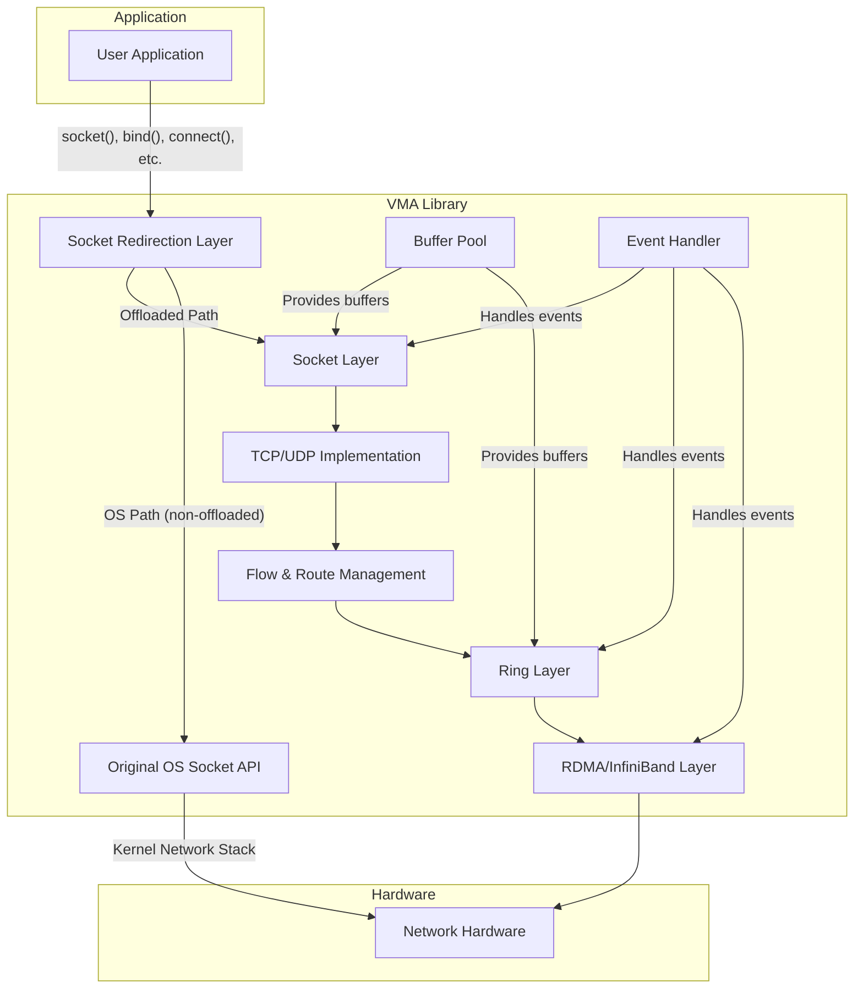
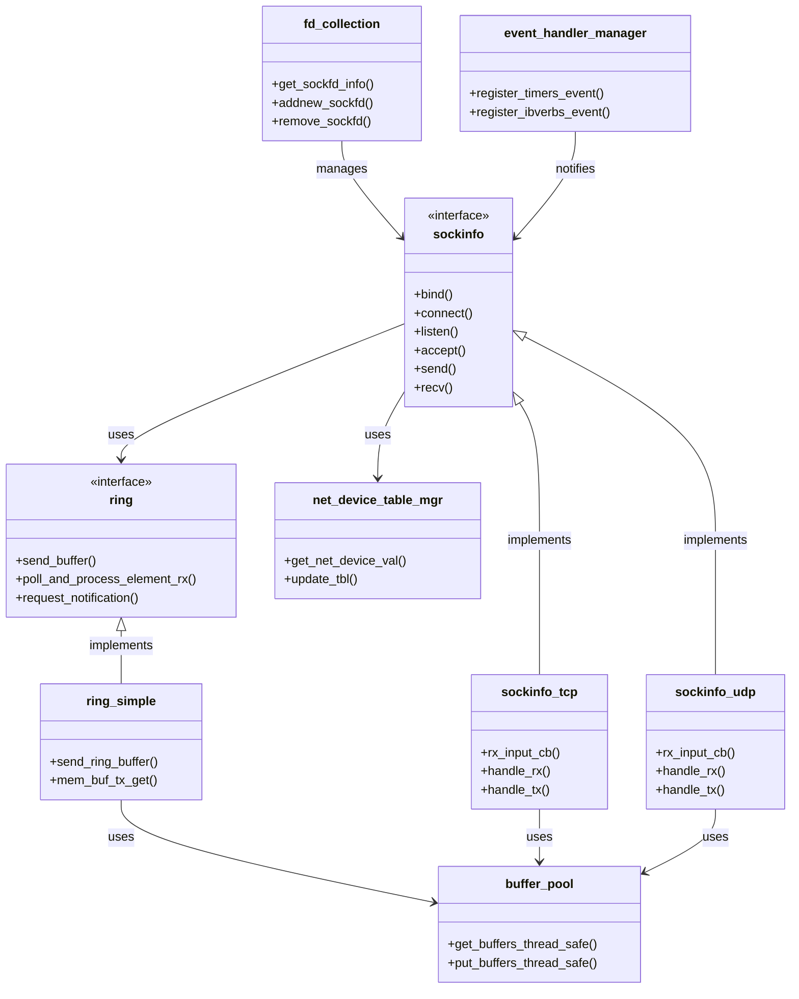
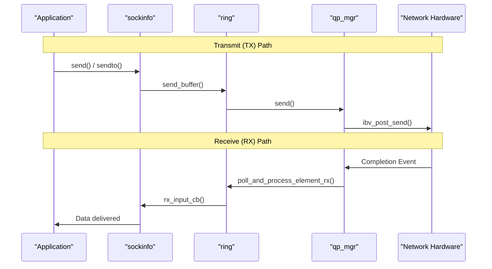
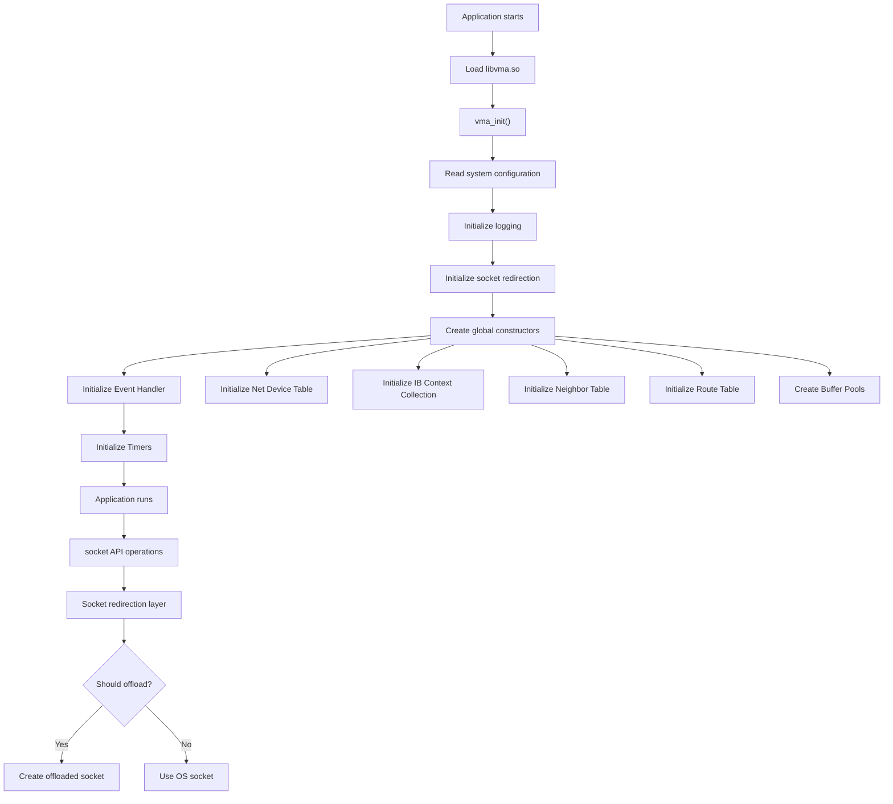

<!-- source: DeepWiki mcp.deepwiki.com · repo Mellanox/libvma · page 1 Overview · fetched 2026-11-11 -->

# Overview

Relevant source files

The following files were used as context for generating this wiki page:

- [CHANGES](CHANGES)
- [README.md](README.md)
- [configure.ac](configure.ac)
- [contrib/scripts/libvma.spec.in](contrib/scripts/libvma.spec.in)
- [src/vma/main.cpp](src/vma/main.cpp)
- [src/vma/util/sys_vars.cpp](src/vma/util/sys_vars.cpp)
- [src/vma/util/sys_vars.h](src/vma/util/sys_vars.h)

This page provides an introduction to NVIDIA Messaging Accelerator (VMA), a high-performance network acceleration library that enhances the performance of TCP/UDP applications. VMA allows applications written using standard socket APIs to bypass the kernel network stack and communicate directly with network hardware from user space, resulting in significantly improved latency and throughput.

VMA targets applications that require high message rates and low latency, such as those found in financial trading systems, high-performance computing, and data processing environments. For information about specific configuration options, see [Configuration and Initialization Flow](#6).

Sources: [src/vma/main.cpp:59-77](), [README.md:1-21](), [contrib/scripts/libvma.spec.in:43-54]()

## Architecture Fundamentals

VMA operates by intercepting standard socket calls through a preloaded library mechanism. When an application makes a socket call (such as `socket()`, `bind()`, `connect()`, etc.), VMA redirects these calls to its own implementation that can bypass the kernel and communicate directly with the network hardware through RDMA verbs.

VMA makes a decision during the socket creation process whether to "offload" the socket (handle it through VMA's high-performance path) or to fall back to the operating system's standard socket implementation. This decision is based on various criteria including the socket type, address/port, and available hardware.

Sources: [src/vma/main.cpp:87-193](), [src/vma/sock/sock-redirect.h](), [src/vma/util/sys_vars.h:426-427]()

## Core Components

VMA consists of several interconnected components that work together to provide high-performance networking:

### Socket Layer

The Socket Layer provides the interface between the application's standard socket calls and VMA's internal implementation. It consists of:

1. **Socket Redirection Layer**: Intercepts standard socket API calls
2. **sockinfo Classes**: Implementations for different socket types (TCP, UDP)
3. **I/O Multiplexing**: Handling of select/poll/epoll operations

Sources: [src/vma/sock/sockinfo_tcp.h](), [src/vma/sock/sockinfo_udp.h](), [src/vma/sock/fd_collection.h](), [src/vma/sock/sock-redirect.h]()

### Network Layer

The Network Layer manages the network device information, routing, and addressing:

1. **Net Device Table Manager**: Manages network device information
2. **Route Table Manager**: Handles routing decisions
3. **Neighbor Table Manager**: Manages ARP and neighbor discovery
4. **Flow Management**: Controls packet flows and rules

Sources: [src/vma/dev/net_device_table_mgr.h](), [src/vma/proto/route_table_mgr.h](), [src/vma/proto/neighbour_table_mgr.h]()

### Hardware Abstraction Layer

The Hardware Abstraction Layer provides an interface to the network hardware:

1. **Ring Layer**: Manages communication rings
2. **Queue Pair Management**: Handles InfiniBand queue pairs
3. **Completion Queue Management**: Processes completion events
4. **Buffer Pool**: Manages memory buffers

Sources: [src/vma/dev/ring.h](), [src/vma/dev/qp_mgr.h](), [src/vma/dev/cq_mgr.h](), [src/vma/dev/buffer_pool.h]()

## Packet Processing Flow

VMA's packet processing can be divided into transmit (TX) and receive (RX) paths:

### Transmit Path

1. Application calls `send()` or `sendto()`
2. VMA's implementation prepares the data for transmission
3. Data is sent through the ring layer to the queue pair
4. Queue pair posts a send work request to the network hardware
5. Hardware transmits the data

### Receive Path

1. Network hardware receives a packet and generates a completion event
2. VMA polls the completion queue and processes the received packet
3. Packet is passed to the appropriate socket based on addressing information
4. Socket delivers the data to the application

Sources: [src/vma/sock/sockinfo.h](), [src/vma/dev/ring.h](), [src/vma/dev/qp_mgr.h]()

## Configuration and Tuning

VMA offers numerous configuration parameters to tune its behavior for different use cases. These parameters can be set through environment variables or configuration files.

| Category | Parameter | Description | Default |
|----------|-----------|-------------|---------|
| General | VMA_SPEC | Preconfigured performance profile | NONE |
| Log | VMA_TRACELEVEL | Log verbosity level | INFO |
| | VMA_LOG_FILE | Log file path | (stdout) |
| Socket | VMA_OFFLOADED_SOCKETS | Enable socket offloading | Enabled |
| | VMA_TCP_3T_RULES | Use 3-tuple rules for TCP | Disabled |
| | VMA_UDP_3T_RULES | Use 3-tuple rules for UDP | Enabled |
| Memory | VMA_RX_BUFS | Number of RX buffers | 200000 |
| | VMA_TX_BUFS | Number of TX buffers | 200000 |
| | VMA_MEM_ALLOC_TYPE | Memory allocation type | HUGEPAGES |
| Ring | VMA_RING_ALLOCATION_LOGIC_TX | TX ring allocation logic | PER_INTERFACE |
| | VMA_RING_ALLOCATION_LOGIC_RX | RX ring allocation logic | PER_INTERFACE |
| Performance | VMA_RX_POLL | Number of RX polling iterations | 100000 |
| | VMA_SELECT_POLL | Number of select polling iterations | 100000 |
| | VMA_SOCKETXTREME | Enable SocketXtreme mode | Disabled |

VMA's configuration is extensively customizable to suit different workloads and hardware environments. The library also provides specialized performance profiles for specific use cases such as ultra-low latency trading applications.

Sources: [src/vma/util/sys_vars.h:428-546](), [src/vma/util/sys_vars.cpp:600-680]()

## Initialization Process

When an application using VMA starts, the library goes through the following initialization process:

The initialization establishes the necessary infrastructure for VMA's operation, including memory allocation, device detection, and event handling systems. Once initialized, VMA intercepts socket calls from the application and makes the decision whether to handle them internally (offload) or pass them to the operating system.

Sources: [src/vma/main.cpp:622-699](), [src/vma/util/sys_vars.cpp:436-603]()

## Performance Features

VMA implements several key features to achieve high performance:

1. **Kernel Bypass**: Direct access to network hardware from user space
2. **Zero-copy**: Minimizing data copying between buffers
3. **Memory Pre-allocation**: Pre-allocating buffers to avoid allocation overhead
4. **Polling**: Actively checking for incoming data instead of waiting for interrupts
5. **Batch Processing**: Processing multiple packets in a single operation
6. **Hardware Offloading**: Utilizing hardware capabilities for tasks like checksum calculation

These features work together to significantly reduce latency and increase throughput for network operations, especially beneficial for applications requiring high message rates and low latency.

Sources: [src/vma/main.cpp:622-699](), [src/vma/util/sys_vars.cpp:436-603]()

---

