<!-- source: DeepWiki mcp.deepwiki.com · repo Mellanox/libvma · page 1.1 Architecture Overview · fetched 2026-11-11 -->

# Architecture Overview

Relevant source files

The following files were used as context for generating this wiki page:

- [src/vma/main.cpp](src/vma/main.cpp)
- [src/vma/sock/pipeinfo.cpp](src/vma/sock/pipeinfo.cpp)
- [src/vma/sock/pipeinfo.h](src/vma/sock/pipeinfo.h)
- [src/vma/sock/sock-redirect.cpp](src/vma/sock/sock-redirect.cpp)
- [src/vma/sock/sock-redirect.h](src/vma/sock/sock-redirect.h)
- [src/vma/sock/socket_fd_api.cpp](src/vma/sock/socket_fd_api.cpp)
- [src/vma/sock/socket_fd_api.h](src/vma/sock/socket_fd_api.h)
- [src/vma/sock/sockinfo.cpp](src/vma/sock/sockinfo.cpp)
- [src/vma/sock/sockinfo.h](src/vma/sock/sockinfo.h)
- [src/vma/sock/sockinfo_tcp.cpp](src/vma/sock/sockinfo_tcp.cpp)
- [src/vma/sock/sockinfo_tcp.h](src/vma/sock/sockinfo_tcp.h)
- [src/vma/sock/sockinfo_udp.cpp](src/vma/sock/sockinfo_udp.cpp)
- [src/vma/sock/sockinfo_udp.h](src/vma/sock/sockinfo_udp.h)
- [src/vma/util/sys_vars.cpp](src/vma/util/sys_vars.cpp)
- [src/vma/util/sys_vars.h](src/vma/util/sys_vars.h)
- [src/vma/vma_extra.h](src/vma/vma_extra.h)

This page provides a comprehensive overview of the VMA (Versatile Message Accelerator) architecture, explaining how its components interact to accelerate network traffic by bypassing the kernel for supported operations while maintaining compatibility with standard socket APIs.

## High-Level Architecture

VMA functions as a high-performance network acceleration library that intercepts standard socket operations and provides a fast data path using RDMA (Remote Direct Memory Access) technology. The library sits between applications and the operating system's network stack, enabling transparent acceleration without requiring application modifications.

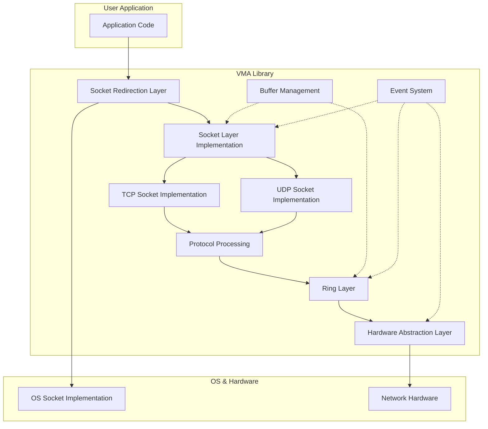

Sources:
- [src/vma/sock/sock-redirect.cpp:1-143]()
- [src/vma/sock/sockinfo_tcp.cpp:1-60]()
- [src/vma/sock/sockinfo_udp.cpp:1-60]()
- [src/vma/main.cpp:1-80]()

## Core Components

### Socket Redirection Layer

The Socket Redirection Layer is the entry point for socket operations. It intercepts standard socket API calls and determines whether to offload them through VMA or pass them to the original OS implementation.

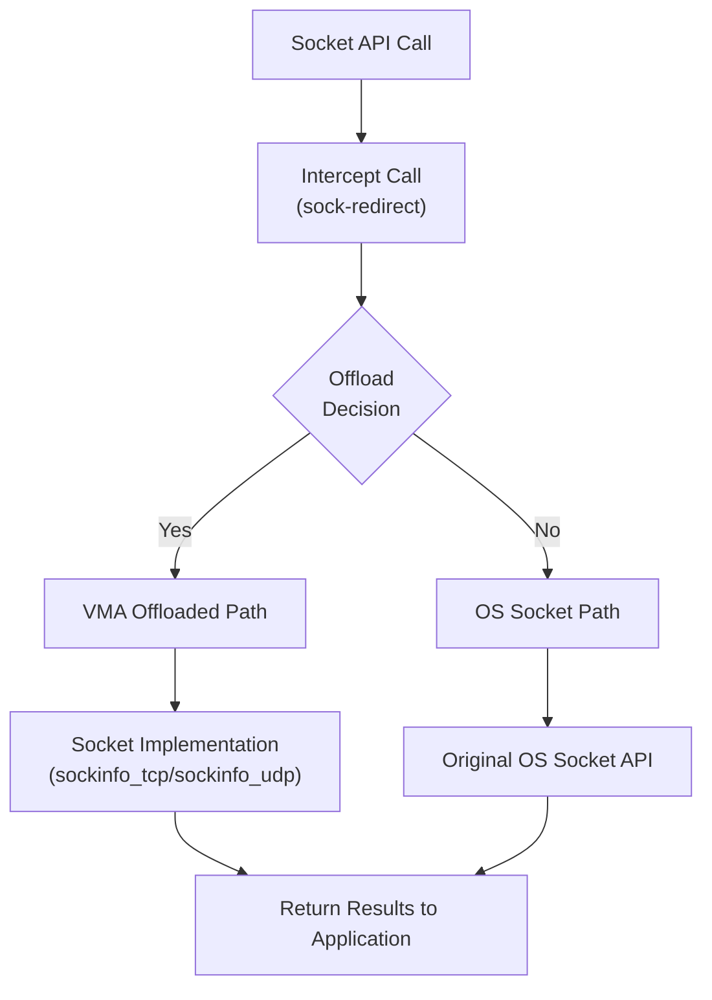

Sources:
- [src/vma/sock/sock-redirect.cpp:793-803]()
- [src/vma/sock/sock-redirect.cpp:117-153]()
- [src/vma/sock/socket_fd_api.cpp:27-111]()

### Socket Implementation

The socket implementation layer provides the core functionality for handling socket operations. It consists of specialized classes for different socket types:

- `socket_fd_api`: Base class for socket file descriptor operations
- `sockinfo`: Common socket functionality implementation
- `sockinfo_tcp`: TCP-specific socket implementation
- `sockinfo_udp`: UDP-specific socket implementation

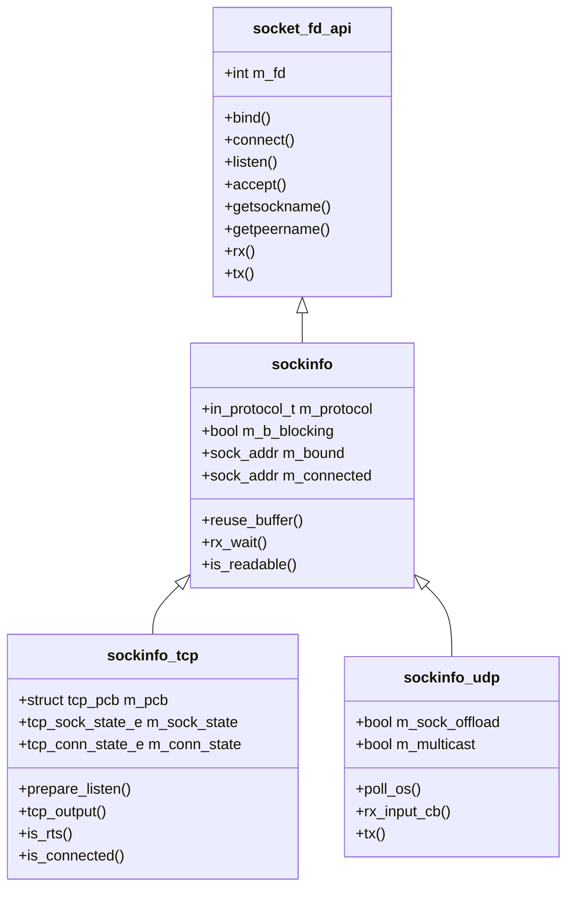

Sources:
- [src/vma/sock/socket_fd_api.h:105-309]()
- [src/vma/sock/sockinfo.h:132-266]()
- [src/vma/sock/sockinfo_tcp.h:90-210]()
- [src/vma/sock/sockinfo_udp.h:63-116]()

### Packet Processing Path

VMA processes packets through a series of interconnected layers, from application socket calls to hardware interaction:

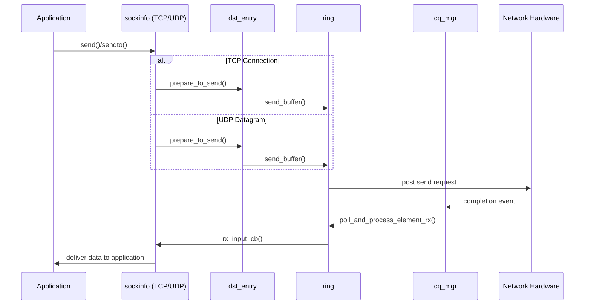

Sources:
- [src/vma/sock/sockinfo_tcp.cpp:709-957]()
- [src/vma/sock/sockinfo_udp.cpp:96-284]()

### Ring Layer

The Ring Layer is a critical component that manages network buffers and interfaces with the hardware. It provides an abstraction over the RDMA/InfiniBand communication mechanisms:

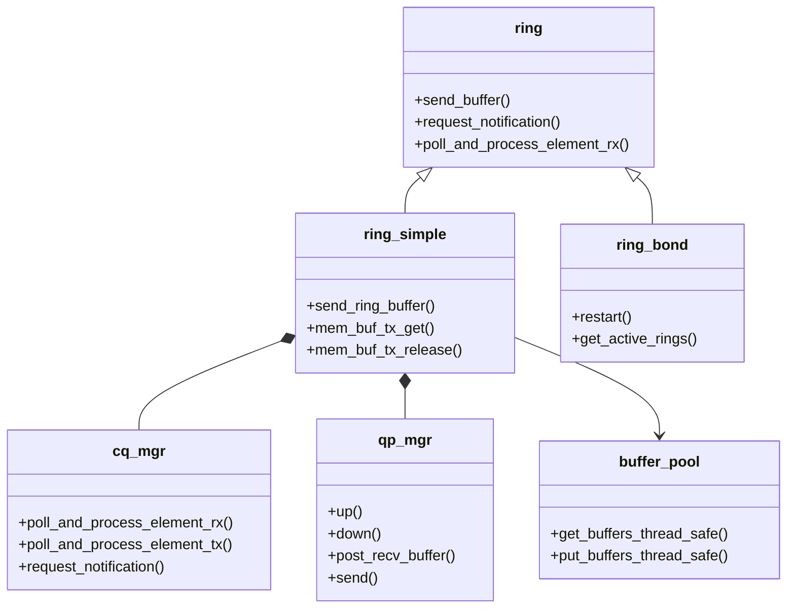

Sources:
- [src/vma/sock/sockinfo_tcp.cpp:1043-1128]()
- [src/vma/sock/sockinfo_udp.cpp:400-550]()

### Memory Management

VMA uses sophisticated buffer management to minimize memory copies and achieve high performance:

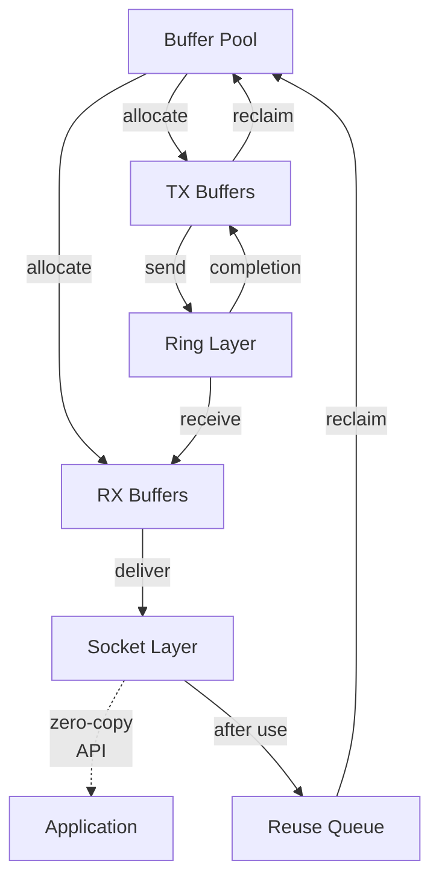

Sources:
- [src/vma/sock/sockinfo.h:213-266]()
- [src/vma/sock/sockinfo.cpp:167-203]()
- [src/vma/sock/sockinfo_tcp.cpp:137-191]()
- [src/vma/sock/sockinfo_udp.cpp:64-90]()

## Data Flow Architecture

The following diagram demonstrates how data flows through VMA during typical send and receive operations:

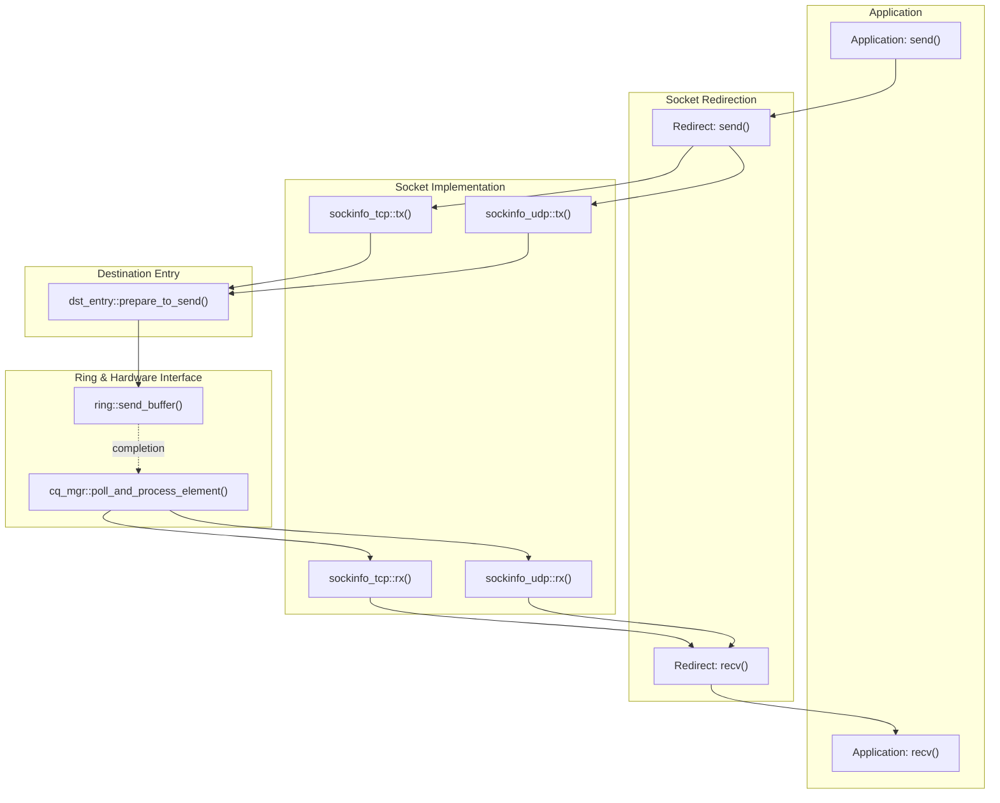

Sources:
- [src/vma/sock/sockinfo_tcp.cpp:709-957]()
- [src/vma/sock/sockinfo_udp.cpp:96-284]()
- [src/vma/sock/sock-redirect.cpp:339-359]()

## Initialization and Configuration

VMA is initialized when the library is loaded, and it uses a comprehensive configuration system to control its behavior:

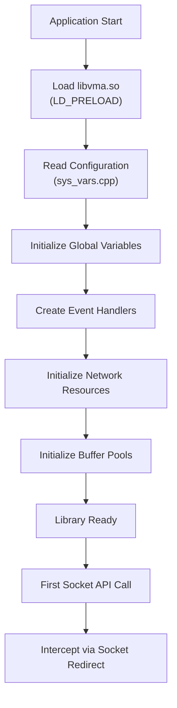

Sources:
- [src/vma/main.cpp:87-193]()
- [src/vma/util/sys_vars.cpp:413-425]()
- [src/vma/sock/sock-redirect.cpp:70-175]()

## Threading Model

VMA's threading model is configurable and supports different modes of operation:

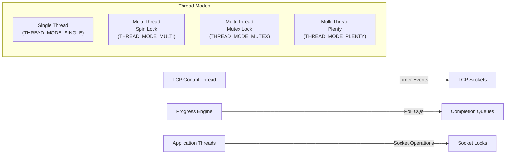

Sources:
- [src/vma/util/sys_vars.h:88-94]()
- [src/vma/util/sys_vars.h:500-508]()
- [src/vma/sock/sockinfo_tcp.cpp:585-595]()

## Offload Decision Logic

The library makes decisions about which sockets to offload based on several factors:

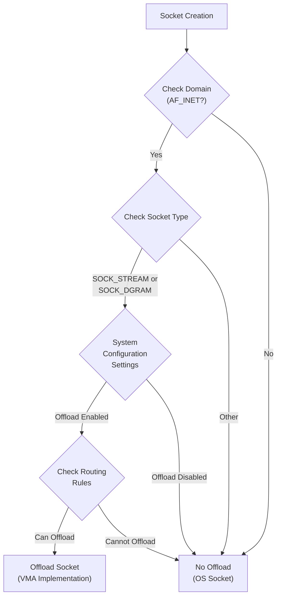

Sources:
- [src/vma/sock/sock-redirect.cpp:793-950]()
- [src/vma/sock/sockinfo_tcp.cpp:222-250]()
- [src/vma/sock/sockinfo_udp.cpp:520-556]()

## Key Performance Optimizations

VMA implements several key optimizations to achieve high performance:

1. **Zero-copy data path**: Minimizes data copies by providing buffer pointers directly to applications
2. **Kernel bypass**: Avoids context switches and system call overhead by handling network operations in user space
3. **RDMA/InfiniBand hardware acceleration**: Uses high-performance networking hardware features
4. **Lock-free design**: Minimizes contention in performance-critical paths
5. **Buffer pooling**: Pre-allocates and reuses memory to reduce allocation overhead
6. **Poll-mode operation**: Avoids blocking/waking thread transitions when needed

Sources:
- [src/vma/sock/sockinfo_tcp.cpp:626-653]()
- [src/vma/sock/sockinfo_udp.cpp:72-89]()
- [src/vma/vma_extra.h:13-38]()

## Integration with Applications

VMA is designed to integrate seamlessly with existing applications without requiring code modifications:

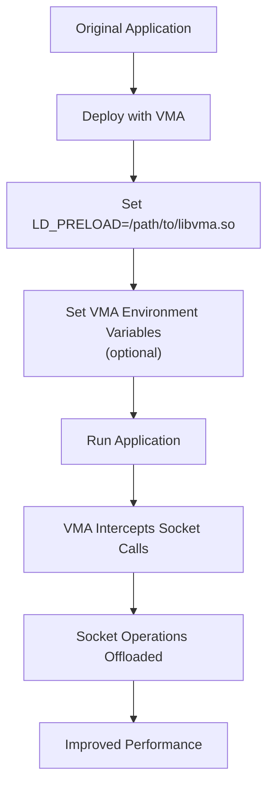

Sources:
- [src/vma/sock/sock-redirect.cpp:40-57]()
- [src/vma/util/sys_vars.h:426-549]()

## Conclusion

VMA's architecture provides a high-performance networking solution by transparently intercepting socket calls and using advanced techniques like RDMA and kernel bypass. The layered design, from socket redirection to hardware access, enables applications to benefit from hardware acceleration while maintaining compatibility with standard socket APIs.

The system's modular design accommodates different protocols (TCP/UDP), networking technologies, and usage patterns, making it a versatile solution for high-performance networking requirements.

---

