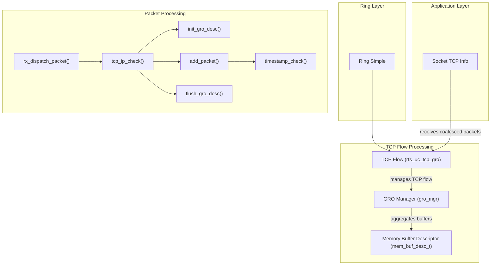
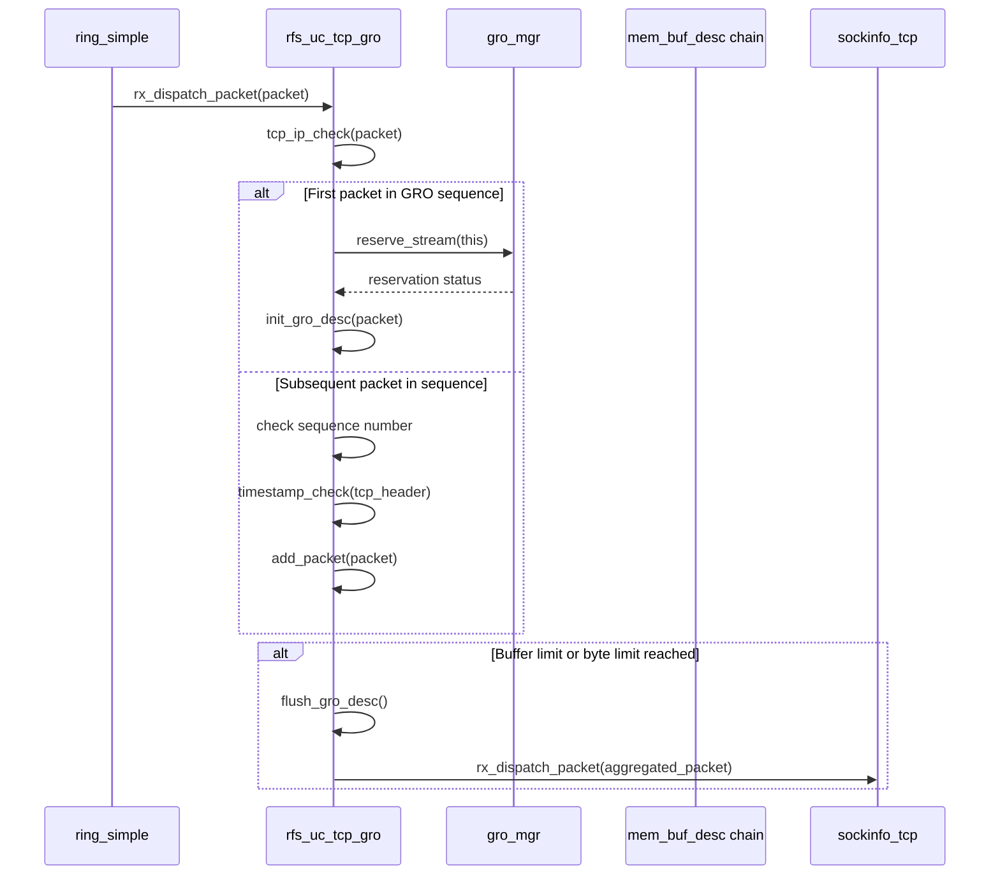
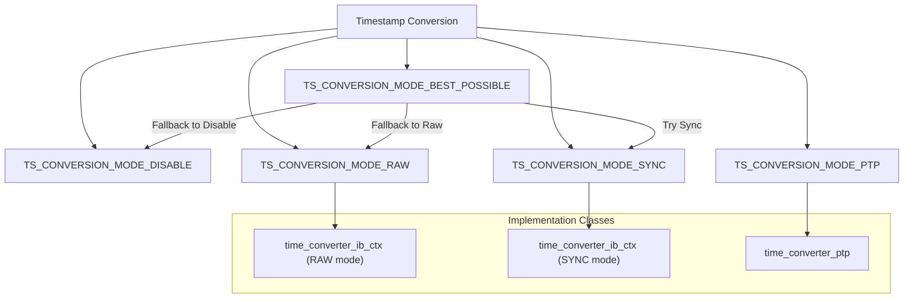
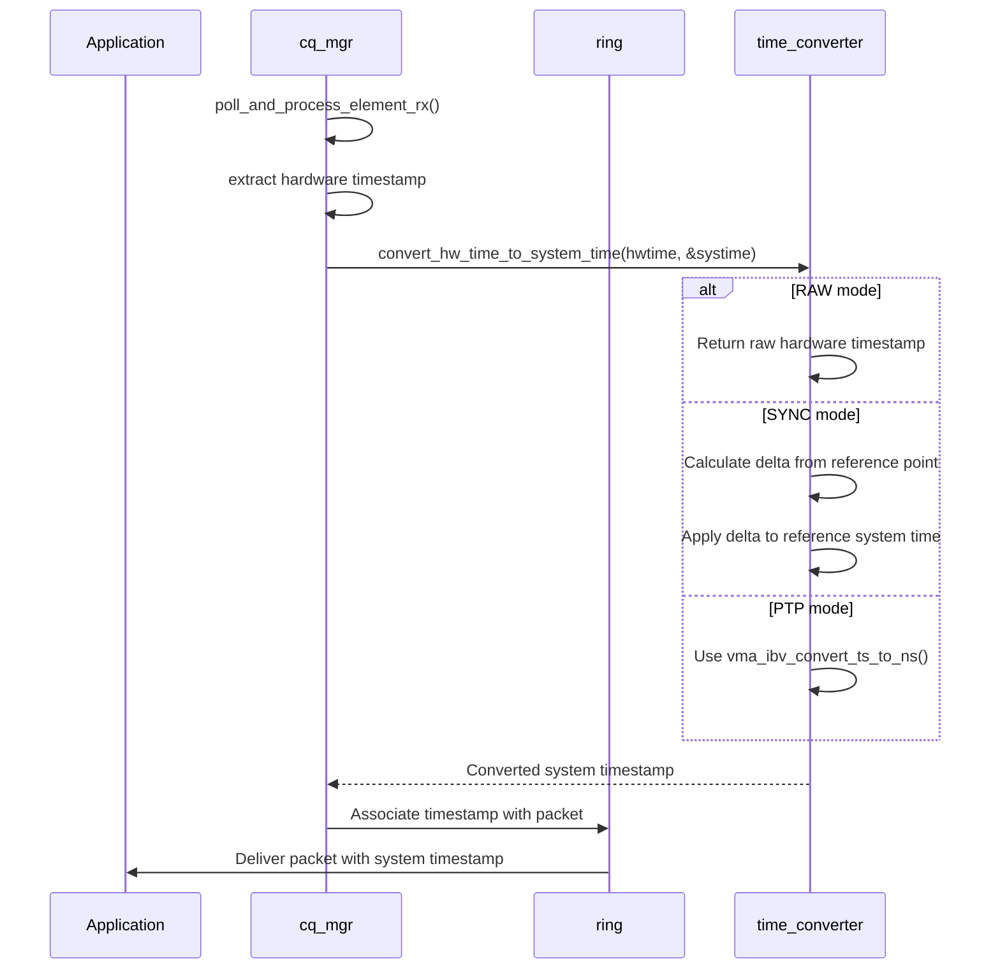

<!-- source: DeepWiki mcp.deepwiki.com · repo Mellanox/libvma · page 10 Advanced Features · fetched 2026-11-11 -->

# Advanced Features

<details>
<summary>Relevant source files</summary>

The following files were used as context for generating this wiki page:

- [src/vma/dev/gro_mgr.cpp](src/vma/dev/gro_mgr.cpp)
- [src/vma/dev/gro_mgr.h](src/vma/dev/gro_mgr.h)
- [src/vma/dev/rfs_uc_tcp_gro.cpp](src/vma/dev/rfs_uc_tcp_gro.cpp)
- [src/vma/dev/rfs_uc_tcp_gro.h](src/vma/dev/rfs_uc_tcp_gro.h)
- [src/vma/dev/time_converter.cpp](src/vma/dev/time_converter.cpp)
- [src/vma/dev/time_converter.h](src/vma/dev/time_converter.h)
- [src/vma/dev/time_converter_ib_ctx.cpp](src/vma/dev/time_converter_ib_ctx.cpp)
- [src/vma/dev/time_converter_ib_ctx.h](src/vma/dev/time_converter_ib_ctx.h)
- [src/vma/dev/time_converter_ptp.cpp](src/vma/dev/time_converter_ptp.cpp)
- [src/vma/dev/time_converter_ptp.h](src/vma/dev/time_converter_ptp.h)

</details>


This document provides a detailed description of advanced optimization features in the VMA (Versatile Message Accelerator) library. These features are designed to enhance performance beyond the standard socket acceleration capabilities provided by the basic library implementation. For general architecture and core functionality information, see [Architecture Overview](#1.1).

## Generic Receive Offload (GRO)

GRO (Generic Receive Offload) is a technique that combines multiple incoming TCP packets from the same flow into a single larger packet before delivering it to the application. This reduces per-packet processing overhead and improves CPU efficiency.

### GRO Architecture



Sources: [src/vma/dev/rfs_uc_tcp_gro.cpp](), [src/vma/dev/rfs_uc_tcp_gro.h](), [src/vma/dev/gro_mgr.cpp](), [src/vma/dev/gro_mgr.h]()

### GRO Components and Workflow

1. **GRO Manager (`gro_mgr`)**: Manages the GRO streams and resources
   - Controls how many flows can use GRO concurrently
   - Maintains an array of TCP flows using GRO
   - Handles flow reservation and flushing

2. **TCP GRO Flow (`rfs_uc_tcp_gro`)**: Extends the unicast flow handler to implement GRO functionality
   - Examines incoming packets for GRO eligibility
   - Aggregates qualifying packets from the same flow
   - Maintains descriptor for GRO state
   - Flushes aggregated packets when needed

3. **GRO Memory Descriptor (`gro_mem_buf_desc_t`)**: Contains the state of the current aggregation
   - Tracks first and last buffer in the chain
   - Maintains sequence numbers, buffer counts, and timestamps
   - Stores TCP/IP header information for the aggregated packet

### Packet Aggregation Process



Sources: [src/vma/dev/rfs_uc_tcp_gro.cpp:38-84](), [src/vma/dev/rfs_uc_tcp_gro.cpp:86-114]()

### GRO Eligibility Criteria

For a packet to be eligible for GRO:

1. Must be a TCP packet with payload data
2. IP header must have standard length (no options)
3. Must not have urgent, RST, SYN, or FIN flags set
4. TCP header must have either no options or only timestamp option
5. Packet must arrive in correct sequence order
6. Must not be a retransmitted packet

Sources: [src/vma/dev/rfs_uc_tcp_gro.cpp:195-230](), [src/vma/dev/rfs_uc_tcp_gro.cpp:232-257]()

### Implementation Details

The GRO implementation in VMA uses a linked-list approach to chain buffer descriptors together:

1. When a packet is eligible for GRO, its buffer descriptor is linked to the existing chain
2. The last packet's next pointer is updated to point to the new packet
3. The packet data is not copied; only buffer descriptors are linked
4. When flushing, the first packet's headers are updated with:
   - Combined IP total length
   - Latest ACK and window values
   - Updated timestamp values
   - Adjusted buffer lengths and payload pointers

Sources: [src/vma/dev/rfs_uc_tcp_gro.cpp:86-114](), [src/vma/dev/rfs_uc_tcp_gro.cpp:128-174]()

### GRO Configuration

GRO is controlled through two main parameters:

1. **Maximum flows**: Controls how many concurrent TCP flows can use GRO
2. **Maximum buffers per flow**: Limits how many packets can be aggregated in a single batch

```
| Parameter | Default | Description |
|-----------|---------|-------------|
| Max flows | Configured at ring creation | Maximum number of TCP flows that can use GRO concurrently |
| Max buffers | 32 | Maximum number of packets that can be aggregated in a single GRO operation |
| Max bytes | 0xFFFF | Maximum total bytes that can be aggregated in a single GRO operation |
```

Sources: [src/vma/dev/gro_mgr.h:12-13](), [src/vma/dev/rfs_uc_tcp_gro.cpp:76-78]()

## Hardware Timestamp Conversion

VMA provides mechanisms to convert hardware timestamps from network devices to system time. This is important for applications that need to accurately measure packet arrival times, particularly for latency-sensitive applications.

### Timestamp Conversion Modes

VMA supports multiple timestamp conversion modes to accommodate different hardware capabilities:



Sources: [src/vma/dev/time_converter.cpp:67-114](), [src/vma/dev/time_converter.h:33-45]()

### Timestamp Conversion Components

1. **Base Time Converter (`time_converter`)**: Abstract base class for all conversion methods
   - Defines interface for hardware-to-system time conversion
   - Manages conversion status and cleanup

2. **IB Context Time Converter (`time_converter_ib_ctx`)**: Implements conversion for InfiniBand contexts
   - Supports both RAW and SYNC conversion modes
   - Periodically calibrates hardware clock to system clock
   - Handles clock drift correction

3. **PTP Time Converter (`time_converter_ptp`)**: Uses Precision Time Protocol for timestamp conversion
   - Utilizes hardware PTP capabilities when available
   - Provides more accurate time synchronization than other methods

Sources: [src/vma/dev/time_converter.h:34-55](), [src/vma/dev/time_converter_ib_ctx.h:16-35](), [src/vma/dev/time_converter_ptp.h:18-32]()

### Conversion Modes Explained

```
| Mode | Description | Requirements | Accuracy |
|------|-------------|--------------|----------|
| DISABLE | No hardware timestamp conversion | None | N/A |
| RAW | Raw hardware timestamps are returned without conversion | `IBV_DEVICE_ATTR_HCA_CORE_CLOCK` | Low |
| SYNC | Synchronizes system clock with hardware clock | `IBV_DEVICE_ATTR_HCA_CORE_CLOCK` and `IBV_VALUES_MASK_RAW_CLOCK` | Medium |
| PTP | Uses Precision Time Protocol capabilities | PTP support in hardware and drivers | High |
| BEST_POSSIBLE | Tries to use best available mode | Depends on hardware capabilities | Varies |
```

Sources: [src/vma/dev/time_converter.cpp:67-114](), [src/vma/dev/time_converter_ib_ctx.cpp:29-56](), [src/vma/dev/time_converter_ptp.cpp:32-44]()

### Implementation Details

#### Clock Synchronization

In SYNC mode, the system periodically synchronizes the hardware clock with the system clock:

1. Takes multiple samples of both system time and hardware time
2. Selects the sample with the smallest interval between readings
3. Periodically re-calibrates to account for clock drift
4. Maintains two parameter sets and switches between them to avoid discontinuities

Sources: [src/vma/dev/time_converter_ib_ctx.cpp:74-105](), [src/vma/dev/time_converter_ib_ctx.cpp:106-143]()

#### Timestamp Conversion Mechanism



Sources: [src/vma/dev/time_converter_ib_ctx.cpp:158-180](), [src/vma/dev/time_converter_ptp.cpp:62-69]()

### Device Status Detection

Before using timestamp conversion, VMA checks each device's capabilities:

1. Tests if `vma_ibv_query_device()` returns valid core clock information
2. Tests if `vma_ibv_query_values()` can retrieve raw clock values
3. Applies the configured conversion mode only if hardware supports it
4. Uses fallback modes when necessary based on configuration policy

Sources: [src/vma/dev/time_converter.cpp:33-65](), [src/vma/dev/time_converter.cpp:67-114]()

## Additional Notes

- Both GRO and hardware timestamp conversion are implemented to minimize impact on the fast path while providing their respective performance benefits
- These features can be combined - GRO-aggregated packets can include accurate hardware timestamps
- Configuration settings can be adjusted to balance between latency, throughput, and resource usage