<!-- source: DeepWiki mcp.deepwiki.com · repo Mellanox/libvma · page 2 Socket Layer · fetched 2026-11-11 -->

# Socket Layer

<details>
<summary>Relevant source files</summary>

The following files were used as context for generating this wiki page:

- [src/vma/sock/pipeinfo.cpp](src/vma/sock/pipeinfo.cpp)
- [src/vma/sock/pipeinfo.h](src/vma/sock/pipeinfo.h)
- [src/vma/sock/sock-redirect.cpp](src/vma/sock/sock-redirect.cpp)
- [src/vma/sock/sock-redirect.h](src/vma/sock/sock-redirect.h)
- [src/vma/sock/socket_fd_api.cpp](src/vma/sock/socket_fd_api.cpp)
- [src/vma/sock/socket_fd_api.h](src/vma/sock/socket_fd_api.h)
- [src/vma/sock/sockinfo.cpp](src/vma/sock/sockinfo.cpp)
- [src/vma/sock/sockinfo.h](src/vma/sock/sockinfo.h)
- [src/vma/sock/sockinfo_tcp.cpp](src/vma/sock/sockinfo_tcp.cpp)
- [src/vma/sock/sockinfo_tcp.h](src/vma/sock/sockinfo_tcp.h)
- [src/vma/sock/sockinfo_udp.cpp](src/vma/sock/sockinfo_udp.cpp)
- [src/vma/sock/sockinfo_udp.h](src/vma/sock/sockinfo_udp.h)
- [src/vma/vma_extra.h](src/vma/vma_extra.h)

</details>


The Socket Layer in VMA provides the core mechanism for intercepting and processing standard socket operations to enable network acceleration. It serves as a bridge between the application's socket API calls and the RDMA/InfiniBand hardware abstraction layers, allowing transparent acceleration of networking operations while maintaining compatibility with standard socket APIs.

For information about the overall VMA architecture, see [Architecture Overview](#1.1). For details about how socket operations are intercepted, see [Socket Redirection](#2.1).

## Socket Layer Overview

The Socket Layer implements socket operations by either offloading them to hardware or passing them through to the operating system. This decision is made based on several factors including socket type, address family, and network device capabilities.

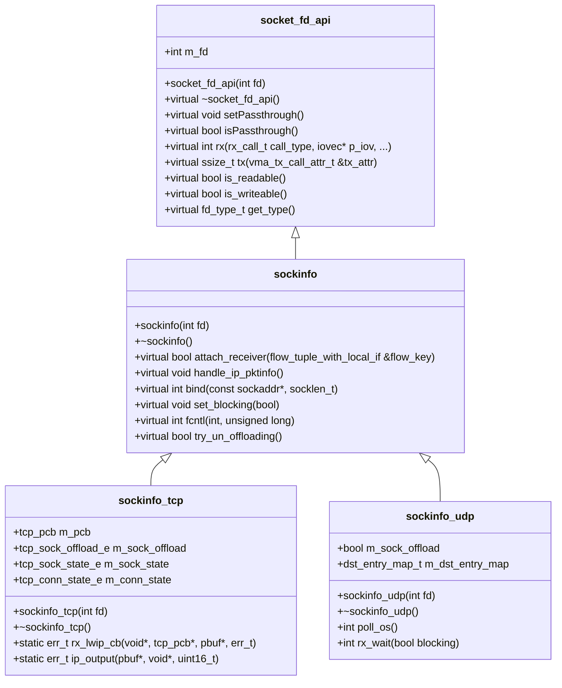

*Socket class hierarchy diagram showing inheritance relationships*

Sources: [src/vma/sock/socket_fd_api.h](), [src/vma/sock/sockinfo.h](), [src/vma/sock/sockinfo_tcp.h](), [src/vma/sock/sockinfo_udp.h]()

## Socket Operations Flow

The following diagram illustrates how socket operations flow through the VMA Socket Layer:

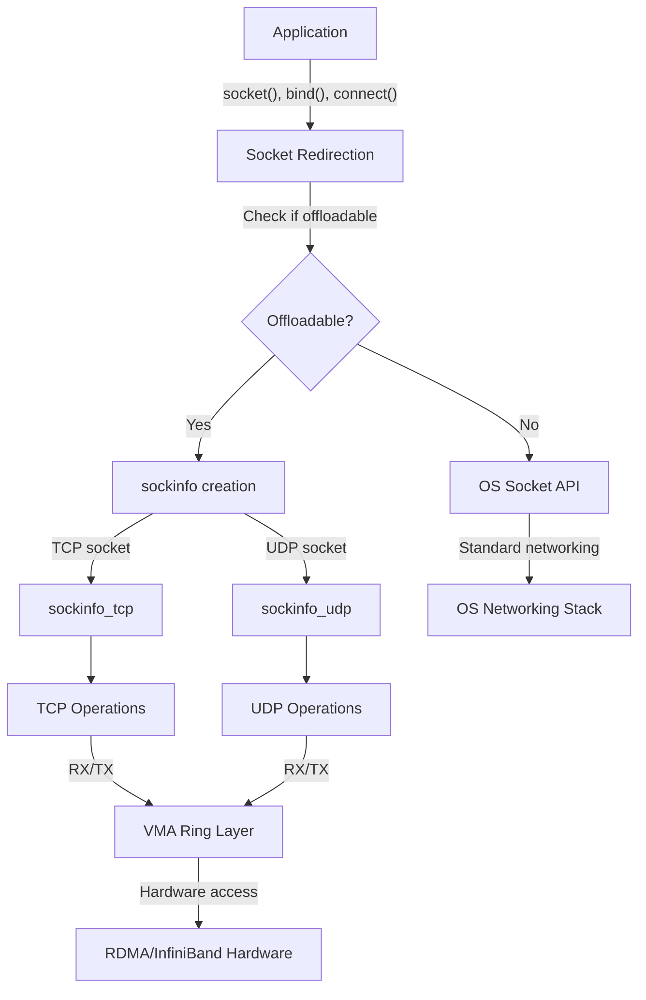

*Socket operations flow diagram*

Sources: [src/vma/sock/sock-redirect.cpp:800-831](), [src/vma/sock/sockinfo_tcp.cpp:193-290](), [src/vma/sock/sockinfo_udp.cpp:304-360]()

## Socket Initialization

When a socket is created through the standard `socket()` call, VMA intercepts this call and determines whether the socket can be offloaded:

1. The Socket Redirection layer intercepts the call
2. For supported socket types (SOCK_DGRAM, SOCK_STREAM), it creates appropriate socket objects
3. TCP sockets are handled by `sockinfo_tcp`, UDP sockets by `sockinfo_udp`
4. The socket objects maintain state and handle subsequent socket operations

Socket offloading eligibility depends on:
- Socket type (TCP or UDP)
- Address family (currently focused on AF_INET)
- Whether the underlying network device supports RDMA/InfiniBand features

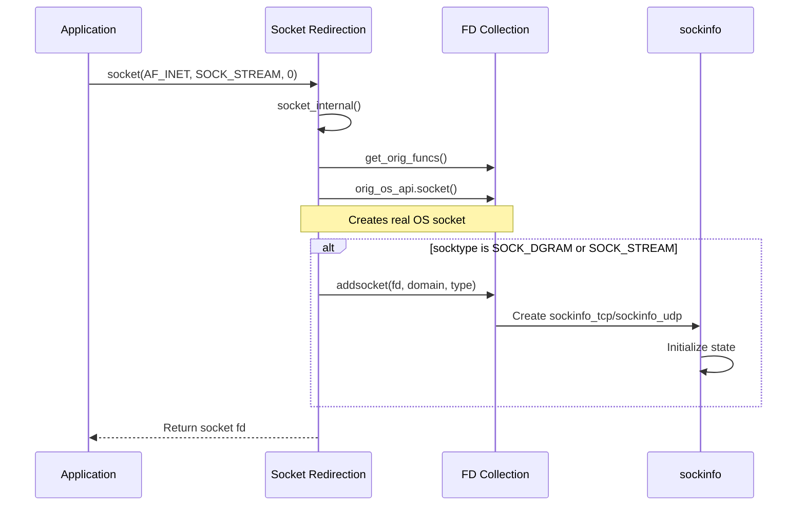

*Socket initialization sequence diagram*

Sources: [src/vma/sock/sock-redirect.cpp:792-831](), [src/vma/sock/sockinfo_tcp.cpp:193-290](), [src/vma/sock/sockinfo_udp.cpp:304-360]()

## Socket Types and Implementation

VMA implements specialized socket classes for different socket types:

### Base Socket Classes

1. **socket_fd_api** - Abstract base class representing socket file descriptor API interface
   - Provides interface for all socket operations
   - Manages socket file descriptor and associated state
   - Implements basic socket functionality

2. **sockinfo** - Base class for socket information
   - Inherits from socket_fd_api
   - Implements common functionality across socket types
   - Manages socket blocking behavior, options, state transitions

### Specialized Socket Implementations

#### TCP Sockets (sockinfo_tcp)

The TCP socket implementation in VMA provides:
- Complete TCP state machine
- Integration with LWIP for wire-compatible TCP implementation
- Support for connection-oriented operations (listen, accept, connect)
- Managed through sockinfo_tcp class

Key components:
- TCP Protocol Control Block (PCB) from LWIP
- Socket state management (INITED, BOUND, CONNECTED, etc.)
- Connection state management (INIT, CONNECTING, CONNECTED, etc.)
- Support for socket options like TCP_NODELAY, SO_RCVBUF, etc.

```
TCP Socket States:
- TCP_SOCK_INITED
- TCP_SOCK_BOUND
- TCP_SOCK_LISTEN_READY
- TCP_SOCK_ACCEPT_READY
- TCP_SOCK_CONNECTED_RD
- TCP_SOCK_CONNECTED_WR
- TCP_SOCK_CONNECTED_RDWR
- TCP_SOCK_ASYNC_CONNECT
- TCP_SOCK_ACCEPT_SHUT
```

#### UDP Sockets (sockinfo_udp)

The UDP socket implementation provides:
- Datagram-based communication
- Support for multicast operations
- Zero-copy receive mechanisms
- Managed through sockinfo_udp class

Key components:
- Destination entry mapping (m_dst_entry_map)
- Buffer management for zero-copy operations
- Support for socket options like IP_MULTICAST_IF, SO_RCVBUF, etc.

Sources: [src/vma/sock/sockinfo_tcp.h:91-453](), [src/vma/sock/sockinfo_udp.h:63-275](), [src/vma/sock/sockinfo.h:131-347]()

## Socket States and Transitions

VMA socket implementations maintain state for proper handling of socket operations:

### Common Socket States

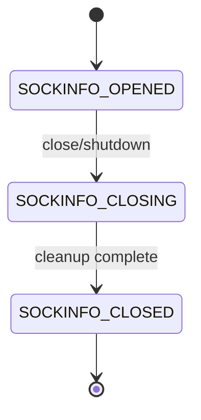

*Common socket state diagram*

### TCP Socket-Specific States

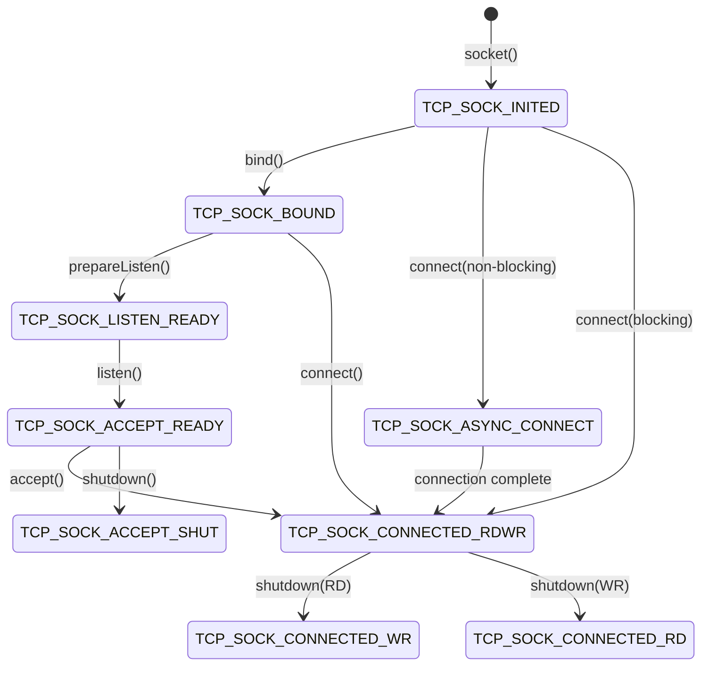

*TCP socket state diagram*

### TCP Connection States

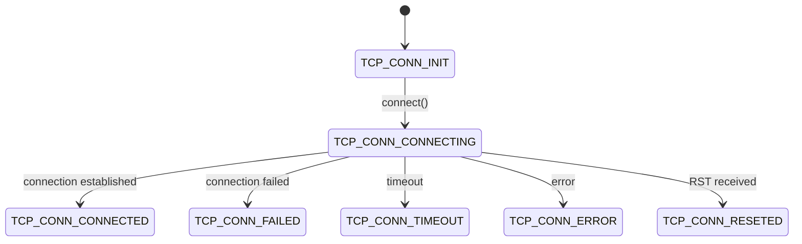

*TCP connection state diagram*

Sources: [src/vma/sock/sockinfo.h:137-141](), [src/vma/sock/sockinfo_tcp.h:31-60]()

## Data Flow in Socket Layer

### Receiving Data (RX Path)

The receive path in the Socket Layer is responsible for:
1. Retrieving data from network hardware (via Ring Layer)
2. Processing it through the appropriate protocol stack
3. Delivering it to the application

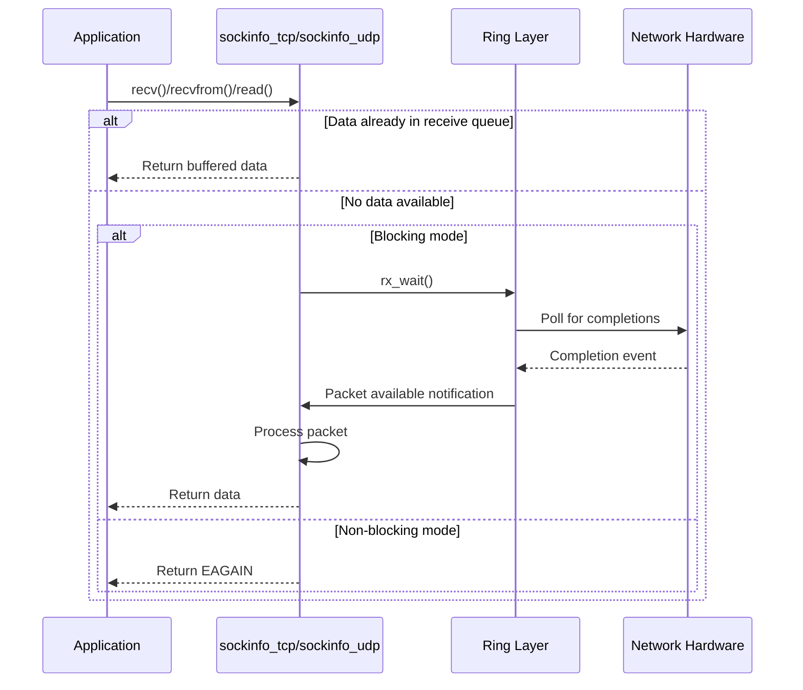

*Receive path sequence diagram*

Sources: [src/vma/sock/sockinfo_tcp.cpp:142-136](), [src/vma/sock/sockinfo_udp.cpp:92-284]()

### Sending Data (TX Path)

The transmit path is responsible for:
1. Preparing data for transmission
2. Sending it through the appropriate protocol stack
3. Submitting it to the network hardware

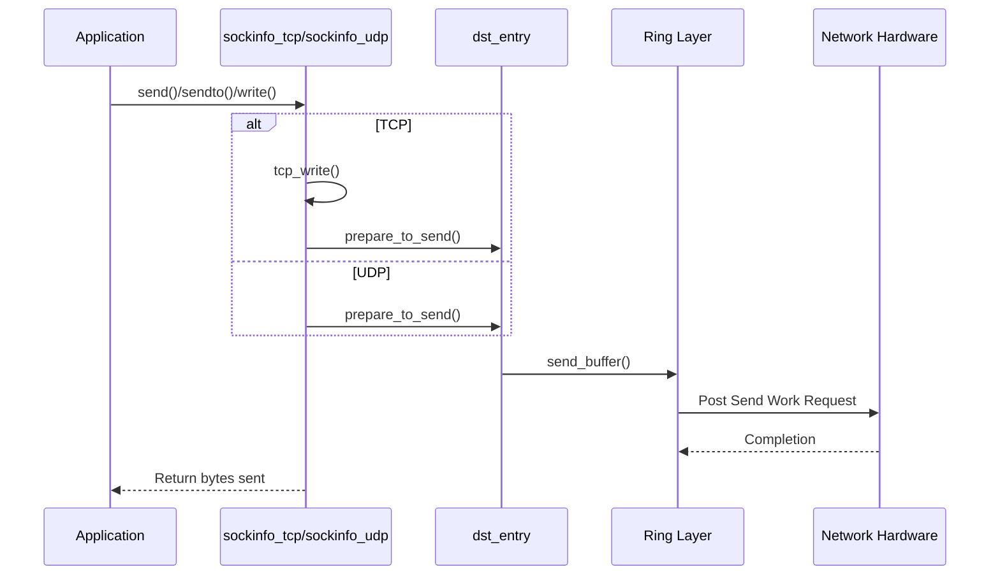

*Transmit path sequence diagram*

Sources: [src/vma/sock/sockinfo_tcp.cpp:709-956](), [src/vma/sock/sockinfo_udp.cpp]()

## Socket Options Handling

The Socket Layer implements standard socket options as well as VMA-specific extensions:

### Standard Socket Options

- **SOL_SOCKET level options** - SO_RCVBUF, SO_SNDBUF, SO_REUSEADDR, etc.
- **IPPROTO_TCP level options** - TCP_NODELAY, TCP_KEEPALIVE, etc.
- **IPPROTO_IP level options** - IP_MULTICAST_IF, IP_TTL, etc.

### VMA-Specific Socket Options

- **SO_VMA_USER_DATA** - Associate custom user data with a socket
- **SO_VMA_RING_ALLOC_LOGIC** - Control ring allocation logic
- **SO_VMA_FLOW_TAG** - Set flow tag for a socket
- **SO_VMA_RING_USER_MEMORY** - Provide user memory for ring buffers

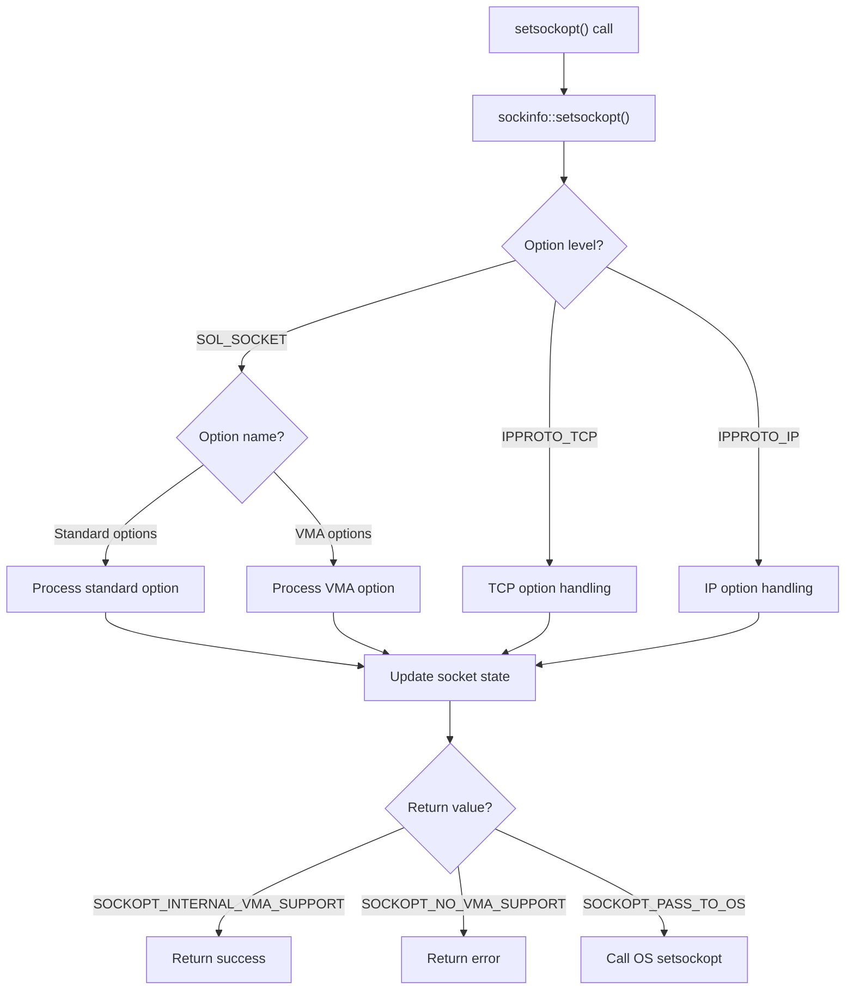

*Socket option handling flow diagram*

Sources: [src/vma/sock/sockinfo.cpp:305-481](), [src/vma/sock/sockinfo_tcp.cpp](), [src/vma/sock/sockinfo_udp.cpp:640-768]()

## Offloading Decision Process

A key responsibility of the Socket Layer is deciding whether a socket can be offloaded or should be passed through to the OS:

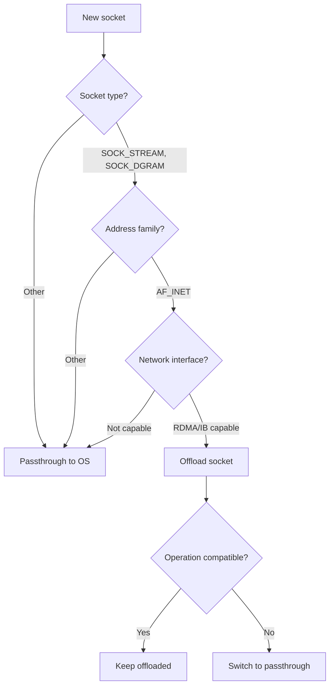

*Offloading decision flow diagram*

Sources: [src/vma/sock/sock-redirect.cpp:793-828](), [src/vma/sock/sockinfo.cpp:532-544]()

## Socket Redirection Mechanism

The Socket Layer relies on the Socket Redirection mechanism to intercept standard socket API calls:

1. VMA replaces standard socket functions (socket, bind, connect, etc.) with its own implementations
2. When these functions are called, VMA intercepts them and routes them through the Socket Layer
3. The Socket Layer either handles the operation or passes it to the original OS implementation

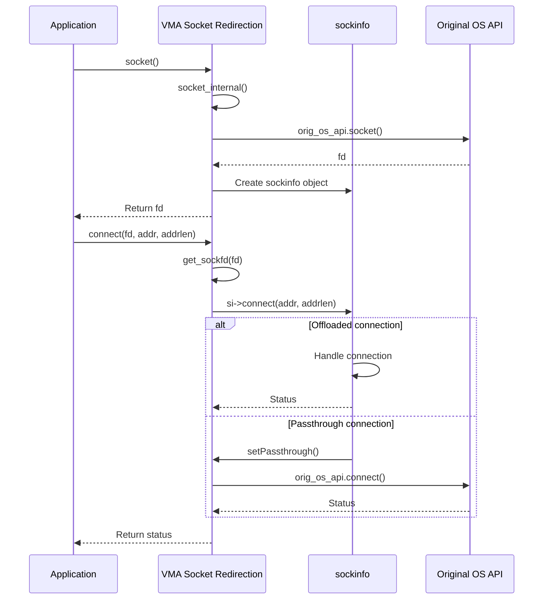

*Socket redirection sequence diagram*

Sources: [src/vma/sock/sock-redirect.cpp:792-1002]()

## Integration with Other VMA Components

The Socket Layer integrates with several other components in the VMA system:

### Ring Layer Integration

Socket objects interact with the Ring Layer to send and receive data:
- Each socket is associated with one or more rings
- Rings provide the interface to the hardware queues
- Sockets use rings for data transmission and reception

### Protocol Implementation Integration

- TCP sockets integrate with the LWIP TCP implementation
- UDP sockets have a custom implementation in VMA
- Both implementations interface with the destination entry management system

### Buffer Management

Socket implementations handle buffer management for efficient data transfer:
- Zero-copy mechanisms to avoid unnecessary data copying
- Buffer pool integration for memory management
- Buffer reuse strategies for optimal performance

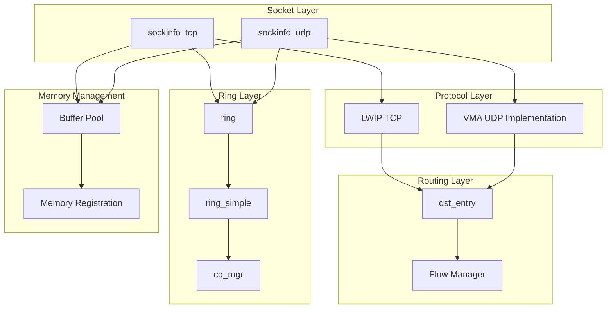

*Socket Layer integration with other VMA components*

Sources: [src/vma/sock/sockinfo_tcp.cpp](), [src/vma/sock/sockinfo_udp.cpp](), [src/vma/sock/sockinfo.h]()

## Socket Performance Optimizations

The Socket Layer implements various optimizations to improve performance:

1. **Zero-copy data transfer** - Avoiding unnecessary data copies between user and kernel space
2. **Buffer reuse** - Efficient reuse of memory buffers to reduce memory allocations
3. **Batch processing** - Processing multiple operations together for better efficiency
4. **Event-driven polling** - Efficient notification mechanisms for socket readiness
5. **Direct hardware access** - Bypassing the kernel for data transfer operations

These optimizations enable VMA to achieve lower latency and higher throughput compared to standard socket implementations.

Sources: [src/vma/sock/sockinfo_tcp.cpp](), [src/vma/sock/sockinfo_udp.cpp]()

## Summary

The Socket Layer in VMA serves as the core component that enables transparent acceleration of socket operations by:

1. Intercepting standard socket API calls through redirection mechanisms
2. Implementing socket behavior for both TCP and UDP protocols
3. Making intelligent decisions about offloading vs. passthrough to OS
4. Managing socket state and operations
5. Integrating with other VMA components for efficient data transfer

This architecture allows applications to benefit from hardware acceleration without requiring code modifications, providing significant performance improvements for network-intensive applications.

---

