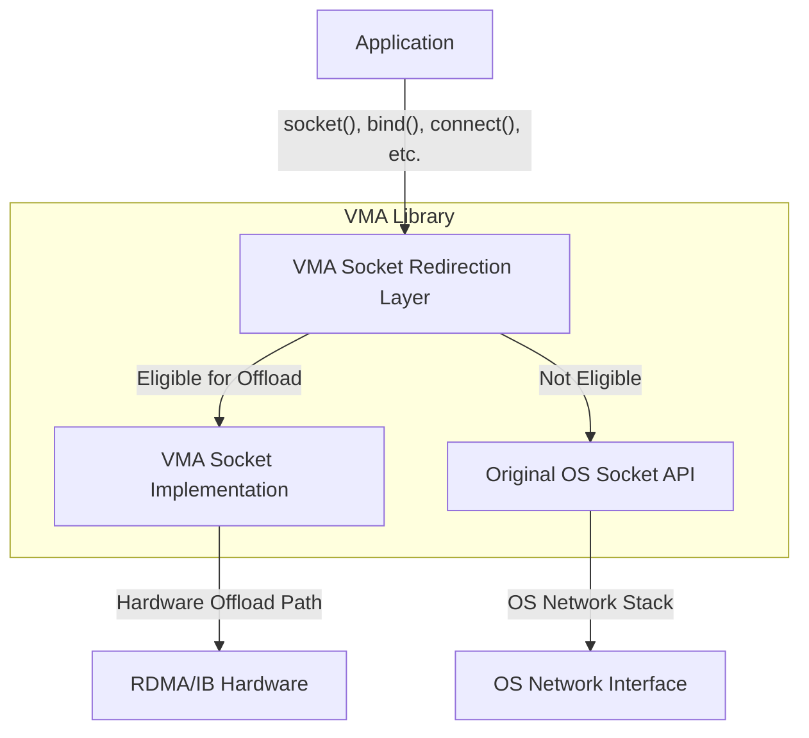
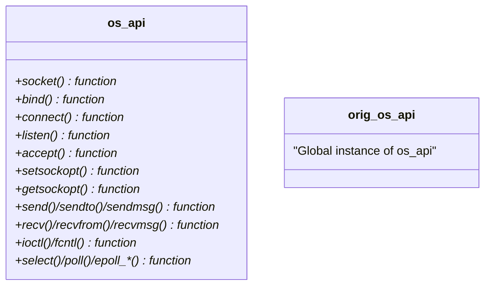
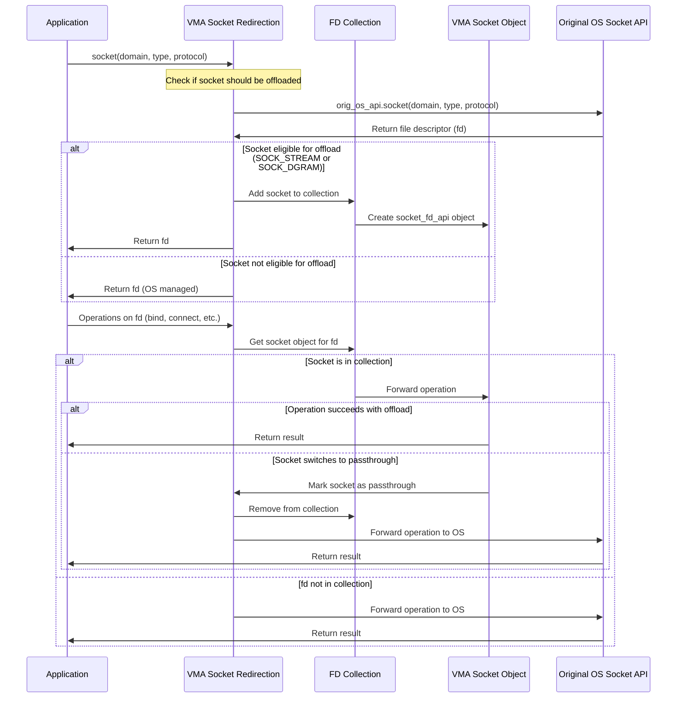
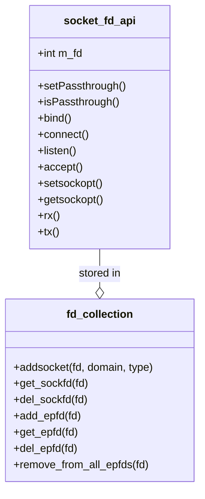
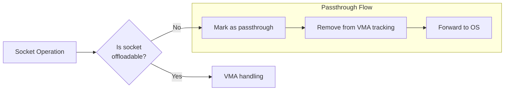

<!-- source: DeepWiki mcp.deepwiki.com · repo Mellanox/libvma · page 2.1 Socket Redirection · fetched 2026-11-11 -->

# Socket Redirection

<details>
<summary>Relevant source files</summary>

The following files were used as context for generating this wiki page:

- [src/vma/sock/pipeinfo.cpp](src/vma/sock/pipeinfo.cpp)
- [src/vma/sock/pipeinfo.h](src/vma/sock/pipeinfo.h)
- [src/vma/sock/sock-redirect.cpp](src/vma/sock/sock-redirect.cpp)
- [src/vma/sock/sock-redirect.h](src/vma/sock/sock-redirect.h)
- [src/vma/sock/socket_fd_api.cpp](src/vma/sock/socket_fd_api.cpp)
- [src/vma/sock/socket_fd_api.h](src/vma/sock/socket_fd_api.h)
- [src/vma/vma_extra.h](src/vma/vma_extra.h)

</details>


## Purpose and Scope

This document details how VMA (Versatile Message Accelerator) redirects standard socket system calls to either be handled by its accelerated networking stack or passed through to the OS. Socket redirection is the entry point mechanism that enables VMA to transparently accelerate network operations without requiring application changes. For specific socket implementations, see [Socket Implementation](#2.2).

## Overview

VMA intercepts socket system calls (such as `socket()`, `bind()`, `connect()`, etc.) by using function name redirection techniques (typically via the LD_PRELOAD mechanism). When an application makes a socket call, VMA's implementation receives the call first, determines whether the socket can be offloaded to hardware or should be handled by the OS, and routes the call accordingly.



*Socket Redirection Architecture*

Sources: [src/vma/sock/sock-redirect.cpp:787-831](), [src/vma/sock/sock-redirect.h:66-148]()

## Interception Mechanism

### Function Pointer Storage

VMA stores pointers to the original OS socket functions in the `orig_os_api` structure, allowing it to call the original implementations when needed. These pointers are obtained during initialization using `dlsym()`.



*Original Function Pointers Storage*

Sources: [src/vma/sock/sock-redirect.cpp:59-62](), [src/vma/sock/sock-redirect.h:72-149](), [src/vma/sock/sock-redirect.cpp:117-176]()

### Initialization

The function pointers to original socket operations are populated using the `get_orig_funcs()` function, which uses `dlsym()` to locate the original function symbols.

Sources: [src/vma/sock/sock-redirect.cpp:117-176]()

## Decision Process

When an application makes a socket call, VMA follows this process to determine how to handle it:



*Socket Operation Decision Flow*

Sources: [src/vma/sock/sock-redirect.cpp:792-831](), [src/vma/sock/sock-redirect.cpp:952-990](), [src/vma/sock/sock-redirect.cpp:1000-1046]()

## Key Intercepted Socket Operations

VMA intercepts and redirects the following core socket operations:

### Socket Creation

The `socket()` function is intercepted to create a socket through the OS and then, if eligible for offloading, register it with VMA's file descriptor collection.

```c
int socket(int __domain, int __type, int __protocol)
{
    // Call internal implementation that can be used safely within VMA
    return socket_internal(__domain, __type, __protocol, true);
}
```

Sources: [src/vma/sock/sock-redirect.cpp:792-797](), [src/vma/sock/sock-redirect.cpp:802-831]()

### Bind, Connect, Listen, Accept

These operations are intercepted and routed to either VMA's implementation or the OS based on whether the socket is being managed by VMA:

- **bind()**: Associates the socket with a local address
- **connect()**: Establishes a connection to a remote endpoint
- **listen()**: Marks a socket as passive for accepting connections
- **accept()/accept4()**: Accepts a new connection on a listening socket

Sources: [src/vma/sock/sock-redirect.cpp:952-990](), [src/vma/sock/sock-redirect.cpp:1000-1046](), [src/vma/sock/sock-redirect.cpp:872-917](), [src/vma/sock/sock-redirect.cpp:921-949]()

### Socket Options

VMA intercepts `setsockopt()` and `getsockopt()` to handle VMA-specific socket options and pass standard options to either VMA's implementation or the OS.

Of particular importance is `SO_VMA_GET_API`, which provides access to VMA's extended API.

Sources: [src/vma/sock/sock-redirect.cpp:1051-1082](), [src/vma/sock/sock-redirect.cpp:1087-1151]()

### I/O Operations

VMA intercepts send and receive operations to handle them through its optimized path:

- **send/sendto/sendmsg**: For transmitting data
- **recv/recvfrom/recvmsg**: For receiving data

Sources: [src/vma/sock/sock-redirect.cpp:1225-2051]()

### Close and Shutdown

VMA intercepts `close()` and `shutdown()` to properly clean up resources for sockets it manages.

Sources: [src/vma/sock/sock-redirect.cpp:833-864](), [src/vma/sock/sock-redirect.cpp:872-888]()

## File Descriptor Management

VMA tracks socket file descriptors using the `fd_collection` class, which maintains a mapping between file descriptors and the corresponding socket objects.



*File Descriptor Management*

Sources: [src/vma/sock/sock-redirect.cpp:300-317](), [src/vma/sock/fd_collection.h]()

## Passthrough Mechanism

If a socket cannot be offloaded or certain operations are not supported by VMA, the socket is marked as passthrough and subsequent operations are forwarded to the OS. This occurs through the following steps:

1. Calling `setPassthrough()` on the socket object
2. Removing the socket from VMA's tracking via `handle_close()`
3. Redirecting all future operations to the OS



*Passthrough Decision Flow*

Sources: [src/vma/sock/sock-redirect.cpp:109-115](), [src/vma/sock/sock-redirect.cpp:952-990](), [src/vma/sock/sock-redirect.cpp:1000-1046]()

## Extended API

VMA provides an extended API for advanced functionality beyond standard socket operations. This API is accessible through the `SO_VMA_GET_API` socket option.

```c
struct vma_api_t* vma_get_api()
{
    struct vma_api_t *api_ptr = NULL;
    socklen_t len = sizeof(api_ptr);
    int err = getsockopt(-1, SOL_SOCKET, SO_VMA_GET_API, &api_ptr, &len);
    if (err < 0) {
        return NULL;
    }
    return api_ptr;
}
```

The extended API provides functions for:

- Zero-copy receive and send operations
- Network hardware direct access
- Performance monitoring and statistics
- Memory registration for RDMA operations

Sources: [src/vma/vma_extra.h:357-763](), [src/vma/sock/sock-redirect.cpp:323-783]()

## Implementation Details

### Function Interceptors

VMA's socket redirection relies on defining exported symbols that match the standard socket API function names. When an application links with VMA (using LD_PRELOAD or direct linking), these functions intercept the calls before they reach the standard library.

Each intercepted function follows a similar pattern:

1. Check if VMA should handle the operation
2. If yes, route to VMA's implementation
3. If no, pass through to the original OS implementation

Sources: [src/vma/sock/sock-redirect.cpp:787-3600]()

### Memory Considerations

For performance reasons, VMA manages specialized memory pools for network operations. This includes buffer pools for zero-copy operations and memory registered with RDMA hardware for direct access.

Sources: [src/vma/sock/sock-redirect.cpp:760-783]()

## Summary

The Socket Redirection component is the entry point to VMA's accelerated networking capabilities. By intercepting standard socket system calls, it transparently routes eligible operations to VMA's optimized implementation while maintaining compatibility with applications by falling back to the OS for unsupported operations. This mechanism allows applications to benefit from hardware acceleration without requiring code changes.

---

